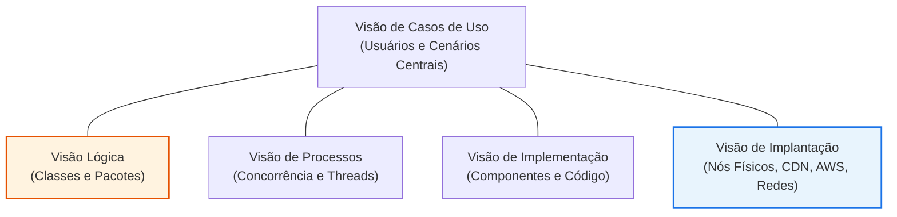
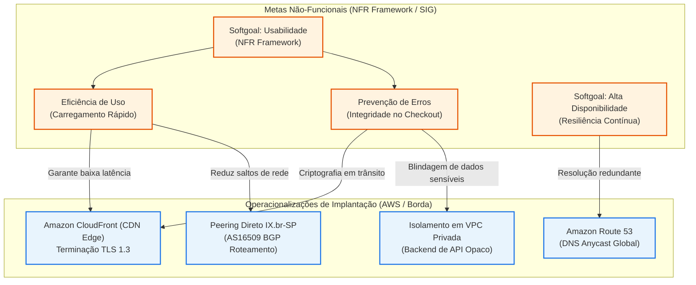
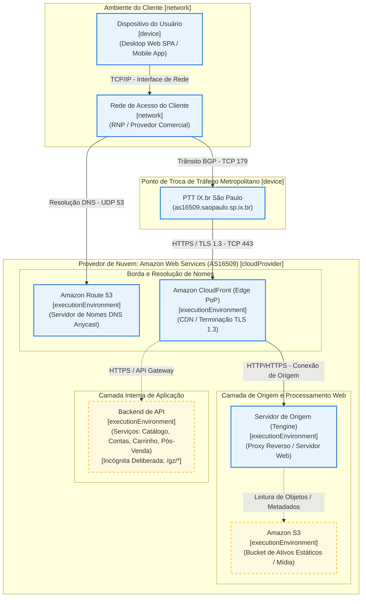
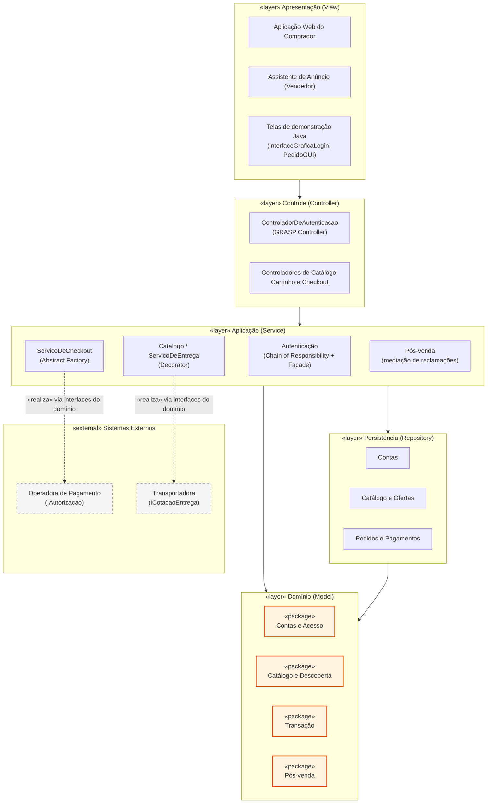
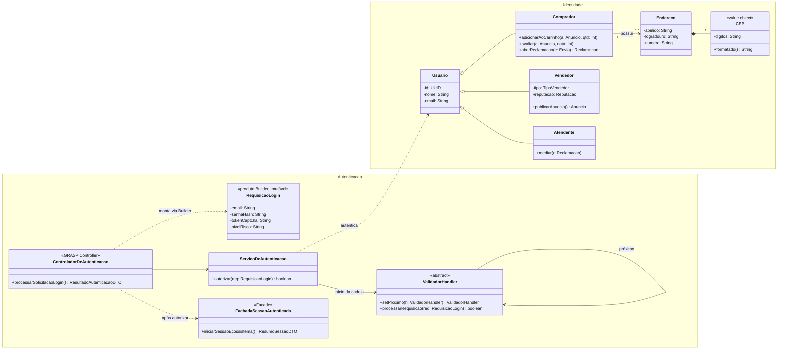
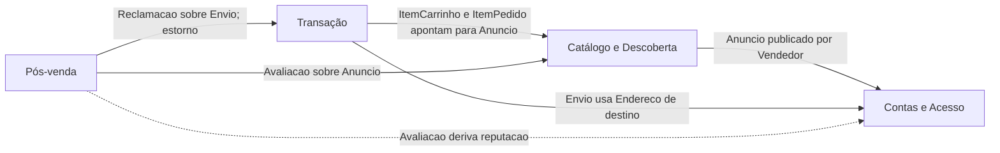

# G1_ProjetoComercioEletronico

# Documento de Arquitetura de Software (DAS)

**Versão 1.2**

---

## Histórico da Revisão

|    Data    | Versão | Descrição                                                                                                                                                           | Autor                | Revisor      |
| :--------: | :----: | :------------------------------------------------------------------------------------------------------------------------------------------------------------------ | :------------------- | :----------- |
| 12/11/2026 |  1.0   | Elaboração inicial das seções de Introdução, Representação Arquitetural, Metas e Restrições e Visão de Implantação com dados da Entrega 01 e Entrega 02             | Pedro Henrique Gomes | Subequipe 03 |
| 12/11/2026 |  1.1   | Enriquecimento arquitetural incorporando o NFR Framework (SIG de Usabilidade), a Engenharia Reversa (Recortes A, B e C) e a decomposição do Diagrama de Componentes | Pedro Henrique Gomes | Subequipe 03 |
| 19/11/2026 |  1.2   | Elaboração da Visão Lógica (seção 9): visão geral com camadas, regras de dependência e rastreabilidade (9.1), pacote Contas e Acesso com subpacote Autenticação (9.2.1), dependências entre pacotes (9.2.5), decisões arquiteturais (9.3) e limitações (9.6); ajustes nas seções 1.1, 1.4, 1.5 e 2 | João Paulo Barbosa Pereira Nunes | Subequipe 03 |

---

## Índice Analítico

- [1. Introdução](#1-introdução)
  - [1.1 Finalidade](#11-finalidade)
  - [1.2 Escopo](#12-escopo)
  - [1.3 Definições, Acrônimos e Abreviações](#13-definições-acrônimos-e-abreviações)
  - [1.4 Referências](#14-referências)
  - [1.5 Visão Geral](#15-visão-geral)
- [2. Representação Arquitetural](#2-representação-arquitetural)
- [3. Metas e Restrições da Arquitetura](#3-metas-e-restrições-da-arquitetura)
  - [3.1 Metas Arquiteturais e Integração NFR](#31-metas-arquiteturais-e-integração-nfr)
  - [3.2 Rastreabilidade: NFR → Infraestrutura Física](#32-rastreabilidade-nfr--infraestrutura-física)
  - [3.3 Restrições Especiais e Metodológicas](#33-restrições-especiais-e-metodológicas)
- [7. Visão de Implantação](#7-visão-de-implantação)
  - [7.1 Visão Geral e Topologia Física](#71-visão-geral-e-topologia-física)
  - [7.2 Decomposição dos Nós e Mapeamento de Componentes](#72-decomposição-dos-nós-e-mapeamento-de-componentes)
  - [7.3 Decisões Arquiteturais e Análise Crítica de Evidências](#73-decisões-arquiteturais-e-análise-crítica-de-evidências)
  - [7.4 Legenda de Confiança da Evidência](#74-legenda-de-confiança-da-evidência)
  - [7.5 Limitações do Método e Considerações de Borda](#75-limitações-do-método-e-considerações-de-borda)
- [9. Visão Lógica](#9-visão-lógica)
  - [9.1 Visão Geral: Camadas e Hierarquia de Pacotes](#91-visão-geral-camadas-e-hierarquia-de-pacotes)
  - [9.2 Pacotes de Design Significativos do Ponto de Vista da Arquitetura](#92-pacotes-de-design-significativos-do-ponto-de-vista-da-arquitetura)
  - [9.3 Decisões Arquiteturais e Análise Crítica](#93-decisões-arquiteturais-e-análise-crítica)
  - [9.4 Legenda de Confiança da Evidência](#94-legenda-de-confiança-da-evidência)
  - [9.5 Evidência de Execução](#95-evidência-de-execução)
  - [9.6 Limitações do Modelo Lógico](#96-limitações-do-modelo-lógico)

---

# 1. Introdução

A introdução deste Documento de Arquitetura de Software fornece uma visão geral do documento inteiro, definindo sua finalidade, abrangência no projeto, terminologias adotadas, referências normativas e estrutura organizacional.

## 1.1 Finalidade

Este documento oferece uma visão arquitetural abrangente e tecnicamente fundamentada do sistema **G1_ProjetoComercioEletronico**, integrando as metas de usabilidade, requisitos não-funcionais e a modelagem modular do sistema, com foco na **Visão Lógica**, que organiza o sistema em camadas, pacotes e classes, e na **Visão de Implantação**, que descreve a topologia física que materializa o ambiente de produção. O objetivo principal é capturar, comunicar e justificar formalmente as decisões arquiteturais de infraestrutura física, roteamento de rede, borda (CDN), terminação de protocolos e segregação de ambientes, servindo de referência confiável para desenvolvedores, arquitetos de infraestrutura e avaliadores acadêmicos.

## 1.2 Escopo

O escopo deste documento cobre a arquitetura física e de distribuição do sistema de comércio eletrônico (inspirado na plataforma de grande porte Mercado Livre), englobando o caminho completo percorrido pelas requisições dos clientes desde os dispositivos de usuário, passando por pontos de troca de tráfego (IX.br), até ingressarem nos clusters em nuvem (Amazon Web Services - AWS).

A abrangência funcional do sistema está delimitada pelos três grandes fluxos comprovados no levantamento de [Engenharia Reversa](https://unbarqdsw2026-2-turma01.github.io/2026.2-T01-_G1_ProjetoComercioEletronico_Entrega_01/#/Base/Relat%C3%B3rios/SubEquipe01/EngenhariaReversa):

- **Recorte A (Busca e Catálogo):** Consulta de produtos, indexação de anúncios, paginação e visualização detalhada de itens com múltiplas mídias.
- **Recorte B (Carrinho, Endereçamento e Checkout):** Gestão de sacola de compras, persistência de endereços de entrega e entrada na orquestração transacional de checkout.
- **Recorte C (Publicação e Vendas):** Publicação de anúncios por vendedores, upload de fotos e precificação.

O documento delimita as fronteiras observáveis de rede que suportam esses três recortes, detalhando a atuação dos servidores de DNS autoritativo, borda de distribuição de conteúdo, servidores proxy de origem, buckets de armazenamento de objetos estáticos e serviços de backend.

## 1.3 Definições, Acrônimos e Abreviações

| Termo / Sigla                                | Definição                                                                                                                                                                           |
| :------------------------------------------- | :---------------------------------------------------------------------------------------------------------------------------------------------------------------------------------- |
| **DAS**                                      | Documento de Arquitetura de Software (_Software Architecture Document_).                                                                                                            |
| **RUP**                                      | _Rational Unified Process_: processo de engenharia de software disciplinado orientado a casos de uso e centrado na arquitetura.                                                     |
| **UML**                                      | _Unified Modeling Language_: notação padronizada para modelagem de sistemas de software (versão 2.5.1).                                                                             |
| **NFR**                                      | _Non-Functional Requirements_: catálogo e framework de metas de requisitos não-funcionais (CHUNG et al., 2000).                                                                     |
| **SIG**                                      | _Softgoal Interdependency Graph_: grafo de interdependência de softgoals utilizado no NFR Framework para registrar refinamentos (AND/OR), operacionalizações e contribuições (+/-). |
| **Softgoal**                                 | Objetivo sem critério de satisfação binário estrito, que é "satisfeito em grau" (_satisficed_) dentro de compromissos técnicos (_trade-offs_).                                      |
| **Operacionalização**                        | Solução técnica, decisão de design ou escolha de infraestrutura adotada para satisfazer um softgoal no grafo SIG.                                                                   |
| **BGP**                                      | _Border Gateway Protocol_ (RFC 4271): protocolo de roteamento dinâmico entre Sistemas Autônomos (AS) na Internet.                                                                   |
| **ASN**                                      | _Autonomous System Number_: identificador numérico global de uma rede sob controle administrativo único (ex.: AS16509 da AWS).                                                      |
| **IX.br**                                    | _Internet Exchange_ Brasil: pontos de troca de tráfego de Internet gerenciados pelo NIC.br/CGI.br.                                                                                  |
| **CDN**                                      | _Content Delivery Network_: rede distribuída geograficamente de servidores proxy de borda para entrega de conteúdo com baixa latência.                                              |
| **PoP**                                      | _Point of Presence_: ponto de presença físico de rede onde servidores de borda interceptam tráfego de usuários.                                                                     |
| **DNS**                                      | _Domain Name System_: sistema distribuído de resolução de nomes de domínio em endereços IP.                                                                                         |
| **TLS**                                      | _Transport Layer Security_ (especialmente versão 1.3 - RFC 8446): protocolo criptográfico de segurança na camada de transporte.                                                     |
| **OSINT**                                    | _Open Source Intelligence_: coleta e análise de inteligência a partir de fontes e comportamentos de rede publicamente acessíveis.                                                   |
| **ICatalogo, IFrete, IPagamento, IRastreio** | Interfaces modulares providas e requeridas identificadas na decomposição de componentes do e-commerce.                                                                              |

_(Para o vocabulário de negócio e termos funcionais do e-commerce, consulte o [Léxico do Projeto](https://unbarqdsw2026-2-turma01.github.io/2026.2-T01-_G1_ProjetoComercioEletronico_Entrega_01/#/Base/Relat%C3%B3rios/SubEquipe03/Lexico))._

## 1.4 Referências

1. KRUCHTEN, Philippe. _The 4+1 View Model of Architecture_. IEEE Software, v. 12, n. 6, p. 42-50, nov. 1995.
2. OMG — Object Management Group. _OMG Unified Modeling Language (OMG UML) Specification, Version 2.5.1_. Deployment Diagrams, 2017. Disponível em: <https://www.omg.org/spec/UML/>.
3. CHUNG, Lawrence; NIXON, Brian A.; YU, Eric; MYLOPOULOS, John. _Non-Functional Requirements in Software Engineering_. Boston: Springer Science & Business Media, 2000.
4. NEWMAN, Sam. _Building Microservices: Designing Fine-Grained Systems_. 2. ed. Sebastopol: O'Reilly Media, 2021.
5. AMAZON WEB SERVICES. _Amazon CloudFront Developer Guide_. AWS, 2024. Disponível em: <https://docs.aws.amazon.com/cloudfront/>.
6. AMAZON WEB SERVICES. _Amazon Route 53 Developer Guide_. AWS, 2024. Disponível em: <https://docs.aws.amazon.com/route53/>.
7. AMAZON WEB SERVICES. _AWS Well-Architected Framework: Reliability and Performance Efficiency Pillars_. AWS, 2024. Disponível em: <https://aws.amazon.com/architecture/well-architected/>.
8. IETF. _RFC 4271: A Border Gateway Protocol 4 (BGP-4)_. Network Working Group, 2006. Disponível em: <https://www.rfc-editor.org/rfc/rfc4271>.
9. IETF. _RFC 8446: The Transport Layer Security (TLS) Protocol Version 1.3_. Internet Engineering Task Force, 2018. Disponível em: <https://www.rfc-editor.org/rfc/rfc8446>.
10. GAMMA, Erich; HELM, Richard; JOHNSON, Ralph; VLISSIDES, John. _Design Patterns: Elements of Reusable Object-Oriented Software_. Boston: Addison-Wesley, 1995.
11. LARMAN, Craig. _Applying UML and Patterns_. 3. ed. Upper Saddle River: Prentice Hall, 2004.
12. FOWLER, Martin. _Patterns of Enterprise Application Architecture_. Boston: Addison-Wesley, 2002.
13. EVANS, Eric. _Domain-Driven Design: Tackling Complexity in the Heart of Software_. Boston: Addison-Wesley, 2003.
14. MARTIN, Robert C. _Clean Architecture: A Craftsman's Guide to Software Structure and Design_. Boston: Prentice Hall, 2017.
15. **Artefatos das Entregas Anteriores do Projeto:**
    - [NFR Framework (SIG de Usabilidade)](https://unbarqdsw2026-2-turma01.github.io/2026.2-T01-_G1_ProjetoComercioEletronico_Entrega_01/#/Base/Relat%C3%B3rios/SubEquipe01/NFR): Grafo centrado em Usabilidade, Eficiência, Prevenção de Erros e Satisfação.
    - [NFR Framework (Desempenho e Segurança)](https://unbarqdsw2026-2-turma01.github.io/2026.2-T01-_G1_ProjetoComercioEletronico_Entrega_01/#/Base/Relat%C3%B3rios/SubEquipe03/NFR): Metas não-funcionais de infraestrutura.
    - [Engenharia Reversa](https://unbarqdsw2026-2-turma01.github.io/2026.2-T01-_G1_ProjetoComercioEletronico_Entrega_01/#/Base/Relat%C3%B3rios/SubEquipe01/EngenhariaReversa): Recortes A (Busca), B (Carrinho/Checkout) e C (Anúncios).
    - [Diagrama de Componentes](https://unbarqdsw2026-2-turma01.github.io/2026.2-T01-_G1_ProjetoComercioEletronico_Entrega_02/#/Base/Relat%C3%B3rios/Subequipe01/ModelagemEstatica/DiagramaDeComponentes): Decomposição de subsistemas e interfaces (`ICatalogo`, `IFrete`, `IPagamento`, `IRastreio`).
    - [Diagrama de Implantação e Fundamentação](https://unbarqdsw2026-2-turma01.github.io/2026.2-T01-_G1_ProjetoComercioEletronico_Entrega_02/#/Base/Relat%C3%B3rios/Subequipe03/ModelagemEstatica/DiagramaDeImplantacao): Coleta empírica de rede OSINT na AWS.
    - [Diagrama de Classes](https://unbarqdsw2026-2-turma01.github.io/2026.2-T01-_G1_ProjetoComercioEletronico_Entrega_02/#/Base/Relat%C3%B3rios/Subequipe01/ModelagemEstatica/DiagramaDeClasses) e [Diagrama de Pacotes](https://unbarqdsw2026-2-turma01.github.io/2026.2-T01-_G1_ProjetoComercioEletronico_Entrega_02/#/Base/Relat%C3%B3rios/Subequipe03/ModelagemEstatica/DiagramaDePacotes): base da Visão Lógica.
    - [Padrões de Projeto (Entrega 03)](https://unbarqdsw2026-2-turma01.github.io/2026.2-T01-_G1_ProjetoComercioEletronico_Entrega_03/): GoFs e GRASP com código Java executável, usados como evidência de execução da Visão Lógica.
    - [Léxico do Domínio](https://unbarqdsw2026-2-turma01.github.io/2026.2-T01-_G1_ProjetoComercioEletronico_Entrega_01/#/Base/Relat%C3%B3rios/SubEquipe03/Lexico) e [Plano de Ação 5W2H](https://unbarqdsw2026-2-turma01.github.io/2026.2-T01-_G1_ProjetoComercioEletronico_Entrega_01/#/Base/Relat%C3%B3rios/SubEquipe03/5W2H).

## 1.5 Visão Geral

O restante deste documento está organizado de forma direcionada à infraestrutura da solução:

- A **Seção 2 (Representação Arquitetural)** formaliza o uso do modelo 4+1 do RUP e posiciona as Visões Lógica e de Implantação na decomposição sistêmica.
- A **Seção 3 (Metas e Restrições da Arquitetura)** consolida a integração dos requisitos não-funcionais com a topologia física, fornecendo o grafo de rastreabilidade até a infraestrutura de nuvem.
- A **Seção 7 (Visão de Implantação)** aprofunda a topologia física, os nós de execução, dispositivos de rede, protocolos, decisões de projeto e limitações empíricas.
- A **Seção 9 (Visão Lógica)** decompõe o sistema em camadas e pacotes de domínio, detalha as classes arquiteturalmente significativas de cada pacote e apresenta a evidência de execução dos padrões implementados.

---

# 2. Representação Arquitetural

A arquitetura de software deste projeto é fundamentada no **Modelo 4+1 Visões** proposto por Philippe Kruchten (1995), o qual preconiza que um sistema complexo não pode ser adequadamente compreendido a partir de uma perspectiva unívoca. O modelo organiza a descrição arquitetural em cinco visões complementares:

1. **Visão de Casos de Uso (Cenários):** Centraliza os objetivos do usuário e direciona as demais visões.
2. **Visão Lógica:** Decompõe os conceitos de domínio em pacotes, subsistemas e classes.
3. **Visão de Processos:** Foca na dinâmica concorrente, sincronismo, mensageria e estados de execução.
4. **Visão de Implementação:** Descreve os módulos de código-fonte, componentes empacotados e camadas de software.
5. **Visão de Implantação:** Captura a distribuição física dos componentes executáveis sobre os nós de hardware e redes de comunicação.

No contexto deste documento, **apresentam-se com aprofundamento a Visão Lógica e a Visão de Implantação**. Os elementos de modelo da **Visão Lógica** pertencem ao metamodelo UML 2.5.1:

- **Pacotes (`«package»` e `«layer»`):** Agrupamentos de elementos de modelo por responsabilidade técnica (camadas) e por coesão de domínio (Contas e Acesso, Catálogo e Descoberta, Transação, Pós-venda).
- **Classes, Interfaces e Enumerações:** Entidades, value objects, serviços de domínio e as abstrações introduzidas pelos padrões de projeto (ex.: `ObservadorDePagamento`, `EstadoPedido`, `FabricaMeioPagamento`).
- **Relacionamentos:** Associação, composição, agregação, generalização, realização e dependência, com multiplicidades.

Os elementos de modelo da **Visão de Implantação** também pertencem ao metamodelo UML 2.5.1:

- **Nós (`«device»` e `«executionEnvironment»`):** Representam os recursos computacionais de processamento físico ou virtualizado (ex.: dispositivos móveis/browsers, switches de PTT, edge servers do CloudFront, instâncias de servidor web Tengine, clusters de microsserviços e buckets S3).
- **Redes e Caminhos de Comunicação (`«communicationPath»` e `«network»`):** Especificam os canais de transmissão física ou lógica e seus protocolos subjacentes (HTTP/HTTPS, TLS 1.3, DNS, BGP).
- **Artefatos (`«artifact»`):** Arquivos físicos empacotados, páginas estáticas, scripts de frontend e bundles de software que são instalados e executados nos nós.

---

# 3. Metas e Restrições da Arquitetura

As decisões de infraestrutura e implantação são orientadas pelas metas não-funcionais eliciadas nos modelos NFR do projeto:

### 3.1 Metas Arquiteturais e Integração NFR

1. **Eficiência de Uso & Resposta de Borda:**
   - _Softgoal Raiz:_ Usabilidade → Eficiência de Uso → Velocidade de Retorno em Consultas e Carregamento de Catálogo.
   - _Racional Arquitetural:_ A busca no comércio eletrônico (Recorte A) é a porta de entrada da conversão de vendas. Consultas lentas degradam o softgoal de eficiência.
   - _Operacionalização Física:_ Distribuição de assets e páginas via **Amazon CloudFront CDN** e peering em ponto de troca de tráfego neutro (**IX.br São Paulo**). A terminação TLS na borda regional reduz drasticamente o _Round-Trip Time_ (RTT), garantindo latência inferior a 200 ms para usuários na América Latina.

2. **Prevenção de Erros & Integridade Transacional:**
   - _Softgoal:_ Usabilidade → Prevenção de Erros → Integridade nas Etapas de Checkout e Cadastro de Endereço.
   - _Racional Arquitetural:_ Falhas de rede transitórias ou interceptações no preenchimento de endereços e pagamentos (Recorte B) frustram o usuário e geram inconsistência transacional.
   - _Operacionalização Física:_ Adoção de **criptografia TLS 1.3 ponta a ponta**, isolamento dos nós de backend em sub-redes privadas da AWS (impedindo ataques de _man-in-the-middle_) e persistência em instâncias de banco com suporte a transações atômicas (ACID).

3. **Alta Disponibilidade e Resiliência Geográfica:**
   - _Softgoal:_ Confiabilidade → Disponibilidade Contínua sem SPOF.
   - _Racional Arquitetural:_ Indisponibilidade de catálogo ou falha de DNS paralisa as vendas da plataforma em escala continental.
   - _Operacionalização Física:_ Utilização do **Amazon Route 53** sob topologia Anycast global com quatro zonas de autoridade independentes (`awsdns-*.co.uk`, `awsdns-*.net`, `awsdns-*.com`, `awsdns-*.org`), imunes à queda de datacenters específicos.

4. **Satisfação do Usuário & Transparência Operacional:**
   - _Softgoal:_ Usabilidade → Satisfação → Cálculo Imediato de Frete e Rastreio Confiável.
   - _Racional Arquitetural:_ O consumidor exige transparência nos prazos de entrega e rastreamento contínuo de encomendas (Pós-Venda).
   - _Operacionalização Física:_ Conforme modelado no Diagrama de Componentes, os subsistemas de catálogo e pós-venda demandam interfaces dedicadas (`IFrete` e `IRastreio`), suportadas fisicamente por microsserviços desacoplados que consultam transportadoras sem onerar a origem primária.

---

### 3.2 Rastreabilidade: NFR → Infraestrutura Física

O grafo a seguir ilustra a ponte conceitual que conecta os softgoals do SIG às operacionalizações de implantação física:

---

### 3.3 Restrições Especiais e Metodológicas

1. **Restrição de Suporte a Duas Aplicações Cliente:**
   - Conforme demonstrado no Diagrama de Componentes, a plataforma suporta duas aplicações clientes distintas: **Aplicação Web SPA** (para navegadores desktop) e **Aplicativo Móvel** (para smartphones). Ambas consomem os mesmos contratos de API, impondo à infraestrutura a entrega diferenciada de assets (HTML/JS estáticos via S3 para web vs. tráfego direto via API Gateway para mobile).

2. **Restrição de Coleta Não Intrusiva (OSINT Passivo):**
   - A modelagem da infraestrutura apoia-se estritamente em engenharia reversa de caixa-preta (_black-box_) com comandos públicos (`dig`, `curl -I`, `traceroute/mtr`, inspeção TLS). A topologia interna de microsserviços de negócio (`/gz/*`) permanece documentada com honestidade como nó opaco ("Backend de API").

3. **Separação Rígida entre Redes de Trânsito e Redes de Destino:**
   - O ambiente de medição do cliente (rede local de teste) e os saltos intermediários de trânsito autônomo pertencem ao caminho de rede do observador e são isolados para não poluir o modelo da empresa-alvo.

---

# 7. Visão de Implantação

A **Visão de Implantação** descreve a configuração física da rede, os nós computacionais e os caminhos de comunicação que executam o software do sistema. Esta seção consolida a reconstrução da infraestrutura em produção a partir de evidências técnicas verificáveis, integrando a fundamentação de infraestrutura da [Entrega 02](https://unbarqdsw2026-2-turma01.github.io/2026.2-T01-_G1_ProjetoComercioEletronico_Entrega_02/#/Base/Relat%C3%B3rios/Subequipe03/ModelagemEstatica/DiagramaDeImplantacao) com a decomposição modular do [Diagrama de Componentes](https://unbarqdsw2026-2-turma01.github.io/2026.2-T01-_G1_ProjetoComercioEletronico_Entrega_02/#/Base/Relat%C3%B3rios/Subequipe01/ModelagemEstatica/DiagramaDeComponentes).

---

## 7.1 Visão Geral e Topologia Física

A infraestrutura física é estruturada em três macroambientes:

1. **Ambiente do Cliente:** Compreende as duas aplicações clientes (Desktop Web SPA e Mobile App) executando nos dispositivos dos usuários finais, conectadas à rede de acesso local.
2. **Ponto de Troca de Tráfego (IX.br-SP):** PTT metropolitano onde ocorre o roteamento BGP direto para a rede autônoma da Amazon (AS16509).
3. **Provedor de Nuvem (Amazon Web Services - AS16509):** Nuvem corporativa segregada contendo a camada de DNS (Route 53), a borda de CDN (CloudFront), servidores web de aceleração (Tengine), buckets de armazenamento (S3) e o cluster de serviços de backend.

### Diagrama de Implantação

<strong>Figura 1: Diagrama de Implantação do Sistema</strong> — Reconstrução da infraestrutura física e de rede via OSINT passivo. <em>Autor: Pedro Henrique Gomes (Entrega 02).</em>

---

### Diagrama Arquitetural de Implantação (Notação Estrutural de Nós)

O diagrama a seguir detalha as relações de nós físicos, ambientes de execução e protocolos de comunicação:

---

## 7.2 Decomposição dos Nós e Mapeamento de Componentes

A tabela a seguir correlaciona os nós físicos e ambientes de execução da Visão de Implantação com os componentes modulares do sistema:

| Nó / Elemento de Modelo          | Estereótipo              | Componentes de Software Mapeados                                                                                                                                                                                         | Evidência Técnica de Rastreio                                                            |
| :------------------------------- | :----------------------- | :----------------------------------------------------------------------------------------------------------------------------------------------------------------------------------------------------------------------- | :--------------------------------------------------------------------------------------- |
| **Dispositivo do Usuário**       | `«device»`               | `Aplicação Web SPA` (Desktop Browser) e `Aplicativo Móvel` (Smartphone).                                                                                                                                                 | Origem das requisições observadas nos fluxos de Busca e Checkout.                        |
| **Ambiente de Acesso**           | `«network»`              | Roteamento de pacotes do usuário até o trânsito autônomo.                                                                                                                                                                | Saltos iniciais identificados via `mtr` e `traceroute`.                                  |
| **IX.br São Paulo**              | `«device»`               | Ponto de conexão física com o sistema autônomo da Amazon (AS16509).                                                                                                                                                      | Salto `as16509.saopaulo.sp.ix.br` detectado via traceroute.                              |
| **Amazon Route 53**              | `«executionEnvironment»` | Resolução autoritativa de DNS com latência otimizada Anycast.                                                                                                                                                            | Consultas `dig NS` apontando para quatro servidores mundiais AWS.                        |
| **Amazon CloudFront**            | `«executionEnvironment»` | Borda de entrega rápida (CDN), terminação TLS 1.3 e cache regional de assets de catálogo.                                                                                                                                | Respostas HTTP contendo cabeçalhos `x-amz-cf-pop` e `x-cache: Hit/Miss from cloudfront`. |
| **Servidor de Origem (Tengine)** | `«executionEnvironment»` | Proxy reverso de alta concorrência e entrega da página raiz do e-commerce.                                                                                                                                               | Cabeçalho `server: Tengine` na requisição ao domínio raiz.                               |
| **Amazon S3**                    | `«executionEnvironment»` | Repositório de mídias de produtos (Recorte A) e upload de fotos de anúncios (Recorte C).                                                                                                                                 | Cabeçalhos `x-amz-server-side-encryption` e `x-amz-version-id`.                          |
| **Backend de API**               | `«executionEnvironment»` | Orquestração dos subsistemas modulares: `Serviço de Contas e Endereços`, `Serviço de Catálogo` (provê `ICatalogo`, requer `IFrete`), `Serviço de Carrinho` e `Serviço de Pós-Venda` (requer `IPagamento` e `IRastreio`). | Rotas com prefixo `/gz/*` e diretivas no arquivo `robots.txt`.                           |

---

## 7.3 Decisões Arquiteturais e Análise Crítica de Evidências

A modelagem da Visão de Implantação fundamenta-se nas seguintes decisões críticas de engenharia:

### 1. Separação Estrita de Domínios (Cliente vs. Trânsito vs. Nuvem)

Um equívoco comum em modelagens arquiteturais baseadas em tráfego de rede é incorporar roteadores intermediários do provedor de acesso do analista como se fossem componentes da empresa-alvo. O diagrama isola deliberadamente os saltos de rede sob o estereótipo `«network» Ambiente do Cliente`, garantindo que apenas os nós de propriedade ou contratação da plataforma façam parte do domínio de nuvem.

### 2. O Peering via IX.br como Evidência Independente de DNS

A identificação do nó `as16509.saopaulo.sp.ix.br` constitui uma evidência independente da cadeia de DNS: o **AS 16509** é o número de sistema autônomo registrado publicamente para a _Amazon.com, Inc._. Essa informação comprova que, ao transitar pelo IX.br em São Paulo, os pacotes ingressam diretamente na rede privada da nuvem AWS, sem intermediação de operadoras terceiras, viabilizando menor latência e maior segurança.

### 3. O "Backend de API" como Incógnita Deliberada e Subsistemas Integrados

As rotas de backend (como `api.mercadolibre.com`) e os serviços transacionais foram confirmados até a camada de CDN (CloudFront). Internamente, o arquivo `robots.txt` e o tráfego HTTP revelam rotas especializadas como `/gz/*`.
Ao cruzarmos esses achados com a decomposição do Diagrama de Componentes, compreende-se que esse nó opaco abriga os subsistemas desacoplados (`Contas/Endereços`, `Catálogo`, `Carrinho` e `Pós-Venda`). A segregação desses serviços através de contratos de interfaces explícitas (`ICatalogo`, `IFrete`, `IPagamento`) viabiliza a independência de falhas, de modo que uma sobrecarga na busca de catálogo não inviabilize o fechamento de pedidos em andamento.

### 4. Coexistência Tengine e S3 no Domínio Raiz

Na inspeção do domínio raiz (`mercadolibre.com`), constatou-se a presença simultânea do cabeçalho `server: Tengine` e de metadados característicos do Amazon S3 (`x-amz-version-id`). Essa configuração aponta para um servidor Tengine atuando como camada de proxy frontal com cache dinâmico conectada a um bucket S3 de origem. Essa relação foi classificada como inferência arquitetural e representada com aresta tracejada.

### 5. Deliberação sobre a Capacidade "WAF" no CloudFront

A inclusão de componentes de _Web Application Firewall_ (WAF) associados ao CloudFront foi expressamente evitada. Embora o CloudFront ofereça suporte nativo ao AWS WAF, nenhum cabeçalho ou evento de bloqueio observado por meio de requisições padrão confirma que essa funcionalidade esteja ativada na rota inspecionada. Tratar uma capacidade potencial como componente real violaria o rigor empírico do artefato.

---

## 7.4 Legenda de Confiança da Evidência

Para assegurar total transparência entre a notação UML oficial e a natureza da engenharia reversa, adotou-se o seguinte padrão de representação:

| Estilo Gráfico no Diagrama | Grau de Certeza                            | Método de Coleta                                       | Exemplos no Diagrama                                          |
| :------------------------- | :----------------------------------------- | :----------------------------------------------------- | :------------------------------------------------------------ |
| **Linha Sólida Contínua**  | **Evidência Direta e Confirmada**          | Inspeção empírica via `curl -I`, `dig` ou `traceroute` | Cliente → PTT IX.br; IX.br → CloudFront; CloudFront → Tengine |
| **Linha Tracejada**        | **Inferência Arquitetural Não Confirmada** | Dedução lógica a partir de metadados indiretos         | CloudFront → Backend de API; Tengine → Bucket S3              |
| **Linha Pontilhada**       | **Consulta e Resolução de Nomes**          | Consulta UDP padrão de protocolo                       | Cliente → Amazon Route 53                                     |

---

## 7.5 Limitações do Método e Considerações de Borda

1. **Cobertura Observacional Parcial:** A topologia física documenta exclusivamente os componentes com interface voltada para a rede pública. Componentes internos (bancos de dados relacionais de contas, catálogo e pedidos, clusters Kafka/RabbitMQ e microsserviços internos de pagamento) operam em sub-redes privadas não expostas.
2. **Volatilidade Temporal de Roteamento:** As resoluções DNS Anycast e caminhos BGP podem sofrer reconfigurações automáticas dinâmicas por políticas de balanceamento de carga da AWS.
3. **Ponto Focal Geográfico:** Os ensaios de traceroute e resolução de PoPs foram realizados a partir de conexão situada em Brasília (DF). Usuários conectando-se de outros estados ou países são atendidos por outros PoPs de borda do CloudFront.

---

# 9. Visão Lógica

A **Visão Lógica** descreve as partes do modelo de design que são significativas do ponto de vista da arquitetura: a divisão do sistema em camadas e pacotes, as classes que sustentam cada pacote e os relacionamentos que atravessam as fronteiras entre eles. Enquanto a [Visão de Implantação](#7-visão-de-implantação) responde **onde** o software executa, esta seção responde **como ele está organizado por dentro** e **quem é responsável por quê**.

Esta visão não foi construída do zero. Ela consolida e reconcilia três artefatos que, até aqui, viviam separados:

- o [Diagrama de Classes](https://unbarqdsw2026-2-turma01.github.io/2026.2-T01-_G1_ProjetoComercioEletronico_Entrega_02/#/Base/Relat%C3%B3rios/Subequipe01/ModelagemEstatica/DiagramaDeClasses) da Subequipe 01 (Entrega 02), que organiza o domínio em quatro pacotes;
- o [Diagrama de Pacotes](https://unbarqdsw2026-2-turma01.github.io/2026.2-T01-_G1_ProjetoComercioEletronico_Entrega_02/#/Base/Relat%C3%B3rios/Subequipe03/ModelagemEstatica/DiagramaDePacotes) da Subequipe 03 (Entrega 02), que organiza o sistema em cinco camadas;
- os padrões GoF e GRASP da [Entrega 03](https://unbarqdsw2026-2-turma01.github.io/2026.2-T01-_G1_ProjetoComercioEletronico_Entrega_03/), que transformaram parte desse modelo em **código Java executável**.

---

## 9.1 Visão Geral: Camadas e Hierarquia de Pacotes

### Duas dimensões de decomposição

Os dois diagramas estáticos da Entrega 02 decompõem o sistema por critérios diferentes, e nenhum dos dois está errado:

| Artefato de origem   | Critério de decomposição                  | Resultado                                                              |
| :------------------- | :---------------------------------------- | :--------------------------------------------------------------------- |
| Diagrama de Pacotes  | **Responsabilidade técnica** (horizontal) | `View`, `Controller`, `Service`, `Model`, `Repository` + externos      |
| Diagrama de Classes  | **Coesão de domínio** (vertical)          | `Contas e Acesso`, `Catálogo e Descoberta`, `Transação`, `Pós-venda`   |

A Visão Lógica adota as duas ao mesmo tempo, como uma matriz: **as camadas dizem o tipo de responsabilidade de uma classe; os pacotes de domínio dizem a qual assunto do negócio ela pertence.** Uma classe como `ControladorDeAutenticacao`, por exemplo, está na camada `Controller` e no pacote `Contas e Acesso`. Essa leitura cruzada é o que permite que a Visão Lógica converse tanto com o modelo de domínio quanto com os serviços que a [Visão de Implantação](#72-decomposição-dos-nós-e-mapeamento-de-componentes) posiciona dentro do nó `Backend de API`.

### Diagrama de Camadas e Pacotes

<strong>Figura 2: Camadas e pacotes de domínio da Visão Lógica.</strong> Setas sólidas: dependência permitida entre camadas. Setas tracejadas: dependência resolvida por interface definida no domínio (inversão de dependência). <em>Autor: João Paulo Barbosa Pereira Nunes.</em>

### Regras de dependência entre camadas

| Camada         | Pode depender de                         | Não pode depender de                     | Origem da regra                          |
| :------------- | :--------------------------------------- | :--------------------------------------- | :--------------------------------------- |
| Apresentação   | Controle                                 | Aplicação, Domínio, Persistência         | Diagrama de Pacotes, seção 4             |
| Controle       | Aplicação                                | Persistência, Sistemas Externos          | GRASP Controller (Entrega 03)            |
| Aplicação      | Domínio, Persistência, interfaces de domínio para externos | Apresentação, Controle   | Diagrama de Pacotes, seções 2 e 4        |
| Domínio        | Nenhuma outra camada                     | Todas as demais                          | Regra de Dependência (MARTIN, 2017)      |
| Persistência   | Domínio                                  | Apresentação, Controle, Aplicação        | Padrão Repository (FOWLER, 2002)         |

A camada de Domínio é a única que não depende de nada. É ela que concentra as regras de negócio observadas na Engenharia Reversa (RN-A, RN-B, RN-C) e, por isso, deve ser a mais estável do sistema.

### Rastreabilidade: Pacote Lógico → Componente → Nó Físico

| Pacote de domínio         | Componentes que o realizam ([Diagrama de Componentes](https://unbarqdsw2026-2-turma01.github.io/2026.2-T01-_G1_ProjetoComercioEletronico_Entrega_02/#/Base/Relat%C3%B3rios/Subequipe01/ModelagemEstatica/DiagramaDeComponentes)) | Interfaces providas                     | Nó na [Visão de Implantação](#72-decomposição-dos-nós-e-mapeamento-de-componentes) |
| :------------------------ | :-------------------------------------------------- | :-------------------------------------- | :------------------------------------------------ |
| **Contas e Acesso**       | Serviço de Contas e Endereços                       | `IEndereco`                             | Backend de API (serviço de Contas e Endereços)    |
| **Catálogo e Descoberta** | Serviço de Catálogo, Serviço de Anúncios            | `ICatalogo`, `IFichaProduto`, `IAnuncio` | Backend de API (Catálogo) e Amazon S3 (mídias)    |
| **Transação**             | Serviço de Carrinho, Serviço de Checkout e Pedidos, Serviço de Pagamentos, Serviço de Entrega | `ICarrinho`, `ICheckout`, `IPagamento`, `IFrete`, `IRastreio` | Backend de API (Carrinho) |
| **Pós-venda**             | Serviço de Pós-venda                                | `IReclamacao`                           | Backend de API (Pós-Venda)                        |
| **Externos**              | Operadora de Pagamento, Transportadora              | `IAutorizacao`, `ICotacaoEntrega`       | Fora da nuvem da plataforma                       |

---

## 9.2 Pacotes de Design Significativos do Ponto de Vista da Arquitetura

Os diagramas a seguir não repetem o Diagrama de Classes completo da Entrega 02 (trinta classificadores em uma única figura). Cada pacote mostra **apenas as classes que carregam uma decisão arquitetural**: as que concentram regras de negócio, as que cruzam fronteiras de pacote e as que foram implementadas na Entrega 03. As classes marcadas com o estereótipo `«implementada»` possuem código Java compilável e executável (ver [seção 9.5](#95-evidência-de-execução)).

### 9.2.1 Pacote Contas e Acesso

**Descrição.** Reúne a identidade dos participantes da plataforma (comprador, vendedor e atendente), os dados de conta que sobrevivem a qualquer compra (endereços) e o subpacote **Autenticação**, que controla a entrada do usuário no sistema. O endereço pertence à conta, e não ao pedido (RN-B02), o que explica por que ele vive aqui e não em `Transação`.

<strong>Figura 3: Pacote Contas e Acesso.</strong> <em>Fonte: Diagrama de Classes (Entrega 02) e padrões Builder, Chain of Responsibility, Facade e GRASP Controller (Entrega 03).</em>

| Classe                       | Responsabilidade arquitetural                                                                                                                                | Origem                                    |
| :--------------------------- | :----------------------------------------------------------------------------------------------------------------------------------------------------------- | :---------------------------------------- |
| `Usuario` e especializações  | Identidade única de quem interage com a plataforma. `Vendedor.tipo` é enumeração (`LOJA_OFICIAL`, `AUTONOMO`), não subclasse, pois a diferença é de ranking e não de comportamento. | Diagrama de Classes, decisão 8            |
| `Endereco` + `CEP`           | Endereço como dado da conta, reutilizado entre pedidos. `CEP` é value object de oito dígitos que garante o formato no construtor.                             | RN-B02, RN-B04                            |
| `ControladorDeAutenticacao`  | Primeiro objeto após a camada de apresentação a receber o evento de login. Coordena, mas não decide: delega montagem, validação e emissão de sessão.         | [GRASP Controller](https://unbarqdsw2026-2-turma01.github.io/2026.2-T01-_G1_ProjetoComercioEletronico_Entrega_03/#/Base/Relat%C3%B3rios/Subequipe03/GRASP/Controller) |
| `RequisicaoLogin`            | Contexto imutável da tentativa de login (credenciais, captcha, telemetria do dispositivo, 2FA), construído passo a passo e validado antes de circular.        | [Builder](https://unbarqdsw2026-2-turma01.github.io/2026.2-T01-_G1_ProjetoComercioEletronico_Entrega_03/#/Base/Relat%C3%B3rios/Subequipe03/GofsCriacionais/FluxoLogin%28Builder%29) |
| `ValidadorHandler` e cadeia  | Barreiras de segurança independentes (`ValidadorCaptcha`, `ValidadorCredenciais`, `ValidadorRisco`, `ValidadorTwoFactor`) encadeadas; cada uma aprova ou interrompe. | [Chain of Responsibility](https://unbarqdsw2026-2-turma01.github.io/2026.2-T01-_G1_ProjetoComercioEletronico_Entrega_03/#/Base/Relat%C3%B3rios/Subequipe03/GofsComportamentais/FluxoDeLogin%28ChainOfResponsibility%29) |
| `FachadaSessaoAutenticada`   | Ponto único para emitir a sessão: token JWT, replicação SSO para Mercado Pago e Mercado Envios, dispositivo confiável e auditoria.                           | [Facade](https://unbarqdsw2026-2-turma01.github.io/2026.2-T01-_G1_ProjetoComercioEletronico_Entrega_03/#/Base/Relat%C3%B3rios/Subequipe03/GofsEstruturais/EmissaoDeSessao%28Facade%29) |

### 9.2.2 Pacote Catálogo e Descoberta

> _Em elaboração. Seção sob responsabilidade de outro membro da Subequipe 03._

### 9.2.3 Pacote Transação

> _Em elaboração. Seção sob responsabilidade de outro membro da Subequipe 03._

### 9.2.4 Pacote Pós-venda

> _Em elaboração. Seção sob responsabilidade de outro membro da Subequipe 03._

### 9.2.5 Dependências entre pacotes de domínio

<strong>Figura 7: Dependências entre os pacotes de domínio.</strong> <em>Autor: João Paulo Barbosa Pereira Nunes.</em>

O grafo é acíclico com uma única exceção conhecida: `Vendedor./reputacao` (Contas e Acesso) é derivada de `Avaliacao` (Pós-venda), enquanto `Avaliacao` depende, indiretamente, de `Vendedor` via `Anuncio`. A seta tracejada registra essa dependência **de dado derivado**, discutida como limitação na [seção 9.6](#96-limitações-do-modelo-lógico).

---

## 9.3 Decisões Arquiteturais e Análise Crítica

### 1. Reconciliar camadas e domínio em vez de escolher um dos dois

O Diagrama de Pacotes (Subequipe 03) e o Diagrama de Classes (Subequipe 01) foram feitos em paralelo e chegaram a decomposições diferentes. A alternativa mais simples seria adotar apenas um deles na Visão Lógica. Optou-se por mantê-los como dimensões ortogonais porque cada um responde a uma pergunta diferente: as camadas controlam **a direção das dependências técnicas**; os pacotes de domínio controlam **o acoplamento entre assuntos de negócio**. Um modelo só com camadas esconderia que `Transação` depende de `Catálogo` (e não o contrário); um modelo só com domínio esconderia que nenhuma classe de `Model` pode conhecer um `Controller`.

### 2. Autenticação como subpacote explícito

O próprio Diagrama de Pacotes da Entrega 02 registrou como limitação a **ausência de uma camada de segurança e autenticação** (seção 7 daquele documento). A Entrega 03 preencheu essa lacuna na prática, com quatro padrões aplicados ao login. A Visão Lógica formaliza o resultado: Autenticação passa a ser um subpacote de `Contas e Acesso`, com papéis distribuídos entre Controller (coordenação), Builder (montagem do contexto), Chain of Responsibility (validação) e Facade (emissão da sessão). Essa é a principal evolução arquitetural desta visão em relação aos artefatos anteriores.

### 3. Padrões de projeto como mecanismos internos, não como pacotes

Uma tentação seria criar pacotes chamados `observer`, `state` ou `factory`, espelhando a organização das pastas da Entrega 03. Isso foi evitado: padrões são **soluções aplicadas dentro de um pacote de domínio**, e não assuntos de negócio. O Observer pertence a `Transação` porque reage a mudanças de `Pagamento`; o Decorator pertence a `Catálogo e Descoberta` porque refina a busca. Organizar por padrão espalharia um mesmo assunto de negócio por vários pacotes técnicos.

### 4. Inversão de dependência aplicada aos sistemas externos

A Operadora de Pagamento e a Transportadora são acessadas apenas por interfaces definidas no domínio (`IAutorizacao`, `ICotacaoEntrega`, e no código, `Autorizador` da Abstract Factory). Assim, trocar de operadora exige uma nova família de classes, sem alteração em `Pedido` ou `Pagamento`. A mesma regra **não** foi aplicada uniformemente à persistência, inconsistência já reconhecida no Diagrama de Pacotes (seção 2.3) e mantida aqui de forma consciente para não inventar uma estrutura que nenhum artefato anterior modelou.

### 5. Monólito lógico, distribuição física opaca

A Visão Lógica descreve uma única aplicação em camadas, enquanto a Visão de Implantação mostra o backend como um nó opaco que, segundo fontes públicas, é composto por milhares de microsserviços. As duas visões não se contradizem: a Visão Lógica organiza **responsabilidades**, não processos. Cada pacote de domínio corresponde a um conjunto de componentes (tabela da seção 9.1) que poderia ser implantado de forma independente sem alterar o modelo lógico. Essa é, inclusive, a trajetória real documentada da empresa (monólito Java em camadas que evoluiu para microsserviços), já discutida no Diagrama de Pacotes da Entrega 02.

---

## 9.4 Legenda de Confiança da Evidência

> _Em elaboração. Seção sob responsabilidade de outro membro da Subequipe 03._

---

## 9.5 Evidência de Execução

> _Em elaboração. Seção sob responsabilidade de outro membro da Subequipe 03._

---

## 9.6 Limitações do Modelo Lógico

1. **Módulos executáveis não integrados:** o código da Entrega 03 está organizado por padrão, e não por pacote lógico. Existem, por exemplo, versões diferentes de `RequisicaoLogin` nos módulos do Builder, do Chain of Responsibility e do GRASP Controller. A Visão Lógica as trata como a mesma classe conceitual, mas o código ainda não reflete essa unificação.
2. **Autenticação ausente no Diagrama de Componentes:** o subpacote Autenticação não tem componente correspondente no Diagrama de Componentes da Entrega 02. Na Visão de Implantação, ele está contido implicitamente no Backend de API. Uma revisão futura do Diagrama de Componentes deveria incluir um `Serviço de Identidade` com interface própria.
3. **Dependência de dado derivado entre Pós-venda e Contas:** `Vendedor./reputacao` depende de `Avaliacao`. Em uma implementação real, essa dependência seria resolvida por evento (o que o próprio Observer da Entrega 03 sugere como mecanismo), e não por referência direta.
4. **Persistência sem abstração uniforme:** como já apontado no Diagrama de Pacotes, `Repository` não é tratado por interface, ao contrário dos sistemas externos.
5. **Modelo, não engenharia reversa do código real:** o código-fonte do Mercado Livre é fechado. Todo o interior desta visão é uma hipótese coerente com o comportamento observado, e não uma reprodução da implementação real.
