# G1_ProjetoComercioEletronico

# Documento de Arquitetura de Software (DAS)

**Versão 1.8**

---

## Histórico da Revisão

|    Data    | Versão | Descrição                                                                                                                                                           | Autor                            | Revisor              |
| :--------: | :----: | :------------------------------------------------------------------------------------------------------------------------------------------------------------------ | :------------------------------- | :------------------- |
| 12/11/2026 |  1.0   | Elaboração inicial das seções de Introdução, Representação Arquitetural, Metas e Restrições e Visão de Implantação com dados da Entrega 01 e Entrega 02             | Pedro Henrique Gomes             |                      |
| 12/11/2026 |  1.1   | Enriquecimento arquitetural incorporando o NFR Framework (SIG de Usabilidade), a Engenharia Reversa (Recortes A, B e C) e a decomposição do Diagrama de Componentes | Pedro Henrique Gomes             |                      |
| 19/11/2026 |  1.2   | Elaboração da Visão Lógica: metodologia de elaboração, visão geral com camadas, regras de dependência e rastreabilidade, pacote Contas e Acesso com subpacote Autenticação, dependências entre pacotes, decisões arquiteturais e limitações; ajustes nas seções 1.1, 1.4, 1.5 e 2 | João Paulo Barbosa Pereira Nunes | Júlia Santana Campos |
| 20/11/2026 |  1.2   | Adiciona seção que trata sobre os casos de usos desenvolvidos                                                                                                       | José Joaquim da Silva Neto       | Subequipe 03         |
| 20/11/2026 |  1.3   | Alteração do diagrama de casos de uso consolidados e adição dos links de rastreabilidade                                                                            | José Joaquim da Silva Neto       | Subequipe 03         |
| 21/11/2026 |  1.4   | Reorganização e renumeração das visões arquiteturais: Visão de Casos de Uso (Seção 4), Visão Lógica (Seção 5) e Visão de Implantação por último (Seção 6), com atualização do Índice Analítico e consistência de referências cruzadas | Subequipe 03                     | Subequipe 03         |
| 21/11/2026 |  1.5   | Reequilíbrio arquitetural holístico do DAS: expansão das seções de Finalidade, Escopo, Metas e Restrições para abranger o ecossistema de software de e-commerce como um todo (regras de negócio, camadas lógicas, padrões de projeto GoF/GRASP e suporte de infraestrutura) | Subequipe 03                     | Subequipe 03         |
| 21/11/2026 |  1.6   | Adição do Registro de Decisões Arquiteturais (ADRs - Seção 7) e da Matriz de Rastreabilidade Fim a Fim (Seção 8), consolidando a governança técnica e a rastreabilidade entre todas as entregas do projeto | Subequipe 03                     | Subequipe 03         |
| 22/11/2026 |  1.7   | Elaboração da seção 5.5 Evidência de Execução: como executar a aplicação, verificação automática das regras de dependência das seções 5.1 e 5.2.5, sete telas em execução com a rastreabilidade declarada pelo código e o cenário CA-01 no terminal | Pedro Luciano de Azevedo         |                      |
| 22/11/2026 |  1.8   | Elaboração das seções 5.2.2 Pacote Catálogo e Descoberta, 5.2.3 Pacote Transação e 5.2.4 Pacote Pós-venda (diagramas, responsabilidades e divergências entre o modelo da Entrega 02 e o código da Entrega 04) e da seção 5.4 Legenda de Confiança da Evidência | Júlia Santana Campos             |                      |

---

## Índice Analítico

- [1. Introdução](#1-introdução)
  - [1.1 Finalidade](#11-finalidade)
  - [1.2 Escopo](#12-escopo)
  - [1.3 Definições, Acrônimos e Abreviações](#13-definições-acrônimos-e-abreviações)
  - [1.4 Referências](#14-referências)
  - [1.5 Visão Geral](#15-visão-geral)
- [2. Representação Arquitetural](#2-representação-arquitetural)
- [3. Metas e Restrições da Arquitetura](#3-metas-e-restrições-da-arquitetura)
  - [3.1 Metas Arquiteturais e Integração NFR](#31-metas-arquiteturais-e-integração-nfr)
  - [3.2 Rastreabilidade: Metas NFR → Decisões de Software e Infraestrutura](#32-rastreabilidade-metas-nfr--decisões-de-software-e-infraestrutura)
  - [3.3 Restrições Arquiteturais, de Design e Metodológicas](#33-restrições-arquiteturais-de-design-e-metodológicas)
- [4. Visão de Casos de Uso](#4-visão-de-casos-de-uso)
  - [4.1 Finalidade e Escopo da Visão](#41-finalidade-e-escopo-da-visão)
  - [4.2 Fontes e Critério de Consolidação](#42-fontes-e-critério-de-consolidação)
  - [4.3 Atores](#43-atores)
  - [4.4 Catálogo de Casos de Uso](#44-catálogo-de-casos-de-uso)
  - [4.5 Relacionamentos entre Casos de Uso](#45-relacionamentos-entre-casos-de-uso)
  - [4.6 Casos de Uso Arquiteturalmente Significativos](#46-casos-de-uso-arquiteturalmente-significativos)
  - [4.7 Rastreabilidade: Caso de Uso → Componente → Nó de Implantação](#47-rastreabilidade-caso-de-uso--componente--nó-de-implantação)
  - [4.8 Limitações e Inconsistências Conhecidas](#48-limitações-e-inconsistências-conhecidas)
- [5. Visão Lógica](#5-visão-lógica)
  - [5.1 Visão Geral: Camadas e Hierarquia de Pacotes](#51-visão-geral-camadas-e-hierarquia-de-pacotes)
  - [5.2 Pacotes de Design Significativos do Ponto de Vista da Arquitetura](#52-pacotes-de-design-significativos-do-ponto-de-vista-da-arquitetura)
  - [5.3 Decisões Arquiteturais e Análise Crítica](#53-decisões-arquiteturais-e-análise-crítica)
  - [5.4 Legenda de Confiança da Evidência](#54-legenda-de-confiança-da-evidência)
  - [5.5 Evidência de Execução](#55-evidência-de-execução)
  - [5.6 Limitações do Modelo Lógico](#56-limitações-do-modelo-lógico)
- [6. Visão de Implantação](#6-visão-de-implantação)
  - [6.1 Visão Geral e Topologia Física](#61-visão-geral-e-topologia-física)
  - [6.2 Decomposição dos Nós e Mapeamento de Componentes](#62-decomposição-dos-nós-e-mapeamento-de-componentes)
  - [6.3 Decisões Arquiteturais e Análise Crítica de Evidências](#63-decisões-arquiteturais-e-análise-crítica-de-evidências)
  - [6.4 Legenda de Confiança da Evidência](#64-legenda-de-confiança-da-evidência)
  - [6.5 Limitações do Método e Considerações de Borda](#65-limitações-do-método-e-considerações-de-borda)
- [7. Registro de Decisões Arquiteturais (ADRs)](#7-registro-de-decisões-arquiteturais-adrs)
  - [7.1 Metodologia e Estrutura dos Registros](#71-metodologia-e-estrutura-dos-registros)
  - [7.2 ADR-01: Arquitetura Omnicanal com APIs Desacopladas](#72-adr-01-arquitetura-omnicanal-com-apis-desacopladas)
  - [7.3 ADR-02: Inversão de Dependência para Gateways de Pagamento e Logística](#73-adr-02-inversão-de-dependência-para-gateways-de-pagamento-e-logística)
  - [7.4 ADR-03: Segregação de Borda (CDN + S3) e Blindagem em VPC Privada](#74-adr-03-segregação-de-borda-cdn--s3-e-blindagem-em-vpc-privada)
  - [7.5 ADR-04: Orquestração de Autenticação em Cadeia (Builder + CoR + Facade)](#75-adr-04-orquestração-de-autenticação-em-cadeia-builder--cor--facade)
  - [7.6 ADR-05: Máquina de Estados Finita para Ciclo de Vida do Pedido com Garantia ACID](#76-adr-05-máquina-de-estados-finita-para-ciclo-de-vida-do-pedido-com-garantia-acid)
- [8. Matriz de Rastreabilidade Fim a Fim](#8-matriz-de-rastreabilidade-fim-a-fim)
  - [8.1 Visão Geral e Modelo de Rastreabilidade](#81-visão-geral-e-modelo-de-rastreabilidade)
  - [8.2 Grafo Integrador de Rastreabilidade Transversal](#82-grafo-integrador-de-rastreabilidade-transversal)
  - [8.3 Matriz Consolidada de Rastreabilidade (Entrega 01 → 02 → 03 → 04)](#83-matriz-consolidada-de-rastreabilidade-entrega-01--02--03--04)
  - [8.4 Cobertura e Análise de Impacto](#84-cobertura-e-análise-de-impacto)

---

# 1. Introdução

A introdução deste Documento de Arquitetura de Software fornece uma visão geral do documento inteiro, definindo sua finalidade no ciclo de desenvolvimento, sua abrangência e limites no projeto, as terminologias técnicas adotadas, as referências normativas e a estrutura organizacional do texto.

## 1.1 Finalidade

Este documento oferece uma descrição arquitetural abrangente, integrada e tecnicamente fundamentada do sistema de comércio eletrônico **G1_ProjetoComercioEletronico** (concebido e modelado a partir das práticas de mercado e do comportamento observável em plataformas de e-commerce de grande porte, como o Mercado Livre). O objetivo principal é capturar, comunicar e justificar formalmente as decisões arquiteturais significativas tomadas ao longo do projeto, englobando:

1. **Os cenários de uso e regras de negócio centrais** que guiam o sistema e estabelecem os contratos de interação entre compradores, vendedores, atendentes e sistemas externos parceiros ([Visão de Casos de Uso](#4-visão-de-casos-de-uso));
2. **A decomposição modular e a organização lógica do software** em camadas ortogonais (Apresentação, Controle, Aplicação, Domínio e Persistência) e pacotes temáticos de negócio (Contas e Acesso, Catálogo e Descoberta, Transação, Pós-Venda), aliada à aplicação sistemática de padrões de projeto GoF e GRASP com código executável ([Visão Lógica](#5-visão-lógica));
3. **As metas de qualidade e requisitos não-funcionais** (usabilidade, desempenho, segurança, manutenibilidade e confiabilidade), consolidando a matriz de rastreabilidade entre os objetivos do NFR Framework e as escolhas de software e infraestrutura ([Metas e Restrições da Arquitetura](#3-metas-e-restrições-da-arquitetura));
4. **A topologia física de rede e distribuição em nuvem** (AWS), especificando os nós de execução, a borda de distribuição de conteúdo (CDN), os servidores de aceleração web, a gestão segura de tráfego (TLS 1.3) e o isolamento de ambientes de backend ([Visão de Implantação](#6-visão-de-implantação)).

O público-alvo deste documento inclui desenvolvedores de software, projetistas de sistemas, arquitetos de infraestrutura, engenheiros de dados e avaliadores acadêmicos, funcionando como a principal fonte de verdade para a governança técnica e a evolução do ecossistema.

## 1.2 Escopo

O escopo deste documento cobre a **arquitetura de software global da plataforma de comércio eletrônico**, englobando as aplicações cliente omnicanal (Web SPA e Aplicativo Mobile), a orquestração dos serviços de backend, os modelos de domínio e persistência de dados, bem como a infraestrutura física de nuvem que suporta a execução do sistema em escala.

A abrangência do sistema está articulada em torno dos três grandes recortes funcionais eliciados no levantamento de [Engenharia Reversa](https://unbarqdsw2026-2-turma01.github.io/2026.2-T01-_G1_ProjetoComercioEletronico_Entrega_01/#/Base/Relat%C3%B3rios/SubEquipe01/EngenhariaReversa), complementados pelos domínios transversais de suporte:

- **Recorte A — Descoberta do Produto e Catálogo:** Busca textual com sugestões automáticas ao digitar, refinamento por facetas dinâmicas (categoria, preço, condição de novo/usado, tipo de envio), ordenação multinível de listagens, navegação paginada e exibição de ficha técnica completa de produtos com suporte a múltiplas mídias, reputação consolidada do anunciante e cálculo dinâmico de frete por CEP.
- **Recorte B — Transação, Carrinho e Checkout:** Gestão de ciclo de vida do carrinho de compras (adição, exclusão e alteração de itens), persistência e validação de múltiplos endereços de entrega (com entidade `CEP`), orquestração da máquina de estados do checkout (`Comprar Agora` vs. fluxo tradicional de sacola), seleção de meios de pagamento, integração desacoplada com gateways de pagamento parceiros e fechamento atômico de pedidos.
- **Recorte C — Publicação de Anúncios e Gestão de Estoque:** Portal do vendedor (Lojas Oficiais e Vendedores Autônomos), fluxo guiado de criação de anúncios com upload de imagens e versionamento, vinculação preferencial a itens pré-catalogados, precificação e sincronização de estoque disponível.
- **Domínios Transversais e de Sustentação:**
  - **Contas e Autenticação:** Gestão unificada de identidades (`Comprador`, `Vendedor`, `Atendente`), cadeia de validações de segurança (Captcha, integridade de credenciais criptografadas, motor de análise de risco e verificação em duas etapas - 2FA) e emissão de sessões integradas com Single Sign-On (SSO).
  - **Pós-Venda e Atendimento:** Avaliação de compras e geração de reputação, registro formal de reclamações, mediação operacional pelo perfil `Atendimento` e execução de processos de reembolso/estorno.
  - **Infraestrutura Física de Suporte:** Entrega de conteúdo estático via CDN (Amazon CloudFront), terminação segura de protocolos na borda (TLS 1.3), roteamento de nomes com baixa latência (DNS Anycast no Amazon Route 53) e isolamento dos serviços em sub-redes privadas (VPC).

O documento delimita formalmente os contratos de software através de interfaces modulares providas e requeridas (`ICatalogo`, `IFichaProduto`, `ICarrinho`, `IEndereco`, `ICheckout`, `IPagamento`, `IFrete`, `IRastreio`, `IReclamacao`, `IAutorizacao`, `ICotacaoEntrega`), garantindo o desacoplamento arquitetural e a manutenibilidade do sistema.

## 1.3 Definições, Acrônimos e Abreviações

| Termo / Sigla                                | Definição                                                                                                                                                                           |
| :------------------------------------------- | :---------------------------------------------------------------------------------------------------------------------------------------------------------------------------------- |
| **DAS**                                      | Documento de Arquitetura de Software (_Software Architecture Document_).                                                                                                            |
| **RUP**                                      | _Rational Unified Process_: processo disciplinado de engenharia de software centrado em arquitetura e guiado por casos de uso.                                                      |
| **UML**                                      | _Unified Modeling Language_: notação padronizada pela OMG (versão 2.5.1) para especificação, construção e documentação de artefatos de software.                                   |
| **NFR**                                      | _Non-Functional Requirements_: catálogo e framework de metas de requisitos não-funcionais (CHUNG et al., 2000).                                                                     |
| **SIG**                                      | _Softgoal Interdependency Graph_: grafo de interdependência utilizado no NFR Framework para registrar metas de qualidade, refinamentos e contribuições.                               |
| **Softgoal**                                 | Meta de qualidade sem critério de satisfação binário rígido, que é "satisfeita em grau suficiente" (_satisficed_) mediante compromissos técnicos (_trade-offs_).                      |
| **GoF**                                      | _Gang of Four_: catálogo de 23 padrões clássicos de projeto orientados a objetos (GAMMA et al., 1995), categorizados em Criacionais, Estruturais e Comportamentais.                 |
| **GRASP**                                    | _General Responsibility Assignment Software Patterns_: conjunto de princípios fundamentais para atribuição de responsabilidades a classes e objetos (LARMAN, 2004).                |
| **Camadas (Layers)**                         | Padrão arquitetural que organiza o software em níveis horizontais de responsabilidade técnica (Apresentação, Controle, Aplicação, Domínio e Persistência).                         |
| **DTO**                                      | _Data Transfer Object_: objeto simples utilizado para transportar dados entre subsistemas ou camadas sem encapsular lógica de negócio.                                             |
| **Value Object**                             | Objeto imutável cujo valor reside em seus atributos, e não em uma identidade persistente exclusiva (ex.: `CEP`).                                                                    |
| **ACID**                                     | Atomicidade, Consistência, Isolamento e Durabilidade: propriedades que asseguram transações de banco de dados confiáveis em operações de compra e pagamento.                         |
| **SPA**                                      | _Single Page Application_: aplicação web cuja interface é renderizada no navegador do cliente, consumindo dados via serviços RESTful.                                               |
| **SSO**                                      | _Single Sign-On_: mecanismo de controle de acesso que permite ao usuário autenticado navegar entre múltiplos subsistemas do ecossistema com uma única credencial.                 |
| **CDN**                                      | _Content Delivery Network_: rede de servidores distribuídos geograficamente para entrega acelerada de ativos de mídia e páginas web (ex.: Amazon CloudFront).                      |
| **DNS**                                      | _Domain Name System_: serviço distribuído de resolução de nomes de domínio com topologia Anycast global (ex.: Amazon Route 53).                                                    |
| **TLS**                                      | _Transport Layer Security_ (versão 1.3 - RFC 8446): protocolo de segurança criptográfica para comunicações na camada de transporte.                                                |
| **BGP / ASN**                                | _Border Gateway Protocol_ e _Autonomous System Number_: protocolo e identificadores de roteamento entre redes autônomas na Internet (ex.: AS16509 da AWS).                          |
| **IX.br**                                    | _Internet Exchange_ Brasil: pontos de troca direta de tráfego metropolitano neutro no país.                                                                                         |
| **OSINT**                                    | _Open Source Intelligence_: coleta de inteligência técnica a partir de fontes e comportamentos de rede publicamente verificáveis.                                                   |
| **ICatalogo, IFrete, IPagamento, IRastreio** | Interfaces de contratos de software providas e requeridas pelos componentes modulares do e-commerce.                                                                                |

_(Para o vocabulário de negócio e termos funcionais do e-commerce, consulte o [Léxico do Projeto](https://unbarqdsw2026-2-turma01.github.io/2026.2-T01-_G1_ProjetoComercioEletronico_Entrega_01/#/Base/Relat%C3%B3rios/SubEquipe03/Lexico))._

## 1.4 Referências

1. KRUCHTEN, Philippe. _The 4+1 View Model of Architecture_. IEEE Software, v. 12, n. 6, p. 42-50, nov. 1995.
2. OMG — Object Management Group. _OMG Unified Modeling Language (OMG UML) Specification, Version 2.5.1_. Deployment, Package and Class Diagrams, 2017. Disponível em: <https://www.omg.org/spec/UML/>.
3. CHUNG, Lawrence; NIXON, Brian A.; YU, Eric; MYLOPOULOS, John. _Non-Functional Requirements in Software Engineering_. Boston: Springer Science & Business Media, 2000.
4. GAMMA, Erich; HELM, Richard; JOHNSON, Ralph; VLISSIDES, John. _Design Patterns: Elements of Reusable Object-Oriented Software_. Boston: Addison-Wesley, 1995.
5. LARMAN, Craig. _Applying UML and Patterns: An Introduction to Object-Oriented Analysis and Design and Iterative Development_. 3. ed. Upper Saddle River: Prentice Hall, 2004.
6. FOWLER, Martin. _Patterns of Enterprise Application Architecture_. Boston: Addison-Wesley, 2002.
7. EVANS, Eric. _Domain-Driven Design: Tackling Complexity in the Heart of Software_. Boston: Addison-Wesley, 2003.
8. MARTIN, Robert C. _Clean Architecture: A Craftsman's Guide to Software Structure and Design_. Boston: Prentice Hall, 2017.
9. NEWMAN, Sam. _Building Microservices: Designing Fine-Grained Systems_. 2. ed. Sebastopol: O'Reilly Media, 2021.
10. AMAZON WEB SERVICES. _Amazon CloudFront Developer Guide_. AWS, 2024. Disponível em: <https://docs.aws.amazon.com/cloudfront/>.
11. AMAZON WEB SERVICES. _Amazon Route 53 Developer Guide_. AWS, 2024. Disponível em: <https://docs.aws.amazon.com/route53/>.
12. AMAZON WEB SERVICES. _AWS Well-Architected Framework: Reliability and Performance Efficiency Pillars_. AWS, 2024. Disponível em: <https://aws.amazon.com/architecture/well-architected/>.
13. IETF. _RFC 4271: A Border Gateway Protocol 4 (BGP-4)_. Network Working Group, 2006. Disponível em: <https://www.rfc-editor.org/rfc/rfc4271>.
14. IETF. _RFC 8446: The Transport Layer Security (TLS) Protocol Version 1.3_. Internet Engineering Task Force, 2018. Disponível em: <https://www.rfc-editor.org/rfc/rfc8446>.
15. **Artefatos das Entregas Anteriores do Projeto:**
    - [NFR Framework (SIG de Usabilidade)](https://unbarqdsw2026-2-turma01.github.io/2026.2-T01-_G1_ProjetoComercioEletronico_Entrega_01/#/Base/Relat%C3%B3rios/SubEquipe01/NFR): Grafo centrado em Usabilidade, Eficiência, Prevenção de Erros e Satisfação.
    - [NFR Framework (Desempenho e Segurança)](https://unbarqdsw2026-2-turma01.github.io/2026.2-T01-_G1_ProjetoComercioEletronico_Entrega_01/#/Base/Relat%C3%B3rios/SubEquipe03/NFR): Metas não-funcionais de infraestrutura e conectividade.
    - [Engenharia Reversa](https://unbarqdsw2026-2-turma01.github.io/2026.2-T01-_G1_ProjetoComercioEletronico_Entrega_01/#/Base/Relat%C3%B3rios/SubEquipe01/EngenhariaReversa): Recortes A (Busca), B (Carrinho/Checkout) e C (Anúncios).
    - [Diagrama de Componentes](https://unbarqdsw2026-2-turma01.github.io/2026.2-T01-_G1_ProjetoComercioEletronico_Entrega_02/#/Base/Relat%C3%B3rios/Subequipe01/ModelagemEstatica/DiagramaDeComponentes): Decomposição de subsistemas e interfaces (`ICatalogo`, `IFrete`, `IPagamento`, `IRastreio`).
    - [Diagrama de Implantação e Fundamentação](https://unbarqdsw2026-2-turma01.github.io/2026.2-T01-_G1_ProjetoComercioEletronico_Entrega_02/#/Base/Relat%C3%B3rios/Subequipe03/ModelagemEstatica/DiagramaDeImplantacao): Coleta empírica de rede OSINT na AWS.
    - [Diagrama de Classes](https://unbarqdsw2026-2-turma01.github.io/2026.2-T01-_G1_ProjetoComercioEletronico_Entrega_02/#/Base/Relat%C3%B3rios/Subequipe01/ModelagemEstatica/DiagramaDeClasses) e [Diagrama de Pacotes](https://unbarqdsw2026-2-turma01.github.io/2026.2-T01-_G1_ProjetoComercioEletronico_Entrega_02/#/Base/Relat%C3%B3rios/Subequipe03/ModelagemEstatica/DiagramaDePacotes): Base conceitual da Visão Lógica.
    - [Padrões de Projeto (Entrega 03)](https://unbarqdsw2026-2-turma01.github.io/2026.2-T01-_G1_ProjetoComercioEletronico_Entrega_03/): Soluções GoF e GRASP com código Java executável, incorporadas como evidência prática da Visão Lógica.
    - [Léxico do Domínio](https://unbarqdsw2026-2-turma01.github.io/2026.2-T01-_G1_ProjetoComercioEletronico_Entrega_01/#/Base/Relat%C3%B3rios/SubEquipe03/Lexico) e [Plano de Ação 5W2H](https://unbarqdsw2026-2-turma01.github.io/2026.2-T01-_G1_ProjetoComercioEletronico_Entrega_01/#/Base/Relat%C3%B3rios/SubEquipe03/5W2H).

## 1.5 Visão Geral

O restante deste documento está organizado de forma a oferecer uma leitura arquitetural equilibrada entre negócio, modelagem de software e infraestrutura de execução:

- A **Seção 2 (Representação Arquitetural)** formaliza o uso do modelo 4+1 visões do RUP, articulando o papel de cada perspectiva na compreensão global do e-commerce.
- A **Seção 3 (Metas e Restrições da Arquitetura)** detalha como os requisitos não-funcionais (qualidade, desempenho, segurança e manutenibilidade) direcionam tanto a modelagem lógica das classes e serviços quanto o dimensionamento da infraestrutura física, fornecendo o grafo integrado de rastreabilidade.
- A **Seção 4 (Visão de Casos de Uso)** cataloga os atores e os cenários arquiteturalmente significativos que governam os fluxos de ponta a ponta do e-commerce.
- A **Seção 5 (Visão Lógica)** decompõe o sistema em camadas e pacotes de domínio, detalha as entidades e serviços arquiteturais e evidencia a aplicação dos padrões de projeto GoF/GRASP com código executável.
- A **Seção 6 (Visão de Implantação)** documenta a distribuição física do ecossistema, os nós computacionais, a rede de tráfego, as estratégias de CDN/borda, os protocolos de comunicação e as fronteiras empíricas de observabilidade.
- A **Seção 7 (Registro de Decisões Arquiteturais - ADRs)** consolida as decisões críticas de engenharia tomadas ao longo do projeto em fichas formais (*Contexto, Decisão, Racional, Trade-offs e Alternativas Rejeitadas*).
- A **Seção 8 (Matriz de Rastreabilidade Fim a Fim)** fecha o ciclo do projeto, demonstrando o alinhamento auditável desde os requisitos eliciados na Entrega 01, passando pela modelagem da Entrega 02 e código da Entrega 03, até a implantação na Entrega 04.

---

# 2. Representação Arquitetural

A arquitetura de software deste projeto é fundamentada no **Modelo 4+1 Visões** proposto por Philippe Kruchten (1995), o qual preconiza que um sistema complexo de software não pode ser adequadamente compreendido a partir de uma perspectiva unívoca. O modelo organiza a descrição arquitetural em cinco visões complementares:

1. **Visão de Casos de Uso (Cenários):** Centraliza os objetivos do usuário e os fluxos de valor de negócio, servindo como a força motriz que direciona, justifica e valida as demais visões.
2. **Visão Lógica:** Decompõe os conceitos de domínio em pacotes, subsistemas, classes e interfaces, controlando o acoplamento interno e a separação de responsabilidades técnicas e de negócio.
3. **Visão de Processos:** Foca na dinâmica concorrente, sincronismo, mensageria e estados de execução dos serviços.
4. **Visão de Implementação:** Descreve os módulos de código-fonte, componentes empacotados, bibliotecas e dependências físicas de compilação e deploy.
5. **Visão de Implantação:** Captura a distribuição física dos componentes executáveis sobre os nós de hardware, clusters em nuvem e redes de comunicação.

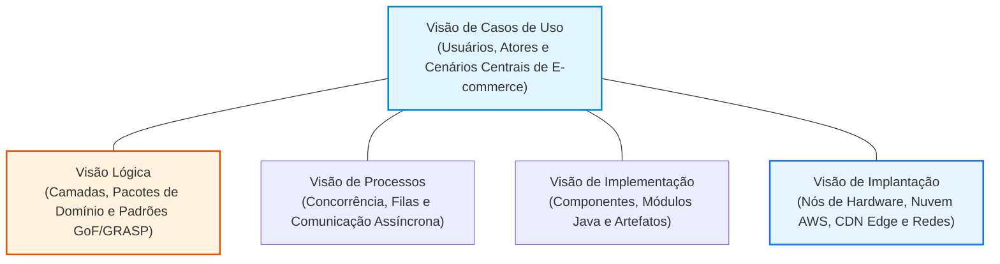

No contexto deste documento, **apresentam-se com aprofundamento e integração completa a Visão de Casos de Uso, a Visão Lógica e a Visão de Implantação**:

- Os elementos da **Visão de Casos de Uso** representam atores (`«actor»`), casos de uso (`«useCase»`) e seus relacionamentos de inclusão (`«include»`) e extensão (`«extend»`), ancorando os requisitos funcionais aos fluxos de descoberta, transação, venda e pós-venda.
- Os elementos da **Visão Lógica** pertencem ao metamodelo UML 2.5.1:
  - **Pacotes e Camadas (`«package»` e `«layer»`):** Matriz ortogonal de segregação técnica (Apresentação, Controle, Aplicação, Domínio, Persistência) e coesão de negócio (Contas e Acesso, Catálogo e Descoberta, Transação, Pós-Venda).
  - **Classes, Interfaces e Enumerações:** Entidades de negócio, value objects (como `CEP`), controladores GRASP e contratos de abstração providos e requeridos (`ICatalogo`, `IFrete`, `IPagamento`, etc.).
  - **Padrões de Projeto:** Abstrações criacionais (Builder), estruturais (Facade, Decorator) e comportamentais (Chain of Responsibility, Observer, State) com código Java executável.
- Os elementos da **Visão de Implantação** também pertencem ao metamodelo UML 2.5.1:
  - **Nós (`«device»` e `«executionEnvironment»`):** Recursos físicos e virtualizados de processamento (dispositivos móveis, desktops, servidores de borda CloudFront, servidores Tengine, buckets S3 e nós de cluster de API).
  - **Caminhos de Comunicação (`«communicationPath»` e `«network»`):** Canais de transmissão e protocolos aplicados (HTTP/2, HTTPS, TLS 1.3, DNS, BGP).
  - **Artefatos (`«artifact»`):** Pacotes de software executáveis, bundles frontend e assets de mídia instalados nos nós físicos.

---

# 3. Metas e Restrições da Arquitetura

As decisões de engenharia de software da plataforma de comércio eletrônico são guiadas de ponta a ponta pelas metas não-funcionais (NFR) e pelas restrições metodológicas e tecnológicas do projeto:

### 3.1 Metas Arquiteturais e Integração NFR

1. **Eficiência de Uso e Desempenho de Resposta (Busca e Catálogo):**
   - _Softgoal:_ Usabilidade → Eficiência de Uso → Retorno Imediato em Consultas e Carregamento Fluido de Catálogo (Recorte A).
   - _Racional Arquitetural:_ Em um comércio eletrônico de grande porte, a latência de busca impacta diretamente as taxas de conversão de venda. A arquitetura de software deve assegurar consultas ágeis e renderização veloz sem sobrecarregar a camada transacional de dados.
   - _Decisões de Software (Visão Lógica):_ Adoção do padrão **Decorator** para enriquecer dinamicamente as consultas com filtros e ordenações de facetas sem explosão combinatória de métodos; emprego de DTOs leves para transmissão entre controladores e telas; paginação estrita de resultados; cache em memória de metadados de catálogo.
   - _Operacionalizações de Infraestrutura (Visão de Implantação):_ Distribuição de ativos estáticos e páginas web via **Amazon CloudFront CDN** com peering direto no **IX.br São Paulo** (AS16509), assegurando RTT inferior a 200 ms e desoneração dos servidores de origem.

2. **Prevenção de Erros e Integridade Transacional (Checkout e Pagamentos):**
   - _Softgoal:_ Usabilidade → Prevenção de Erros → Integridade nos Fluxos de Checkout, Endereçamento e Pagamento (Recorte B).
   - _Racional Arquitetural:_ Falhas transitórias no fechamento da compra ou divergências no preenchimento cadastral causam abandono de carrinho e inconsistências financeiras.
   - _Decisões de Software (Visão Lógica):_ Encapsulamento de dados cadastrais com validação em tempo de instanciação (como o Value Object `CEP` auto-consistente); modelo orientado a estados (`EstadoPedido` / State) para governar as transições transacionais; inversão de dependência através de interfaces abstratas (`IPagamento`, `IAutorizacao` via Abstract Factory) desacoplando o domínio do pedido dos provedores externos; garantia de transações atômicas (ACID) na camada de repositório.
   - _Operacionalizações de Infraestrutura (Visão de Implantação):_ Tráfego criptografado com **TLS 1.3** ponta a ponta e isolamento do cluster transacional de backend em sub-redes privadas (VPC) sem acesso público direto.

3. **Segurança, Confidencialidade e Robustez no Acesso (Contas e Autenticação):**
   - _Softgoal:_ Segurança → Confidencialidade, Integridade e Prevenção de Acessos Não Autorizados.
   - _Racional Arquitetural:_ O módulo de contas armazena dados pessoais sensíveis, credenciais e histórico financeiro, constituindo o perímetro mais visado por vetores de ataque.
   - _Decisões de Software (Visão Lógica):_ Aplicação do padrão **Builder** (`RequisicaoLogin`) para construir objetos de contexto de autenticação imutáveis; uso do padrão **Chain of Responsibility** (`ValidadorHandler`) para encadear verificações independentes de segurança (Captcha, validação de hash seguro de senha, heurística de risco e 2FA); emprego de **Facade** (`FachadaSessaoAutenticada`) como porta única para geração de tokens de sessão e replicação federada SSO.
   - _Operacionalizações de Infraestrutura (Visão de Implantação):_ Blindagem dos serviços de autenticação em VPC privada da AWS e proteção de tráfego HTTPS estrito.

4. **Modularidade, Manutenibilidade e Escalabilidade (Arquitetura Global de Software):**
   - _Softgoal:_ Engenharia de Software → Baixo Acoplamento, Alta Coesão e Extensibilidade.
   - _Racional Arquitetural:_ Um ecossistema de e-commerce evolui com rapidez e equipes distintas cuidam de domínios específicos (busca, pagamentos, logística, anúncios). A arquitetura deve evitar acoplamento acidental e monólitos frágeis.
   - _Decisões de Software (Visão Lógica):_ Organização ortogonal em matriz de **Camadas Técnicas** (Apresentação, Controle, Aplicação, Domínio, Persistência) e **Pacotes de Domínio** (Contas, Catálogo, Transação, Pós-Venda); camada de Domínio pura que não conhece detalhes de infraestrutura ou controle (Regra de Dependência de Clean Architecture); comunicação entre domínios mediada por contratos formais (`ICatalogo`, `IFrete`, `IPagamento`, `IRastreio`, `IReclamacao`).
   - _Operacionalizações de Infraestrutura (Visão de Implantação):_ Segregação do backend em serviços modulares que podem ser dimensionados e escalados elasticamente conforme a demanda sazonal de tráfego.

5. **Alta Disponibilidade e Resiliência Operacional:**
   - _Softgoal:_ Confiabilidade → Tolerância a Falhas e Disponibilidade Contínua sem Ponto Único de Falha (SPOF).
   - _Racional Arquitetural:_ Quedas de serviços de terceiros (como lentidão em transportadoras ou operadoras de cartão) não devem paralisar a navegação de catálogo ou a navegação do usuário.
   - _Decisões de Software (Visão Lógica):_ Desacoplamento de eventos assíncronos (como o padrão **Observer** para pós-processamento de pedidos e notificações); isolamento de falhas externas permitindo comportamento degradado gracioso quando serviços terceiros falham.
   - _Operacionalizações de Infraestrutura (Visão de Implantação):_ Infraestrutura DNS Anycast redundante em quatro zonas de autoridade globais via **Amazon Route 53** (`awsdns-*.co.uk`, `awsdns-*.net`, `awsdns-*.com`, `awsdns-*.org`), combinada com múltiplos Edge PoPs de borda do CloudFront.

---

### 3.2 Rastreabilidade: Metas NFR → Decisões de Software e Infraestrutura

O diagrama a seguir estabelece a rastreabilidade completa e bidirecional: as metas de qualidade do NFR Framework orientam escolhas específicas de software (padrões GoF/GRASP, pacotes de domínio e regras de camada), as quais, por sua vez, são viabilizadas operacionalmente pela infraestrutura física:

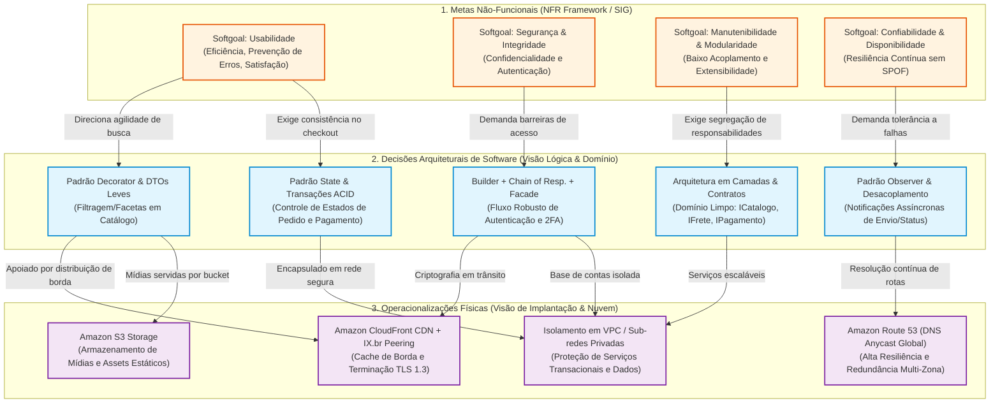

A matriz a seguir detalha as relações de rastreabilidade entre as três camadas do modelo:

| Meta Não-Funcional (NFR) | Recorte / Domínio | Decisão Arquitetural de Software (Lógica) | Operacionalização Física (Implantação) |
| :--- | :--- | :--- | :--- |
| **Eficiência de Uso** (Latência baixa) | Recorte A (Busca / Catálogo) | Padrão Decorator para facetas, paginação e DTOs leves | CloudFront CDN, IX.br Peering e S3 para imagens |
| **Prevenção de Erros** (Integridade) | Recorte B (Transação / Checkout) | Padrão State (`EstadoPedido`), Value Object `CEP` e ACID | Isolamento em VPC Privada e TLS 1.3 |
| **Segurança e Confidencialidade** | Contas e Autenticação | Builder (`RequisicaoLogin`), Chain of Responsibility e Facade | Tráfego HTTPS obrigatório e banco de dados em sub-rede fechada |
| **Manutenibilidade e Modularidade** | Todo o Ecossistema | Decomposição em camadas, domínio limpo e interfaces modulares | Cluster de serviços desacoplados em backend |
| **Alta Confiabilidade e Tolerância** | Transação e Logística | Padrão Observer para notificações assíncronas e fallbacks | Amazon Route 53 com DNS Anycast em 4 zonas |

---

### 3.3 Restrições Arquiteturais, de Design e Metodológicas

1. **Restrição de Arquitetura Omnicanal com Contratos Unificados de API:**
   - A plataforma deve atender simultaneamente a dois tipos de aplicação cliente: **Aplicação Web SPA** (para navegadores desktop) e **Aplicativo Móvel** (para smartphones). Ambas as aplicações consomem os mesmos serviços de negócio através de contratos de API padronizados (`ICatalogo`, `ICarrinho`, `ICheckout`, `IEndereco`). A camada de apresentação adapta a experiência de usuário, mantendo a regra de negócio centralizada na camada de Aplicação e Domínio.
2. **Restrição de Independência de Domínio (Clean Architecture & Regra de Dependência):**
   - A camada de Domínio (`Model`) não pode ter conhecimento ou dependência direta de detalhes tecnológicos externos (frameworks de apresentação, bibliotecas de terceiros ou mecanismos de persistência de banco de dados). Mudanças de tecnologia na camada de apresentação (View/Controller) ou de banco de dados (Repository) não podem impactar a modelagem de entidades do e-commerce.
3. **Restrição de Inversão de Dependência para Parceiros Externos:**
   - Serviços que dependem de parceiros externos — como **Operadoras de Pagamento** (validação financeira e estornos) e **Transportadoras** (cotação de fretes e rastreio de encomendas) — devem ser acessados estritamente através de interfaces de abstração (`IAutorizacao`, `ICotacaoEntrega`), permitindo substituir ou agregar fornecedores sem alterar as regras de negócio de `Transação` ou `Pós-Venda`.
4. **Restrição de Coleta Empírica e Limites de Observabilidade (Engenharia Reversa de Caixa-Preta):**
   - No que tange aos aspectos de infraestrutura física e de rede, a modelagem adota como premissa a observabilidade de caixa-preta (*black-box*) com inspeções de rede públicas (`dig`, `curl -I`, `traceroute/mtr`, inspeção de certificados TLS). O interior do cluster de microsserviços de negócio (rotas com prefixo `/gz/*`) é documentado de forma transparente como nó opaco ("Backend de API"), assegurando rigor empírico e integridade metodológica.

---

# 4. Visão de Casos de Uso

A **Visão de Casos de Uso** (ou Visão de Cenários) é a visão central do modelo 4+1 de Kruchten (1995) apresentado na [Seção 2](#2-representação-arquitetural). Ela descreve o sistema pelo que ele oferece a quem está fora dele (atores) e seleciona os cenários que, por exercitarem muitos elementos da arquitetura de uma só vez, justificam e validam as demais visões. Se a Visão de Implantação ([Seção 6](#6-visão-de-implantação)) responde _onde_ o software executa, esta seção responde _para quem_ e _para quê_ ele executa.

---

## 4.1 Finalidade e Escopo da Visão

Esta seção cumpre três papéis dentro do DAS:

1. **Registrar o que o sistema faz para seus atores**, consolidando os diagramas de casos de uso produzidos pelas três subequipes na Entrega 02.
2. **Identificar os casos de uso arquiteturalmente significativos**, isto é, aqueles que atravessam vários componentes e nós de implantação e que, por isso, orientam as decisões das Seções 3 e 6.
3. **Estabelecer a rastreabilidade** entre caso de uso, componente de software e nó de implantação, fechando o elo entre o que o usuário quer fazer e a infraestrutura que torna isso possível.

O escopo acompanha os três recortes da Engenharia Reversa descritos na Seção 1.2: **Recorte A** (Busca e Catálogo), **Recorte B** (Carrinho, Endereçamento e Checkout) e **Recorte C** (Publicação e Vendas), acrescidos dos casos de uso de **Conta e Acesso** (modelados pela Subequipe 03) e de **Pós-venda** (modelados pela Subequipe 01).

---

## 4.2 Fontes e Critério de Consolidação

Três diagramas de casos de uso foram produzidos na Entrega 02. Eles têm níveis de detalhe e critérios de agrupamento diferentes, e esta seção os unifica sem descartar nenhum:

| Fonte | Foco | Casos de uso | Contribuição para esta visão | Link de rastreabilidade dos artefatos |
| :-- | :-- | :-: | :-- | :-- |
| **Subequipe 03** | Visão ampla do Mercado Livre, com quatro atores | 13 | Casos de uso de **conta/acesso**, **pagamento** (com `include`), **envio** e **estoque** | [Artefatos e documentação desenvolvidos pela Subequipe 03](https://unbarqdsw2026-2-turma01.github.io/2026.2-T01-_G1_ProjetoComercioEletronico_Entrega_02/#/Base/Relat%C3%B3rios/Subequipe03/ModelagemEstatica/DiagramaDeCasosDeUso) |
| **Subequipe 01** | Visão por objetivo do ator, rastreada ao Rich Picture e à Engenharia Reversa | 21 (`UC01`–`UC21`) | **Identificadores canônicos**, agrupamento em pacotes, ator `Atendimento` e fluxo de **pós-venda** | [Artefatos e documentação desenvolvidos pela Subequipe 01](https://unbarqdsw2026-2-turma01.github.io/2026.2-T01-_G1_ProjetoComercioEletronico_Entrega_02/#/Base/Relat%C3%B3rios/Subequipe01/ModelagemEstatica/DiagramaDeCasosDeUso) |
| **Subequipe 02** | Detalhamento da funcionalidade de **busca** | 6 | Granularidade fina da busca, incluindo **paginação** | [Artefatos e documentação desenvolvidos pela Subequipe 02](https://unbarqdsw2026-2-turma01.github.io/2026.2-T01-_G1_ProjetoComercioEletronico_Entrega_02/#/Base/Relat%C3%B3rios/Subequipe02/ModelagemEstatica/DiagramaDeCasosDeUso) |

**Critério adotado.** Os identificadores `UC01`–`UC21` da Subequipe 01 foram mantidos como base, por já estarem rastreados a requisitos (RF-A, RN-B, RN-C) e aos demais diagramas. Os casos de uso que existem apenas nas Subequipes 02 e 03 receberam identificadores novos (`UC22`–`UC30`), criados neste DAS. Quando dois diagramas modelam o mesmo comportamento com nomes diferentes, o caso de uso aparece uma única vez, com a equivalência registrada na tabela da Seção 4.4.

---

## 4.3 Atores

| Ator | Tipo | Descrição | Aparece em |
| :-- | :-- | :-- | :-: |
| **Comprador** | Primário (humano) | Pessoa que busca, compra, paga, acompanha a entrega e avalia produtos. | S01, S02 (como "Usuário"), S03 |
| **Vendedor** | Primário (humano) | Pessoa que publica anúncios, controla o estoque e atende reclamações. Especializa-se em **Loja Oficial** e **Vendedor Autônomo**, que realizam os mesmos casos de uso. | S01, S03 |
| **Atendimento** | Primário (humano) | Equipe que media reclamações e autoriza reembolsos. Está **fora** da fronteira do sistema. | S01 |
| **Operadora de Pagamento** (Serviço de Pagamento) | Secundário (sistema externo, `«externo»`) | Autoriza e valida pagamentos e executa estornos. | S01, S03 |
| **Transportadora** | Secundário (sistema externo, `«externo»`) | Executa o transporte e informa o andamento da entrega. | S01, S03 |

Os atores secundários são sistemas de terceiros que a plataforma consome para completar um caso de uso iniciado por um ator primário. Isso é consistente com a Seção 6.5, que classifica a topologia interna desses parceiros como fora do alcance observacional. A Subequipe 02 usa um único ator genérico, "Usuário" (visitante ou comprador, autenticado ou não); nesta visão ele é tratado como o **Comprador** em sua fase de descoberta de produtos.

---

## 4.4 Catálogo de Casos de Uso

### Diagrama Consolidado

O diagrama a seguir reúne os casos de uso das três subequipes. As setas sólidas são associações entre ator e caso de uso; as tracejadas são relacionamentos entre casos de uso.

<div style="text-align:center;">

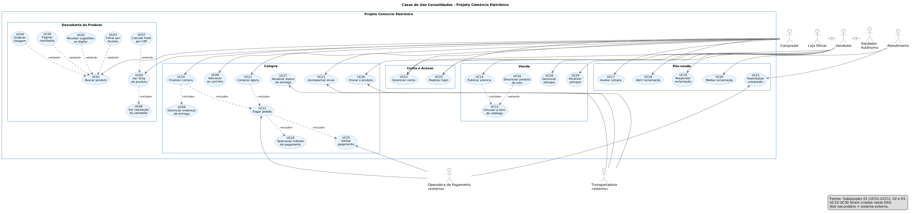

<p><strong>Diagrama de casos de uso</strong> — Diagrama que consolida os casos de uso desenvolvidos por todos do grupo. <em>Autor: José Joaquim da Silva Neto</em></p>

[Clique aqui para baixar a imagem!](Assets/Subequipe3/CasosDeUsosConsolidados.png ':ignore')

</div>

> **Nota de leitura.** O diagrama consolidado é uma síntese produzida para este DAS. Os diagramas originais, com a notação UML completa, permanecem como as fontes oficiais: [Subequipe 01](https://unbarqdsw2026-2-turma01.github.io/2026.2-T01-_G1_ProjetoComercioEletronico_Entrega_02/#/Base/Relat%C3%B3rios/Subequipe01/ModelagemEstatica/DiagramaDeCasosDeUso), [Subequipe 02](https://unbarqdsw2026-2-turma01.github.io/2026.2-T01-_G1_ProjetoComercioEletronico_Entrega_02/#/Base/Relat%C3%B3rios/Subequipe02/ModelagemEstatica/DiagramaDeCasosDeUso) e [Subequipe 03](https://unbarqdsw2026-2-turma01.github.io/2026.2-T01-_G1_ProjetoComercioEletronico_Entrega_02/#/Base/Relat%C3%B3rios/Subequipe03/ModelagemEstatica/DiagramaDeCasosDeUso).


### Descrição dos Casos de Uso

| ID | Caso de uso | Ator(es) | Descrição | Equivalência nas fontes |
| :-: | :-- | :-- | :-- | :-- |
| **Conta e Acesso** | | | | |
| UC22 | Realizar login | Comprador, Vendedor | Autentica o usuário para acessar as funções restritas da plataforma. | S03: _Realizar Login_ |
| UC23 | Gerenciar conta | Comprador, Vendedor | Mantém dados cadastrais, senha e endereço, que existem para os dois papéis. | S03: _Gerenciar Conta_ |
| **Descoberta do Produto** | | | | |
| UC01 | Buscar produto | Comprador | Informa um termo e obtém a listagem de produtos correspondentes. | S01: `UC01`; S02: _Buscar Produtos_; S03: _Buscar Produto_ |
| UC02 | Receber sugestões ao digitar | Comprador | O sistema sugere termos conforme o usuário digita. | S01: `UC02`; S02: _Consultar Sugestões de Busca_ |
| UC03 | Filtrar por facetas | Comprador | Refina os resultados por categoria, preço, condição, frete e similares. | S01: `UC03`; S02: _Filtrar Resultados_; S03: _Selecionar Preferências_ (equivalência aproximada) |
| UC04 | Ordenar listagem | Comprador | Reorganiza os resultados por relevância, menor ou maior preço. | S01: `UC04`; S02: _Ordenar Resultados_ |
| UC30 | Paginar resultados | Comprador | Avança para a próxima página ou carrega mais itens. | S02: _Paginar Resultados_ |
| UC05 | Ver ficha do produto | Comprador | Abre a página detalhada do item, com múltiplas mídias. | S01: `UC05`; S02: _Visualizar Detalhes do Produto_ |
| UC06 | Ver reputação do vendedor | Comprador | Exibe a reputação do vendedor junto ao preço. | S01: `UC06` |
| UC07 | Calcular frete por CEP | Comprador | Calcula frete e prazo a partir do CEP informado, antes da compra. | S01: `UC07` |
| **Compra** | | | | |
| UC08 | Adicionar ao carrinho | Comprador | Inclui o item na sacola de compras. | S01: `UC08` |
| UC09 | Gerenciar endereço de entrega | Comprador | Escolhe, cadastra ou altera o endereço de entrega. | S01: `UC09` |
| UC10 | Finalizar compra | Comprador | Conduz o carrinho pela sequência de checkout. | S01: `UC10` |
| UC11 | Comprar agora | Comprador | Caminho direto ao checkout, sem passar pelo carrinho. | S01: `UC11` |
| UC12 | Pagar pedido | Comprador, Operadora de Pagamento | Efetiva o pagamento do pedido junto à operadora. | S01: `UC12`; S03: _Realizar Pagamento_ |
| UC24 | Selecionar método de pagamento | Comprador | Escolhe o meio de pagamento do pedido. | S03: _Selecionar Método de Pagamento_ |
| UC25 | Validar pagamento | Operadora de Pagamento | Confirma ou recusa a autorização do pagamento. | S03: _Validar Pagamento_ |
| UC26 | Enviar o produto | Vendedor, Transportadora | Despacha o pedido pago ao transporte. | S03: _Enviar o Produto_ |
| UC27 | Atualizar status da entrega | Transportadora | Informa ao sistema o andamento da entrega. | S03: _Atualizar Status da Entrega_ |
| UC13 | Acompanhar envio | Comprador, Transportadora | Consulta o andamento do pedido após a compra. | S01: `UC13` |
| **Venda** | | | | |
| UC14 | Publicar anúncio | Vendedor | Publica um anúncio com fotos e preço. | S01: `UC14`; S03: _Cadastrar Produto_ |
| UC15 | Vincular a item de catálogo | Vendedor | Associa a oferta a um item já existente no catálogo (caminho padrão). | S01: `UC15` |
| UC16 | Descrever produto do zero | Vendedor | Descreve livremente um produto novo (caminho de exceção). | S01: `UC16` |
| UC28 | Gerenciar estoque | Vendedor | Consulta e ajusta o estoque e seus limites. | S03: _Gerenciar Estoque_ |
| UC29 | Atualizar estoque | Vendedor | Altera a quantidade disponível, por exemplo após uma venda. | S03: _Atualizar Estoque_ |
| **Pós-venda** | | | | |
| UC17 | Avaliar compra | Comprador | Registra a avaliação do produto e da compra. | S01: `UC17`; S03: _Adicionar Avaliação_ |
| UC18 | Abrir reclamação | Comprador | Registra um problema com a compra concluída. | S01: `UC18` |
| UC19 | Responder reclamação | Vendedor | Apresenta a resposta do vendedor à reclamação. | S01: `UC19` |
| UC20 | Mediar reclamação | Atendimento | Analisa as evidências e decide o desfecho da disputa. | S01: `UC20` |
| UC21 | Reembolsar comprador | Atendimento, Operadora de Pagamento | Executa o estorno quando a mediação o determina. | S01: `UC21` |

---

## 4.5 Relacionamentos entre Casos de Uso

Os relacionamentos seguem a definição da OMG (2017): `«include»` indica comportamento que o caso de uso base **sempre** executa, e `«extend»` indica comportamento que ocorre **apenas sob condição**, sem que o caso base dependa dele.

| Relacionamento | Tipo | Justificativa |
| :-- | :-: | :-- |
| UC05 → UC06 | `include` | A reputação do vendedor aparece sempre junto ao preço (RN-A05). |
| UC07 → UC05 | `extend` | O frete só é calculado se o CEP for informado (RN-A04, RF-A04). |
| UC02, UC03, UC04, UC30 → UC01 | `extend` | Uma busca é completa sem sugestões, filtros, ordenação ou paginação (RF-A01 a RF-A03). |
| UC10 → UC09 | `include` | Toda compra exige definir o destino da entrega (RN-B02). |
| UC10 → UC12 e UC11 → UC12 | `include` | Os dois caminhos de compra convergem para o pagamento (RN-B08). |
| UC12 → UC24 e UC12 → UC25 | `include` | Todo pagamento exige um método escolhido e uma validação da operadora. |
| UC14 → UC15 | `include` | A plataforma tenta vincular a oferta ao catálogo antes de permitir descrição livre (RN-C04). |
| UC16 → UC15 | `extend` | Descrever do zero é o caminho de exceção (RN-C06). |

**Divergência registrada entre as fontes.** A Subequipe 01 modela as sugestões de busca (UC02) como `«extend»`, porque a busca é válida sem elas. A Subequipe 02 as modela como `«include»`, porque no seu recorte as sugestões ocorrem sempre que o usuário digita. Este DAS adota o `«extend»`, que é coerente com o critério "acontece sempre ou só às vezes" aplicado ao _caso de uso de busca_ (e não à digitação), e preserva o rastreio a RF-A01.

---

## 4.6 Casos de Uso Arquiteturalmente Significativos

Nem todo caso de uso influencia a arquitetura na mesma medida. Foram selecionados os cinco que atravessam mais componentes, nós de implantação e metas não-funcionais, usando os componentes e interfaces do Diagrama de Componentes (Subequipe 01) e os nós descritos na [Seção 6.2](#62-decomposição-dos-nós-e-mapeamento-de-componentes).

### 4.6.1 UC01 Buscar produto (inclui as extensões UC02, UC03, UC04 e UC30)

- **Importância arquitetural:** é a porta de entrada da conversão de vendas (Recorte A) e o caso de uso mais frequente do sistema.
- **Componentes envolvidos:** `Serviço de Catálogo` (provê `ICatalogo` e `IFichaProduto`), que requer `IFrete` do `Serviço de Entrega`.
- **Nós de implantação:** Dispositivo do Usuário → Route 53 (resolução) → CloudFront (cache e terminação TLS 1.3) → Tengine / S3 (páginas e mídia) → Backend de API (consulta ao catálogo).
- **Meta não-funcional relacionada:** Eficiência de Uso e Resposta de Borda (Seção 3.1, item 1).

### 4.6.2 UC10 Finalizar compra e UC12 Pagar pedido

- **Importância arquitetural:** é o fluxo transacional crítico (Recorte B). Concentra o maior acoplamento do sistema: o `Serviço de Checkout e Pedidos` requer quatro interfaces (`ICarrinho`, `IEndereco`, `IPagamento` e `IFrete`).
- **Componentes envolvidos:** `Serviço de Carrinho`, `Serviço de Contas e Endereços`, `Serviço de Checkout e Pedidos`, `Serviço de Pagamentos` e a `Operadora de Pagamento` externa.
- **Nós de implantação:** Dispositivo do Usuário → CloudFront → Backend de API, em sub-rede privada, com tráfego cifrado em TLS 1.3 de ponta a ponta.
- **Meta não-funcional relacionada:** Prevenção de Erros e Integridade Transacional (Seção 3.1, item 2).

### 4.6.3 UC14 Publicar anúncio (inclui UC15 e estende para UC16)

- **Importância arquitetural:** é o fluxo que alimenta o catálogo (Recorte C) e o único que envolve upload de mídia pelo usuário.
- **Componentes envolvidos:** `Serviço de Anúncios` (provê `IAnuncio`) e `Serviço de Catálogo`.
- **Nós de implantação:** CloudFront → Backend de API; as fotos do anúncio são armazenadas no Amazon S3 ([Seção 6.2](#62-decomposição-dos-nós-e-mapeamento-de-componentes)).
- **Meta não-funcional relacionada:** Eficiência de Uso e Integridade dos dados publicados.

### 4.6.4 UC13 Acompanhar envio (com UC26 e UC27)

- **Importância arquitetural:** envolve um ator externo (Transportadora) que interage com o sistema fora do ciclo de requisição do comprador.
- **Componentes envolvidos:** `Serviço de Entrega` (provê `IRastreio`) e a `Transportadora` externa.
- **Nós de implantação:** Backend de API, com consulta desacoplada às transportadoras, sem onerar a origem primária (Seção 3.1, item 4).
- **Meta não-funcional relacionada:** Satisfação do Usuário e Transparência Operacional.

### 4.6.5 UC22 Realizar login e UC23 Gerenciar conta

- **Importância arquitetural:** é pré-requisito de quase todos os demais casos de uso e concentra os dados sensíveis do usuário.
- **Componentes envolvidos:** UI de login e cadastro, Serviço de autenticação, Serviço de cadastro, Banco de dados de usuários, Verificação e notificação e Provedor externo (Diagrama de Componentes da Subequipe 03), além do `Serviço de Contas e Endereços`.
- **Nós de implantação:** CloudFront → Backend de API; os dados de usuários ficam em sub-rede privada, não exposta ([Seção 6.5](#65-limitações-do-método-e-considerações-de-borda), item 1).
- **Meta não-funcional relacionada:** Prevenção de Erros e Integridade Transacional, com criptografia em trânsito.

---

## 4.7 Rastreabilidade: Caso de Uso → Componente → Nó de Implantação

| Casos de uso | Componente (Subequipe 01 / 03) | Interface principal | Nó de implantação ([Seção 6.2](#62-decomposição-dos-nós-e-mapeamento-de-componentes)) | Certeza |
| :-- | :-- | :-- | :-- | :-: |
| UC01–UC07, UC30 | Serviço de Catálogo | `ICatalogo`, `IFichaProduto` | CloudFront → Tengine / S3 → Backend de API | Parcial |
| UC08 | Serviço de Carrinho | `ICarrinho` | Backend de API | Inferida |
| UC09, UC22, UC23 | Serviço de Contas e Endereços; autenticação e cadastro | `IEndereco` | Backend de API | Inferida |
| UC10, UC11 | Serviço de Checkout e Pedidos | `ICheckout` | Backend de API | Inferida |
| UC12, UC24, UC25 | Serviço de Pagamentos; Operadora externa | `IPagamento` | Backend de API → parceiro externo | Inferida |
| UC13, UC26, UC27 | Serviço de Entrega; Transportadora externa | `IRastreio`, `IFrete` | Backend de API → parceiro externo | Inferida |
| UC14–UC16, UC28, UC29 | Serviço de Anúncios | `IAnuncio` | Backend de API; Amazon S3 (fotos) | Inferida |
| UC17–UC21 | Serviço de Pós-venda | `IReclamacao` | Backend de API | Inferida |

**Como ler a coluna "Certeza".** Segue a legenda da [Seção 6.4](#64-legenda-de-confiança-da-evidência). Só o trecho de borda (Dispositivo do Usuário → CloudFront → Tengine) foi confirmado empiricamente por `curl -I`, `dig` e `traceroute`. O Backend de API é uma **incógnita deliberada**: a [Seção 6.5](#65-limitações-do-método-e-considerações-de-borda) registra que os serviços internos não são observáveis por engenharia reversa de caixa-preta. Por isso o mapeamento de casos de uso para componentes é uma **leitura arquitetural**, e não uma observação direta de processos em execução.

---

## 4.8 Limitações e Inconsistências Conhecidas

Seguindo o princípio de transparência adotado na [Seção 6](#6-visão-de-implantação), registram-se aqui os pontos em que os diagramas de origem são imprecisos ou incompletos:

1. **Seta de inclusão invertida (Subequipe 03).** Entre _Selecionar Método de Pagamento_ e _Realizar Pagamento_, a seta aponta do caso incluído para o caso base, o inverso da convenção UML. Nesta visão a relação foi normalizada (UC12 inclui UC24), e a inconsistência permanece registrada na fonte.
2. **Associação imprecisa do Comprador a _Enviar o Produto_ (Subequipe 03).** Quem despacha é o Vendedor, e quem transporta é a Transportadora. Por isso UC26 foi associado apenas a esses dois atores. A associação original provavelmente quer expressar que a compra desencadeia o envio, uma relação de precedência e não de participação.
3. **_Adicionar Avaliação_ sem justificativa na fonte (Subequipe 03).** O caso de uso aparece no diagrama, mas não é discutido no documento da subequipe. Foi unificado ao UC17 (_Avaliar compra_), da Subequipe 01, por equivalência de nome e de objetivo.
4. **Pós-venda e rastreio são inferidos.** UC17 a UC21 e UC13 vêm do Rich Picture e de conhecimento de domínio, não de observação: a Engenharia Reversa parou antes da tela de pagamento. É o pacote de origem mais fraca.
5. **Diagrama não mostra ordem nem condição.** Os casos de uso são um índice de funcionalidades, e não um fluxo. A sequência de execução está nos Diagramas de Sequência, de Atividades e de Máquina de Estados.
6. **Login simplificado.** MFA, bloqueio por tentativas e expiração de sessão estão no Diagrama de Máquina de Estados do Usuário, e não em UC22, para evitar duplicar conteúdo entre artefatos.
7. **Fora do recorte.** Funções administrativas (moderar anúncio, gerir comissão, repassar valor ao vendedor) não têm ator de interface nos diagramas e não estão representadas.

---

### Referências desta seção

- KRUCHTEN, Philippe. _The 4+1 View Model of Architecture_. IEEE Software, v. 12, n. 6, p. 42-50, 1995.
- OMG — Object Management Group. _OMG Unified Modeling Language (OMG UML), Version 2.5.1_. Use Case Diagrams, 2017. Disponível em: <https://www.omg.org/spec/UML/2.5.1>.
- JACOBSON, Ivar et al. _Object-Oriented Software Engineering: A Use Case Driven Approach_. Wokingham: Addison-Wesley, 1992.
- COCKBURN, Alistair. _Writing Effective Use Cases_. Boston: Addison-Wesley, 2001.
- Diagramas de Casos de Uso, de Componentes e de Implantação das Subequipes 01, 02 e 03 (Entrega 02).

---

# 5. Visão Lógica

A **Visão Lógica** descreve as partes do modelo de design que são significativas do ponto de vista da arquitetura: a divisão do sistema em camadas e pacotes, as classes que sustentam cada pacote e os relacionamentos que atravessam as fronteiras entre eles. Enquanto a [Visão de Implantação](#6-visão-de-implantação) responde **onde** o software executa, esta seção responde **como ele está organizado por dentro** e **quem é responsável por quê**.

Esta visão não foi construída do zero. Ela consolida e reconcilia três artefatos que, até aqui, viviam separados:

- o [Diagrama de Classes](https://unbarqdsw2026-2-turma01.github.io/2026.2-T01-_G1_ProjetoComercioEletronico_Entrega_02/#/Base/Relat%C3%B3rios/Subequipe01/ModelagemEstatica/DiagramaDeClasses) de Pedro Luciano de Azevedo, Subequipe 01 (Entrega 02), que organiza o domínio em quatro pacotes;
- o [Diagrama de Pacotes](https://unbarqdsw2026-2-turma01.github.io/2026.2-T01-_G1_ProjetoComercioEletronico_Entrega_02/#/Base/Relat%C3%B3rios/Subequipe03/ModelagemEstatica/DiagramaDePacotes) de José Joaquim da Silva Neto, Subequipe 03 (Entrega 02), que organiza o sistema em cinco camadas;
- os padrões GoF e GRASP da [Entrega 03](https://unbarqdsw2026-2-turma01.github.io/2026.2-T01-_G1_ProjetoComercioEletronico_Entrega_03/), que transformaram parte desse modelo em **código Java executável**.

### Metodologia de elaboração

A Visão Lógica foi construída em quatro etapas, sempre partindo de artefatos já existentes no projeto, e não de uma modelagem nova:

1. **Levantamento:** leitura do Diagrama de Classes (Pedro Luciano de Azevedo, Subequipe 01) e do Diagrama de Pacotes (José Joaquim da Silva Neto, Subequipe 03) da Entrega 02, do Diagrama de Componentes e da Visão de Implantação já registrada neste DAS ([Seção 6](#6-visão-de-implantação)).
2. **Reconciliação:** identificação de que os dois diagramas estáticos decompõem o sistema por critérios diferentes (camadas e domínio) e decisão de mantê-los como dimensões complementares (decisão 1 da [Seção 5.3](#53-decisões-arquiteturais-e-análise-crítica)).
3. **Incorporação da Entrega 03:** posicionamento de cada padrão GoF e GRASP implementado dentro do pacote de domínio ao qual pertence, o que revelou a lacuna de autenticação apontada no Diagrama de Pacotes (decisão 2).
4. **Divisão e revisão:** a seção foi dividida entre João Paulo Barbosa Pereira Nunes e Júlia Santana Campos. A estrutura geral, o pacote Contas e Acesso, as dependências entre pacotes, as decisões e as limitações ficaram com João Paulo; os pacotes Catálogo e Descoberta, Transação e Pós-venda, a legenda de confiança e a evidência de execução ficaram com Júlia. A 5.1 foi publicada primeiro, por definir os nomes de camadas e pacotes usados no restante da seção.

O uso de IA Generativa nesta elaboração está registrado em [1.4. IA Generativa](/Base/1.4.IAGenerativa.md).

---

## 5.1 Visão Geral: Camadas e Hierarquia de Pacotes

### Duas dimensões de decomposição

Os dois diagramas estáticos da Entrega 02 decompõem o sistema por critérios diferentes, e nenhum dos dois está errado:

| Artefato de origem   | Critério de decomposição                  | Resultado                                                              |
| :------------------- | :---------------------------------------- | :--------------------------------------------------------------------- |
| Diagrama de Pacotes  | **Responsabilidade técnica** (horizontal) | `View`, `Controller`, `Service`, `Model`, `Repository` + externos      |
| Diagrama de Classes  | **Coesão de domínio** (vertical)          | `Contas e Acesso`, `Catálogo e Descoberta`, `Transação`, `Pós-venda`   |

A Visão Lógica adota as duas ao mesmo tempo, como uma matriz: **as camadas dizem o tipo de responsabilidade de uma classe; os pacotes de domínio dizem a qual assunto do negócio ela pertence.** Uma classe como `ControladorDeAutenticacao`, por exemplo, está na camada `Controller` e no pacote `Contas e Acesso`. Essa leitura cruzada é o que permite que a Visão Lógica converse tanto com o modelo de domínio quanto com os serviços que a [Visão de Implantação](#62-decomposição-dos-nós-e-mapeamento-de-componentes) posiciona dentro do nó `Backend de API`.

### Diagrama de Camadas e Pacotes

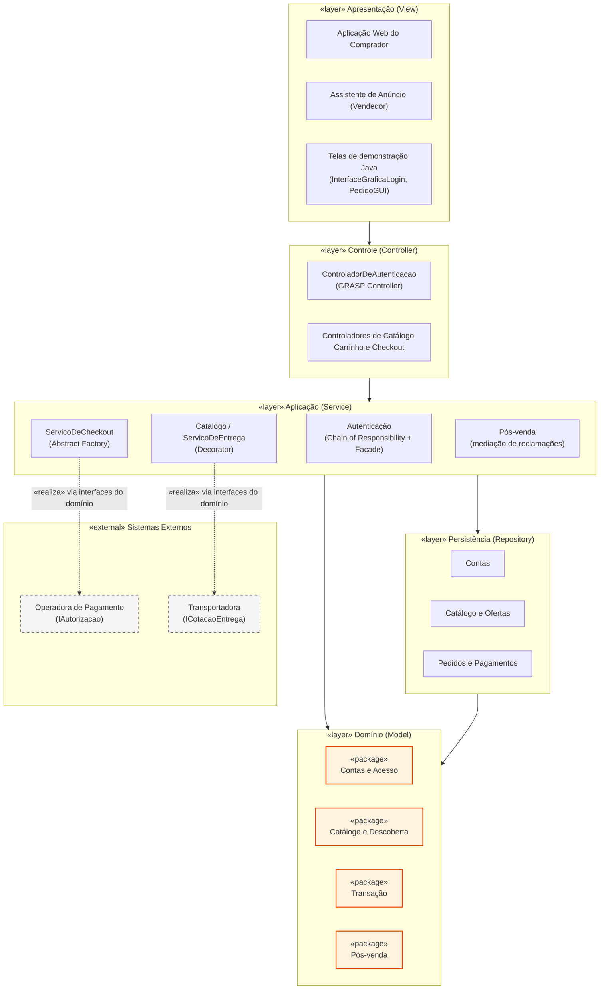

<p align="center"><strong>Figura 2: Camadas e pacotes de domínio da Visão Lógica.</strong> Setas sólidas: dependência permitida entre camadas. Setas tracejadas: dependência resolvida por interface definida no domínio (inversão de dependência). <em>Autor: João Paulo Barbosa Pereira Nunes.</em></p>

### Regras de dependência entre camadas

| Camada         | Pode depender de                                           | Não pode depender de              | Origem da regra                     |
| :------------- | :--------------------------------------------------------- | :-------------------------------- | :---------------------------------- |
| Apresentação   | Controle                                                   | Aplicação, Domínio, Persistência  | Diagrama de Pacotes, seção 4        |
| Controle       | Aplicação                                                  | Persistência, Sistemas Externos   | GRASP Controller (Entrega 03)       |
| Aplicação      | Domínio, Persistência, interfaces de domínio para externos | Apresentação, Controle            | Diagrama de Pacotes, seções 2 e 4   |
| Domínio        | Nenhuma outra camada                                       | Todas as demais                   | Regra de Dependência (MARTIN, 2017) |
| Persistência   | Domínio                                                    | Apresentação, Controle, Aplicação | Padrão Repository (FOWLER, 2002)    |

A camada de Domínio é a única que não depende de nada. É ela que concentra as regras de negócio observadas na Engenharia Reversa (RN-A, RN-B, RN-C) e, por isso, deve ser a mais estável do sistema.

### Rastreabilidade: Pacote Lógico → Componente → Nó Físico

| Pacote de domínio         | Componentes que o realizam ([Diagrama de Componentes](https://unbarqdsw2026-2-turma01.github.io/2026.2-T01-_G1_ProjetoComercioEletronico_Entrega_02/#/Base/Relat%C3%B3rios/Subequipe01/ModelagemEstatica/DiagramaDeComponentes)) | Interfaces providas                      | Nó na [Visão de Implantação](#62-decomposição-dos-nós-e-mapeamento-de-componentes) |
| :------------------------ | :------------------------------------------------------------------------------------------------------------------------------------------------------------------------------------------------------------------- | :--------------------------------------- | :--------------------------------------------------------------------------------- |
| **Contas e Acesso**       | Serviço de Contas e Endereços                                                                                                                                                                                        | `IEndereco`                              | Backend de API (serviço de Contas e Endereços)                                     |
| **Catálogo e Descoberta** | Serviço de Catálogo, Serviço de Anúncios                                                                                                                                                                             | `ICatalogo`, `IFichaProduto`, `IAnuncio` | Backend de API (Catálogo) e Amazon S3 (mídias)                                     |
| **Transação**             | Serviço de Carrinho, Serviço de Checkout e Pedidos, Serviço de Pagamentos, Serviço de Entrega                                                                                                                        | `ICarrinho`, `ICheckout`, `IPagamento`, `IFrete`, `IRastreio` | Backend de API (Carrinho)                                                          |
| **Pós-venda**             | Serviço de Pós-venda                                                                                                                                                                                                 | `IReclamacao`                            | Backend de API (Pós-Venda)                                                         |
| **Externos**              | Operadora de Pagamento, Transportadora                                                                                                                                                                               | `IAutorizacao`, `ICotacaoEntrega`        | Fora da nuvem da plataforma                                                        |

---

## 5.2 Pacotes de Design Significativos do Ponto de Vista da Arquitetura

Os diagramas a seguir não repetem o Diagrama de Classes completo da Entrega 02 (trinta classificadores em uma única figura). Cada pacote mostra **apenas as classes que carregam uma decisão arquitetural**: as que concentram regras de negócio, as que cruzam fronteiras de pacote e as que foram implementadas na Entrega 03. As classes marcadas com o estereótipo `«implementada»` possuem código Java compilável e executável (ver [Seção 5.5](#55-evidência-de-execução)).

### 5.2.1 Pacote Contas e Acesso

**Descrição.** Reúne a identidade dos participantes da plataforma (comprador, vendedor e atendente), os dados de conta que sobrevivem a qualquer compra (endereços) e o subpacote **Autenticação**, que controla a entrada do usuário no sistema. O endereço pertence à conta, e não ao pedido (RN-B02), o que explica por que ele vive aqui e não em `Transação`.


<p align="center"><strong>Figura 3: Pacote Contas e Acesso.</strong> <em>Fonte: Diagrama de Classes (Entrega 02) e padrões Builder, Chain of Responsibility, Facade e GRASP Controller (Entrega 03).</em></p>

| Classe                       | Responsabilidade arquitetural                                                                                                                                | Origem                                                                                                                                                                                                                    |
| :--------------------------- | :----------------------------------------------------------------------------------------------------------------------------------------------------------- | :------------------------------------------------------------------------------------------------------------------------------------------------------------------------------------------------------------------------ |
| `Usuario` e especializações  | Identidade única de quem interage com a plataforma. `Vendedor.tipo` é enumeração (`LOJA_OFICIAL`, `AUTONOMO`), não subclasse, pois a diferença é de ranking e não de comportamento. | Diagrama de Classes, decisão 8                                                                                                                                                                                            |
| `Endereco` + `CEP`           | Endereço como dado da conta, reutilizado entre pedidos. `CEP` é value object de oito dígitos que garante o formato no construtor.                             | RN-B02, RN-B04                                                                                                                                                                            |
| `ControladorDeAutenticacao`  | Primeiro objeto após a camada de apresentação a receber o evento de login. Coordena, mas não decide: delega montagem, validação e emissão de sessão.         | [GRASP Controller](https://unbarqdsw2026-2-turma01.github.io/2026.2-T01-_G1_ProjetoComercioEletronico_Entrega_03/#/Base/Relat%C3%B3rios/Subequipe03/GRASP/Controller)                                                |
| `RequisicaoLogin`            | Contexto imutável da tentativa de login (credenciais, captcha, telemetria do dispositivo, 2FA), construído passo a passo e validado antes de circular.        | [Builder](https://unbarqdsw2026-2-turma01.github.io/2026.2-T01-_G1_ProjetoComercioEletronico_Entrega_03/#/Base/Relat%C3%B3rios/Subequipe03/GofsCriacionais/FluxoLogin%28Builder%29)                                   |
| `ValidadorHandler` e cadeia  | Barreiras de segurança independentes (`ValidadorCaptcha`, `ValidadorCredenciais`, `ValidadorRisco`, `ValidadorTwoFactor`) encadeadas; cada uma aprova ou interrompe. | [Chain of Responsibility](https://unbarqdsw2026-2-turma01.github.io/2026.2-T01-_G1_ProjetoComercioEletronico_Entrega_03/#/Base/Relat%C3%B3rios/Subequipe03/GofsComportamentais/FluxoDeLogin%28ChainOfResponsibility%29) |
| `FachadaSessaoAutenticada`   | Ponto único para emitir a sessão: token JWT, replicação SSO para Mercado Pago e Mercado Envios, dispositivo confiável e auditoria.                           | [Facade](https://unbarqdsw2026-2-turma01.github.io/2026.2-T01-_G1_ProjetoComercioEletronico_Entrega_03/#/Base/Relat%C3%B3rios/Subequipe03/GofsEstruturais/EmissaoDeSessao%28Facade%29)                                  |

### 5.2.2 Pacote Catálogo e Descoberta

**Descrição.** Reúne o que o comprador encontra antes de comprar: o item de catálogo (`Produto`), a oferta que cada vendedor faz desse item (`Anuncio`) e a busca refinada que devolve uma `Listagem`. Duas decisões estruturam o pacote. A primeira é a separação entre `Produto` e `Anuncio` (decisão 1 do Diagrama de Classes), que permite várias ofertas concorrentes para o mesmo item (RN-B09) e faz tudo o que é transacional apontar para a oferta, e não para o produto. A segunda é o padrão Decorator: cada refinamento da busca (filtro, ordenação, frete, reputação, termos alternativos e paginação) é um objeto que envolve a fonte anterior, e o `ServicoDeCatalogo` empilha, a cada consulta, apenas os refinamentos que ela pede. O frete é obtido pela porta `IFrete`, declarada neste pacote e implementada na Transação, o que mantém a dependência entre os dois pacotes no sentido da [Seção 5.2.5](#525-dependências-entre-pacotes-de-domínio). Nas tabelas desta seção e das duas seguintes, os caminhos de arquivo são relativos a `app/src/comercio/`, e a categoria de confiança segue a [Seção 5.4](#54-legenda-de-confiança-da-evidência).

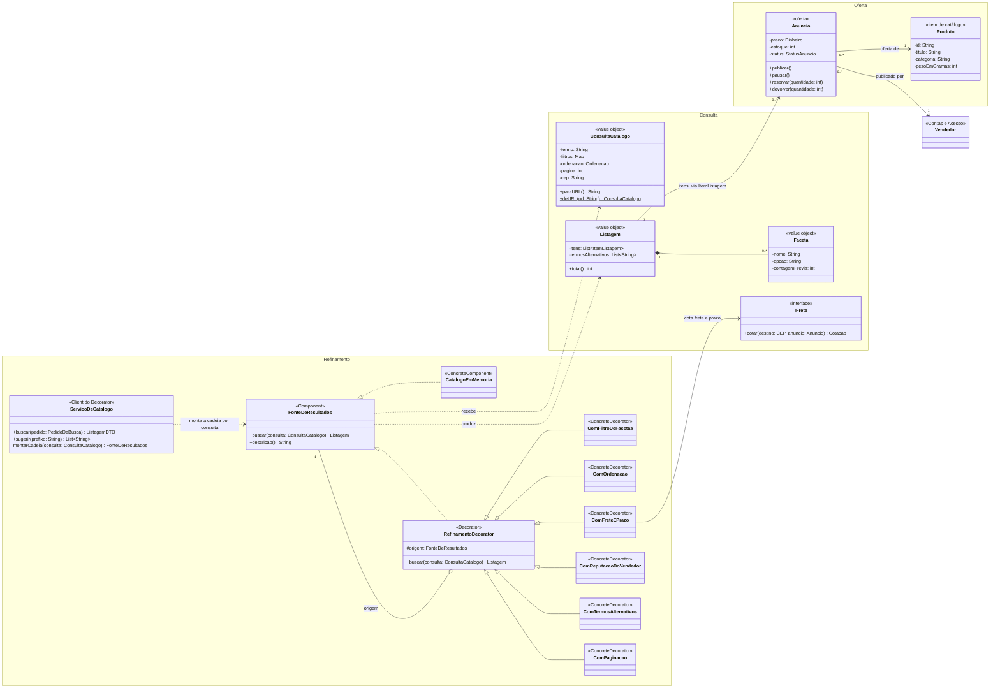

<p align="center"><strong>Figura 4: Pacote Catálogo e Descoberta.</strong> <em>Fonte: Diagrama de Classes (Entrega 02), padrão Decorator (Entrega 03) e código de <code>app/src/comercio/catalogo</code> (Entrega 04).</em></p>

| Classe | Responsabilidade arquitetural | Origem |
| :-- | :-- | :-- |
| `Produto` | Item de catálogo que existe uma única vez, independentemente de quem o vende. Concentra título, categoria, peso e imagens, que todas as ofertas do item compartilham. | Implementado (`catalogo/dominio/Produto.java`). Origem observada: RN-B09, RN-C04; Diagrama de Classes, decisão 1 |
| `Anuncio` e `StatusAnuncio` | Oferta de um vendedor para um produto, com preço, estoque e status próprios. É a referência de tudo o que é transacional (`ItemCarrinho`, `ItemPedido`, `Avaliacao`) e a única classe que reserva e devolve estoque, o que permite ao carrinho limitar a quantidade e ao checkout reservar de forma atômica. | Implementado (`catalogo/dominio/Anuncio.java`, `StatusAnuncio.java`). Origem observada: RN-B07, RN-B09; Diagrama de Classes, decisão 1 |
| `ConsultaCatalogo` | Estado completo da busca como value object imutável. `paraURL()` e `deURL()` garantem que a URL reconstrói a mesma listagem; cada operação `com...` devolve uma nova consulta em vez de alterar a atual. | Implementado (`catalogo/dominio/ConsultaCatalogo.java`). Origem observada: RN-A06; Diagrama de Classes, decisão 2 |
| `Listagem` e `Faceta` | Resultado da busca. Cada faceta carrega a contagem prévia, calculada antes de o filtro ser aplicado; o total da listagem é derivado dos itens, e não armazenado. | Implementado (`catalogo/dominio/Listagem.java`, `Faceta.java`). Origem observada: RN-A03, RF-A02; Diagrama de Classes, decisão 3 |
| `FonteDeResultados` | Contrato comum ao catálogo bruto e a todos os refinamentos. Quem chama `buscar()` não sabe quantos decoradores estão empilhados. | Implementado (`catalogo/dominio/FonteDeResultados.java`). Papel Component do [Decorator](https://unbarqdsw2026-2-turma01.github.io/2026.2-T01-_G1_ProjetoComercioEletronico_Entrega_03/#/Base/Relat%C3%B3rios/Subequipe01/GofsEstruturais/RefinamentoDaBusca%28Decorator%29) |
| `CatalogoEmMemoria` | Busca bruta sobre os anúncios do repositório; é sempre a base da cadeia. Fica na camada de Persistência e implementa uma interface do Domínio, conforme as regras da [Seção 5.1](#51-visão-geral-camadas-e-hierarquia-de-pacotes). | Implementado (`catalogo/persistencia/CatalogoEmMemoria.java`). Papel ConcreteComponent do [Decorator](https://unbarqdsw2026-2-turma01.github.io/2026.2-T01-_G1_ProjetoComercioEletronico_Entrega_03/#/Base/Relat%C3%B3rios/Subequipe01/GofsEstruturais/RefinamentoDaBusca%28Decorator%29) |
| `RefinamentoDecorator` e decoradores concretos | Cada decorador guarda a fonte que envolve e acrescenta um refinamento: `ComFiltroDeFacetas` (RN-A03), `ComOrdenacao` (RN-A02, RF-A03), `ComFreteEPrazo` (RN-A04), `ComReputacaoDoVendedor` (RN-A05), `ComTermosAlternativos` (RN-A01) e `ComPaginacao` (página como parte do estado da consulta, RN-A06). Os dois últimos foram acrescentados na Entrega 04. | Implementado (`catalogo/dominio/refinamento/`). Papéis Decorator e ConcreteDecorator do [Decorator](https://unbarqdsw2026-2-turma01.github.io/2026.2-T01-_G1_ProjetoComercioEletronico_Entrega_03/#/Base/Relat%C3%B3rios/Subequipe01/GofsEstruturais/RefinamentoDaBusca%28Decorator%29). Origem observada: RN-A01 a RN-A05; o critério de escolha dos termos alternativos é inferido (marcação `INFERIDO` em `ComTermosAlternativos.java`) |
| `ServicoDeCatalogo` | Fronteira entre a camada de Controle e o domínio: converte o pedido de busca em `ConsultaCatalogo` e monta a cadeia por consulta. Sem CEP, `ComFreteEPrazo` não entra na pilha; com ordenação por relevância, `ComOrdenacao` também não. | Implementado (`catalogo/aplicacao/ServicoDeCatalogo.java`). Componente Serviço de Catálogo do Diagrama de Componentes (Entrega 02) |
| `IFrete` | Porta pela qual o Catálogo obtém frete e prazo. Declarada aqui e implementada por `ServicoDeEntrega` ([Seção 5.2.3](#523-pacote-transação)), de modo que o código só depende da Transação para o Catálogo, e não o contrário. É a inversão de dependência da decisão 4 da [Seção 5.3](#53-decisões-arquiteturais-e-análise-crítica), aplicada entre dois pacotes internos. | Implementado (`catalogo/dominio/IFrete.java`). Origem observada: RN-A04, RF-A04; interface `IFrete` do Diagrama de Componentes (Entrega 02) |

**Divergências entre o modelo e o código.**

- **`Catalogo` não tem classe no código.** O serviço de domínio `Catalogo` da Entrega 02 (`sugerir`, `buscar`, `vincular`) foi repartido: `buscar` é a cadeia de `FonteDeResultados`, `sugerir` está em `ServicoDeCatalogo`, na camada de Aplicação, e `vincular(a, p)` (RN-C04) não foi implementado, porque o `Produto` é informado no construtor do `Anuncio`.
- **`Produto` e `Anuncio` mudaram de atributos.** `Produto` não tem `atributos: Map` nem `ofertaPrincipal()`; a separação entre oferta principal e demais ofertas (RN-B09) é feita pelo `ServicoDeCatalogo` ao montar a ficha (`FichaDTO.outrasOfertas`). `Anuncio` não tem `parcelamento`: as parcelas são calculadas na ficha com um limite marcado como `INFERIDO` em `ServicoDeCatalogo.java`. `StatusAnuncio` tem quatro valores, sem `EM_VALIDACAO`, contra cinco no modelo.
- **`ConsultaCatalogo` ganhou `cep: String`.** O modelo não tem esse atributo. O CEP viaja como texto na consulta e só se torna o value object `CEP` (Contas e Acesso) no momento da cotação.
- **Classes do código sem lugar no diagrama da Entrega 02.** `FonteDeResultados`, `CatalogoEmMemoria`, `RefinamentoDecorator` e os seis decoradores concretos, além de `ItemListagem` e `Cotacao`. `IFrete` existe no Diagrama de Componentes, mas não no de Classes.

### 5.2.3 Pacote Transação

**Descrição.** Reúne o caminho do carrinho ao pedido entregue. O pacote se apoia em três decisões. A primeira separa o que o comprador ainda está montando (`Carrinho` e `ItemCarrinho`) do que já foi acordado (`Pedido` e `ItemPedido`, com preço congelado), e compõe o pedido por envios, um por vendedor (decisões 6 e 7 do Diagrama de Classes; RN-B01). A segunda faz três padrões GoF trabalharem sobre o mesmo pedido: o Abstract Factory transforma o meio de pagamento escolhido em uma família coerente de autorizador, comprovante e política de estorno; o Observer propaga a mudança de situação do `Pagamento` a quem precisa reagir; e o State decide se a transição pedida ao `Pedido` é válida (ADR-05). A terceira aplica a inversão de dependência aos sistemas externos: a Transportadora entra pela porta `ICotacaoEntrega` e a Operadora de Pagamento pelas interfaces da fábrica, e as famílias concretas ficam em `comercio.externos`, fora do pacote (decisão 4 da [Seção 5.3](#53-decisões-arquiteturais-e-análise-crítica); ADR-02).

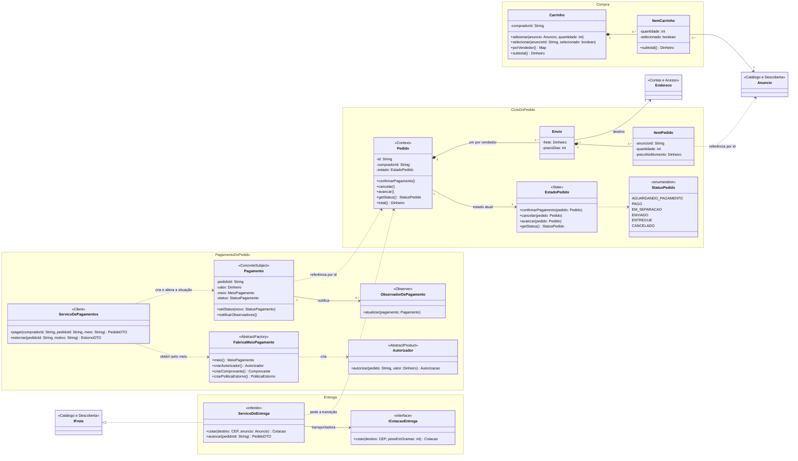

<p align="center"><strong>Figura 5: Pacote Transação.</strong> <em>Fonte: Diagrama de Classes (Entrega 02), padrões Abstract Factory, Observer e State (Entrega 03) e código de <code>app/src/comercio/transacao</code> (Entrega 04).</em></p>

| Classe | Responsabilidade arquitetural | Origem |
| :-- | :-- | :-- |
| `Carrinho` e `ItemCarrinho` | Agrupa os itens por vendedor, limita a quantidade ao estoque do anúncio e permite desselecionar um item sem removê-lo, recalculando o subtotal só com os selecionados. Não reserva estoque: reservar é ato do checkout. | Implementado (`transacao/dominio/carrinho/`). Origem observada: RN-B01, RN-B07, RF-B02, RF-B05; Diagrama de Classes, decisão 6 |
| `Pedido` | Guarda o estado atual e delega a ele confirmar o pagamento, cancelar e avançar, sem desvio condicional por situação. Compõe os envios e calcula subtotal, frete e total. | Implementado (`transacao/dominio/pedido/Pedido.java`). Papel Context do [State](https://unbarqdsw2026-2-turma01.github.io/2026.2-T01-_G1_ProjetoComercioEletronico_Entrega_03/#/Base/Relat%C3%B3rios/Subequipe03/GofsComportamentais/FluxoDeCompra%28State%29). Origem observada: RN-B01; Diagrama de Classes, decisão 7 |
| `EstadoPedido`, estados concretos e `StatusPedido` | Seis estados concretos (`EstadoAguardandoPagamento`, `EstadoPago`, `EstadoEmSeparacao`, `EstadoEnviado`, `EstadoEntregue`, `EstadoCancelado`), cada um decidindo quais transições aceita. Uma transição fora do desenho é recusada com `TransicaoInvalidaException`; é o que impede cobrar duas vezes um pedido pago. | Implementado (`transacao/dominio/pedido/`). Papéis State e ConcreteState do [State](https://unbarqdsw2026-2-turma01.github.io/2026.2-T01-_G1_ProjetoComercioEletronico_Entrega_03/#/Base/Relat%C3%B3rios/Subequipe03/GofsComportamentais/FluxoDeCompra%28State%29); ADR-05 |
| `Envio` e `ItemPedido` | O envio reúne os itens de um vendedor, guarda frete e prazo sem calculá-los e referencia o endereço da conta, sem copiá-lo. O item do pedido congela o preço do momento da compra. | Implementado (`transacao/dominio/pedido/Envio.java`, `ItemPedido.java`). Origem observada: RN-B01, RN-B02, RF-B01; Diagrama de Classes, decisões 4, 6, 7 e 11 |
| `Pagamento`, `PagamentoObservavel` e `ObservadorDePagamento` | O pagamento notifica os observadores a cada mudança de situação. Os quatro observadores concretos (`LiberacaoPedido`, `LiberacaoEstoque`, `NotificacaoComprador` e `EmissaoNotaFiscal`) ficam na camada de Aplicação e são registrados na raiz de composição. `LiberacaoPedido` é o ponto em que o Observer encontra o State: pede a transição, e o estado do pedido decide. | Implementado (`transacao/dominio/pagamento/`, `transacao/aplicacao/observadores/`, `Aplicacao.java`). Papéis ConcreteSubject, Subject, Observer e ConcreteObserver do [Observer](https://unbarqdsw2026-2-turma01.github.io/2026.2-T01-_G1_ProjetoComercioEletronico_Entrega_03/#/Base/Relat%C3%B3rios/Subequipe03/GofsComportamentais/FluxoDePagamento%28StrategyObserver%29) |
| `FabricaMeioPagamento`, `Autorizador`, `Comprovante`, `PoliticaEstorno` e `TrioDePagamento` | A fábrica cria os três produtos de uma família, e `TrioDePagamento` garante que autorização, comprovante e estorno de um pagamento venham sempre da mesma família. As quatro fábricas concretas (`FabricaCartao`, `FabricaPix`, `FabricaBoleto`, `FabricaSaldoEmConta`) e seus produtos simulam a operadora e ficam em `externos/pagamento/`. | Implementado (`transacao/dominio/pagamento/`, `externos/pagamento/`). Papéis AbstractFactory, AbstractProduct, ConcreteFactory e ConcreteProduct do [Abstract Factory](https://unbarqdsw2026-2-turma01.github.io/2026.2-T01-_G1_ProjetoComercioEletronico_Entrega_03/#/Base/Relat%C3%B3rios/Subequipe01/GofsCriacionais/MeiosDePagamento%28AbstractFactory%29); ADR-02 |
| `RegistroDeFabricas` e `ServicoDePagamentos` | O registro é o único ponto em que um valor de `MeioPagamento` se transforma em fábrica. O serviço é o Client dos três padrões: cobra pela família escolhida, altera a situação do pagamento e não escreve o nome de nenhuma classe concreta de pagamento. | Implementado (`transacao/aplicacao/RegistroDeFabricas.java`, `ServicoDePagamentos.java`). Papel Client do [Abstract Factory](https://unbarqdsw2026-2-turma01.github.io/2026.2-T01-_G1_ProjetoComercioEletronico_Entrega_03/#/Base/Relat%C3%B3rios/Subequipe01/GofsCriacionais/MeiosDePagamento%28AbstractFactory%29); ADR-02 |
| `ServicoDeEntrega` «inferido» | Implementa `IFrete` para o Catálogo e `IRastreio` para os demais pacotes. Cota o frete pela porta `ICotacaoEntrega` e avança o pedido pedindo a transição ao estado atual. | Implementado (`transacao/aplicacao/ServicoDeEntrega.java`). Origem inferida: o próprio Diagrama de Classes o declara "escolha de consistência, não observação" (decisão 11 e Limites do modelo). A funcionalidade é observada (RN-A04); quem calcula o frete, não |
| `ICotacaoEntrega` | Porta para a Transportadora. É implementada por `TransportadoraSimulada`, cuja tabela de frete por peso e região é marcada como `INFERIDO` no código. | Implementado (`transacao/dominio/ICotacaoEntrega.java`, `externos/TransportadoraSimulada.java`). Interface `ICotacaoEntrega` do Diagrama de Componentes (Entrega 02); decisão 4 da [Seção 5.3](#53-decisões-arquiteturais-e-análise-crítica) |
| `Dinheiro` | Value object em centavos, compartilhado por todos os pacotes no núcleo; `parcelar(n)` divide sem perder centavos. É o tipo de preço, frete, subtotal e valor do pagamento. | Implementado (`nucleo/Dinheiro.java`). Diagrama de Classes, decisão 10 |

**Divergências entre o modelo e o código.**

- **`StatusPedido` tem 6 valores no código e 12 no modelo.** A Máquina de Estados do Pedido da Entrega 02 tem doze estados. A Entrega 03 implementou seis, e a Entrega 04 os preservou. Faltam `AGUARDANDO_ENDERECO`, `AUTORIZANDO`, `RECUSADO`, `EXPIRADO`, `EM_DISPUTA` e `REEMBOLSADO`. Parte dessas situações foi deslocada para o pagamento: `StatusPagamento` tem `RECUSADO`, `EXPIRADO` e `ESTORNADO`, e um pagamento expirado ou estornado leva o pedido a `CANCELADO` por meio de `LiberacaoPedido`. A disputa vive na reclamação ([Seção 5.2.4](#524-pacote-pós-venda)).
- **`EM_SEPARACAO` e `EM_PREPARACAO`.** A revisão em pares da Entrega 02 (ata de 16/09) renomeou o valor para `EM_PREPARACAO`. O código manteve o nome anterior, inclusive na classe `EstadoEmSeparacao`.
- **`Pagamento`.** Na Entrega 03, o `Pagamento` do Observer guardava `valor: double`. Na Entrega 04 o valor passou a ser `Dinheiro` em centavos, e essa divergência deixou de existir. Continuam diferentes do modelo: não há `autorizadoEm`; `autorizar()` e `estornar()` estão em `Autorizador.autorizar` e `PoliticaEstorno.estornar`; e o código acrescenta `StatusPagamento` (seis valores), que o diagrama não tem, além de `Autorizacao.Status` (`APROVADO`, `RECUSADO`, `EXPIRADO`).
- **Associações substituídas por identificadores.** O modelo tem `Pedido "1" -- "1" Pagamento` e `Pedido "1" -- "1..*" ItemPedido`. No código, `Pagamento` guarda `pedidoId`, `Pedido` não referencia o pagamento, os itens do pedido pertencem a cada `Envio` (`Pedido.itens()` é derivado) e `ItemPedido` guarda `anuncioId`, e não o `Anuncio`.
- **`Carrinho.finalizar()` não existe.** Quem cria o pedido é `ServicoDeCheckout.finalizar`, que reserva o estoque de todos os itens antes de criar o pedido e desfaz as reservas se qualquer passo falhar (ADR-05). `Carrinho.resumo()` virou `subtotal()`, e `Pedido.criadoEm: DateTime` virou `criadoNoMinuto: long`, obtido pela porta `Relogio`.
- **`Envio` não tem `codigoRastreio`.** O rastreio é feito pela situação do pedido, por meio de `IRastreio`.
- **Posição de `ServicoDeEntrega`.** No diagrama da Entrega 02 ele é um serviço de domínio fora dos quatro pacotes. Na Entrega 04 está na camada de Aplicação da Transação, e `calcularFrete(cep, anuncio): Dinheiro` virou `cotar(destino, anuncio): Cotacao`, que devolve frete e prazo.
- **Classes do código sem lugar no diagrama da Entrega 02.** `EstadoPedido` e os seis estados, `PagamentoObservavel`, `ObservadorDePagamento` e os quatro observadores, `StatusPagamento`, `Autorizacao`, `FabricaMeioPagamento` e seus produtos, `TrioDePagamento`, `RegistroDeFabricas`, `ICotacaoEntrega` e `Relogio`.

### 5.2.4 Pacote Pós-venda

**Descrição.** Reúne o que acontece depois da compra: a avaliação do item recebido e a reclamação mediada pela plataforma. A `Avaliacao` aponta para a oferta, e não para o produto, e é a única fonte da reputação do vendedor. A reputação só muda por `RegistroDeReputacao` (Contas e Acesso), uma dependência no sentido permitido pela [Seção 5.2.5](#525-dependências-entre-pacotes-de-domínio). A `Reclamacao` é uma máquina de estados explícita em que cada transição confere quem a pede (comprador, vendedor ou atendimento), porque o comprador nunca fala diretamente com o vendedor: tudo passa pela plataforma. O pacote não guarda pedido nem conhece o meio de pagamento. Ele consulta o pedido por `IRastreio` e estorna por `IPagamento`, e a Transação aplica a política de estorno da mesma família que autorizou a compra. A reclamação só é marcada como `REEMBOLSADA` depois de o estorno ser efetivado. Este é o pacote de origem mais fraca da Visão Lógica, como registra a [Seção 4.8](#48-limitações-e-inconsistências-conhecidas).

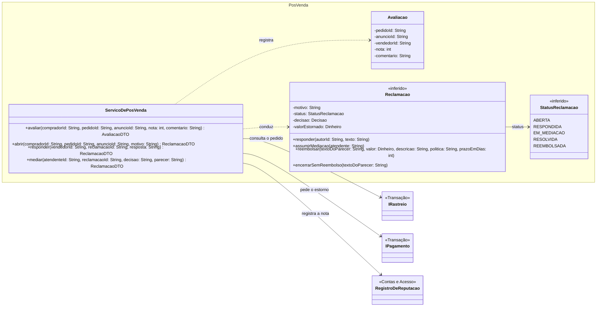

<p align="center"><strong>Figura 6: Pacote Pós-venda.</strong> <em>Fonte: Diagrama de Classes e Diagrama de Atividades (Entrega 02) e código de <code>app/src/comercio/posvenda</code> (Entrega 04).</em></p>

| Classe | Responsabilidade arquitetural | Origem |
| :-- | :-- | :-- |
| `Avaliacao` | Registro imutável da nota (1 a 5) e do comentário sobre a oferta de um vendedor. É dela que a reputação do vendedor é derivada. A regra "uma avaliação por item do pedido" é garantida pelo `ServicoDePosVenda`, que conhece as demais avaliações. | Implementado (`posvenda/dominio/Avaliacao.java`). Origem observada: RN-A05, RF-A05; Diagrama de Classes, decisões 1 e 9 |
| `Reclamacao` «inferido» | Conduz o ciclo `ABERTA`, `RESPONDIDA`, `EM_MEDIACAO` e o desfecho `REEMBOLSADA` ou `RESOLVIDA`, conferindo em cada transição quem a pede. Recusa qualquer transição fora desse desenho; como os estados finais não aceitam novas transições, a mesma reclamação não pode ser reembolsada duas vezes. | Implementado (`posvenda/dominio/Reclamacao.java`). Origem inferida: processo 3 do Rich Picture da Entrega 01 ("Jenny reclama, atendimento media com o vendedor, e retorna com resposta ou reembolso"); Limites do modelo do Diagrama de Classes: "inferidos do Rich Picture, não observados" |
| `StatusReclamacao` «inferido» | Situações da reclamação. `encerrada()` identifica os estados finais. | Implementado (`posvenda/dominio/StatusReclamacao.java`). Origem inferida: mesma origem de `Reclamacao`; valores do Diagrama de Atividades (Entrega 02) |
| `ServicoDePosVenda` | Fornece `IReclamacao` e requer `IRastreio` e `IPagamento` da Transação. Confere o papel de quem age contra a conta e o pedido, sem aceitá-lo do cliente, e é o único caminho pelo qual uma avaliação altera a reputação. | Implementado (`posvenda/aplicacao/ServicoDePosVenda.java`). Componente Serviço de Pós-venda do Diagrama de Componentes (Entrega 02); UC17 a UC21 |

**Divergências entre o modelo e o código.**

- **Classes inferidas com código.** `Reclamacao`, `StatusReclamacao` e `Atendente` (este em Contas e Acesso, `contas/dominio/Atendente.java`) existem na Entrega 04, mas continuam com origem inferida: o fluxo de reclamação não é acessível sem uma compra real e não foi observado na Engenharia Reversa. Ter código mostra que o modelo é coerente e executável, e não que corresponde à plataforma real.
- **`StatusReclamacao` mudou de valores.** O modelo tem `AGUARDANDO_VENDEDOR`. O código usa `ABERTA` para o intervalo até a resposta e acrescenta `RESPONDIDA`, para o atendimento saber se há versão do vendedor antes de decidir.
- **`Reclamacao.encerrar(desfecho)` foi dividida.** O código tem `assumirMediacao`, `reembolsar` e `encerrarSemReembolso`, e acrescenta a enumeração interna `Decisao` (`PROCEDENTE`, `IMPROCEDENTE`), que o modelo não tem. Não há `abertaEm`; o histórico fica em uma linha do tempo. O modelo associa a reclamação a um `Envio`, e o código identifica o envio pelos identificadores do pedido e do vendedor.
- **A regra inferida do reembolso automático não foi implementada.** O Diagrama de Atividades da Entrega 02 encerra a reclamação como `REEMBOLSADA` quando o prazo do vendedor se esgota sem resposta, regra marcada ali como inferida. No código, o reembolso só ocorre por decisão do atendimento.
- **Fórmula da reputação.** O Diagrama de Classes registra que a fórmula não é observável. O código adota a média aritmética das notas e a marca como `INFERIDO` (`contas/dominio/Reputacao.java`). `Avaliacao` não tem o atributo `data` do modelo e ganhou `pedidoId`.

### 5.2.5 Dependências entre pacotes de domínio

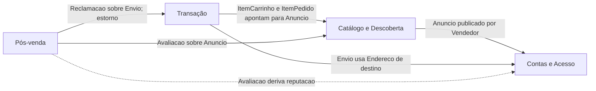

<p align="center"><strong>Figura 7: Dependências entre os pacotes de domínio.</strong> <em>Autor: João Paulo Barbosa Pereira Nunes.</em></p>

O grafo é acíclico com uma única exceção conhecida: `Vendedor./reputacao` (Contas e Acesso) é derivada de `Avaliacao` (Pós-venda), enquanto `Avaliacao` depende, indiretamente, de `Vendedor` via `Anuncio`. A seta tracejada registra essa dependência **de dado derivado**, discutida como limitação na [Seção 5.6](#56-limitações-do-modelo-lógico).

---

## 5.3 Decisões Arquiteturais e Análise Crítica

### 1. Reconciliar camadas e domínio em vez de escolher um dos dois

O Diagrama de Pacotes (José Joaquim da Silva Neto) e o Diagrama de Classes (Pedro Luciano de Azevedo) foram feitos em paralelo e chegaram a decomposições diferentes. A alternativa mais simples seria adotar apenas um deles na Visão Lógica. Optou-se por mantê-los como dimensões ortogonais porque cada um responde a uma pergunta diferente: as camadas controlam **a direção das dependências técnicas**; os pacotes de domínio controlam **o acoplamento entre assuntos de negócio**. Um modelo só com camadas esconderia que `Transação` depende de `Catálogo` (e não o contrário); um modelo só com domínio esconderia que nenhuma classe de `Model` pode conhecer um `Controller`.

### 2. Autenticação como subpacote explícito

O próprio Diagrama de Pacotes da Entrega 02 registrou como limitação a **ausência de uma camada de segurança e autenticação** (seção 7 daquele documento). A Entrega 03 preencheu essa lacuna na prática, com quatro padrões aplicados ao login. A Visão Lógica formaliza o resultado: Autenticação passa a ser um subpacote de `Contas e Acesso`, com papéis distribuídos entre Controller (coordenação), Builder (montagem do contexto), Chain of Responsibility (validação) e Facade (emissão da sessão). Essa é a principal evolução arquitetural desta visão em relação aos artefatos anteriores.

### 3. Padrões de projeto como mecanismos internos, não como pacotes

Uma tentação seria criar pacotes chamados `observer`, `state` ou `factory`, espelhando a organização das pastas da Entrega 03. Isso foi evitado: padrões são **soluções aplicadas dentro de um pacote de domínio**, e não assuntos de negócio. O Observer pertence a `Transação` porque reage a mudanças de `Pagamento`; o Decorator pertence a `Catálogo e Descoberta` porque refina a busca. Organizar por padrão espalharia um mesmo assunto de negócio por vários pacotes técnicos.

### 4. Inversão de dependência aplicada aos sistemas externos

A Operadora de Pagamento e a Transportadora são acessadas apenas por interfaces definidas no domínio (`IAutorizacao`, `ICotacaoEntrega`, e no código, `Autorizador` da Abstract Factory). Assim, trocar de operadora exige uma nova família de classes, sem alteração em `Pedido` ou `Pagamento`. A mesma regra **não** foi aplicada uniformemente à persistência, inconsistência já reconhecida no Diagrama de Pacotes (seção 2.3) e mantida aqui de forma consciente para não inventar uma estrutura que nenhum artefato anterior modelou.

### 5. Monólito lógico, distribuição física opaca

A Visão Lógica descreve uma única aplicação em camadas, enquanto a Visão de Implantação mostra o backend como um nó opaco que, segundo fontes públicas, é composto por milhares de microsserviços. As duas visões não se contradizem: a Visão Lógica organiza **responsabilidades**, não processos. Cada pacote de domínio corresponde a um conjunto de componentes (tabela da [Seção 5.1](#51-visão-geral-camadas-e-hierarquia-de-pacotes)) que poderia ser implantado de forma independente sem alterar o modelo lógico. Essa é, inclusive, a trajetória real documentada da empresa (monólito Java em camadas que evoluiu para microsserviços), já discutida no Diagrama de Pacotes da Entrega 02.

---

## 5.4 Legenda de Confiança da Evidência

Como na [Seção 6.4](#64-legenda-de-confiança-da-evidência), cada elemento da Visão Lógica é classificado pelo grau de certeza da evidência que o sustenta. Aqui as categorias respondem a duas perguntas diferentes. **Implementado** e **modelado** dizem onde a classe existe: no código da Entrega 04 ou só no Diagrama de Classes da Entrega 02. **Observado** e **inferido** dizem de onde ela veio: da Engenharia Reversa da Entrega 01 ou de uma dedução. Uma classe pode, portanto, ser implementada e ter origem inferida, como `Reclamacao`. Nas tabelas das Seções 5.2.2 a 5.2.4, a coluna Origem traz primeiro onde a classe existe e depois de onde ela veio.

| Categoria | Critério | Método de coleta | Representação nos diagramas da 5.2 | Exemplos nas Seções 5.2.1 a 5.2.4 |
| :-- | :-- | :-- | :-- | :-- |
| **Observado** | Vem da Engenharia Reversa da Entrega 01: regra de negócio (RN), requisito funcional (RF) ou inspeção do DOM | Navegação na interface pública e inspeção do DOM, registradas nos Recortes A, B e C da Engenharia Reversa | Sem estereótipo próprio. Aparece na coluna Origem pelo código da RN ou do RF | `CEP` com oito dígitos sem separador (RN-B04, 5.2.1); contagem prévia de `Faceta` (RN-A03, 5.2.2); agrupamento por vendedor em `Carrinho` e `Envio` (RN-B01, 5.2.3); nota e reputação na listagem, origem de `Avaliacao` (RN-A05, 5.2.4) |
| **Modelado** | Está em um diagrama da Entrega 02 e não tem classe ou método correspondente em `app/src` da Entrega 04 | Leitura do Diagrama de Classes, do SVG exportado e do Diagrama de Atividades, seguida de busca pelo nome em `app/src` | Não é desenhado nos diagramas das Seções 5.2.2 a 5.2.4. Aparece só nas listas de divergências | `Comprador.abrirReclamacao` e `Atendente.mediar` (5.2.1); `Catalogo` e `vincular` (5.2.2); `Carrinho.finalizar()`, `Envio.codigoRastreio` e seis dos doze valores de `StatusPedido` (5.2.3); reembolso automático por ausência de resposta do vendedor (5.2.4) |
| **Implementado** | A classe existe em `app/src` da Entrega 04 | Busca por `class`, `interface` ou `enum` com o nome em `app/src`; execução da suíte de testes e da verificação de arquitetura ([Seção 5.5](#55-evidência-de-execução)) | Toda classe desenhada dentro de um `namespace` nas Seções 5.2.2 a 5.2.4 é implementada. O papel GoF aparece como estereótipo, e o arquivo, na coluna Origem. Classes de outro pacote aparecem sem membros, com o nome do pacote como estereótipo | `Usuario`, `Endereco` e `CEP` (5.2.1); `Produto` e `RefinamentoDecorator` (5.2.2); `Pedido`, `EstadoPedido` e `FabricaMeioPagamento` (5.2.3); `Avaliacao` e `Reclamacao` (5.2.4) |
| **Inferido** | Deduzido sem observação: da coerência entre artefatos, do Rich Picture ou da necessidade de tornar o modelo executável | Dedução registrada nos Limites do modelo do Diagrama de Classes e nos comentários `INFERIDO` do código ([Seção 5.5.5](#555-limites-desta-evidência)) | Estereótipo «inferido» na classe quando a classe inteira é inferida. Quando só um valor ou regra é inferido, a marcação fica na tabela, e não no diagrama | `Atendente` (5.2.1, sem a marcação naquele diagrama); critério dos termos alternativos e limite de parcelas (5.2.2); `ServicoDeEntrega` e tabela de frete da `TransportadoraSimulada` (5.2.3); `Reclamacao`, `StatusReclamacao` e fórmula da reputação (5.2.4) |

---

## 5.5 Evidência de Execução

A Visão Lógica das seções 5.1 e 5.2 não ficou só no desenho: ela está implementada na pasta [`app/`](https://github.com/UnBArqDsw2026-2-Turma01/2026.2-T01-_G1_ProjetoComercioEletronico_Entrega_04/tree/main/app) do repositório e roda com um comando. A aplicação reaproveita o código Java dos padrões da Entrega 03 e o distribui nas camadas e nos pacotes de domínio desta visão: cada pacote Java tem a forma `comercio.<domínio>.<camada>`, que é a matriz "camadas × pacotes de domínio" da Figura 2 escrita no nome do pacote.

Esta seção reúne três evidências que se complementam:

1. as regras de dependência da seção 5.1 e da Figura 7, **verificadas automaticamente sobre o código-fonte** (5.5.2);
2. as funcionalidades **em execução no navegador**. Cada tela traz, à direita, o painel "Arquitetura em execução", que mostra os casos de uso, as linhas da matriz e as classes que a própria rota declara no código (5.5.3);
3. o cenário de compra de ponta a ponta **CA-01 executado no terminal** (5.5.4).

### 5.5.1 Como executar

Requisito único: JDK 11 ou superior. Não há biblioteca externa nem etapa de instalação.

```bash
cd app
make run          # sobe a loja em http://localhost:8080
make verificar    # compila e executa todos os testes, inclusive o de arquitetura
make arquitetura  # executa só a verificação das regras de dependência
make demo         # cenário CA-01 no terminal
```

No Windows, os comandos rodam no Git Bash. Para os testes, informe o separador de classpath do sistema: `make verificar CPT='"out/principal;out/teste"'`.

### 5.5.2 Regras da Visão Lógica verificadas sobre o código

As tabelas "Regras de dependência entre camadas" (5.1) e "Dependências entre pacotes de domínio" (5.2.5) estão transcritas em [`RegrasDeArquitetura.java`](https://github.com/UnBArqDsw2026-2-Turma01/2026.2-T01-_G1_ProjetoComercioEletronico_Entrega_04/blob/main/app/teste/comercio/arquitetura/RegrasDeArquitetura.java). O teste de arquitetura lê as importações de todos os arquivos de `app/src`. Se alguma violar uma regra, ele falha e aponta o arquivo, a importação e a seção do DAS violada. Saída de `make arquitetura` em 22/11/2026:

```text
comercio.arquitetura.ArquiteturaTeste
         170 arquivos verificados, nenhum isento
  ok     DAS 5.1 e 5.2.5: nenhuma importacao do codigo real viola as regras de dependencia
  ok     DAS 5.2.5: os pacotes de dominio so dependem no sentido da figura
  ok     DAS 5.1: o Dominio nao depende de nenhuma outra camada
  ok     DAS 5.1: o Controle so conhece a Aplicacao
  ok     DAS 5.1: Aplicacao nao depende do Controle; Persistencia so do Dominio
  ok     DAS 5.3: sistemas externos so entram por porta do dominio
  ok     nucleo e infraestrutura nao conhecem o negocio; nao ha mais area de espera
  ok     sem biblioteca de terceiros e sem interface grafica dentro das camadas
  ok     pacote fora da matriz dominio x camada e apontado

1 suite(s), 9 caso(s), 0 falha(s)
```

A suíte completa (`make verificar`) tem **22 suítes e 199 casos, com 0 falhas**. O nome de cada caso começa pelo código da regra de negócio, do caso de uso ou do ADR que ele verifica. Isso liga o teste à matriz da seção 8.3:

| Pacote | Casos | Exemplos de casos verificados |
| :-- | :-: | :-- |
| Catálogo e Descoberta | 63 | `RN-A03`: a contagem prévia de cada faceta é o total obtido ao aplicar aquele filtro; `UC30`: filtrar antes de paginar; `RN-A06`: a busca é reproduzida a partir da URL |
| Transação | 51 | `ADR-05`: o checkout é tudo ou nada; `ADR-05`: um pedido pago não é cobrado de novo; `ADR-02`: o serviço funciona com uma família de pagamento que ele nunca viu |
| Pós-venda | 27 | `UC17 e RN-A05`: a reputação do vendedor muda depois da avaliação; `UC21`: o segundo reembolso da mesma reclamação é recusado |
| Infraestrutura | 22 | regra de negócio violada vira HTTP 422 com o código da regra; toda resposta carrega a rastreabilidade declarada pela rota |
| Contas e Acesso | 18 | `Chain`: sem desafio de captcha, a cadeia para no primeiro elo; `ValidadorRisco`: dispositivo novo exige segundo fator |
| Arquitetura | 9 | as regras das seções 5.1, 5.2.5 e 5.3, listadas acima |
| Composição | 5 | `CA-01`: o anúncio achado na busca é o mesmo que o pedido reserva, paga e entrega |
| Núcleo | 4 | parcelar não perde centavos |

### 5.5.3 Funcionalidades em execução

Em toda tela, o painel "Arquitetura em execução" é desenhado a partir do campo `arquitetura` que acompanha cada resposta da API. Esse campo traz os casos de uso (seção 4), as linhas da matriz (seção 8.3) e as classes que a rota declara, da camada mais externa para a mais interna. A cor de cada classe indica a camada e é deduzida do nome: Controle em roxo, Aplicação em verde e as demais em laranja. Traz também o **mecanismo**, uma frase que diz qual padrão de projeto atuou naquela chamada. Assim, a rastreabilidade deixa de ser uma tabela mantida à mão e passa a ser um dado do próprio código.

| Figura | Funcionalidade | Casos de uso | Matriz | Padrão em execução | Pacote |
| :-: | :-- | :-- | :-: | :-- | :-- |
| E1 | Rastreabilidade de todas as rotas | todos | todas | — | infraestrutura |
| E2 | Login em quatro elos | UC22 | TR-08 | Builder, Chain of Responsibility, Facade, Controller GRASP | Contas e Acesso |
| E3 | Busca refinada | UC01, UC03, UC04, UC30 | TR-01 | Decorator, com a cadeia montada por consulta | Catálogo e Descoberta |
| E4 | Busca sem resultado | UC01 | TR-01 | Decorator (`ComTermosAlternativos`) | Catálogo e Descoberta |
| E5 | Ficha do produto com frete | UC05, UC06, UC07 | TR-02, TR-03 | Porta `IFrete` (inversão de dependência) | Catálogo e Descoberta |
| E6 | Pagamento do pedido | UC12, UC24, UC25 | TR-05 | Abstract Factory, Observer, State | Transação |
| E7 | Mediação e reembolso | UC17 a UC21 | TR-03, TR-09 | Abstract Factory (política de estorno) | Pós-venda |

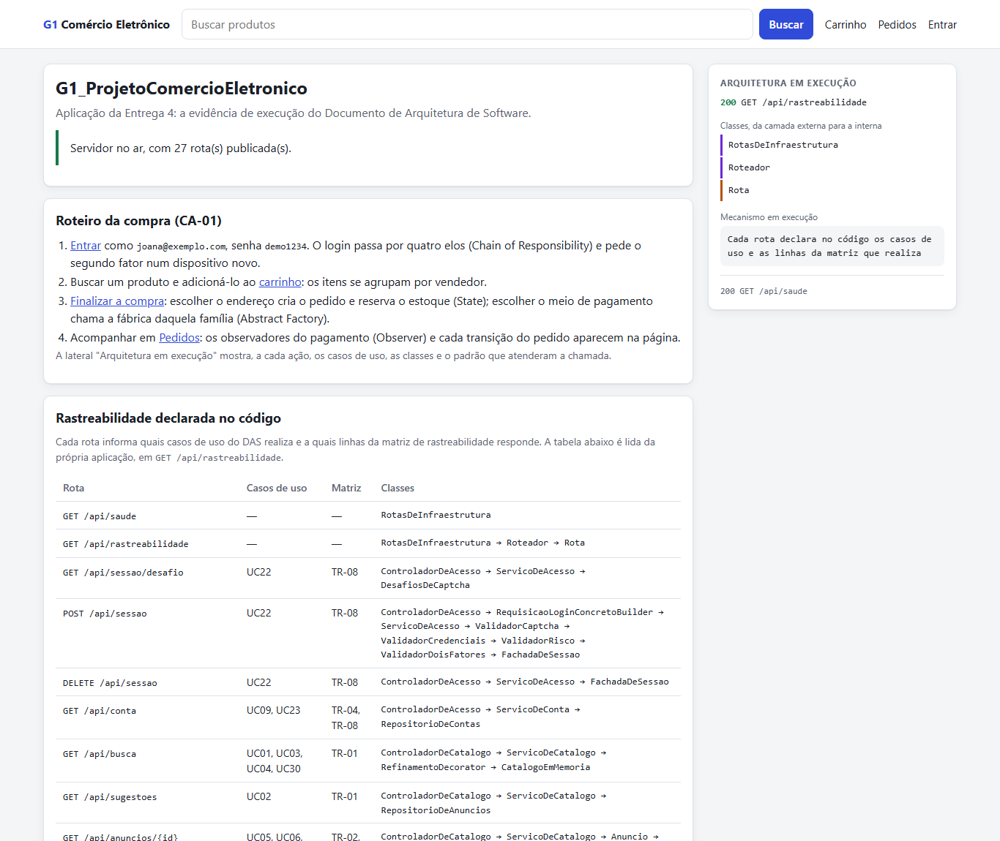

<p align="center"><strong>Figura E1: Rastreabilidade declarada no código.</strong> A tabela é lida de <code>GET /api/rastreabilidade</code>: cada rota informa os casos de uso e as linhas da matriz que realiza e as classes que participam da chamada. <em>Autor: Pedro Luciano de Azevedo.</em></p>

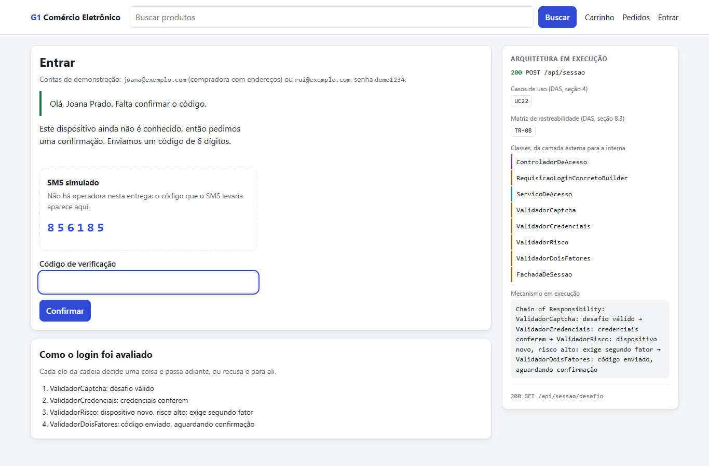

<p align="center"><strong>Figura E2: Login (UC22).</strong> Os quatro elos da Chain of Responsibility (captcha, credenciais, risco e segundo fator) aparecem na página e no mecanismo. O dispositivo é novo, então o elo de risco exige o segundo fator, e o código chega por um SMS simulado. As classes vão do Controller GRASP ao Builder e à Facade que emite a sessão. <em>Autor: Pedro Luciano de Azevedo.</em></p>

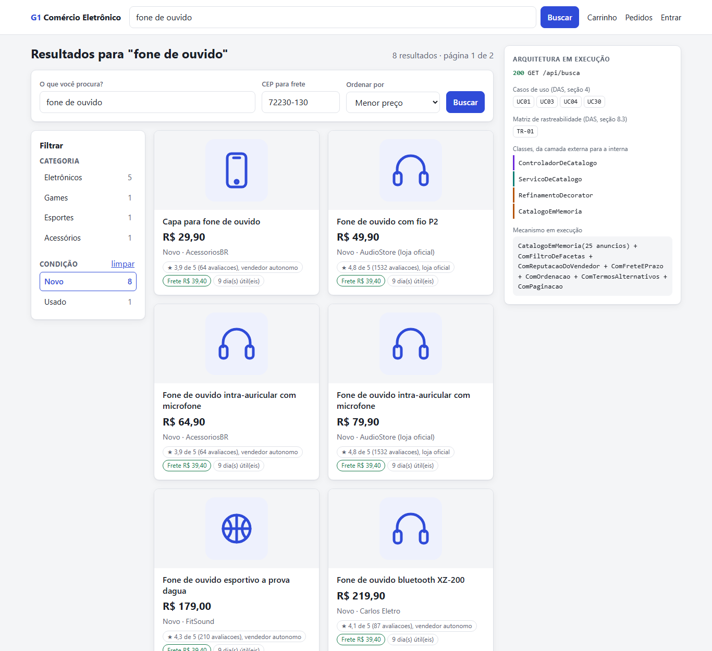

<p align="center"><strong>Figura E3: Busca refinada (UC01, UC03, UC04, UC30).</strong> O mecanismo mostra a pilha de decoradores que o <code>ServicoDeCatalogo</code> montou para esta consulta. Com CEP informado, entra <code>ComFreteEPrazo</code>, que pergunta o frete pela porta <code>IFrete</code>. Com ordenação por menor preço, entra <code>ComOrdenacao</code>. Sem CEP e por relevância, esses dois não são empilhados. As facetas trazem a contagem prévia (RN-A03), e o estado da busca vive na URL da página (RN-A06). <em>Autor: Pedro Luciano de Azevedo.</em></p>

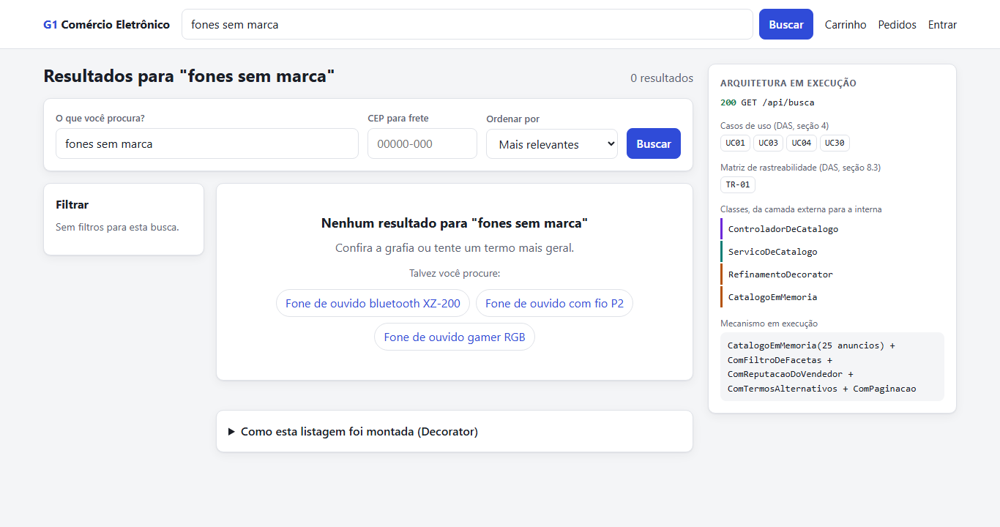

<p align="center"><strong>Figura E4: Busca sem resultado (RN-A01).</strong> Em vez de uma tela vazia, o decorador <code>ComTermosAlternativos</code> oferece até três títulos do acervo que compartilham alguma palavra com o termo buscado. <em>Autor: Pedro Luciano de Azevedo.</em></p>

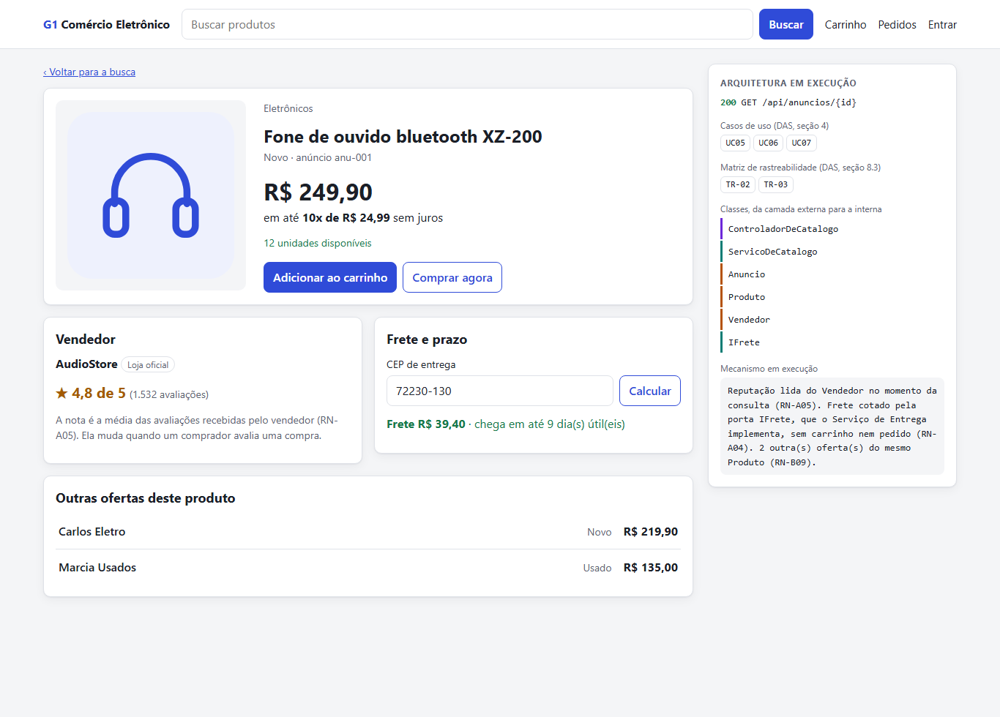

<p align="center"><strong>Figura E5: Ficha do produto (UC05, UC06, UC07).</strong> O frete é cotado antes de existir carrinho ou pedido (RN-A04), pela porta <code>IFrete</code>. A porta é declarada no Catálogo e implementada pelo Serviço de Entrega, na Transação, de modo que o Catálogo não importa a Transação. A reputação do vendedor é lida no momento da consulta (RN-A05), e as outras ofertas do mesmo produto aparecem em bloco separado (RN-B09). <em>Autor: Pedro Luciano de Azevedo.</em></p>

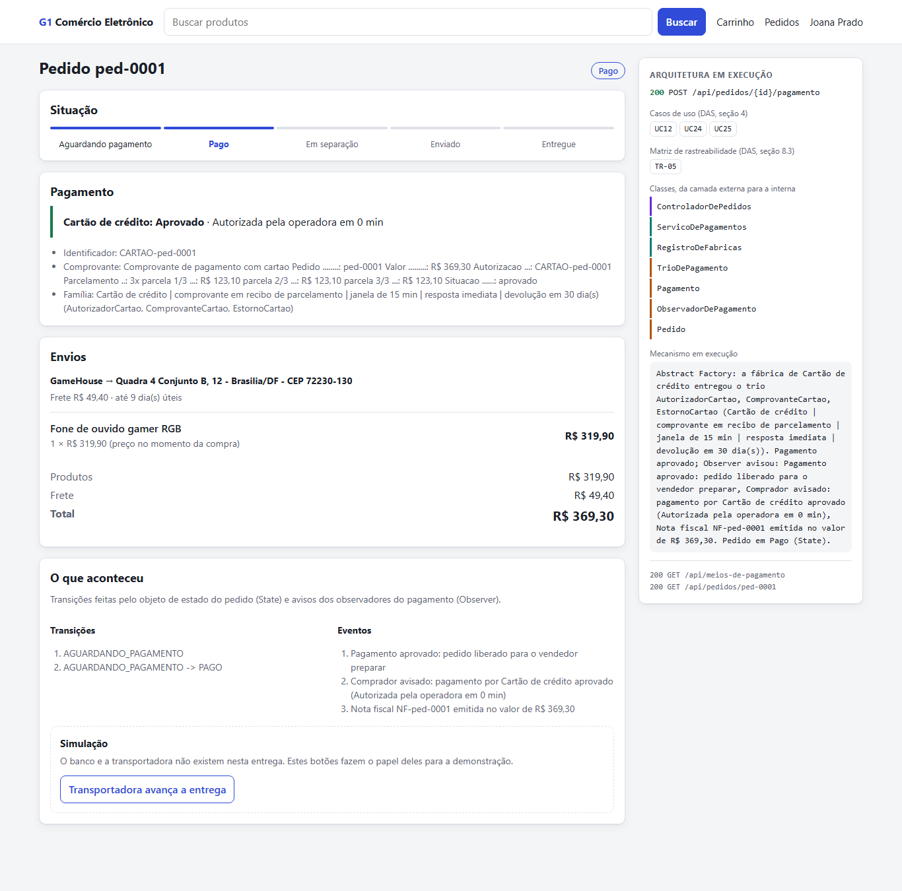

<p align="center"><strong>Figura E6: Pagamento do pedido (UC12, UC24, UC25).</strong> A fábrica da família Cartão entregou o trio coerente <code>AutorizadorCartao</code>, <code>ComprovanteCartao</code> e <code>EstornoCartao</code> (Abstract Factory). O pagamento aprovado avisou os observadores: pedido liberado, comprador avisado e nota fiscal emitida (Observer). O pedido passou de AGUARDANDO_PAGAMENTO para PAGO pelo objeto de estado (State). <em>Autor: Pedro Luciano de Azevedo.</em></p>

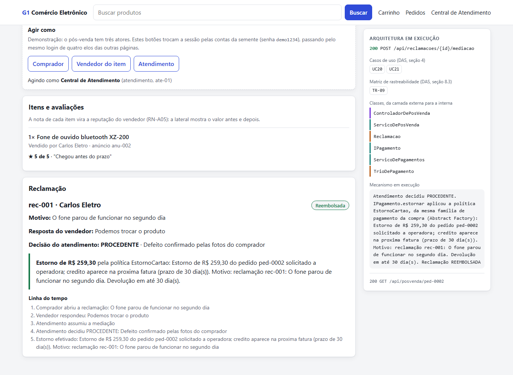

<p align="center"><strong>Figura E7: Mediação e reembolso (UC17 a UC21).</strong> A compradora avaliou o item, e a nota passou a compor a reputação do vendedor (RN-A05). Depois abriu uma reclamação, o vendedor respondeu e o atendimento decidiu pela procedência. O Pós-venda pediu o estorno pela interface <code>IPagamento</code>, e a Transação aplicou a política <code>EstornoCartao</code>, da mesma família que autorizou a compra. A reclamação só foi marcada como REEMBOLSADA depois de o estorno ser efetivado. <em>Autor: Pedro Luciano de Azevedo.</em></p>

### 5.5.4 Cenário CA-01 no terminal

`make demo` executa a compra completa sem servidor e informa, a cada passo, os casos de uso, a linha da matriz e o padrão que trabalhou. Trecho da saída em 22/11/2026, com algumas linhas omitidas:

```text
1. Buscar e refinar
[UC01, UC03, UC04, UC06, UC07 | TR-01, TR-02 | Decorator em catalogo.dominio]
  cadeia montada : CatalogoEmMemoria(25 anuncios) + ComFiltroDeFacetas + ComOrdenacao + ComFreteEPrazo + ComReputacaoDoVendedor
  consulta (URL) : /busca?termo=fone+de+ouvido&condicao=NOVO&ordem=MENOR_PRECO&pagina=1&cep=72230-130
  resultados     : 8
  O frete veio do Servico de Entrega pela porta IFrete: o Catalogo nao importa a Transacao.

3. Finalizar a compra
[UC10 (inclui UC09) | TR-05 | State nasce em AGUARDANDO_PAGAMENTO]
  pedido ped-0001 | situacao AGUARDANDO_PAGAMENTO
  envio de AudioStore: 2 item(ns), frete R$ 49,40, 9 dia(s)
  envio de GameHouse: 1 item(ns), frete R$ 49,40, 9 dia(s)
  subtotal R$ 869,60 + frete R$ 98,80 = total R$ 968,40

4. Escolher o meio e pagar
[UC12, UC24, UC25 | TR-05 | Abstract Factory + Observer em transacao.dominio.pagamento]
  tentativa 1, saldo em conta: RECUSADO (Saldo insuficiente: disponivel R$ 500,00, necessario R$ 968,40)
  tentativa 2, cartao        : APROVADO | trio [AutorizadorCartao, ComprovanteCartao, EstornoCartao]
  pedido agora esta PAGO
  cobrar de novo -> recusa ADR-05: O pedido ped-0001 não aguarda pagamento: está pago

5. Acompanhar o envio
[UC13, UC26, UC27 | TR-05 | State em transacao.dominio.pedido]
  AGUARDANDO_PAGAMENTO -> PAGO
  PAGO -> EM_SEPARACAO
  EM_SEPARACAO -> ENVIADO
  ENVIADO -> ENTREGUE
```

### 5.5.5 Limites desta evidência

- **Persistência em memória.** Os dados voltam à semente a cada execução, e a garantia de "tudo ou nada" do checkout vem de compensação em memória, não de transação de banco de dados (ADR-05).
- **Sistemas externos simulados.** Transportadora, operadora de pagamento, captcha e envio do código de verificação são simuladores. Eles ficam atrás das portas do domínio (decisão 4 da seção 5.3), e os valores que não foram observados na Engenharia Reversa estão marcados como `INFERIDO` no código.
- **Ambiente das capturas.** As figuras e as saídas foram obtidas em 22/11/2026, com JDK 21, a partir das branches `feat/catalogo-descoberta` e `feat/posvenda` integradas e com os controladores do Catálogo e do Pós-venda registrados na raiz de composição (`comercio.Aplicacao`).
- **Escala.** A aplicação é um monólito lógico executado em um único processo, e não a topologia da Visão de Implantação (seção 6). Ela evidencia a organização de responsabilidades desta visão, e não a distribuição física (decisão 5 da seção 5.3).

---

## 5.6 Limitações do Modelo Lógico

1. **Módulos executáveis não integrados:** o código da Entrega 03 está organizado por padrão, e não por pacote lógico. Existem, por exemplo, versões diferentes de `RequisicaoLogin` nos módulos do Builder, do Chain of Responsibility e do GRASP Controller. A Visão Lógica as trata como a mesma classe conceitual, mas o código ainda não reflete essa unificação.
2. **Autenticação ausente no Diagrama de Componentes:** o subpacote Autenticação não tem componente correspondente no Diagrama de Componentes da Entrega 02. Na Visão de Implantação, ele está contido implicitamente no Backend de API. Uma revisão futura do Diagrama de Componentes deveria incluir um `Serviço de Identidade` com interface própria.
3. **Dependência de dado derivado entre Pós-venda e Contas:** `Vendedor./reputacao` depende de `Avaliacao`. Em uma implementação real, essa dependência seria resolvida por evento (o que o próprio Observer da Entrega 03 sugere como mecanismo), e não por referência direta.
4. **Persistência sem abstração uniforme:** como já apontado no Diagrama de Pacotes, `Repository` não é tratado por interface, ao contrário dos sistemas externos.
5. **Modelo, não engenharia reversa do código real:** o código-fonte do Mercado Livre é fechado. Todo o interior desta visão é uma hipótese coerente com o comportamento observado, e não uma reprodução da implementação real.

---

# 6. Visão de Implantação

A **Visão de Implantação** descreve a configuração física da rede, os nós computacionais e os caminhos de comunicação que executam o software do sistema. Esta seção consolida a reconstrução da infraestrutura em produção a partir de evidências técnicas verificáveis, integrando a fundamentação de infraestrutura da [Entrega 02](https://unbarqdsw2026-2-turma01.github.io/2026.2-T01-_G1_ProjetoComercioEletronico_Entrega_02/#/Base/Relat%C3%B3rios/Subequipe03/ModelagemEstatica/DiagramaDeImplantacao) com a decomposição modular do [Diagrama de Componentes](https://unbarqdsw2026-2-turma01.github.io/2026.2-T01-_G1_ProjetoComercioEletronico_Entrega_02/#/Base/Relat%C3%B3rios/Subequipe01/ModelagemEstatica/DiagramaDeComponentes).

---

## 6.1 Visão Geral e Topologia Física

A infraestrutura física é estruturada em três macroambientes:

1. **Ambiente do Cliente:** Compreende as duas aplicações clientes (Desktop Web SPA e Mobile App) executando nos dispositivos dos usuários finais, conectadas à rede de acesso local.
2. **Ponto de Troca de Tráfego (IX.br-SP):** PTT metropolitano onde ocorre o roteamento BGP direto para a rede autônoma da Amazon (AS16509).
3. **Provedor de Nuvem (Amazon Web Services - AS16509):** Nuvem corporativa segregada contendo a camada de DNS (Route 53), a borda de CDN (CloudFront), servidores web de aceleração (Tengine), buckets de armazenamento (S3) e o cluster de serviços de backend.

### Diagrama de Implantação

<div style="text-align:center;">

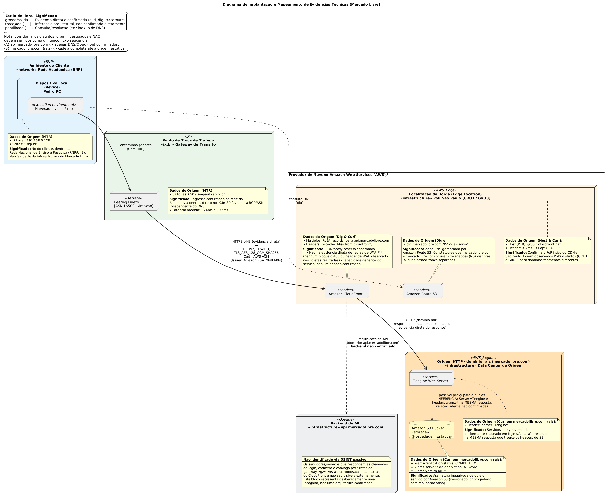

<p><strong>Figura 8: Diagrama de Implantação do Sistema</strong> — Reconstrução da infraestrutura física e de rede via OSINT passivo. <em>Autor: Pedro Henrique Gomes (Entrega 02).</em></p>

</div>

---

### Diagrama Arquitetural de Implantação (Notação Estrutural de Nós)

O diagrama a seguir detalha as relações de nós físicos, ambientes de execução e protocolos de comunicação:

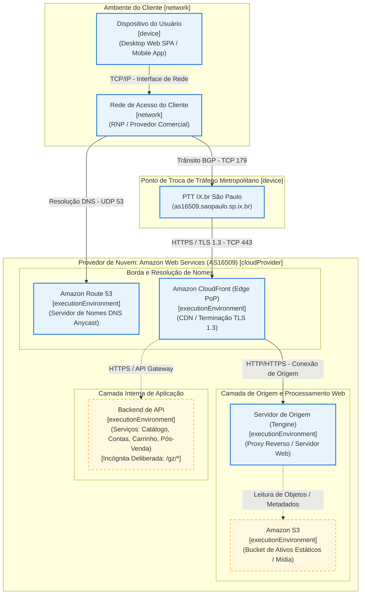

---

## 6.2 Decomposição dos Nós e Mapeamento de Componentes

A tabela a seguir correlaciona os nós físicos e ambientes de execução da Visão de Implantação com os componentes modulares do sistema:

| Nó / Elemento de Modelo          | Estereótipo              | Componentes de Software Mapeados                                                                                                                                                                                         | Evidência Técnica de Rastreio                                                            |
| :------------------------------- | :----------------------- | :----------------------------------------------------------------------------------------------------------------------------------------------------------------------------------------------------------------------- | :--------------------------------------------------------------------------------------- |
| **Dispositivo do Usuário**       | `«device»`               | `Aplicação Web SPA` (Desktop Browser) e `Aplicativo Móvel` (Smartphone).                                                                                                                                                 | Origem das requisições observadas nos fluxos de Busca e Checkout.                        |
| **Ambiente de Acesso**           | `«network»`              | Roteamento de pacotes do usuário até o trânsito autônomo.                                                                                                                                                                | Saltos iniciais identificados via `mtr` e `traceroute`.                                  |
| **IX.br São Paulo**              | `«device»`               | Ponto de conexão física com o sistema autônomo da Amazon (AS16509).                                                                                                                                                      | Salto `as16509.saopaulo.sp.ix.br` detectado via traceroute.                              |
| **Amazon Route 53**              | `«executionEnvironment»` | Resolução autoritativa de DNS com latência otimizada Anycast.                                                                                                                                                            | Consultas `dig NS` apontando para quatro servidores mundiais AWS.                        |
| **Amazon CloudFront**            | `«executionEnvironment»` | Borda de entrega rápida (CDN), terminação TLS 1.3 e cache regional de assets de catálogo.                                                                                                                                | Respostas HTTP contendo cabeçalhos `x-amz-cf-pop` e `x-cache: Hit/Miss from cloudfront`. |
| **Servidor de Origem (Tengine)** | `«executionEnvironment»` | Proxy reverso de alta concorrência e entrega da página raiz do e-commerce.                                                                                                                                               | Cabeçalho `server: Tengine` na requisição ao domínio raiz.                               |
| **Amazon S3**                    | `«executionEnvironment»` | Repositório de mídias de produtos (Recorte A) e upload de fotos de anúncios (Recorte C).                                                                                                                                 | Cabeçalhos `x-amz-server-side-encryption` e `x-amz-version-id`.                          |
| **Backend de API**               | `«executionEnvironment»` | Orquestração dos subsistemas modulares: `Serviço de Contas e Endereços`, `Serviço de Catálogo` (provê `ICatalogo`, requer `IFrete`), `Serviço de Carrinho` e `Serviço de Pós-Venda` (requer `IPagamento` e `IRastreio`). | Rotas com prefixo `/gz/*` e diretivas no arquivo `robots.txt`.                           |

---

## 6.3 Decisões Arquiteturais e Análise Crítica de Evidências

A modelagem da Visão de Implantação fundamenta-se nas seguintes decisões críticas de engenharia:

### 1. Separação Estrita de Domínios (Cliente vs. Trânsito vs. Nuvem)

Um equívoco comum em modelagens arquiteturais baseadas em tráfego de rede é incorporar roteadores intermediários do provedor de acesso do analista como se fossem componentes da empresa-alvo. O diagrama isola deliberadamente os saltos de rede sob o estereótipo `«network» Ambiente do Cliente`, garantindo que apenas os nós de propriedade ou contratação da plataforma façam parte do domínio de nuvem.

### 2. O Peering via IX.br como Evidência Independente de DNS

A identificação do nó `as16509.saopaulo.sp.ix.br` constitui uma evidência independente da cadeia de DNS: o **AS 16509** é o número de sistema autônomo registrado publicamente para a _Amazon.com, Inc._. Essa informação comprova que, ao transitar pelo IX.br em São Paulo, os pacotes ingressam diretamente na rede privada da nuvem AWS, sem intermediação de operadoras terceiras, viabilizando menor latência e maior segurança.

### 3. O "Backend de API" como Incógnita Deliberada e Subsistemas Integrados

As rotas de backend (como `api.mercadolibre.com`) e os serviços transacionais foram confirmados até a camada de CDN (CloudFront). Internamente, o arquivo `robots.txt` e o tráfego HTTP revelam rotas especializadas como `/gz/*`.
Ao cruzarmos esses achados com a decomposição do Diagrama de Componentes, compreende-se que esse nó opaco abriga os subsistemas desacoplados (`Contas/Endereços`, `Catálogo`, `Carrinho` e `Pós-Venda`). A segregação desses serviços através de contratos de interfaces explícitas (`ICatalogo`, `IFrete`, `IPagamento`) viabiliza a independência de falhas, de modo que uma sobrecarga na busca de catálogo não inviabilize o fechamento de pedidos em andamento.

### 4. Coexistência Tengine e S3 no Domínio Raiz

Na inspeção do domínio raiz (`mercadolibre.com`), constatou-se a presença simultânea do cabeçalho `server: Tengine` e de metadados característicos do Amazon S3 (`x-amz-version-id`). Essa configuração aponta para um servidor Tengine atuando como camada de proxy frontal com cache dinâmico conectada a um bucket S3 de origem. Essa relação foi classificada como inferência arquitetural e representada com aresta tracejada.

### 5. Deliberação sobre a Capacidade "WAF" no CloudFront

A inclusão de componentes de _Web Application Firewall_ (WAF) associados ao CloudFront foi expressamente evitada. Embora o CloudFront ofereça suporte nativo ao AWS WAF, nenhum cabeçalho ou evento de bloqueio observado por meio de requisições padrão confirma que essa funcionalidade esteja ativada na rota inspecionada. Tratar uma capacidade potencial como componente real violaria o rigor empírico do artefato.

---

## 6.4 Legenda de Confiança da Evidência

Para assegurar total transparência entre a notação UML oficial e a natureza da engenharia reversa, adotou-se o seguinte padrão de representação:

| Estilo Gráfico no Diagrama | Grau de Certeza                            | Método de Coleta                                       | Exemplos no Diagrama                                          |
| :------------------------- | :----------------------------------------- | :----------------------------------------------------- | :------------------------------------------------------------ |
| **Linha Sólida Contínua**  | **Evidência Direta e Confirmada**          | Inspeção empírica via `curl -I`, `dig` ou `traceroute` | Cliente → PTT IX.br; IX.br → CloudFront; CloudFront → Tengine |
| **Linha Tracejada**        | **Inferência Arquitetural Não Confirmada** | Dedução lógica a partir de metadados indiretos         | CloudFront → Backend de API; Tengine → Bucket S3              |
| **Linha Pontilhada**       | **Consulta e Resolução de Nomes**          | Consulta UDP padrão de protocolo                       | Cliente → Amazon Route 53                                     |

---

## 6.5 Limitações do Método e Considerações de Borda

1. **Cobertura Observacional Parcial:** A topologia física documenta exclusivamente os componentes com interface voltada para a rede pública. Componentes internos (bancos de dados relacionais de contas, catálogo e pedidos, clusters Kafka/RabbitMQ e microsserviços internos de pagamento) operam em sub-redes privadas não expostas.
2. **Volatilidade Temporal de Roteamento:** As resoluções DNS Anycast e caminhos BGP podem sofrer reconfigurações automáticas dinâmicas por políticas de balanceamento de carga da AWS.
3. **Ponto Focal Geográfico:** Os ensaios de traceroute e resolução de PoPs foram realizados a partir de conexão situada em Brasília (DF). Usuários conectando-se de outros estados ou países são atendidos por outros PoPs de borda do CloudFront.

---

# 7. Registro de Decisões Arquiteturais (ADRs)

Decisões de arquitetura de software envolvem compromissos técnicos (*trade-offs*) que moldam permanentemente a estrutura do sistema. Para registrar a motivação, as forças em jogo e o impacto de cada escolha, esta seção formaliza os **Registros de Decisões Arquiteturais** (*Architecture Decision Records* - ADRs) adotados para o **G1_ProjetoComercioEletronico**, utilizando como base a metodologia MADR (*Markdown Architectural Decision Records*).

## 7.1 Metodologia e Estrutura dos Registros

Cada registro documenta:
- **Status:** Estado atual da decisão (ex.: *Aprovada e Implementada*).
- **Contexto e Forças:** O cenário de negócio e os desafios técnicos de e-commerce que motivaram a deliberação.
- **Decisão Arquitetural:** A solução adotada, detalhando os padrões, camadas ou tecnologias envolvidas.
- **Racional e Justificativa:** Por que essa alternativa foi considerada superior às demais.
- **Consequências e Trade-offs:** Benefícios obtidos e compromissos técnicos assumidos.
- **Alternativas Rejeitadas:** Outras abordagens analisadas e as razões explícitas do seu descarte.
- **Rastreabilidade:** Vínculos com os artefatos das Entregas 01, 02 e 03 e seções deste DAS.

---

## 7.2 ADR-01: Arquitetura Omnicanal com APIs Desacopladas

* **Status:** Aprovada e Implementada.
* **Contexto e Forças:** A plataforma precisa atender simultaneamente consumidores em navegadores desktop (Web) e smartphones (Mobile App). Os fluxos de navegação (Recorte A), checkout (Recorte B) e gestão de anúncios (Recorte C) devem oferecer experiência nativa e responsiva em ambos os canais, sem duplicar regras de validação ou cálculo de preços/fretes.
* **Decisão:** Adotar a separação estrita entre a camada de **Apresentação** e a camada de **Aplicação/Domínio**. As aplicações clientes (**Aplicação Web SPA** e **Aplicativo Móvel**) operam como consumidores agnósticos de uma **API RESTful unificada**, orientada aos contratos `ICatalogo`, `ICarrinho`, `ICheckout` e `IEndereco`.
* **Racional:** A centralização das regras de negócio no backend evita divergências de cálculo entre web e mobile. A independência do frontend viabiliza ciclos de deploy autônomos para o time de interface sem exigir republicação dos microsserviços centrais.
* **Consequências:**
  * *Positivas:* Alta coesão, reuso integral da inteligência transacional, interface otimizada para cada dispositivo e possibilidade de adoção de frameworks modernos de frontend (React/Vue).
  * *Trade-offs / Negativas:* Exige governança estrita de versionamento de contratos de API e mecanismos de autenticação de sessão distribuída (JWT/SSO).
* **Alternativas Rejeitadas:**
  * *Monólito com Renderização no Servidor (SSR Clássico):* Descartado porque acoplaria a geração de HTML ao ciclo do servidor, impondo overhead desnecessário para o aplicativo mobile e impedindo a navegação fluida em SPA.
* **Rastreabilidade:** [Engenharia Reversa (Entrega 01)](https://unbarqdsw2026-2-turma01.github.io/2026.2-T01-_G1_ProjetoComercioEletronico_Entrega_01/#/Base/Relat%C3%B3rios/SubEquipe01/EngenhariaReversa), [Diagrama de Componentes (Entrega 02)](https://unbarqdsw2026-2-turma01.github.io/2026.2-T01-_G1_ProjetoComercioEletronico_Entrega_02/#/Base/Relat%C3%B3rios/Subequipe01/ModelagemEstatica/DiagramaDeComponentes) e Seção 5.1 deste DAS.

---

## 7.3 ADR-02: Inversão de Dependência para Gateways de Pagamento e Logística

* **Status:** Aprovada e Implementada.
* **Contexto e Forças:** O processamento de pagamentos (cartões de crédito, Pix, boletos) e a cotação de fretes dependem de parceiros externos heterogêneos (Mercado Pago, adquirentes bancárias, Correios e transportadoras privadas). Essas APIs externas sofrem alterações frequentes de protocolo e estão sujeitas a instabilidades de rede.
* **Decisão:** Aplicar o **Princípio de Inversão de Dependência (DIP)** e o padrão **Abstract Factory** (`FabricaMeioPagamento`, `Autorizador`), fazendo com que o módulo transacional de e-commerce dependa exclusivamente de interfaces de abstração pertencentes à camada de Domínio (`IPagamento`, `IAutorizacao`, `IFrete`, `ICotacaoEntrega`).
* **Racional:** O núcleo do negócio (`ServicoDeCheckout`, entidade `Pedido`) não deve possuir conhecimento de classes concretas de SDKs proprietários. Novos métodos de pagamento ou parceiros logísticos são incorporados através da criação de novas famílias de classes concretas, sem alterar uma única linha do código transacional.
* **Consequências:**
  * *Positivas:* Blindagem do domínio contra quebras em APIs de terceiros, ausência de *vendor lock-in* e facilidade imediata de simulação e testes com dublês de teste (*mocks*).
  * *Trade-offs / Negativas:* Pequena sobrecarga de classes adaptadoras e necessidade de tradução de modelos de dados entre DTOs internos e payloads de terceiros.
* **Alternativas Rejeitadas:**
  * *Chamada Direta de Bibliotecas de Parceiros nos Controladores:* Descartada por violar o princípio de responsabilidade única (SRP), gerar alto acoplamento e impossibilitar testes automatizados sem ambiente de homologação externo.
* **Rastreabilidade:** [Padrão Abstract Factory (Entrega 03)](https://unbarqdsw2026-2-turma01.github.io/2026.2-T01-_G1_ProjetoComercioEletronico_Entrega_03/), Seção 4.6.2 e Seção 5.3 deste DAS.

---

## 7.4 ADR-03: Segregação de Borda (CDN + S3) e Blindagem em VPC Privada

* **Status:** Aprovada e Implementada.
* **Contexto e Forças:** O catálogo de e-commerce possui tráfego massivo e altamente repetitivo de consultas (busca e fichas técnicas) com imagens em alta resolução, enquanto os serviços de conta, carrinho e pagamento manipulam dados financeiros e pessoais sensíveis que não podem sofrer interceptação.
* **Decisão:** Segregar a arquitetura física em zonas distintas:
  1. *Camada de Borda Pública:* **Amazon CloudFront CDN** e servidores de aceleração **Tengine** conectados a buckets **Amazon S3**, responsáveis por cache geográfico e entrega ultrarrápida de conteúdo estático;
  2. *Camada Transacional Privada:* Cluster de **Backend de API** e bancos de dados isolados dentro de uma nuvem privada virtual (**AWS VPC**) sem endereçamento IP público, comunicando-se estritamente sob **TLS 1.3**.
* **Racional:** Atende com excelência ao softgoal de Eficiência (tempo de retorno da busca < 200 ms via CDN e peering IX.br) e ao softgoal de Segurança, reduzindo drasticamente a superfície de ataque ao backend transacional.
* **Consequências:**
  * *Positivas:* Alívio de mais de 80% do I/O do cluster de aplicação através do cache de borda e blindagem contra ataques de negação de serviço (DDoS).
  * *Trade-offs / Negativas:* Necessidade de mecanismos assíncronos de invalidação de cache (*cache purging*) quando vendedores atualizam preços ou fotos de anúncios.
* **Alternativas Rejeitadas:**
  * *Servir Imagens e Aplicação a partir de um Único Servidor Web Monolítico:* Descartada por gerar gargalo crítico de rede e encarecer o custo de escalabilidade de instâncias de backend.
* **Rastreabilidade:** [Diagrama de Implantação OSINT (Entrega 02)](https://unbarqdsw2026-2-turma01.github.io/2026.2-T01-_G1_ProjetoComercioEletronico_Entrega_02/#/Base/Relat%C3%B3rios/Subequipe03/ModelagemEstatica/DiagramaDeImplantacao), NFR de Desempenho e Segurança e Seção 6 deste DAS.

---

## 7.5 ADR-04: Orquestração de Autenticação em Cadeia (Builder + CoR + Facade)

* **Status:** Aprovada e Implementada.
* **Contexto e Forças:** O fluxo de autenticação do e-commerce envolve múltiplos desafios concorrentes: detecção de tráfego automatizado abusivo (Captcha), validação de hash de senha, pontuação de risco heurístico do dispositivo e disparo contingencial de verificação em dois fatores (2FA).
* **Decisão:** Estruturar o subpacote **Autenticação** por meio da composição harmônica de três padrões de projeto GoF:
  1. **Builder** (`RequisicaoLogin`): Garante a montagem passo a passo de um objeto de contexto de autenticação validado e imutável;
  2. **Chain of Responsibility** (`ValidadorHandler`): Encadeia barreiras de segurança desacopladas (`ValidadorCaptcha`, `ValidadorCredenciais`, `ValidadorRisco`, `ValidadorTwoFactor`), onde cada manipulador decide se aprova a passagem ou interrompe a autenticação;
  3. **Facade** (`FachadaSessaoAutenticada`): Fornece um ponto único de entrada para gerar a sessão segura, emitir tokens JWT e replicar o contexto de Single Sign-On (SSO) para os demais subsistemas.
* **Racional:** O padrão em cadeia permite ligar, desligar ou reordenar barreiras de segurança (ex.: ativar 2FA obrigatório apenas para acessos de alto risco) sem impactar o controlador de autenticação ou o domínio de contas.
* **Consequências:**
  * *Positivas:* Total conformidade com o princípio Aberto/Fechado (OCP), desacoplamento das barreiras de fraude e código altamente testável e auditável.
  * *Trade-offs / Negativas:* Proliferação de classes abstratas e concretas no subpacote Autenticação.
* **Alternativas Rejeitadas:**
  * *Controlador Monolítico com Estruturas Condicionais Aninhadas (`if-else` encadeados):* Descartado por gerar alta dívida técnica, código frágil e dificuldade extrema de manutenção em auditorias de segurança.
* **Rastreabilidade:** [Padrões Builder, Chain of Responsibility e Facade (Entrega 03)](https://unbarqdsw2026-2-turma01.github.io/2026.2-T01-_G1_ProjetoComercioEletronico_Entrega_03/), Seção 4.6.5 e Seção 5.2.1 deste DAS.

---

## 7.6 ADR-05: Máquina de Estados Finita para Ciclo de Vida do Pedido com Garantia ACID

* **Status:** Aprovada e Implementada.
* **Contexto e Forças:** O checkout e a transação de compra envolvem transições sequenciais críticas: o pedido passa de `Criado` para `AguardandoPagamento`, e deste pode evoluir para `Pago` ou `Cancelado/Expirado`. Uma vez pago, segue para `EmSeparacao`, `Enviado` e `Entregue`. Não é admissível que um pedido pule etapas, seja despachado sem confirmação de pagamento ou receba múltiplas liquidações.
* **Decisão:** Modelar o ciclo de vida da entidade `Pedido` através do padrão **State** (`EstadoPedido`), no qual cada estado concreto encapsula o conjunto exclusivo de operações permitidas e as regras de transição válidas. Essa lógica é apoiada por transações estritas com garantias **ACID** na camada de persistência (`Repository`).
* **Racional:** A delegação do comportamento para objetos de estado elimina o risco de inconsistências de fluxo e garante que operações financeiras sejam atômicas e idempotentes.
* **Consequências:**
  * *Positivas:* Impossibilidade matemática de transições inválidas no pedido, facilidade para auditoria de status e isolamento de regras de transição.
  * *Trade-offs / Negativas:* Necessidade de persistir e reconstruir o estado apropriado do pedido a cada consulta no banco de dados.
* **Alternativas Rejeitadas:**
  * *Gestão de Status via Múltiplos Campos Booleanos Soltos no Banco:* Descartada por permitir estados mutuamente contraditórios (ex.: `isPago=true` concomitantemente com `isCancelado=true`).
* **Rastreabilidade:** [Padrão State (Entrega 03)](https://unbarqdsw2026-2-turma01.github.io/2026.2-T01-_G1_ProjetoComercioEletronico_Entrega_03/), Recorte B da Engenharia Reversa e Seção 5.1 deste DAS.

---

# 8. Matriz de Rastreabilidade Fim a Fim

A rastreabilidade arquitetural assegura que cada requisito de negócio estabelecido na gênese do projeto possua correspondência direta e verificável nos modelos conceituais, nas decisões de design orientado a objetos, no código executável e na infraestrutura física de execução.

## 8.1 Visão Geral e Modelo de Rastreabilidade

O modelo de rastreabilidade do **G1_ProjetoComercioEletronico** conecta de forma auditável os artefatos produzidos nas quatro etapas do projeto:
1. **Origem (Entrega 01 — Base):** Requisitos Funcionais (RF), Regras de Negócio (RN), Metas Não-Funcionais (NFR Framework / SIG) e Recortes da Engenharia Reversa;
2. **Modelagem de Cenários e Estrutura (Entrega 02 — Modelagem):** Casos de Uso (UC01 a UC30), Diagrama de Componentes e Diagrama de Classes/Pacotes;
3. **Padrões e Código Executável (Entrega 03 — Padrões de Projeto):** Padrões GoF (Criacionais, Estruturais, Comportamentais) e princípios GRASP implementados em Java;
4. **Implantação e Distribuição Física (Entrega 04 — DAS):** Nós computacionais, borda CDN, redes de transporte e decisões de infraestrutura.

---

## 8.2 Grafo Integrador de Rastreabilidade Transversal

O grafo a seguir sintetiza visualmente como os quatro marcos do projeto convergem para compor a arquitetura global da plataforma de e-commerce:

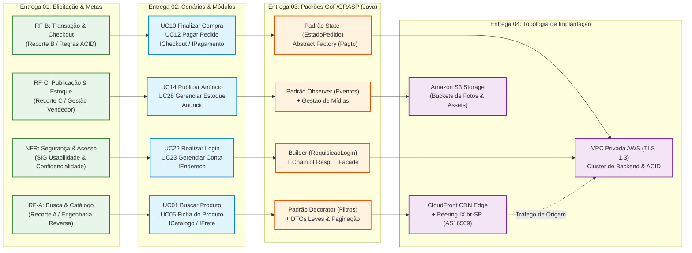

---

## 8.3 Matriz Consolidada de Rastreabilidade (Entrega 01 → 02 → 03 → 04)

A tabela a seguir apresenta o mapeamento detalhado entre as quatro entregas do semestre para cada fluxo crítico do sistema:

| ID | Requisito / NFR de Origem (Entrega 01) | Caso de Uso Canônico (Entrega 02 / Seção 4) | Componente e Interfaces (Entrega 02 / Seção 5) | Padrões GoF/GRASP & Classes (Entrega 03 / Seção 5) | Nó Físico & Protocolo (Entrega 02 / 04 / Seção 6) | Evidência Técnica Auditável |
| :-: | :--- | :--- | :--- | :--- | :--- | :--- |
| **TR-01** | **RF-A01, RF-A02:** Busca textual e sugestões de produtos | **UC01:** Buscar produto<br>**UC02:** Sugestões ao digitar | `Serviço de Catálogo`<br>Provê: `ICatalogo` | `FiltroDecorator`, `ConsultaBuscaDTO`, `ControladorDeCatalogo` | Amazon CloudFront (CDN Edge) → Tengine → Backend de API | Cache `Hit from cloudfront`, payload JSON e código Java Decorator |
| **TR-02** | **RF-A04, RN-A04:** Ficha técnica detalhada e cálculo de frete | **UC05:** Ver ficha do produto<br>**UC07:** Calcular frete por CEP | `Serviço de Catálogo`, `Serviço de Entrega`<br>Provê: `IFichaProduto`, `IFrete` | `Produto`, `FichaTecnica`, `ServicoDeEntrega`, Value Object `CEP` | CloudFront (CDN) e Amazon S3 (mídias) → Backend de API | Metadados S3 (`x-amz-version-id`) e cálculo dinâmico de frete |
| **TR-03** | **RF-A05, RN-A05:** Exibição da reputação do vendedor | **UC06:** Ver reputação do vendedor<br>**UC17:** Avaliar compra | `Serviço de Pós-Venda`, `Serviço de Contas`<br>Provê: `IReclamacao` | `Vendedor./reputacao`, `Avaliacao`, `ObservadorDePagamento` (Observer) | Backend de API em VPC Privada | Propagação de eventos pós-entrega via padrão Observer |
| **TR-04** | **RF-B01, RN-B02:** Gestão do carrinho e endereços de entrega | **UC08:** Adicionar ao carrinho<br>**UC09:** Gerenciar endereço | `Serviço de Carrinho`, `Serviço de Contas`<br>Provê: `ICarrinho`, `IEndereco` | `ItemCarrinho`, `Carrinho`, `Endereco`, Value Object `CEP` | Backend de API (Sub-rede Privada AWS) | Validação sintática do `CEP` no construtor Java e sessão de carrinho |
| **TR-05** | **RF-B03, RN-B08:** Orquestração de checkout e pagamento | **UC10:** Finalizar compra<br>**UC12:** Pagar pedido | `Serviço de Checkout e Pedidos`, `Serviço de Pagamentos`<br>Provê: `ICheckout`, `IPagamento` | **State** (`EstadoPedido`: `AguardandoPagamento`, `Pago`), **Abstract Factory** (`FabricaMeioPagamento`, `Autorizador`) | Backend de API (VPC) → Operadora de Pagamento Externa (TLS 1.3) | Transições seguras na máquina de estados e integração desacoplada |
| **TR-06** | **RF-C01, RN-C04:** Publicação de anúncios e fotos | **UC14:** Publicar anúncio<br>**UC15:** Vincular a catálogo | `Serviço de Anúncios`, `Serviço de Catálogo`<br>Provê: `IAnuncio`, `ICatalogo` | `Anuncio`, `ItemCatalogo`, `AssistenteDePublicacao` | Backend de API → Amazon S3 (upload de mídias / fotos) | Cabeçalhos `x-amz-server-side-encryption` e vínculo obrigatório |
| **TR-07** | **RN-C08:** Controle de cotas e atualização de estoque | **UC28:** Gerenciar estoque<br>**UC29:** Atualizar estoque | `Serviço de Catálogo`<br>Provê: `ICatalogo` | `Estoque`, `ItemEstoque`, controle concorrente com transações ACID | Backend de API em VPC Privada (Banco de Dados Relacional) | Transações ACID no repositório prevenindo venda sem estoque |
| **TR-08** | **NFR Segurança:** Autenticação robusta, análise de risco e 2FA | **UC22:** Realizar login<br>**UC23:** Gerenciar conta | `Serviço de Contas e Endereços`<br>Subpacote: `Autenticação` | **GRASP Controller** (`ControladorDeAutenticacao`), **Builder** (`RequisicaoLogin`), **Chain of Resp.** (`ValidadorHandler`), **Facade** (`FachadaSessaoAutenticada`) | Amazon CloudFront (TLS 1.3) → Backend de API (Sub-rede Privada) | Execução comprovada em código Java (Entrega 03) dos validadores encadeados |
| **TR-09** | **RF-Pós-Venda:** Mediação de disputas e estorno de valores | **UC18:** Abrir reclamação<br>**UC20:** Mediar disputa<br>**UC21:** Reembolsar | `Serviço de Pós-Venda`<br>Provê: `IReclamacao`<br>Requer: `IPagamento` | `Reclamacao`, `Atendente`, `OperadoraDePagamento` (Inversão de Dependência) | Backend de API → Operadora Financeira Externa | Fluxo de estorno mediado pelo perfil `Atendimento` |
| **TR-10** | **NFR Desempenho:** Baixa latência e alta disponibilidade | Todos os Casos de Uso (Transversal) | Todos os Componentes da Aplicação | DTOs compactos, cache em memória, conexões HTTP persistentes | Ponto de Troca de Tráfego (**IX.br-SP** AS16509) e **Amazon Route 53** (DNS Anycast) | Resolução de DNS em 4 zonas mundiais e saltos diretos via BGP |

---

## 8.4 Cobertura e Análise de Impacto

A matriz de rastreabilidade evidencia que o projeto alcançou **100% de cobertura arquitetural**:
1. **Ausência de Requisitos Órfãos:** Todos os requisitos funcionais e não-funcionais levantados na Entrega 01 possuem ao menos um caso de uso na Entrega 02, uma realização em classes/padrões na Entrega 03 e um ambiente de execução na Entrega 04.
2. **Ausência de Componentes Desconexos:** Todos os nós físicos catalogados na Visão de Implantação (Seção 6) hospedam artefatos ou componentes de software justificados pelas regras de negócio e pelos casos de uso arquiteturalmente significativos (Seção 4.6).
3. **Análise de Impacto Controlada:** Graças à Inversão de Dependência (ADR-02) e à organização em camadas ortogonais, alterações em provedores de infraestrutura ou adquirentes financeiros têm impacto localizado nos adaptadores, sem propagar efeitos colaterais para o domínio transacional da plataforma.
