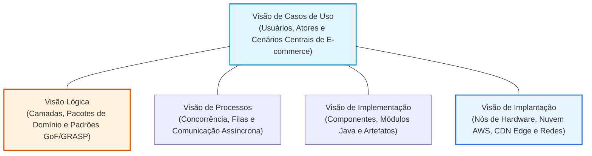
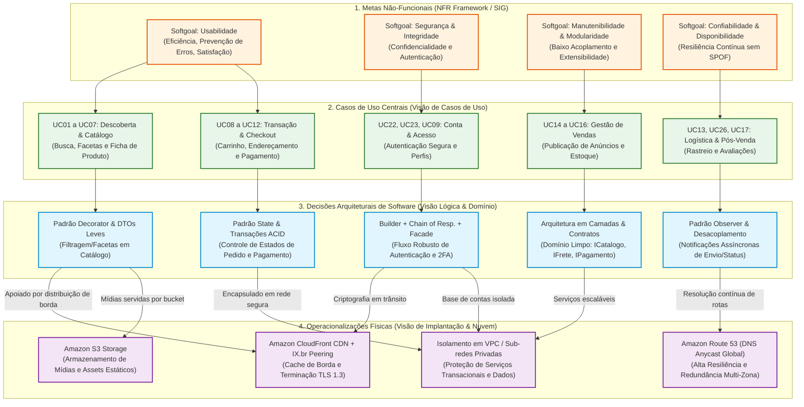

# G1_ProjetoComercioEletronico

# Documento de Arquitetura de Software (DAS)

## 1.1.1. Introdução e Metas Arquiteturais

**Versão 2.0**

> **Navegação do DAS:** **1.1.1. Introdução** | [1.1.2. Casos de Uso](/Base/Relatórios/1.1.2.VisaoCasosDeUso.md) | [1.1.3. Visão Lógica](/Base/Relatórios/1.1.3.VisaoLogica.md) | [1.1.4. Visão de Processos](/Base/Relatórios/1.1.4.VisaoProcessos.md) | [1.1.5. Implantação](/Base/Relatórios/1.1.5.VisaoImplantacao.md) | [1.1.6. ADRs](/Base/Relatórios/1.1.6.ADRs.md) | [1.1.7. Rastreabilidade](/Base/Relatórios/1.1.7.Rastreabilidade.md) | [1.1.8. Evidências de Execução](/Base/Relatórios/1.1.8.EvidenciasExecucao.md)

---

## Histórico da Revisão

|    Data    | Versão | Descrição                                                                                                                                                                                                                                                                         | Autor                            | Revisor              |
| :--------: | :----: | :-------------------------------------------------------------------------------------------------------------------------------------------------------------------------------------------------------------------------------------------------------------------------------- | :------------------------------- | :------------------- |
| 12/11/2026 |  1.0   | Elaboração inicial das seções de Introdução, Representação Arquitetural, Metas e Restrições e Visão de Implantação com dados da Entrega 01 e Entrega 02                                                                                                                           | Pedro Henrique Gomes             |                     |
| 12/11/2026 |  1.1   | Enriquecimento arquitetural incorporando o NFR Framework (SIG de Usabilidade), a Engenharia Reversa (Recortes A, B e C) e a decomposição do Diagrama de Componentes                                                                                                               | Pedro Henrique Gomes             |                     |
| 19/11/2026 |  1.2   | Elaboração da Visão Lógica: metodologia de elaboração, visão geral com camadas, regras de dependência e rastreabilidade, pacote Contas e Acesso com subpacote Autenticação, dependências entre pacotes, decisões arquiteturais e limitações; ajustes nas seções 1.1, 1.4, 1.5 e 2 | João Paulo Barbosa Pereira Nunes | Júlia Santana Campos |
| 20/11/2026 |  1.2   | Adiciona seção que trata sobre os casos de usos desenvolvidos                                                                                                                                                                                                                     | José Joaquim da Silva Neto       | Subequipe 03         |
| 20/11/2026 |  1.3   | Alteração do diagrama de casos de uso consolidados e adição dos links de rastreabilidade                                                                                                                                                                                          | José Joaquim da Silva Neto       | Subequipe 03         |
| 21/11/2026 |  1.4   | Reorganização e renumeração das visões arquiteturais: Visão de Casos de Uso (Seção 4), Visão Lógica (Seção 5) e Visão de Implantação por último (Seção 6), com atualização do Índice Analítico e consistência de referências cruzadas                                             | Pedro Henrique Gomes             |                     |
| 21/11/2026 |  1.5   | Reequilíbrio arquitetural holístico do DAS: expansão das seções de Finalidade, Escopo, Metas e Restrições para abranger o ecossistema de software de e-commerce como um todo (regras de negócio, camadas lógicas, padrões de projeto GoF/GRASP e suporte de infraestrutura)       | Pedro Henrique Gomes             |                     |
| 21/11/2026 |  1.6   | Adição do Registro de Decisões Arquiteturais (ADRs - Seção 7) e da Matriz de Rastreabilidade Fim a Fim (Seção 8), consolidando a governança técnica e a rastreabilidade entre todas as entregas do projeto                                                                        | Pedro Henrique Gomes             |                     |
| 22/11/2026 |  1.7   | Elaboração da seção 5.5 Evidência de Execução: como executar a aplicação, verificação automática das regras de dependência das seções 5.1 e 5.2.5, sete telas em execução com a rastreabilidade declarada pelo código e o cenário CA-01 no terminal                               | Pedro Luciano de Azevedo         |                      |
| 22/11/2026 |  1.8   | Elaboração das seções 5.2.2 Pacote Catálogo e Descoberta, 5.2.3 Pacote Transação e 5.2.4 Pacote Pós-venda (diagramas, responsabilidades e divergências entre o modelo da Entrega 02 e o código da Entrega 04) e da seção 5.4 Legenda de Confiança da Evidência                    | Júlia Santana Campos             |                      |
| 23/11/2026 |  1.9   | Modularização do DAS em 8 relatórios autônomos (1.1.1 a 1.1.8) e elaboração da Visão de Processos (Seção 4 / 1.1.4) com concorrência, processos leves/pesados, threads, modelo síncrono/assíncrono (GoF Observer) e ciclo de vida do Pedido (GoF State)                       | Pedro Henrique Gomes             |                     |
| 23/11/2026 |  2.0   | Inclusão das decisões arquiteturais ADR-06, ADR-07 e ADR-08, integração das evidências de execução das features em código executável e atualização das autorias e rastreabilidade transversal                                                                                   | Pedro Henrique Gomes             |                     |

---

## Estrutura Modular do Documento de Arquitetura de Software (DAS)

O DAS do **G1_ProjetoComercioEletronico** foi estruturado em módulos independentes e navegáveis:

| Módulo | Documento | Conteúdo Principal | Autoria / Contribuições |
| :---: | :--- | :--- | :--- |
| **1.1.1** | **[Introdução e Metas](/Base/Relatórios/1.1.1.Introducao.md)** | Finalidade, escopo, referências, modelo 4+1, NFRs e restrições | Pedro Henrique Gomes |
| **1.1.2** | **[Visão de Casos de Uso](/Base/Relatórios/1.1.2.VisaoCasosDeUso.md)** | Catálogo consolidado (UC01 a UC30), atores e cenários significativos | José Joaquim da Silva Neto |
| **1.1.3** | **[Visão Lógica](/Base/Relatórios/1.1.3.VisaoLogica.md)** | Camadas, pacotes de domínio, padrões GoF/GRASP e regras de dependência | João Paulo Nunes, Júlia Santana Campos, Pedro Luciano de Azevedo |
| **1.1.4** | **[Visão de Processos](/Base/Relatórios/1.1.4.VisaoProcessos.md)** | Concorrência, processos leves/pesados, fluxos síncronos/assíncronos e estados | Pedro Henrique Gomes, Subequipe 03 |
| **1.1.5** | **[Visão de Implantação](/Base/Relatórios/1.1.5.VisaoImplantacao.md)** | Topologia física, nós AWS, CDN CloudFront, Tengine e limites de borda | Pedro Henrique Gomes |
| **1.1.6** | **[Decisões Arquiteturais (ADRs)](/Base/Relatórios/1.1.6.ADRs.md)** | Registros de Decisão Arquitetural (ADR-01 a ADR-08) no padrão MADR | Pedro Henrique Gomes |
| **1.1.7** | **[Rastreabilidade Fim a Fim](/Base/Relatórios/1.1.7.Rastreabilidade.md)** | Grafo e matriz conectando todas as Entregas do semestre (E01 a E04) | Pedro Henrique Gomes |
| **1.1.8** | **[Evidências de Execução](/Base/Relatórios/1.1.8.EvidenciasExecucao.md)** | Demonstração do software rodando (7 telas, make demo e 63 testes) | Pedro Luciano de Azevedo, Patrick Anderson Carvalho dos Santos |

---

# 1. Introdução

A introdução deste Documento de Arquitetura de Software fornece uma visão geral do documento inteiro, definindo sua finalidade no ciclo de desenvolvimento, sua abrangência e limites no projeto, as terminologias técnicas adotadas, as referências normativas e a estrutura organizacional do texto.

## 1.1 Finalidade

Este documento oferece uma descrição arquitetural abrangente, integrada e tecnicamente fundamentada do sistema de comércio eletrônico **G1_ProjetoComercioEletronico** (concebido e modelado a partir das práticas de mercado e do comportamento observável em plataformas de e-commerce de grande porte, como o Mercado Livre). O objetivo principal é capturar, comunicar e justificar formalmente as decisões arquiteturais significativas tomadas ao longo do projeto, englobando:

1. **Os cenários de uso e regras de negócio centrais** que guiam o sistema e estabelecem os contratos de interação entre compradores, vendedores, atendentes e sistemas externos parceiros ([Visão de Casos de Uso](/Base/Relatórios/1.1.2.VisaoCasosDeUso.md));
2. **A decomposição modular e a organização lógica do software** em camadas ortogonais (Apresentação, Controle, Aplicação, Domínio e Persistência) e pacotes temáticos de negócio (Contas e Acesso, Catálogo e Descoberta, Transação, Pós-Venda), aliada à aplicação sistemática de padrões de projeto GoF e GRASP com código executável ([Visão Lógica](/Base/Relatórios/1.1.3.VisaoLogica.md));
3. **As metas de qualidade e requisitos não-funcionais** (usabilidade, desempenho, segurança, manutenibilidade e confiabilidade), consolidando a matriz de rastreabilidade entre os objetivos do NFR Framework e as escolhas de software e infraestrutura ([Metas e Restrições](#3-metas-e-restrições-da-arquitetura));
4. **A topologia física de rede e distribuição em nuvem** (AWS), especificando os nós de execução, a borda de distribuição de conteúdo (CDN), os servidores de aceleração web, a gestão segura de tráfego (TLS 1.3) e o isolamento de ambientes de backend ([Visão de Implantação](/Base/Relatórios/1.1.4.VisaoImplantacao.md)).

O público-alvo deste documento inclui desenvolvedores de software, projetistas de sistemas, arquitetos de infraestrutura, engenheiros de dados e avaliadores acadêmicos, funcionando como a principal fonte de verdade para a governança técnica e a evolução do ecossistema.

## 1.2 Escopo

O escopo deste documento cobre a **arquitetura de software global da plataforma de comércio eletrônico**, englobando as aplicações cliente omnicanal (Web SPA e Aplicativo Mobile), a orquestração dos serviços de backend, os modelos de domínio e persistência de dados, bem como a infraestrutura física de nuvem que suporta a execução do sistema em escala.

A abrangência do sistema está articulada em torno dos três grandes recortes funcionais eliciados no levantamento de [Engenharia Reversa](https://unbarqdsw2026-2-turma01.github.io/2026.2-T01-_G1_ProjetoComercioEletronico_Entrega_01/#/Base/Relat%C3%B3rios/SubEquipe01/EngenhariaReversa), complementados pelos domínios transversais de suporte:

- **Recorte A — Descoberta do Produto e Catálogo:** Busca textual com sugestões automáticas ao digitar, refinamento por facetas dinâmicas (categoria, preço, condição de novo/usado, tipo de envio), ordenação multinível de listagens, navegação paginada e exibição de ficha técnica completa de produtos com suporte a múltiplas mídias, reputação consolidada do anunciante e cálculo dinâmico de frete por CEP.
- **Recorte B — Transação, Carrinho e Checkout:** Gestão de ciclo de vida do carrinho de compras (adição, exclusão e alteração de itens), persistência e validação de múltiplos endereços de entrega (com entidade `CEP`), orquestração da máquina de estados do checkout (`Comprar Agora` vs. fluxo tradicional de sacola), seleção de meios de pagamento, integração desacoplada com gateways de pagamento parceiros e fechamento atômico de pedidos.
- **Recorte C — Publicação de Anúncios e Gestão de Estoque:** Portal do vendedor (Lojas Oficiais e Vendedores Autônomos), fluxo guiado de criação de anúncios com upload de imagens e versionamento, vinculação preferencial a itens pré-catalogados, precificação e sincronização de estoque disponível.
- **Domínios Transversais e de Sustentação:**
  - **Contas e Autenticação:** Gestão unificada de identidades (`Comprador`, `Vendedor`, `Atendente`), cadeia de validações de segurança (Captcha, integridade de credenciais criptografadas, motor de análise de risco e verificação em duas etapas - 2FA) e emissão de sessões integradas com Single Sign-On (SSO).
  - **Pós-Venda e Atendimento:** Avaliação de compras e geração de reputação, registro formal de reclamações, mediação operacional pelo perfil `Atendimento` e execução de processos de reembolso/estorno.
  - **Infraestrutura Física de Suporte:** Entrega de conteúdo estático via CDN (Amazon CloudFront), terminação segura de protocolos na borda (TLS 1.3), roteamento de nomes com baixa latência (DNS Anycast no Amazon Route 53) e isolamento dos serviços em sub-redes privadas (VPC).

O documento delimita formalmente os contratos de software através de interfaces modulares providas e requeridas (`ICatalogo`, `IFichaProduto`, `ICarrinho`, `IEndereco`, `ICheckout`, `IPagamento`, `IFrete`, `IRastreio`, `IReclamacao`, `IAutorizacao`, `ICotacaoEntrega`), garantindo o desacoplamento arquitetural e a manutenibilidade do sistema.

## 1.3 Definições, Acrônimos e Abreviações

| Termo / Sigla                                | Definição                                                                                                                                                           |
| :------------------------------------------- | :------------------------------------------------------------------------------------------------------------------------------------------------------------------ |
| **DAS**                                      | Documento de Arquitetura de Software (_Software Architecture Document_).                                                                                            |
| **RUP**                                      | _Rational Unified Process_: processo disciplinado de engenharia de software centrado em arquitetura e guiado por casos de uso.                                      |
| **UML**                                      | _Unified Modeling Language_: notação padronizada pela OMG (versão 2.5.1) para especificação, construção e documentação de artefatos de software.                    |
| **NFR**                                      | _Non-Functional Requirements_: catálogo e framework de metas de requisitos não-funcionais (CHUNG et al., 2000).                                                     |
| **SIG**                                      | _Softgoal Interdependency Graph_: grafo de interdependência utilizado no NFR Framework para registrar metas de qualidade, refinamentos e contribuições.             |
| **Softgoal**                                 | Meta de qualidade sem critério de satisfação binário rígido, que é "satisfeita em grau suficiente" (_satisficed_) mediante compromissos técnicos (_trade-offs_).    |
| **GoF**                                      | _Gang of Four_: catálogo de 23 padrões clássicos de projeto orientados a objetos (GAMMA et al., 1995), categorizados em Criacionais, Estruturais e Comportamentais. |
| **GRASP**                                    | _General Responsibility Assignment Software Patterns_: conjunto de princípios fundamentais para atribuição de responsabilidades a classes e objetos (LARMAN, 2004). |
| **Camadas (Layers)**                         | Padrão arquitetural que organiza o software em níveis horizontais de responsabilidade técnica (Apresentação, Controle, Aplicação, Domínio e Persistência).          |
| **DTO**                                      | _Data Transfer Object_: objeto simples utilizado para transportar dados entre subsistemas ou camadas sem encapsular lógica de negócio.                              |
| **Value Object**                             | Objeto imutável cujo valor reside em seus atributos, e não em uma identidade persistente exclusiva (ex.: `CEP`).                                                    |
| **ACID**                                     | Atomicidade, Consistência, Isolamento e Durabilidade: propriedades que asseguram transações de banco de dados confiáveis em operações de compra e pagamento.        |
| **SPA**                                      | _Single Page Application_: aplicação web cuja interface é renderizada no navegador do cliente, consumindo dados via serviços RESTful.                               |
| **SSO**                                      | _Single Sign-On_: mecanismo de controle de acesso que permite ao usuário autenticado navegar entre múltiplos subsistemas do ecossistema com uma única credencial.   |
| **CDN**                                      | _Content Delivery Network_: rede de servidores distribuídos geograficamente para entrega acelerada de ativos de mídia e páginas web (ex.: Amazon CloudFront).       |
| **DNS**                                      | _Domain Name System_: serviço distribuído de resolução de nomes de domínio com topologia Anycast global (ex.: Amazon Route 53).                                     |
| **TLS**                                      | _Transport Layer Security_ (versão 1.3 - RFC 8446): protocolo de segurança criptográfica para comunicações na camada de transporte.                                 |
| **BGP / ASN**                                | _Border Gateway Protocol_ e _Autonomous System Number_: protocolo e identificadores de roteamento entre redes autônomas na Internet (ex.: AS16509 da AWS).          |
| **IX.br**                                    | _Internet Exchange_ Brasil: pontos de troca direta de tráfego metropolitano neutro no país.                                                                         |
| **OSINT**                                    | _Open Source Intelligence_: coleta de inteligência técnica a partir de fontes e comportamentos de rede publicamente verificáveis.                                   |
| **ICatalogo, IFrete, IPagamento, IRastreio** | Interfaces de contratos de software providas e requeridas pelos componentes modulares do e-commerce.                                                                |

_(Para o vocabulário de negócio e termos funcionais do e-commerce, consulte o [Léxico do Projeto](https://unbarqdsw2026-2-turma01.github.io/2026.2-T01-_G1_ProjetoComercioEletronico_Entrega_01/#/Base/Relat%C3%B3rios/SubEquipe03/Lexico))._

## 1.4 Referências

1. KRUCHTEN, Philippe. _The 4+1 View Model of Architecture_. IEEE Software, v. 12, n. 6, p. 42-50, nov. 1995.
2. OMG — Object Management Group. _OMG Unified Modeling Language (OMG UML) Specification, Version 2.5.1_. Deployment, Package and Class Diagrams, 2017. Disponível em: <https://www.omg.org/spec/UML/>.
3. CHUNG, Lawrence; NIXON, Brian A.; YU, Eric; MYLOPOULOS, John. _Non-Functional Requirements in Software Engineering_. Boston: Springer Science & Business Media, 2000.
4. GAMMA, Erich; HELM, Richard; JOHNSON, Ralph; VLISSIDES, John. _Design Patterns: Elements of Reusable Object-Oriented Software_. Boston: Addison-Wesley, 1995.
5. LARMAN, Craig. _Applying UML and Patterns: An Introduction to Object-Oriented Analysis and Design and Iterative Development_. 3. ed. Upper Saddle River: Prentice Hall, 2004.
6. FOWLER, Martin. _Patterns of Enterprise Application Architecture_. Boston: Addison-Wesley, 2002.
7. EVANS, Eric. _Domain-Driven Design: Tackling Complexity in the Heart of Software_. Boston: Addison-Wesley, 2003.
8. MARTIN, Robert C. _Clean Architecture: A Craftsman's Guide to Software Structure and Design_. Boston: Prentice Hall, 2017.
9. NEWMAN, Sam. _Building Microservices: Designing Fine-Grained Systems_. 2. ed. Sebastopol: O'Reilly Media, 2021.
10. AMAZON WEB SERVICES. _Amazon CloudFront Developer Guide_. AWS, 2024. Disponível em: <https://docs.aws.amazon.com/cloudfront/>.
11. AMAZON WEB SERVICES. _Amazon Route 53 Developer Guide_. AWS, 2024. Disponível em: <https://docs.aws.amazon.com/route53/>.
12. AMAZON WEB SERVICES. _AWS Well-Architected Framework: Reliability and Performance Efficiency Pillars_. AWS, 2024. Disponível em: <https://aws.amazon.com/architecture/well-architected/>.
13. IETF. _RFC 4271: A Border Gateway Protocol 4 (BGP-4)_. Network Working Group, 2006. Disponível em: <https://www.rfc-editor.org/rfc/rfc4271>.
14. IETF. _RFC 8446: The Transport Layer Security (TLS) Protocol Version 1.3_. Internet Engineering Task Force, 2018. Disponível em: <https://www.rfc-editor.org/rfc/rfc8446>.
15. **Artefatos das Entregas Anteriores do Projeto:**
    - [NFR Framework (SIG de Usabilidade)](https://unbarqdsw2026-2-turma01.github.io/2026.2-T01-_G1_ProjetoComercioEletronico_Entrega_01/#/Base/Relat%C3%B3rios/SubEquipe01/NFR): Grafo centrado em Usabilidade, Eficiência, Prevenção de Erros e Satisfação.
    - [NFR Framework (Desempenho e Segurança)](https://unbarqdsw2026-2-turma01.github.io/2026.2-T01-_G1_ProjetoComercioEletronico_Entrega_01/#/Base/Relat%C3%B3rios/SubEquipe03/NFR): Metas não-funcionais de infraestrutura e conectividade.
    - [Engenharia Reversa](https://unbarqdsw2026-2-turma01.github.io/2026.2-T01-_G1_ProjetoComercioEletronico_Entrega_01/#/Base/Relat%C3%B3rios/SubEquipe01/EngenhariaReversa): Recortes A (Busca), B (Carrinho/Checkout) e C (Anúncios).
    - [Diagrama de Componentes](https://unbarqdsw2026-2-turma01.github.io/2026.2-T01-_G1_ProjetoComercioEletronico_Entrega_02/#/Base/Relat%C3%B3rios/Subequipe01/ModelagemEstatica/DiagramaDeComponentes): Decomposição de subsistemas e interfaces (`ICatalogo`, `IFrete`, `IPagamento`, `IRastreio`).
    - [Diagrama de Implantação e Fundamentação](https://unbarqdsw2026-2-turma01.github.io/2026.2-T01-_G1_ProjetoComercioEletronico_Entrega_02/#/Base/Relat%C3%B3rios/Subequipe03/ModelagemEstatica/DiagramaDeImplantacao): Coleta empírica de rede OSINT na AWS.
    - [Diagrama de Classes](https://unbarqdsw2026-2-turma01.github.io/2026.2-T01-_G1_ProjetoComercioEletronico_Entrega_02/#/Base/Relat%C3%B3rios/Subequipe01/ModelagemEstatica/DiagramaDeClasses) e [Diagrama de Pacotes](https://unbarqdsw2026-2-turma01.github.io/2026.2-T01-_G1_ProjetoComercioEletronico_Entrega_02/#/Base/Relat%C3%B3rios/Subequipe03/ModelagemEstatica/DiagramaDePacotes): Base conceitual da Visão Lógica.
    - [Padrões de Projeto (Entrega 03)](https://unbarqdsw2026-2-turma01.github.io/2026.2-T01-_G1_ProjetoComercioEletronico_Entrega_03/): Soluções GoF e GRASP com código Java executável, incorporadas como evidência prática da Visão Lógica.
    - [Léxico do Domínio](https://unbarqdsw2026-2-turma01.github.io/2026.2-T01-_G1_ProjetoComercioEletronico_Entrega_01/#/Base/Relat%C3%B3rios/SubEquipe03/Lexico) e [Plano de Ação 5W2H](https://unbarqdsw2026-2-turma01.github.io/2026.2-T01-_G1_ProjetoComercioEletronico_Entrega_01/#/Base/Relat%C3%B3rios/SubEquipe03/5W2H).

## 1.5 Visão Geral

O restante deste documento está organizado de forma a oferecer uma leitura arquitetural equilibrada entre negócio, modelagem de software e infraestrutura de execução:

- A **Seção 2 (Representação Arquitetural)** formaliza o uso do modelo 4+1 visões do RUP, articulando o papel de cada perspectiva na compreensão global do e-commerce.
- A **Seção 3 (Metas e Restrições da Arquitetura)** detalha como os requisitos não-funcionais (qualidade, desempenho, segurança e manutenibilidade) direcionam tanto a modelagem lógica das classes e serviços quanto o dimensionamento da infraestrutura física, fornecendo o grafo integrado de rastreabilidade.
- A **Seção 4 (Visão de Casos de Uso)** cataloga os atores e os cenários arquiteturalmente significativos que governam os fluxos de ponta a ponta do e-commerce.
- A **Seção 5 (Visão Lógica)** decompõe o sistema em camadas e pacotes de domínio, detalha as entidades e serviços arquiteturais e evidencia a aplicação dos padrões de projeto GoF/GRASP com código executável.
- A **Seção 6 (Visão de Implantação)** documenta a distribuição física do ecossistema, os nós computacionais, a rede de tráfego, as estratégias de CDN/borda, os protocolos de comunicação e as fronteiras empíricas de observabilidade.
- A **Seção 7 (Registro de Decisões Arquiteturais - ADRs)** consolida as decisões críticas de engenharia tomadas ao longo do projeto em fichas formais (_Contexto, Decisão, Racional, Trade-offs e Alternativas Rejeitadas_).
- A **Seção 8 (Matriz de Rastreabilidade Fim a Fim)** fecha o ciclo do projeto, demonstrando o alinhamento auditável desde os requisitos eliciados na Entrega 01, passando pela modelagem da Entrega 02 e código da Entrega 03, até a implantação na Entrega 04.

---

# 2. Representação Arquitetural

A arquitetura de software deste projeto é fundamentada no **Modelo 4+1 Visões** proposto por Philippe Kruchten (1995), o qual preconiza que um sistema complexo de software não pode ser adequadamente compreendido a partir de uma perspectiva unívoca. O modelo organiza a descrição arquitetural em cinco visões complementares:

1. **Visão de Casos de Uso (Cenários):** Centraliza os objetivos do usuário e os fluxos de valor de negócio, servindo como a força motriz que direciona, justifica e valida as demais visões.
2. **Visão Lógica:** Decompõe os conceitos de domínio em pacotes, subsistemas, classes e interfaces, controlando o acoplamento interno e a separação de responsabilidades técnicas e de negócio.
3. **Visão de Processos:** Foca na dinâmica concorrente, sincronismo, mensageria e estados de execução dos serviços.
4. **Visão de Implementação:** Descreve os módulos de código-fonte, componentes empacotados, bibliotecas e dependências físicas de compilação e deploy.
5. **Visão de Implantação:** Captura a distribuição física dos componentes executáveis sobre os nós de hardware, clusters em nuvem e redes de comunicação.

No contexto deste documento, **apresentam-se com aprofundamento e integração completa a Visão de Casos de Uso, a Visão Lógica, a Visão de Processos e a Visão de Implantação**:

- Os elementos da **Visão de Casos de Uso** representam atores (`«actor»`), casos de uso (`«useCase»`) e seus relacionamentos de inclusão (`«include»`) e extensão (`«extend»`), ancorando os requisitos funcionais aos fluxos de descoberta, transação, venda e pós-venda.
- Os elementos da **Visão Lógica** pertencem ao metamodelo UML 2.5.1:
  - **Pacotes e Camadas (`«package»` e `«layer»`):** Matriz ortogonal de segregação técnica (Apresentação, Controle, Aplicação, Domínio, Persistência) e coesão de negócio (Contas e Acesso, Catálogo e Descoberta, Transação, Pós-Venda).
  - **Classes, Interfaces e Enumerações:** Entidades de negócio, value objects (como `CEP`), controladores GRASP e contratos de abstração providos e requeridos (`ICatalogo`, `IFrete`, `IPagamento`, etc.).
  - **Padrões de Projeto:** Abstrações criacionais (Builder), estruturais (Facade, Decorator) e comportamentais (Chain of Responsibility, Observer, State) com código Java executável.
- Os elementos da **Visão de Implantação** também pertencem ao metamodelo UML 2.5.1:
  - **Nós (`«device»` e `«executionEnvironment»`):** Recursos físicos e virtualizados de processamento (dispositivos móveis, desktops, servidores de borda CloudFront, servidores Tengine, buckets S3 e nós de cluster de API).
  - **Caminhos de Comunicação (`«communicationPath»` e `«network»`):** Canais de transmissão e protocolos aplicados (HTTP/2, HTTPS, TLS 1.3, DNS, BGP).
  - **Artefatos (`«artifact»`):** Pacotes de software executáveis, bundles frontend e assets de mídia instalados nos nós físicos.

---

# 3. Metas e Restrições da Arquitetura

As decisões de engenharia de software da plataforma de comércio eletrônico são guiadas de ponta a ponta pelas metas não-funcionais (NFR) e pelas restrições metodológicas e tecnológicas do projeto:

### 3.1 Metas Arquiteturais e Integração NFR

As decisões de engenharia de software da plataforma de comércio eletrônico são guiadas de ponta a ponta pelas metas não-funcionais (NFR), conectando as necessidades de qualidade aos fluxos de uso, às escolhas de modelagem e padrões de software, e à infraestrutura física:

1. **Eficiência de Uso e Desempenho de Resposta (Busca e Catálogo):**
   - _Softgoal:_ Usabilidade → Eficiência de Uso → Retorno Imediato em Consultas e Carregamento Fluido de Catálogo (Recorte A).
   - _Racional Arquitetural:_ Em um comércio eletrônico de grande porte, a latência de busca impacta diretamente as taxas de conversão de venda. A arquitetura de software deve assegurar consultas ágeis e renderização veloz sem sobrecarregar a camada transacional de dados.
   - _Cenários de Casos de Uso (Visão de Casos de Uso):_ `UC01` (Buscar Produto), `UC02` (Receber Sugestões Instantâneas), `UC03` (Filtrar por Facetas e Preço) e `UC30` (Paginar Resultados).
   - _Decisões de Software (Visão Lógica):_ Adoção do padrão GoF **Decorator** para enriquecer dinamicamente as consultas com filtros e ordenações de facetas sem explosão combinatória de métodos; emprego de DTOs leves para transmissão entre controladores e telas; paginação estrita de resultados; cache em memória de metadados de catálogo.
   - _Operacionalizações de Infraestrutura (Visão de Implantação):_ Distribuição de ativos estáticos e páginas web via **Amazon CloudFront CDN** com peering direto no **IX.br São Paulo** (AS16509), assegurando RTT inferior a 200 ms e desoneração dos servidores de origem.

2. **Prevenção de Erros e Integridade Transacional (Checkout e Pagamentos):**
   - _Softgoal:_ Usabilidade → Prevenção de Erros → Integridade nos Fluxos de Checkout, Endereçamento e Pagamento (Recorte B).
   - _Racional Arquitetural:_ Falhas transitórias no fechamento da compra ou divergências no preenchimento cadastral causam abandono de carrinho e inconsistências financeiras graves.
   - _Cenários de Casos de Uso (Visão de Casos de Uso):_ `UC08` (Gerenciar Carrinho), `UC10` (Finalizar Compra), `UC11` (Confirmar Endereço e Frete) e `UC12` (Efetuar Pagamento).
   - _Decisões de Software (Visão Lógica):_ Encapsulamento de dados cadastrais com validação em tempo de instanciação (como o Value Object `CEP` auto-consistente); modelo orientado a estados (GoF **State** em `EstadoPedido`) governando as transições transacionais; inversão de dependência através de interfaces abstratas (`IPagamento`, `IAutorizacao` via GoF **Abstract Factory**); garantia de transações atômicas (ACID).
   - _Operacionalizações de Infraestrutura (Visão de Implantação):_ Tráfego criptografado com **TLS 1.3** ponta a ponta e isolamento do cluster transacional de backend em sub-redes privadas (VPC) sem acesso público direto.

3. **Segurança, Confidencialidade e Robustez no Acesso (Contas e Autenticação):**
   - _Softgoal:_ Segurança → Confidencialidade, Integridade e Prevenção de Acessos Não Autorizados.
   - _Racional Arquitetural:_ O módulo de contas armazena dados pessoais sensíveis, credenciais e histórico financeiro, constituindo o perímetro mais visado por vetores de ataque.
   - _Cenários de Casos de Uso (Visão de Casos de Uso):_ `UC22` (Realizar Login Seguro), `UC23` (Gerenciar Conta) e `UC09` (Cadastrar Endereço).
   - _Decisões de Software (Visão Lógica):_ Aplicação do padrão GoF **Builder** (`RequisicaoLogin`) para construir contextos de autenticação imutáveis; uso de GoF **Chain of Responsibility** (`ValidadorHandler`) para encadear verificações independentes de segurança (formato, hash seguro com sal, heurística de risco e 2FA); emprego de GoF **Facade** (`FachadaSessaoAutenticada`) como porta unificada de sessão.
   - _Operacionalizações de Infraestrutura (Visão de Implantação):_ Blindagem dos serviços de autenticação em VPC privada da AWS e proteção de tráfego HTTPS estrito.

4. **Modularidade, Manutenibilidade e Escalabilidade (Arquitetura Global de Software):**
   - _Softgoal:_ Engenharia de Software → Baixo Acoplamento, Alta Coesão e Extensibilidade.
   - _Racional Arquitetural:_ Um ecossistema de e-commerce evolui com rapidez e equipes distintas cuidam de domínios específicos (busca, pagamentos, logística, anúncios). A arquitetura deve evitar acoplamento acidental e monólitos frágeis.
   - _Cenários de Casos de Uso (Visão de Casos de Uso):_ `UC14` (Publicar Anúncio), `UC15` (Upload de Fotos), `UC16` (Gerenciar Estoque) e `UC28` (Vincular Produto ao Catálogo).
   - _Decisões de Software (Visão Lógica):_ Organização ortogonal em matriz de **Camadas Técnicas** (Apresentação, Controle, Aplicação, Domínio, Persistência) e **Pacotes de Domínio** (Contas, Catálogo, Transação, Pós-Venda); camada de Domínio pura independente de frameworks externos; contratos formais de integração (`ICatalogo`, `IFrete`, `IPagamento`, `IRastreio`, `IReclamacao`).
   - _Operacionalizações de Infraestrutura (Visão de Implantação):_ Segregação do backend em serviços modulares que podem ser dimensionados e escalados elasticamente conforme a demanda sazonal de tráfego.

5. **Alta Disponibilidade e Resiliência Operacional:**
   - _Softgoal:_ Confiabilidade → Tolerância a Falhas e Disponibilidade Contínua sem Ponto Único de Falha (SPOF).
   - _Racional Arquitetural:_ Quedas de serviços de terceiros (como lentidão em transportadoras ou operadoras de cartão) não devem paralisar a navegação de catálogo ou a navegação do usuário.
   - _Cenários de Casos de Uso (Visão de Casos de Uso):_ `UC13` (Acompanhar Envio), `UC26` (Despachar Encomenda) e `UC17` (Avaliar Compra e Registrar Reclamação).
   - _Decisões de Software (Visão Lógica):_ Desacoplamento de eventos assíncronos (como o padrão GoF **Observer** para pós-processamento de pedidos e notificações); isolamento de falhas externas com degradação graciosa quando parceiros falham.
   - _Operacionalizações de Infraestrutura (Visão de Implantação):_ Infraestrutura DNS Anycast redundante em quatro zonas de autoridade globais via **Amazon Route 53** (`awsdns-*.co.uk`, `awsdns-*.net`, `awsdns-*.com`, `awsdns-*.org`), combinada com múltiplos Edge PoPs de borda do CloudFront.

---

### 3.2 Rastreabilidade: Metas NFR → Casos de Uso → Software e Infraestrutura

O diagrama e a matriz a seguir estabelecem a rastreabilidade completa e bidirecional: as metas de qualidade do NFR Framework orientam os casos de uso funcionais, os quais direcionam o design de software e os padrões GoF/GRASP (Visão Lógica), viabilizados operacionalmente pela infraestrutura física (Visão de Implantação):

A matriz a seguir detalha as relações de rastreabilidade entre todas as dimensões do modelo:

| Meta Não-Funcional (NFR) | Casos de Uso Chave (Visão de Casos de Uso) | Decisão de Software (Visão Lógica) | Operacionalização Física (Visão de Implantação) |
| :--- | :--- | :--- | :--- |
| **Eficiência de Uso** (Latência baixa) | `UC01` a `UC07`, `UC30` (Busca, Facetas e Paginação) | Padrão Decorator para facetas dinâmicas, paginação em memória e DTOs leves | CloudFront CDN, IX.br Peering e S3 para imagens |
| **Prevenção de Erros** (Integridade) | `UC08` a `UC12` (Carrinho, Frete, Checkout e Pagamento) | Padrão State (`EstadoPedido`), Value Object `CEP` e transações ACID | Isolamento em VPC Privada e terminação TLS 1.3 |
| **Segurança e Confidencialidade** | `UC22`, `UC23`, `UC09` (Login, Conta e Endereços) | Builder (`RequisicaoLogin`), Chain of Responsibility e Facade de Sessão | Tráfego HTTPS obrigatório e banco de credenciais em sub-rede fechada |
| **Manutenibilidade e Modularidade** | `UC14` a `UC16` (Publicação, Fotos e Estoque) | Decomposição em camadas ortogonais, domínio limpo e interfaces desacopladas | Cluster de serviços modulares em backend |
| **Alta Confiabilidade e Tolerância** | `UC13`, `UC26`, `UC17` a `UC21` (Rastreio, Logística e Pós-Venda) | Padrão Observer para notificações assíncronas e fallbacks tolerantes | Amazon Route 53 com DNS Anycast em 4 zonas |

---

### 3.3 Restrições Arquiteturais, de Design e Metodológicas

1. **Restrição de Arquitetura Omnicanal com Contratos Unificados de API:**
   - A plataforma deve atender simultaneamente a dois tipos de aplicação cliente: **Aplicação Web SPA** (para navegadores desktop) e **Aplicativo Móvel** (para smartphones). Ambas as aplicações consomem os mesmos serviços de negócio através de contratos de API padronizados (`ICatalogo`, `ICarrinho`, `ICheckout`, `IEndereco`). A camada de apresentação adapta a experiência de usuário, mantendo a regra de negócio centralizada na camada de Aplicação e Domínio.
2. **Restrição de Independência de Domínio (Clean Architecture & Regra de Dependência):**
   - A camada de Domínio (`Model`) não pode ter conhecimento ou dependência direta de detalhes tecnológicos externos (frameworks de apresentação, bibliotecas de terceiros ou mecanismos de persistência de banco de dados). Mudanças de tecnologia na camada de apresentação (View/Controller) ou de banco de dados (Repository) não podem impactar a modelagem de entidades do e-commerce.
3. **Restrição de Inversão de Dependência para Parceiros Externos:**
   - Serviços que dependem de parceiros externos — como **Operadoras de Pagamento** (validação financeira e estornos) e **Transportadoras** (cotação de fretes e rastreio de encomendas) — devem ser acessados estritamente através de interfaces de abstração (`IAutorizacao`, `ICotacaoEntrega`), permitindo substituir ou agregar fornecedores sem alterar as regras de negócio de `Transação` ou `Pós-Venda`.
4. **Restrição de Coleta Empírica e Limites de Observabilidade (Engenharia Reversa de Caixa-Preta):**
   - No que tange aos aspectos de infraestrutura física e de rede, a modelagem adota como premissa a observabilidade de caixa-preta (_black-box_) com inspeções de rede públicas (`dig`, `curl -I`, `traceroute/mtr`, inspeção de certificados TLS). O interior do cluster de microsserviços de negócio (rotas com prefixo `/gz/*`) é documentado de forma transparente como nó opaco ("Backend de API"), assegurando rigor empírico e integridade metodológica.

---

---

  
  <a href="#/Base/Relatórios/1.1.2.VisaoCasosDeUso"><strong>Avançar para 1.1.2. Visão de Casos de Uso →</strong></a>

