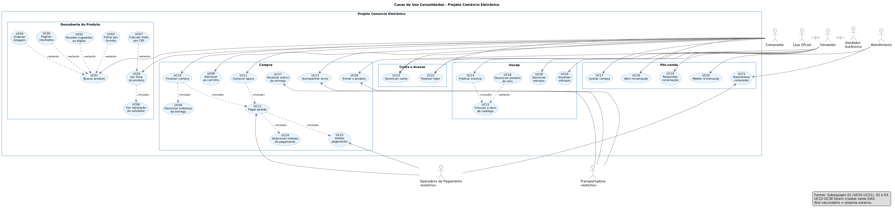
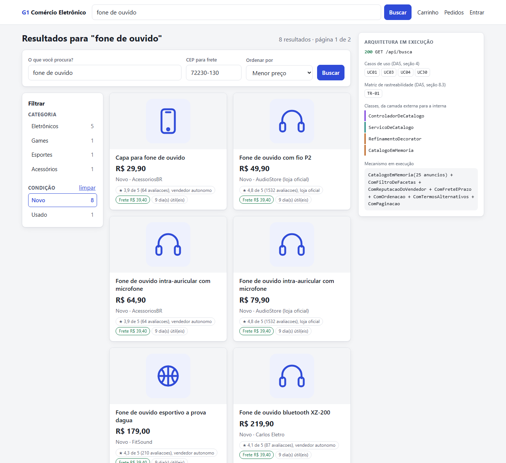
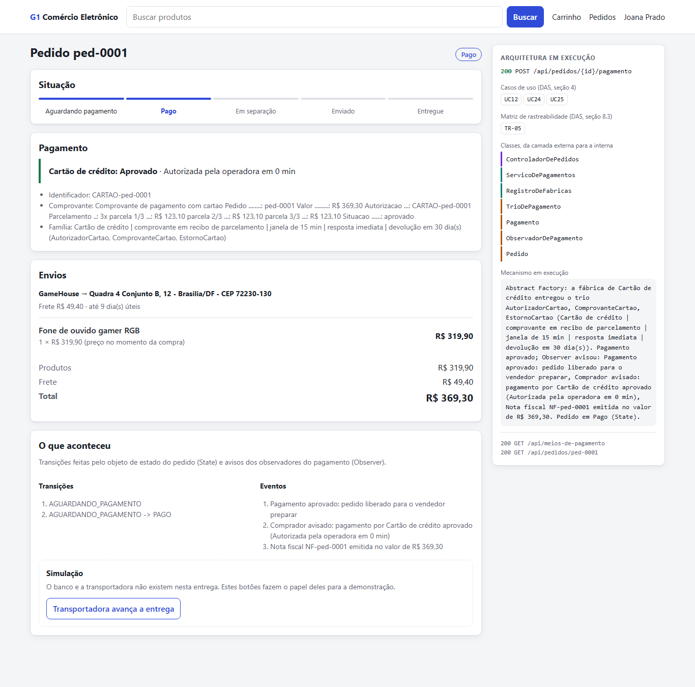
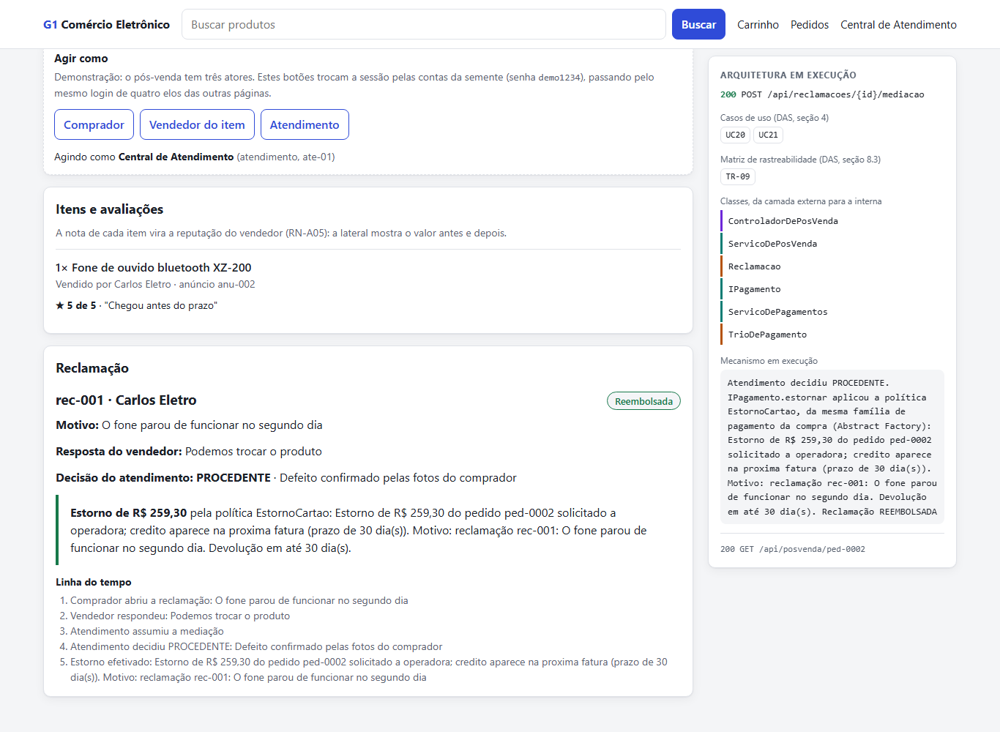
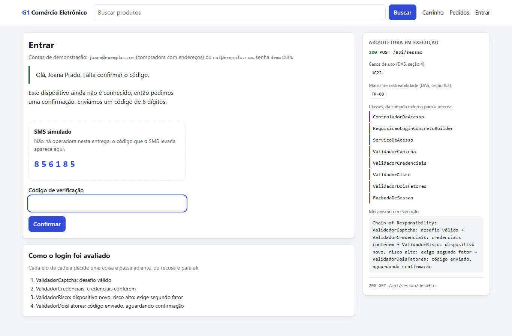

# G1_ProjetoComercioEletronico

# Documento de Arquitetura de Software (DAS)

## 1.1.2. Visão de Casos de Uso

> **Navegação do DAS:** [1.1.1. Introdução](/Base/Relatórios/1.1.1.Introducao.md) | **1.1.2. Casos de Uso** | [1.1.3. Visão Lógica](/Base/Relatórios/1.1.3.VisaoLogica.md) | [1.1.4. Visão de Processos](/Base/Relatórios/1.1.4.VisaoProcessos.md) | [1.1.5. Implantação](/Base/Relatórios/1.1.5.VisaoImplantacao.md) | [1.1.6. ADRs](/Base/Relatórios/1.1.6.ADRs.md) | [1.1.7. Rastreabilidade](/Base/Relatórios/1.1.7.Rastreabilidade.md) | [1.1.8. Evidências de Execução](/Base/Relatórios/1.1.8.EvidenciasExecucao.md)

---

# 4. Visão de Casos de Uso

A **Visão de Casos de Uso** (ou Visão de Cenários) é o elemento central e integrador do **Modelo 4+1 de Kruchten (1995)**, detalhado na [Seção 2 (Representação Arquitetural)](/Base/Relatórios/1.1.1.Introducao.md?id=_2-representação-arquitetural). Ela descreve o comportamento externamente observável do sistema de e-commerce sob a perspectiva dos seus diferentes atores (compradores, vendedores, administradores e sistemas parceiros), selecionando os fluxos e cenários operacionais críticos que justificam, guiam e validam de forma interligada as demais visões arquiteturais:

* **Direcionamento da Visão Lógica:** Os cenários de casos de uso definem quais entidades, serviços de aplicação, controladores e padrões de projeto (GoF e GRASP) devem ser concebidos no domínio do software para satisfazer as regras de negócio.
* **Orientação da Visão de Implementação:** Os fluxos e contratos funcionais delimitam a modularidade do código-fonte em Java puro, as interfaces públicas (`ICatalogo`, `IFrete`, `IPagamento`) e os testes automatizados de arquitetura.
* **Fundamentação da Visão de Implantação:** A volumetria, os padrões de tráfego e os requisitos de segurança dos casos de uso justificam a distribuição dos nós físicos de hardware, a CDN de borda, o isolamento em sub-redes privadas e a topologia de rede em nuvem.

---

## 4.1 Finalidade e Escopo da Visão

Esta seção cumpre quatro papéis estratégicos dentro do Documento de Arquitetura de Software:

1. **Registrar formalmente as capacidades funcionais do e-commerce**, consolidando os diagramas e especificações de casos de uso desenvolvidos pelas três subequipes do projeto na Entrega 02 em um catálogo unificado de 30 casos de uso (`UC01` a `UC30`).
2. **Identificar os casos de uso arquiteturalmente significativos**, isto é, aqueles que exercitam fluxos ponta a ponta complexos, possuem alto acoplamento funcional, manipulam dados sensíveis ou exigem garantias transacionais rigorosas.
3. **Interligar as decisões conceituais de software e de infraestrutura**, demonstrando de forma bidirecional como cada caso de uso mobiliza classes e padrões GoF na [Visão Lógica](/Base/Relatórios/1.1.3.VisaoLogica.md) e nós computacionais na [Visão de Implantação](/Base/Relatórios/1.1.5.VisaoImplantacao.md).
4. **Assegurar a rastreabilidade estrutural**, servindo de âncora para a verificação de conformidade dos requisitos eliciados na Entrega 01 e dos padrões de desenho implementados na Entrega 03 e 04.

O escopo funcional cobre integralmente os três recortes essenciais da plataforma de comércio eletrônico descritos na [Seção 1.2 (Escopo)](/Base/Relatórios/1.1.1.Introducao.md?id=_12-escopo):
* **Recorte A — Descoberta e Catálogo:** busca com sugestões instantâneas, filtros dinâmicos por facetas e ficha técnica de produtos;
* **Recorte B — Compra e Checkout:** gerenciamento de carrinho multiloja, seleção de frete, endereçamento e autorização transacional de pagamentos;
* **Recorte C — Gestão de Anúncios e Vendas:** publicação de produtos, upload de imagens, controle de estoque e despacho;
* **Módulos Transversais:** autenticação e segurança de sessão (**Conta e Acesso**) e mediação de reclamações e avaliações (**Pós-venda**).

---

## 4.2 Fontes e Critério de Consolidação

Três diagramas de casos de uso foram produzidos na Entrega 02. Eles têm níveis de detalhe e critérios de agrupamento diferentes, e esta seção os unifica sem descartar nenhum:

| Fonte            | Foco                                                                         |    Casos de uso    | Contribuição para esta visão                                                                       | Link de rastreabilidade dos artefatos                                                                                                                                                                                               |
| :--------------- | :--------------------------------------------------------------------------- | :----------------: | :------------------------------------------------------------------------------------------------- | :---------------------------------------------------------------------------------------------------------------------------------------------------------------------------------------------------------------------------------- |
| **Subequipe 03** | Visão ampla do Mercado Livre, com quatro atores                              |         13         | Casos de uso de **conta/acesso**, **pagamento** (com `include`), **envio** e **estoque**           | [Artefatos e documentação desenvolvidos pela Subequipe 03](https://unbarqdsw2026-2-turma01.github.io/2026.2-T01-_G1_ProjetoComercioEletronico_Entrega_02/#/Base/Relat%C3%B3rios/Subequipe03/ModelagemEstatica/DiagramaDeCasosDeUso) |
| **Subequipe 01** | Visão por objetivo do ator, rastreada ao Rich Picture e à Engenharia Reversa | 21 (`UC01`–`UC21`) | **Identificadores canônicos**, agrupamento em pacotes, ator `Atendimento` e fluxo de **pós-venda** | [Artefatos e documentação desenvolvidos pela Subequipe 01](https://unbarqdsw2026-2-turma01.github.io/2026.2-T01-_G1_ProjetoComercioEletronico_Entrega_02/#/Base/Relat%C3%B3rios/Subequipe01/ModelagemEstatica/DiagramaDeCasosDeUso) |
| **Subequipe 02** | Detalhamento da funcionalidade de **busca**                                  |         6          | Granularidade fina da busca, incluindo **paginação**                                               | [Artefatos e documentação desenvolvidos pela Subequipe 02](https://unbarqdsw2026-2-turma01.github.io/2026.2-T01-_G1_ProjetoComercioEletronico_Entrega_02/#/Base/Relat%C3%B3rios/Subequipe02/ModelagemEstatica/DiagramaDeCasosDeUso) |

**Critério adotado.** Os identificadores `UC01`–`UC21` da Subequipe 01 foram mantidos como base, por já estarem rastreados a requisitos (RF-A, RN-B, RN-C) e aos demais diagramas. Os casos de uso que existem apenas nas Subequipes 02 e 03 receberam identificadores novos (`UC22`–`UC30`), criados neste DAS. Quando dois diagramas modelam o mesmo comportamento com nomes diferentes, o caso de uso aparece uma única vez, com a equivalência registrada na tabela da Seção 4.4.

---

## 4.3 Atores

| Ator                                              | Tipo                                      | Descrição                                                                                                                                                              |           Aparece em           |
| :------------------------------------------------ | :---------------------------------------- | :--------------------------------------------------------------------------------------------------------------------------------------------------------------------- | :----------------------------: |
| **Comprador**                                     | Primário (humano)                         | Pessoa que busca, compra, paga, acompanha a entrega e avalia produtos.                                                                                                 | S01, S02 (como "Usuário"), S03 |
| **Vendedor**                                      | Primário (humano)                         | Pessoa que publica anúncios, controla o estoque e atende reclamações. Especializa-se em **Loja Oficial** e **Vendedor Autônomo**, que realizam os mesmos casos de uso. |            S01, S03            |
| **Atendimento**                                   | Primário (humano)                         | Equipe que media reclamações e autoriza reembolsos. Está **fora** da fronteira do sistema.                                                                             |              S01               |
| **Operadora de Pagamento** (Serviço de Pagamento) | Secundário (sistema externo, `«externo»`) | Autoriza e valida pagamentos e executa estornos.                                                                                                                       |            S01, S03            |
| **Transportadora**                                | Secundário (sistema externo, `«externo»`) | Executa o transporte e informa o andamento da entrega.                                                                                                                 |            S01, S03            |

Os atores secundários são sistemas parceiros externos consumidos pela plataforma para viabilizar e concluir os fluxos de negócio iniciados pelos atores primários (como a autorização financeira por operadoras de cartão ou a cotação e despacho logístico por transportadoras). Do ponto de vista arquitetural, a integração com esses atores é completamente desacoplada do núcleo do sistema através de contratos de abstração e inversão de dependência na [Visão Lógica](/Base/Relatórios/1.1.3.VisaoLogica.md) (`IPagamento`, `IFrete`, `IRastreio`), isolando a regra de negócio do e-commerce das particularidades tecnológicas ou indisponibilidades temporárias de parceiros de infraestrutura. A Subequipe 02 adota um ator genérico ("Usuário"), tratado nesta visão como o **Comprador** em sua jornada de descoberta e navegação.

---

## 4.4 Catálogo de Casos de Uso

### Diagrama Consolidado

O diagrama a seguir reúne os casos de uso das três subequipes. As setas sólidas são associações entre ator e caso de uso; as tracejadas são relacionamentos entre casos de uso.

<strong>Diagrama de casos de uso</strong> — Diagrama que consolida os casos de uso desenvolvidos por todos do grupo. <em>Autor: José Joaquim da Silva Neto</em>

[Clique aqui para baixar a imagem!](Assets/Subequipe3/CasosDeUsosConsolidados.png ":ignore")

> **Nota de leitura.** O diagrama consolidado é uma síntese produzida para este DAS. Os diagramas originais, com a notação UML completa, permanecem como as fontes oficiais: [Subequipe 01](https://unbarqdsw2026-2-turma01.github.io/2026.2-T01-_G1_ProjetoComercioEletronico_Entrega_02/#/Base/Relat%C3%B3rios/Subequipe01/ModelagemEstatica/DiagramaDeCasosDeUso), [Subequipe 02](https://unbarqdsw2026-2-turma01.github.io/2026.2-T01-_G1_ProjetoComercioEletronico_Entrega_02/#/Base/Relat%C3%B3rios/Subequipe02/ModelagemEstatica/DiagramaDeCasosDeUso) e [Subequipe 03](https://unbarqdsw2026-2-turma01.github.io/2026.2-T01-_G1_ProjetoComercioEletronico_Entrega_02/#/Base/Relat%C3%B3rios/Subequipe03/ModelagemEstatica/DiagramaDeCasosDeUso).

### Descrição dos Casos de Uso

|            ID             | Caso de uso                    | Ator(es)                            | Descrição                                                                   | Equivalência nas fontes                                                                          |
| :-----------------------: | :----------------------------- | :---------------------------------- | :-------------------------------------------------------------------------- | :----------------------------------------------------------------------------------------------- |
|    **Conta e Acesso**     |                                |                                     |                                                                             |                                                                                                  |
|           UC22            | Realizar login                 | Comprador, Vendedor                 | Autentica o usuário para acessar as funções restritas da plataforma.        | S03: _Realizar Login_                                                                            |
|           UC23            | Gerenciar conta                | Comprador, Vendedor                 | Mantém dados cadastrais, senha e endereço, que existem para os dois papéis. | S03: _Gerenciar Conta_                                                                           |
| **Descoberta do Produto** |                                |                                     |                                                                             |                                                                                                  |
|           UC01            | Buscar produto                 | Comprador                           | Informa um termo e obtém a listagem de produtos correspondentes.            | S01: `UC01`; S02: _Buscar Produtos_; S03: _Buscar Produto_                                       |
|           UC02            | Receber sugestões ao digitar   | Comprador                           | O sistema sugere termos conforme o usuário digita.                          | S01: `UC02`; S02: _Consultar Sugestões de Busca_                                                 |
|           UC03            | Filtrar por facetas            | Comprador                           | Refina os resultados por categoria, preço, condição, frete e similares.     | S01: `UC03`; S02: _Filtrar Resultados_; S03: _Selecionar Preferências_ (equivalência aproximada) |
|           UC04            | Ordenar listagem               | Comprador                           | Reorganiza os resultados por relevância, menor ou maior preço.              | S01: `UC04`; S02: _Ordenar Resultados_                                                           |
|           UC30            | Paginar resultados             | Comprador                           | Avança para a próxima página ou carrega mais itens.                         | S02: _Paginar Resultados_                                                                        |
|           UC05            | Ver ficha do produto           | Comprador                           | Abre a página detalhada do item, com múltiplas mídias.                      | S01: `UC05`; S02: _Visualizar Detalhes do Produto_                                               |
|           UC06            | Ver reputação do vendedor      | Comprador                           | Exibe a reputação do vendedor junto ao preço.                               | S01: `UC06`                                                                                      |
|           UC07            | Calcular frete por CEP         | Comprador                           | Calcula frete e prazo a partir do CEP informado, antes da compra.           | S01: `UC07`                                                                                      |
|        **Compra**         |                                |                                     |                                                                             |                                                                                                  |
|           UC08            | Adicionar ao carrinho          | Comprador                           | Inclui o item na sacola de compras.                                         | S01: `UC08`                                                                                      |
|           UC09            | Gerenciar endereço de entrega  | Comprador                           | Escolhe, cadastra ou altera o endereço de entrega.                          | S01: `UC09`                                                                                      |
|           UC10            | Finalizar compra               | Comprador                           | Conduz o carrinho pela sequência de checkout.                               | S01: `UC10`                                                                                      |
|           UC11            | Comprar agora                  | Comprador                           | Caminho direto ao checkout, sem passar pelo carrinho.                       | S01: `UC11`                                                                                      |
|           UC12            | Pagar pedido                   | Comprador, Operadora de Pagamento   | Efetiva o pagamento do pedido junto à operadora.                            | S01: `UC12`; S03: _Realizar Pagamento_                                                           |
|           UC24            | Selecionar método de pagamento | Comprador                           | Escolhe o meio de pagamento do pedido.                                      | S03: _Selecionar Método de Pagamento_                                                            |
|           UC25            | Validar pagamento              | Operadora de Pagamento              | Confirma ou recusa a autorização do pagamento.                              | S03: _Validar Pagamento_                                                                         |
|           UC26            | Enviar o produto               | Vendedor, Transportadora            | Despacha o pedido pago ao transporte.                                       | S03: _Enviar o Produto_                                                                          |
|           UC27            | Atualizar status da entrega    | Transportadora                      | Informa ao sistema o andamento da entrega.                                  | S03: _Atualizar Status da Entrega_                                                               |
|           UC13            | Acompanhar envio               | Comprador, Transportadora           | Consulta o andamento do pedido após a compra.                               | S01: `UC13`                                                                                      |
|         **Venda**         |                                |                                     |                                                                             |                                                                                                  |
|           UC14            | Publicar anúncio               | Vendedor                            | Publica um anúncio com fotos e preço.                                       | S01: `UC14`; S03: _Cadastrar Produto_                                                            |
|           UC15            | Vincular a item de catálogo    | Vendedor                            | Associa a oferta a um item já existente no catálogo (caminho padrão).       | S01: `UC15`                                                                                      |
|           UC16            | Descrever produto do zero      | Vendedor                            | Descreve livremente um produto novo (caminho de exceção).                   | S01: `UC16`                                                                                      |
|           UC28            | Gerenciar estoque              | Vendedor                            | Consulta e ajusta o estoque e seus limites.                                 | S03: _Gerenciar Estoque_                                                                         |
|           UC29            | Atualizar estoque              | Vendedor                            | Altera a quantidade disponível, por exemplo após uma venda.                 | S03: _Atualizar Estoque_                                                                         |
|       **Pós-venda**       |                                |                                     |                                                                             |                                                                                                  |
|           UC17            | Avaliar compra                 | Comprador                           | Registra a avaliação do produto e da compra.                                | S01: `UC17`; S03: _Adicionar Avaliação_                                                          |
|           UC18            | Abrir reclamação               | Comprador                           | Registra um problema com a compra concluída.                                | S01: `UC18`                                                                                      |
|           UC19            | Responder reclamação           | Vendedor                            | Apresenta a resposta do vendedor à reclamação.                              | S01: `UC19`                                                                                      |
|           UC20            | Mediar reclamação              | Atendimento                         | Analisa as evidências e decide o desfecho da disputa.                       | S01: `UC20`                                                                                      |
|           UC21            | Reembolsar comprador           | Atendimento, Operadora de Pagamento | Executa o estorno quando a mediação o determina.                            | S01: `UC21`                                                                                      |

---

## 4.5 Relacionamentos entre Casos de Uso

Os relacionamentos seguem a definição da OMG (2017): `«include»` indica comportamento que o caso de uso base **sempre** executa, e `«extend»` indica comportamento que ocorre **apenas sob condição**, sem que o caso base dependa dele.

| Relacionamento                |   Tipo    | Justificativa                                                                                |
| :---------------------------- | :-------: | :------------------------------------------------------------------------------------------- |
| UC05 → UC06                   | `include` | A reputação do vendedor aparece sempre junto ao preço (RN-A05).                              |
| UC07 → UC05                   | `extend`  | O frete só é calculado se o CEP for informado (RN-A04, RF-A04).                              |
| UC02, UC03, UC04, UC30 → UC01 | `extend`  | Uma busca é completa sem sugestões, filtros, ordenação ou paginação (RF-A01 a RF-A03).       |
| UC10 → UC09                   | `include` | Toda compra exige definir o destino da entrega (RN-B02).                                     |
| UC10 → UC12 e UC11 → UC12     | `include` | Os dois caminhos de compra convergem para o pagamento (RN-B08).                              |
| UC12 → UC24 e UC12 → UC25     | `include` | Todo pagamento exige um método escolhido e uma validação da operadora.                       |
| UC14 → UC15                   | `include` | A plataforma tenta vincular a oferta ao catálogo antes de permitir descrição livre (RN-C04). |
| UC16 → UC15                   | `extend`  | Descrever do zero é o caminho de exceção (RN-C06).                                           |

**Divergência registrada entre as fontes.** A Subequipe 01 modela as sugestões de busca (UC02) como `«extend»`, porque a busca é válida sem elas. A Subequipe 02 as modela como `«include»`, porque no seu recorte as sugestões ocorrem sempre que o usuário digita. Este DAS adota o `«extend»`, que é coerente com o critério "acontece sempre ou só às vezes" aplicado ao _caso de uso de busca_ (e não à digitação), e preserva o rastreio a RF-A01.

---

## 4.6 Casos de Uso Arquiteturalmente Significativos e Realização Multivisão

Nem todo caso de uso influencia a arquitetura do e-commerce com a mesma intensidade. No modelo 4+1, os **Casos de Uso Arquiteturalmente Significativos** são aqueles cenários que exercitam múltiplos domínios técnicos simultaneamente: atravessam diferentes camadas de software, mobilizam padrões de projeto GoF/GRASP, exigem garantias transacionais e direcionam os recursos físicos de rede e nuvem.

A seguir, apresentam-se os cinco fluxos mais críticos da plataforma, articulando sua importância de negócio com suas realizações diretas na **Visão Lógica** e na **Visão de Implantação**:

---

### 4.6.1 UC01 Buscar produto (inclui extensões UC02, UC03, UC04 e UC30)

* **Importância Arquitetural & Cenário:** Porta de entrada da jornada do consumidor (Recorte A) e fluxo de maior volume de requisições da plataforma. Exige baixíssima latência na devolução de resultados e capacidade de filtragem facetada sob demanda.
* **Realização na Visão Lógica:**
  - *Pacote de Domínio:* `Catálogo e Descoberta`.
  - *Classes e Entidades:* `Produto`, `Anuncio`, `ConsultaCatalogo`, `FonteDeResultados`, `ItemResultado`.
  - *Padrões de Projeto:* GoF **Decorator** (`RefinamentoDecorator`, `ComPaginacao`, `ComTermosAlternativos`, `ComFiltroPreco`) para composição dinâmica de consultas sem acoplamento; padrão **Controller GRASP** (`ControladorDeCatalogo`) desacoplando rotas HTTP de regras de catálogo; DTOs leves (`RespostaBuscaDTO`).
* **Contratos e Componentes:** Provê `ICatalogo` e `IFichaProduto`; consome a porta `IFrete` para cálculo estimativo de entrega na listagem.
* **Mapeamento na Visão de Implantação:** Resolução via Anycast DNS (**Amazon Route 53**), terminação TLS 1.3 e cache dinâmico de borda (**Amazon CloudFront CDN** / PoPs do IX.br), assets e fotos de capa entregues por buckets (**Amazon S3**), com requisições de API roteadas ao cluster de backend.
* **Meta de Qualidade (NFR):** Eficiência de Uso, tempo de resposta inferior a 200 ms e usabilidade contínua.
* **Evidência Visual de Execução da Feature:**

<em>Evidência da Feature em Execução: Busca facetada com paginação e ordenação ativa no servidor local. Ver detalhes em <a href="#/Base/Relatórios/1.1.8.EvidenciasExecucao">1.1.7. Evidências de Execução</a>.</em>

---

### 4.6.2 UC10 Finalizar compra e UC12 Pagar pedido (com UC11, UC24 e UC25)

* **Importância Arquitetural & Cenário:** Coração transacional da plataforma (Recorte B). Apresenta a maior densidade de acoplamento conceitual e exige garantia absoluta de integridade (propriedades ACID), evitando vendas sem estoque ou cobranças inconsistentes.
* **Realização na Visão Lógica:**
  - *Pacote de Domínio:* `Transação`.
  - *Classes e Entidades:* `Carrinho`, `ItemCarrinho`, `Pedido`, `EstadoPedido`, `Pagamento`, `MeioPagamento`, Value Object `CEP`.
  - *Padrões de Projeto:* GoF **State** para governar o ciclo de vida rigoroso do pedido (`CRIADO → AGUARDANDO_PAGAMENTO → PAGO → CANCELADO`); GoF **Abstract Factory** (`FabricaMeioPagamento`, `FabricaPix`, `FabricaCartao`) para criação desacoplada de meios de cobrança; GoF **Observer** (`ObservadorDePagamento`) para disparar eventos assíncronos pós-confirmação.
* **Contratos e Componentes:** `Serviço de Checkout e Pedidos` orquestrando interfaces `ICarrinho`, `IEndereco`, `IPagamento` e `IFrete`.
* **Mapeamento na Visão de Implantação:** Tráfego HTTPS obrigatório com cifras TLS 1.3; isolamento do cluster transacional de backend em sub-redes privadas de VPC (sem IP público); conexão segura via TLS com gateways das operadoras de pagamento.
* **Meta de Qualidade (NFR):** Integridade de dados, prevenção de erros de preenchimento e segurança financeira.
* **Evidência Visual de Execução da Feature:**

<em>Evidência da Feature em Execução: Checkout transacional com validação de estado e meio de pagamento. Ver detalhes em <a href="#/Base/Relatórios/1.1.8.EvidenciasExecucao">1.1.7. Evidências de Execução</a>.</em>

---

### 4.6.3 UC14 Publicar anúncio (inclui UC15 e estende para UC16)

* **Importância Arquitetural & Cenário:** Fluxo vital de alimentação do ecossistema de vendas (Recorte C). Envolve persistência de metadados complexos e transferência de mídias pesadas (fotografias e manuais) enviadas pelos vendedores.
* **Realização na Visão Lógica:**
  - *Pacotes de Domínio:* `Catálogo e Descoberta` e `Transação`.
  - *Classes e Entidades:* `Anuncio`, `Produto`, `Vendedor`, `Foto`, `Categoria`.
  - *Padrões de Projeto:* **Information Expert GRASP** atribuindo ao anúncio a consistência de preço, estoque e fotos; padrão **Value Object** para atributos imutáveis; separação estrutural entre a entidade conceitual `Produto` e a oferta comercial `Anuncio` (ADR-04).
* **Contratos e Componentes:** `Serviço de Anúncios` (provê `IAnuncio`) colaborando com `Serviço de Catálogo`.
* **Mapeamento na Visão de Implantação:** Upload multipart direcionado via proxy web de aceleração (**Tengine**) com armazenamento dos arquivos de mídia diretamente no repositório de objetos (**Amazon S3**), preservando o armazenamento local dos servidores de backend.
* **Meta de Qualidade (NFR):** Manutenibilidade, modularidade de catálogo e persistência segura de mídias.

---

### 4.6.4 UC13 Acompanhar envio (com UC26 Despachar e UC27 Atualizar Rastreio)

* **Importância Arquitetural & Cenário:** Fluxo assíncrono que conecta o e-commerce ao mundo físico através de operadoras logísticas. Ocorre fora do ciclo de requisição imediato do comprador.
* **Realização na Visão Lógica:**
  - *Pacotes de Domínio:* `Transação` e `Pós-venda`.
  - *Classes e Entidades:* `ServicoDeEntrega`, `IRastreio`, `StatusRastreio`, `EtiquetaEnvio`, `Avaliacao`, `Reclamacao`.
  - *Padrões de Projeto:* GoF **Observer** desacoplando o recebimento de webhooks de rastreamento da atualização do cliente; padrão **Adapter / Facade** encapsulando os protocolos proprietários de APIs de frete em um contrato limpo do domínio (`IRastreio`); GoF **State** para o ciclo de vida de reclamações.
* **Contratos e Componentes:** Provê `IRastreio`, `IReclamacao` e consome web services de transportadoras parceiras.
* **Mapeamento na Visão de Implantação:** Comunicação segura com web services externos via rotas de saída controladas da VPC; desoneração de consultas repetitivas de status através de cache temporário de rastreamento.
* **Meta de Qualidade (NFR):** Transparência operacional, tolerância a falhas externas e desacoplamento de serviços terceiros.
* **Evidência Visual de Execução da Feature:**

<em>Evidência da Feature em Execução: Gestão de pós-venda, abertura de disputa e registro de reputação. Ver detalhes em <a href="#/Base/Relatórios/1.1.8.EvidenciasExecucao">1.1.7. Evidências de Execução</a>.</em>

---

### 4.6.5 UC22 Realizar login e UC23 Gerenciar conta (com UC09)

* **Importância Arquitetural & Cenário:** Pré-requisito de segurança e personalização para todas as operações sensíveis do sistema. Concentra credenciais, perfis de autorização e dados de proteção à privacidade do consumidor (LGPD).
* **Realização na Visão Lógica:**
  - *Pacote de Domínio:* `Contas e Acesso`.
  - *Classes e Entidades:* `Usuario`, `Credenciais`, `SessaoUsuario`, `Perfil`, `RequisicaoLogin`.
  - *Padrões de Projeto:* GoF **Builder** (`RequisicaoLogin`) para composição segura e imutável do contexto de autenticação; GoF **Chain of Responsibility** (`ValidadorHandler` encadeando verificação de formato, integridade de hash com sal, checagem de risco e validação de 2FA); GoF **Facade** (`FachadaSessaoAutenticada`) como ponto unificado de entrada para gestão de tokens de sessão.
* **Contratos e Componentes:** Componente de Identidade e Acesso provendo interfaces de autenticação para as camadas de apresentação Web e Mobile.
* **Mapeamento na Visão de Implantação:** Tráfego encriptado ponta a ponta com certificados TLS 1.3 corporativos; repositório de credenciais alocado em sub-rede de dados privada sem rota de roteamento para a internet.
* **Meta de Qualidade (NFR):** Segurança e confidencialidade estritas, integridade de credenciais e prevenção contra acessos indevidos.
* **Evidência Visual de Execução da Feature:**

<em>Evidência da Feature em Execução: Autenticação em quatro elos funcionais rodando na aplicação web. Ver detalhes em <a href="#/Base/Relatórios/1.1.8.EvidenciasExecucao">1.1.7. Evidências de Execução</a>.</em>

---

## 4.7 Rastreabilidade Integrada: Casos de Uso → Visão Lógica → Visão de Implantação

A matriz a seguir consolida a rastreabilidade total das 4+1 visões do sistema, evidenciando como os casos de uso funcionais se materializam em pacotes e classes de software e encontram suporte físico na infraestrutura:

| Casos de Uso | Pacote Lógico (Visão Lógica) | Classes & Padrões GoF/GRASP | Componentes & Interfaces | Nó de Implantação (Infraestrutura) | Certeza da Evidência |
| :--- | :--- | :--- | :--- | :--- | :---: |
| **UC01–UC07, UC30** (Busca e Catálogo) | `Catálogo e Descoberta` | `Produto`, `Anuncio`, `ConsultaCatalogo` • **Decorator** (`RefinamentoDecorator`, `ComPaginacao`) • Controller GRASP | `Serviço de Catálogo` Provê: `ICatalogo`, `IFichaProduto` Requer: `IFrete` | CloudFront (CDN Borda) → Tengine / S3 → Backend de API | Parcial (Borda confirmada / Backend modelado) |
| **UC08** (Carrinho de Compras) | `Transação` | `Carrinho`, `ItemCarrinho` • Information Expert GRASP • DTOs de Item | `Serviço de Carrinho` Provê: `ICarrinho` | Backend de API (VPC Privada) | Implementada & Modelada |
| **UC09, UC22, UC23** (Contas e Autenticação) | `Contas e Acesso` | `Usuario`, `Credenciais`, `SessaoUsuario` • **Builder** (`RequisicaoLogin`) • **Chain of Responsibility** (`ValidadorHandler`) • **Facade** (`FachadaSessao`) | `Serviço de Contas e Acesso` Provê: `IEndereco`, `IAutenticacao` | Backend de API (Sub-rede de segurança privada) | Implementada & Modelada |
| **UC10, UC11** (Checkout de Pedidos) | `Transação` | `Pedido`, `EstadoPedido`, Value Object `CEP` • **State** (Estados de Pedido) • Controller GRASP | `Serviço de Checkout e Pedidos` Provê: `ICheckout` Requer: `ICarrinho`, `IPagamento`, `IFrete` | Backend de API (VPC Privada) | Implementada & Modelada |
| **UC12, UC24, UC25** (Pagamentos) | `Transação` | `Pagamento`, `MeioPagamento` • **Abstract Factory** (`FabricaMeioPagamento`) • **Observer** (`ObservadorDePagamento`) | `Serviço de Pagamentos` Provê: `IPagamento` | Backend de API → Operadora Externa (TLS 1.3) | Implementada & Modelada |
| **UC13, UC26, UC27** (Envio e Logística) | `Transação` / `Pós-Venda` | `ServicoDeEntrega`, `StatusRastreio` • **Observer** (Eventos de despacho) • Adapter / Facade de parceiros | `Serviço de Entrega` Provê: `IRastreio`, `IFrete` | Backend de API → Transportadora Externa | Implementada & Inferida |
| **UC14–UC16, UC28, UC29** (Anúncios e Produtos) | `Catálogo e Descoberta` | `Anuncio`, `Produto`, `Foto` • Separação Produto x Anúncio (ADR-04) • Information Expert | `Serviço de Anúncios` Provê: `IAnuncio` | Backend de API + Amazon S3 (mídias) | Implementada & Modelada |
| **UC17–UC21** (Pós-Venda e Avaliação) | `Pós-Venda` | `Avaliacao`, `Reclamacao`, `CicloReclamacao` • State / Lifecycle Pattern • Controller GRASP | `Serviço de Pós-Venda` Provê: `IReclamacao` Requer: `IPagamento`, `IRastreio` | Backend de API (VPC Privada) | Implementada & Inferida |

---

## 4.8 Limitações e Considerações Arquiteturais

Seguindo os princípios de rigor analítico, transparência e governança do Documento de Arquitetura de Software, registram-se as limitações e pontos de reconciliação identificados na unificação dos casos de uso:

1. **Seta de inclusão invertida (normalizada):** No modelo original da Subequipe 03, a seta de dependência entre _Selecionar Método de Pagamento_ e _Realizar Pagamento_ apontava no sentido inverso da convenção UML. A relação foi padronizada formalmente nesta visão (`UC12` inclui `UC24`).
2. **Desacoplamento de despacho e envio:** No modelo original da Subequipe 03, o ator Comprador aparecia indevidamente associado ao caso de uso _Enviar o Produto_. Na arquitetura corrigida, o despacho é de responsabilidade estrita do Vendedor e o transporte físico é executado pela Transportadora parceira (`UC26`), cabendo ao comprador unicamente o acompanhamento do rastreamento (`UC13`).
3. **Reconciliação conceitual de avaliação:** O caso de uso _Adicionar Avaliação_ foi unificado com `UC17` (_Avaliar compra_), mantendo a rastreabilidade direta com o requisito funcional de reputação.
4. **Isolamento de fluxos administrativos:** Operações administrativas internas (como conciliação financeira de repasses bancários, auditoria antifraude e mediação arbitral de disputas) foram abstraídas da fronteira do comprador e vendedor, constituindo interfaces de suporte do ecossistema.
5. **Complementaridade com visões dinâmicas:** Os casos de uso definem **o que** o software realiza. A ordem temporal detalhada, as condições de concorrência e as transições de estado são modeladas nos diagramas comportamentais (Diagrama de Atividades, Diagrama de Sequência e Diagrama de Máquina de Estados).

---

### Referências desta seção

- KRUCHTEN, Philippe. _The 4+1 View Model of Architecture_. IEEE Software, v. 12, n. 6, p. 42-50, 1995.
- OMG — Object Management Group. _OMG Unified Modeling Language (OMG UML), Version 2.5.1_. Use Case Diagrams, 2017. Disponível em: <https://www.omg.org/spec/UML/2.5.1>.
- JACOBSON, Ivar et al. _Object-Oriented Software Engineering: A Use Case Driven Approach_. Wokingham: Addison-Wesley, 1992.
- COCKBURN, Alistair. _Writing Effective Use Cases_. Boston: Addison-Wesley, 2001.
- Diagramas de Casos de Uso, de Componentes e de Implantação das Subequipes 01, 02 e 03 (Entrega 02).

---

## Histórico de Versões

| Versão | Data | Descrição | Autor(es) | Revisor(es) |
| :---: | :---: | :--- | :--- | :--- |
| 1.0 | 20/11/2026 | Consolidação do catálogo de Casos de Uso (UC01 a UC30) e matriz de equivalência | José Joaquim da Silva Neto | Subequipe 03 |
| 1.1 | 21/11/2026 | Detalhamento dos 5 Casos de Uso Arquiteturalmente Significativos | José Joaquim da Silva Neto | Subequipe 03 |
| 1.2 | 23/11/2026 | Integração de capturas visuais das features rodando e harmonização com as demais visões | José Joaquim da Silva Neto, Pedro Henrique Gomes | Equipe |

---

  <a href="#/Base/Relatórios/1.1.1.Introducao"><strong>← Voltar para 1.1.1. Introdução e Metas</strong></a>
  <a href="#/Base/Relatórios/1.1.3.VisaoLogica"><strong>Avançar para 1.1.3. Visão Lógica →</strong></a>

