# G1_ProjetoComercioEletronico

# Documento de Arquitetura de Software (DAS)

## 1.1.3. Visão Lógica

> **Navegação do DAS:** [1.1.1. Introdução](/Base/Relatórios/1.1.1.Introducao.md) | [1.1.2. Casos de Uso](/Base/Relatórios/1.1.2.VisaoCasosDeUso.md) | **1.1.3. Visão Lógica** | [1.1.4. Visão de Processos](/Base/Relatórios/1.1.4.VisaoProcessos.md) | [1.1.5. Implantação](/Base/Relatórios/1.1.5.VisaoImplantacao.md) | [1.1.6. ADRs](/Base/Relatórios/1.1.6.ADRs.md) | [1.1.7. Rastreabilidade](/Base/Relatórios/1.1.7.Rastreabilidade.md) | [1.1.8. Evidências de Execução](/Base/Relatórios/1.1.8.EvidenciasExecucao.md)

---

# 5. Visão Lógica

A **Visão Lógica** materializa a estrutura conceitual e o design interno do software para atender integralmente aos cenários funcionais especificados na [Visão de Casos de Uso](/Base/Relatórios/1.1.2.VisaoCasosDeUso.md): define a decomposição do sistema em camadas arquiteturais ortogonais, estabelece as fronteiras e contratos dos pacotes de domínio, detalha as entidades de negócio e formaliza a aplicação dos padrões de projeto (**GoF e GRASP**) com código Java executável.

Dentro do modelo arquitetural global do DAS, a Visão Lógica exerce o papel de integração central:
* **Conexão com a Visão de Casos de Uso:** Cada pacote e controlador realiza fluxos de negócio específicos da plataforma (`UC01` a `UC30`), transformando intenções de usuário em algoritmos e regras de domínio;
* **Conexão com a Visão de Implementação:** As regras de dependência estritas entre camadas orientam a compilação, a estrutura de pacotes Java e a validação contínua por testes automatizados de arquitetura;
* **Conexão com a Visão de Implantação:** A segregação de responsabilidades em contratos abstratos (`ICatalogo`, `IFrete`, `IPagamento`, `IRastreio`) viabiliza a distribuição e a escalabilidade dos serviços nos nós físicos e de nuvem descritos na [Visão de Implantação](/Base/Relatórios/1.1.5.VisaoImplantacao.md).

Esta visão não foi construída do zero. Ela consolida e reconcilia três dimensões essenciais da evolução do projeto:

- o [Diagrama de Classes](https://unbarqdsw2026-2-turma01.github.io/2026.2-T01-_G1_ProjetoComercioEletronico_Entrega_02/#/Base/Relat%C3%B3rios/Subequipe01/ModelagemEstatica/DiagramaDeClasses) (Entrega 02), que estrutura o domínio em quatro grandes pacotes de negócio;
- o [Diagrama de Pacotes](https://unbarqdsw2026-2-turma01.github.io/2026.2-T01-_G1_ProjetoComercioEletronico_Entrega_02/#/Base/Relat%C3%B3rios/Subequipe03/ModelagemEstatica/DiagramaDePacotes) (Entrega 02), que organiza as responsabilidades técnicas do sistema em cinco camadas;
- os padrões GoF e GRASP da [Entrega 03](https://unbarqdsw2026-2-turma01.github.io/2026.2-T01-_G1_ProjetoComercioEletronico_Entrega_03/), integrados em **código Java executável e testável**.

### Metodologia de Elaboração e Reconciliação

A Visão Lógica foi concebida por meio de um processo estruturado em quatro etapas de engenharia de software:

1. **Levantamento e Mapeamento de Contratos:** Análise aprofundada dos casos de uso arquiteturais, do Diagrama de Classes e do Diagrama de Pacotes, identificando as entidades centrais, as operações e as portas de comunicação necessárias para o funcionamento do e-commerce.
2. **Reconciliação Arquitetural (Matriz Camadas × Domínio):** Unificação da decomposição horizontal (camadas técnicas de responsabilidade) com a decomposição vertical (pacotes coesos de negócio), estabelecendo uma organização matricial clara e regras de dependência unidirecionais.
3. **Incorporação dos Padrões GoF/GRASP:** Enquadramento de cada padrão de desenho desenvolvido na Entrega 03 em seu respectivo pacote de domínio — ex.: Decorator no Catálogo ([ADR-08](/Base/Relatórios/1.1.6.ADRs.md?id=_79-adr-08-enriquecimento-contextual-de-preços-e-badges-de-vitrine-via-padrão-gof-decorator)), State e Observer na Transação ([ADR-05](/Base/Relatórios/1.1.6.ADRs.md?id=_76-adr-05-máquina-de-estados-finita-para-ciclo-de-vida-do-pedido-com-garantia-acid), [ADR-06](/Base/Relatórios/1.1.6.ADRs.md?id=_77-adr-06-desacoplamento-de-tarefas-pós-transação-via-padrão-gof-observer)), Builder, Chain of Responsibility e Facade em Contas ([ADR-04](/Base/Relatórios/1.1.6.ADRs.md?id=_75-adr-04-orquestração-de-autenticação-em-cadeia-builder-cor-facade)) —, fechando lacunas de arquitetura identificadas em modelagens anteriores.
4. **Verificação por Código e Testes de Arquitetura:** Materialização do modelo em código Java puro sobre o JDK (sem dependências externas), suportado por uma suíte de testes de arquitetura nativa que valida em tempo de compilação a conformidade com as regras de importação e isolamento de camadas ([ADR-07](/Base/Relatórios/1.1.6.ADRs.md?id=_78-adr-07-monólito-modular-em-java-puro-sobre-o-jdk-e-verificação-arquitetural-automatizada)).

---

## 5.1 Visão Geral: Camadas e Hierarquia de Pacotes

### Duas dimensões de decomposição

Os dois diagramas estáticos da Entrega 02 decompõem o sistema por critérios diferentes, e nenhum dos dois está errado:

| Artefato de origem  | Critério de decomposição                  | Resultado                                                            |
| :------------------ | :---------------------------------------- | :------------------------------------------------------------------- |
| Diagrama de Pacotes | **Responsabilidade técnica** (horizontal) | `View`, `Controller`, `Service`, `Model`, `Repository` + externos    |
| Diagrama de Classes | **Coesão de domínio** (vertical)          | `Contas e Acesso`, `Catálogo e Descoberta`, `Transação`, `Pós-venda` |

A Visão Lógica adota as duas ao mesmo tempo, como uma matriz: **as camadas dizem o tipo de responsabilidade de uma classe; os pacotes de domínio dizem a qual assunto do negócio ela pertence.** Uma classe como `ControladorDeAutenticacao`, por exemplo, está na camada `Controller` e no pacote `Contas e Acesso`. Essa organização matricial é o alicerce integrador que conecta os cenários funcionais da [Visão de Casos de Uso](/Base/Relatórios/1.1.2.VisaoCasosDeUso.md) (que orientam o valor de negócio), as implementações em código executável (que obedecem à regra de independência de camadas) e a distribuição de serviços nos nós descritos na [Visão de Implantação](/Base/Relatórios/1.1.5.VisaoImplantacao.md?id=_62-decomposição-dos-nós-e-mapeamento-de-componentes).

### Diagrama de Camadas e Pacotes

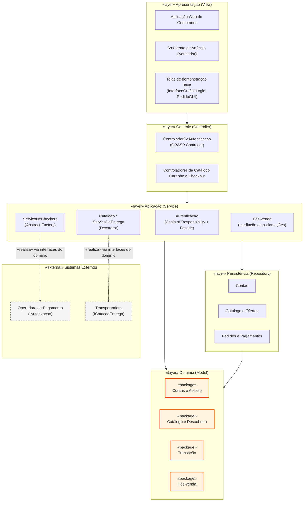

<p align="center"><strong>Figura 2: Camadas e pacotes de domínio da Visão Lógica.</strong> Setas sólidas: dependência permitida entre camadas. Setas tracejadas: dependência resolvida por interface definida no domínio (inversão de dependência). <em>Autor: João Paulo Barbosa Pereira Nunes.</em></p>

### Regras de dependência entre camadas

| Camada       | Pode depender de                                           | Não pode depender de              | Origem da regra                     |
| :----------- | :--------------------------------------------------------- | :-------------------------------- | :---------------------------------- |
| Apresentação | Controle                                                   | Aplicação, Domínio, Persistência  | Diagrama de Pacotes, seção 4        |
| Controle     | Aplicação                                                  | Persistência, Sistemas Externos   | GRASP Controller (Entrega 03)       |
| Aplicação    | Domínio, Persistência, interfaces de domínio para externos | Apresentação, Controle            | Diagrama de Pacotes, seções 2 e 4   |
| Domínio      | Nenhuma outra camada                                       | Todas as demais                   | Regra de Dependência (MARTIN, 2017) |
| Persistência | Domínio                                                    | Apresentação, Controle, Aplicação | Padrão Repository (FOWLER, 2002)    |

A camada de Domínio é a única que não depende de nada. É ela que concentra as regras de negócio observadas na Engenharia Reversa (RN-A, RN-B, RN-C) e, por isso, deve ser a mais estável do sistema.

### Rastreabilidade: Pacote Lógico → Componente → Nó Físico

| Pacote de domínio         | Componentes que o realizam ([Diagrama de Componentes](https://unbarqdsw2026-2-turma01.github.io/2026.2-T01-_G1_ProjetoComercioEletronico_Entrega_02/#/Base/Relat%C3%B3rios/Subequipe01/ModelagemEstatica/DiagramaDeComponentes)) | Interfaces providas                                           | Nó na [Visão de Implantação](/Base/Relatórios/1.1.5.VisaoImplantacao.md?id=_62-decomposição-dos-nós-e-mapeamento-de-componentes) |
| :------------------------ | :------------------------------------------------------------------------------------------------------------------------------------------------------------------------------------------------------------------------------- | :------------------------------------------------------------ | :--------------------------------------------------------------------------------- |
| **Contas e Acesso**       | Serviço de Contas e Endereços                                                                                                                                                                                                    | `IEndereco`                                                   | Backend de API (serviço de Contas e Endereços)                                     |
| **Catálogo e Descoberta** | Serviço de Catálogo, Serviço de Anúncios                                                                                                                                                                                         | `ICatalogo`, `IFichaProduto`, `IAnuncio`                      | Backend de API (Catálogo) e Amazon S3 (mídias)                                     |
| **Transação**             | Serviço de Carrinho, Serviço de Checkout e Pedidos, Serviço de Pagamentos, Serviço de Entrega                                                                                                                                    | `ICarrinho`, `ICheckout`, `IPagamento`, `IFrete`, `IRastreio` | Backend de API (Carrinho)                                                          |
| **Pós-venda**             | Serviço de Pós-venda                                                                                                                                                                                                             | `IReclamacao`                                                 | Backend de API (Pós-Venda)                                                         |
| **Externos**              | Operadora de Pagamento, Transportadora                                                                                                                                                                                           | `IAutorizacao`, `ICotacaoEntrega`                             | Fora da nuvem da plataforma                                                        |

---

## 5.2 Pacotes de Design Significativos do Ponto de Vista da Arquitetura

Os diagramas a seguir não repetem o Diagrama de Classes completo da Entrega 02 (trinta classificadores em uma única figura). Cada pacote mostra **apenas as classes que carregam uma decisão arquitetural**: as que concentram regras de negócio, as que cruzam fronteiras de pacote e as que foram implementadas na Entrega 03. As classes marcadas com o estereótipo `«implementada»` possuem código Java compilável e executável (ver [Seção 5.5](#55-evidência-de-execução)).

### 5.2.1 Pacote Contas e Acesso

**Descrição.** Reúne a identidade dos participantes da plataforma (comprador, vendedor e atendente), os dados de conta que sobrevivem a qualquer compra (endereços) e o subpacote **Autenticação**, que controla a entrada do usuário no sistema. O endereço pertence à conta, e não ao pedido (RN-B02), o que explica por que ele vive aqui e não em `Transação`.

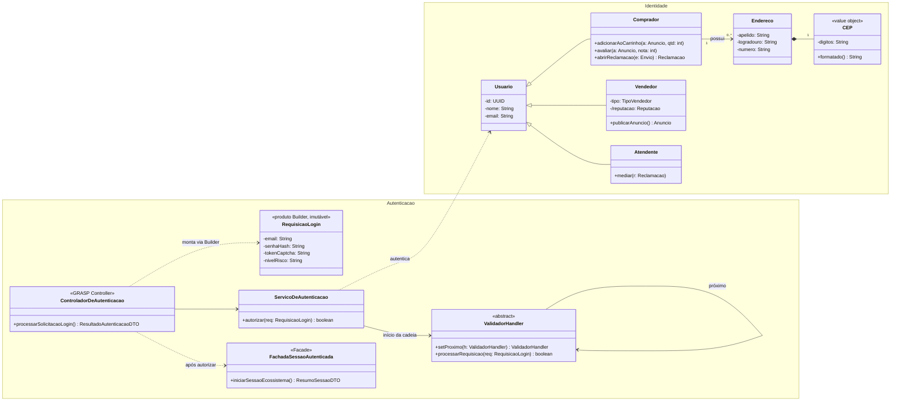

<p align="center"><strong>Figura 3: Pacote Contas e Acesso.</strong> <em>Fonte: Diagrama de Classes (Entrega 02) e padrões Builder, Chain of Responsibility, Facade e GRASP Controller (Entrega 03).</em></p>

| Classe                      | Responsabilidade arquitetural                                                                                                                                                       | Origem                                                                                                                                                                                                                  |
| :-------------------------- | :---------------------------------------------------------------------------------------------------------------------------------------------------------------------------------- | :---------------------------------------------------------------------------------------------------------------------------------------------------------------------------------------------------------------------- |
| `Usuario` e especializações | Identidade única de quem interage com a plataforma. `Vendedor.tipo` é enumeração (`LOJA_OFICIAL`, `AUTONOMO`), não subclasse, pois a diferença é de ranking e não de comportamento. | Diagrama de Classes, decisão 8                                                                                                                                                                                          |
| `Endereco` + `CEP`          | Endereço como dado da conta, reutilizado entre pedidos. `CEP` é value object de oito dígitos que garante o formato no construtor.                                                   | RN-B02, RN-B04                                                                                                                                                                                                          |
| `ControladorDeAutenticacao` | Primeiro objeto após a camada de apresentação a receber o evento de login. Coordena, mas não decide: delega montagem, validação e emissão de sessão.                                | [GRASP Controller](https://unbarqdsw2026-2-turma01.github.io/2026.2-T01-_G1_ProjetoComercioEletronico_Entrega_03/#/Base/Relat%C3%B3rios/Subequipe03/GRASP/Controller)                                                   |
| `RequisicaoLogin`           | Contexto imutável da tentativa de login (credenciais, captcha, telemetria do dispositivo, 2FA), construído passo a passo e validado antes de circular.                              | [Builder](https://unbarqdsw2026-2-turma01.github.io/2026.2-T01-_G1_ProjetoComercioEletronico_Entrega_03/#/Base/Relat%C3%B3rios/Subequipe03/GofsCriacionais/FluxoLogin%28Builder%29)                                     |
| `ValidadorHandler` e cadeia | Barreiras de segurança independentes (`ValidadorCaptcha`, `ValidadorCredenciais`, `ValidadorRisco`, `ValidadorTwoFactor`) encadeadas; cada uma aprova ou interrompe.                | [Chain of Responsibility](https://unbarqdsw2026-2-turma01.github.io/2026.2-T01-_G1_ProjetoComercioEletronico_Entrega_03/#/Base/Relat%C3%B3rios/Subequipe03/GofsComportamentais/FluxoDeLogin%28ChainOfResponsibility%29) |
| `FachadaSessaoAutenticada`  | Ponto único para emitir a sessão: token JWT, replicação SSO para Mercado Pago e Mercado Envios, dispositivo confiável e auditoria.                                                  | [Facade](https://unbarqdsw2026-2-turma01.github.io/2026.2-T01-_G1_ProjetoComercioEletronico_Entrega_03/#/Base/Relat%C3%B3rios/Subequipe03/GofsEstruturais/EmissaoDeSessao%28Facade%29)                                  |

### 5.2.2 Pacote Catálogo e Descoberta

**Descrição.** Reúne o que o comprador encontra antes de comprar: o item de catálogo (`Produto`), a oferta que cada vendedor faz desse item (`Anuncio`) e a busca refinada que devolve uma `Listagem`. Duas decisões estruturam o pacote. A primeira é a separação entre `Produto` e `Anuncio` (decisão 1 do Diagrama de Classes), que permite várias ofertas concorrentes para o mesmo item (RN-B09) e faz tudo o que é transacional apontar para a oferta, e não para o produto. A segunda é o padrão Decorator: cada refinamento da busca (filtro, ordenação, frete, reputação, termos alternativos e paginação) é um objeto que envolve a fonte anterior, e o `ServicoDeCatalogo` empilha, a cada consulta, apenas os refinamentos que ela pede. O frete é obtido pela porta `IFrete`, declarada neste pacote e implementada na Transação, o que mantém a dependência entre os dois pacotes no sentido da [Seção 5.2.5](#525-dependências-entre-pacotes-de-domínio). Nas tabelas desta seção e das duas seguintes, os caminhos de arquivo são relativos a `app/src/comercio/`, e a categoria de confiança segue a [Seção 5.4](#54-legenda-de-confiança-da-evidência).

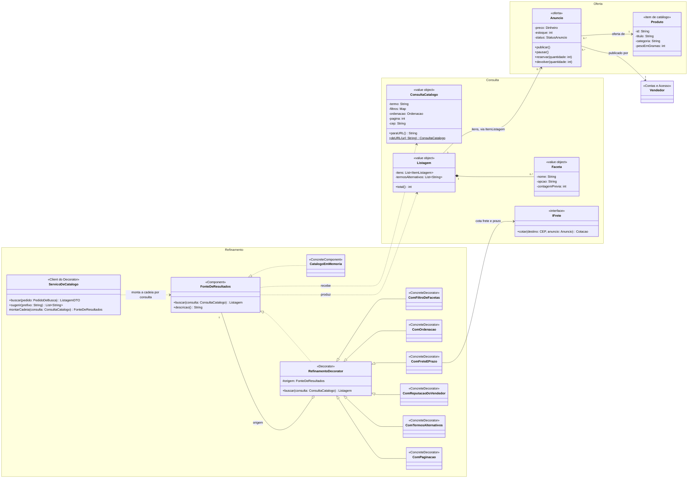

<p align="center"><strong>Figura 4: Pacote Catálogo e Descoberta.</strong> <em>Fonte: Diagrama de Classes (Entrega 02), padrão Decorator (Entrega 03) e código de <code>app/src/comercio/catalogo</code> (Entrega 04).</em></p>

| Classe                                         | Responsabilidade arquitetural                                                                                                                                                                                                                                                                                                                                              | Origem                                                                                                                                                                                                                                                                                                                                                                                                                                     |
| :--------------------------------------------- | :------------------------------------------------------------------------------------------------------------------------------------------------------------------------------------------------------------------------------------------------------------------------------------------------------------------------------------------------------------------------- | :----------------------------------------------------------------------------------------------------------------------------------------------------------------------------------------------------------------------------------------------------------------------------------------------------------------------------------------------------------------------------------------------------------------------------------------- |
| `Produto`                                      | Item de catálogo que existe uma única vez, independentemente de quem o vende. Concentra título, categoria, peso e imagens, que todas as ofertas do item compartilham.                                                                                                                                                                                                      | Implementado (`catalogo/dominio/Produto.java`). Origem observada: RN-B09, RN-C04; Diagrama de Classes, decisão 1                                                                                                                                                                                                                                                                                                                           |
| `Anuncio` e `StatusAnuncio`                    | Oferta de um vendedor para um produto, com preço, estoque e status próprios. É a referência de tudo o que é transacional (`ItemCarrinho`, `ItemPedido`, `Avaliacao`) e a única classe que reserva e devolve estoque, o que permite ao carrinho limitar a quantidade e ao checkout reservar de forma atômica.                                                               | Implementado (`catalogo/dominio/Anuncio.java`, `StatusAnuncio.java`). Origem observada: RN-B07, RN-B09; Diagrama de Classes, decisão 1                                                                                                                                                                                                                                                                                                     |
| `ConsultaCatalogo`                             | Estado completo da busca como value object imutável. `paraURL()` e `deURL()` garantem que a URL reconstrói a mesma listagem; cada operação `com...` devolve uma nova consulta em vez de alterar a atual.                                                                                                                                                                   | Implementado (`catalogo/dominio/ConsultaCatalogo.java`). Origem observada: RN-A06; Diagrama de Classes, decisão 2                                                                                                                                                                                                                                                                                                                          |
| `Listagem` e `Faceta`                          | Resultado da busca. Cada faceta carrega a contagem prévia, calculada antes de o filtro ser aplicado; o total da listagem é derivado dos itens, e não armazenado.                                                                                                                                                                                                           | Implementado (`catalogo/dominio/Listagem.java`, `Faceta.java`). Origem observada: RN-A03, RF-A02; Diagrama de Classes, decisão 3                                                                                                                                                                                                                                                                                                           |
| `FonteDeResultados`                            | Contrato comum ao catálogo bruto e a todos os refinamentos. Quem chama `buscar()` não sabe quantos decoradores estão empilhados.                                                                                                                                                                                                                                           | Implementado (`catalogo/dominio/FonteDeResultados.java`). Papel Component do [Decorator](https://unbarqdsw2026-2-turma01.github.io/2026.2-T01-_G1_ProjetoComercioEletronico_Entrega_03/#/Base/Relat%C3%B3rios/Subequipe01/GofsEstruturais/RefinamentoDaBusca%28Decorator%29)                                                                                                                                                               |
| `CatalogoEmMemoria`                            | Busca bruta sobre os anúncios do repositório; é sempre a base da cadeia. Fica na camada de Persistência e implementa uma interface do Domínio, conforme as regras da [Seção 5.1](#51-visão-geral-camadas-e-hierarquia-de-pacotes).                                                                                                                                         | Implementado (`catalogo/persistencia/CatalogoEmMemoria.java`). Papel ConcreteComponent do [Decorator](https://unbarqdsw2026-2-turma01.github.io/2026.2-T01-_G1_ProjetoComercioEletronico_Entrega_03/#/Base/Relat%C3%B3rios/Subequipe01/GofsEstruturais/RefinamentoDaBusca%28Decorator%29)                                                                                                                                                  |
| `RefinamentoDecorator` e decoradores concretos | Cada decorador guarda a fonte que envolve e acrescenta um refinamento: `ComFiltroDeFacetas` (RN-A03), `ComOrdenacao` (RN-A02, RF-A03), `ComFreteEPrazo` (RN-A04), `ComReputacaoDoVendedor` (RN-A05), `ComTermosAlternativos` (RN-A01) e `ComPaginacao` (página como parte do estado da consulta, RN-A06). Os dois últimos foram acrescentados na Entrega 04.               | Implementado (`catalogo/dominio/refinamento/`). Papéis Decorator e ConcreteDecorator do [Decorator](https://unbarqdsw2026-2-turma01.github.io/2026.2-T01-_G1_ProjetoComercioEletronico_Entrega_03/#/Base/Relat%C3%B3rios/Subequipe01/GofsEstruturais/RefinamentoDaBusca%28Decorator%29). Origem observada: RN-A01 a RN-A05; o critério de escolha dos termos alternativos é inferido (marcação `INFERIDO` em `ComTermosAlternativos.java`) |
| `ServicoDeCatalogo`                            | Fronteira entre a camada de Controle e o domínio: converte o pedido de busca em `ConsultaCatalogo` e monta a cadeia por consulta. Sem CEP, `ComFreteEPrazo` não entra na pilha; com ordenação por relevância, `ComOrdenacao` também não.                                                                                                                                   | Implementado (`catalogo/aplicacao/ServicoDeCatalogo.java`). Componente Serviço de Catálogo do Diagrama de Componentes (Entrega 02)                                                                                                                                                                                                                                                                                                         |
| `IFrete`                                       | Porta pela qual o Catálogo obtém frete e prazo. Declarada aqui e implementada por `ServicoDeEntrega` ([Seção 5.2.3](#523-pacote-transação)), de modo que o código só depende da Transação para o Catálogo, e não o contrário. É a inversão de dependência da decisão 4 da [Seção 5.3](#53-decisões-arquiteturais-e-análise-crítica), aplicada entre dois pacotes internos. | Implementado (`catalogo/dominio/IFrete.java`). Origem observada: RN-A04, RF-A04; interface `IFrete` do Diagrama de Componentes (Entrega 02)                                                                                                                                                                                                                                                                                                |

**Divergências entre o modelo e o código.**

- **`Catalogo` não tem classe no código.** O serviço de domínio `Catalogo` da Entrega 02 (`sugerir`, `buscar`, `vincular`) foi repartido: `buscar` é a cadeia de `FonteDeResultados`, `sugerir` está em `ServicoDeCatalogo`, na camada de Aplicação, e `vincular(a, p)` (RN-C04) não foi implementado, porque o `Produto` é informado no construtor do `Anuncio`.
- **`Produto` e `Anuncio` mudaram de atributos.** `Produto` não tem `atributos: Map` nem `ofertaPrincipal()`; a separação entre oferta principal e demais ofertas (RN-B09) é feita pelo `ServicoDeCatalogo` ao montar a ficha (`FichaDTO.outrasOfertas`). `Anuncio` não tem `parcelamento`: as parcelas são calculadas na ficha com um limite marcado como `INFERIDO` em `ServicoDeCatalogo.java`. `StatusAnuncio` tem quatro valores, sem `EM_VALIDACAO`, contra cinco no modelo.
- **`ConsultaCatalogo` ganhou `cep: String`.** O modelo não tem esse atributo. O CEP viaja como texto na consulta e só se torna o value object `CEP` (Contas e Acesso) no momento da cotação.
- **Classes do código sem lugar no diagrama da Entrega 02.** `FonteDeResultados`, `CatalogoEmMemoria`, `RefinamentoDecorator` e os seis decoradores concretos, além de `ItemListagem` e `Cotacao`. `IFrete` existe no Diagrama de Componentes, mas não no de Classes.

### 5.2.3 Pacote Transação

**Descrição.** Reúne o caminho do carrinho ao pedido entregue. O pacote se apoia em três decisões. A primeira separa o que o comprador ainda está montando (`Carrinho` e `ItemCarrinho`) do que já foi acordado (`Pedido` e `ItemPedido`, com preço congelado), e compõe o pedido por envios, um por vendedor (decisões 6 e 7 do Diagrama de Classes; RN-B01). A segunda faz três padrões GoF trabalharem sobre o mesmo pedido: o Abstract Factory transforma o meio de pagamento escolhido em uma família coerente de autorizador, comprovante e política de estorno; o Observer propaga a mudança de situação do `Pagamento` a quem precisa reagir; e o State decide se a transição pedida ao `Pedido` é válida (ADR-05). A terceira aplica a inversão de dependência aos sistemas externos: a Transportadora entra pela porta `ICotacaoEntrega` e a Operadora de Pagamento pelas interfaces da fábrica, e as famílias concretas ficam em `comercio.externos`, fora do pacote (decisão 4 da [Seção 5.3](#53-decisões-arquiteturais-e-análise-crítica); ADR-02).

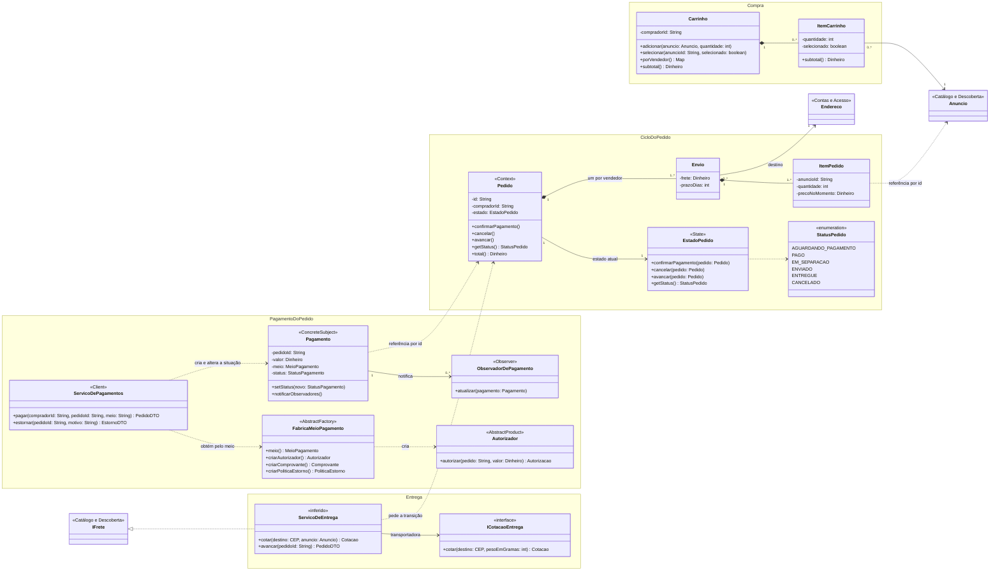

<p align="center"><strong>Figura 5: Pacote Transação.</strong> <em>Fonte: Diagrama de Classes (Entrega 02), padrões Abstract Factory, Observer e State (Entrega 03) e código de <code>app/src/comercio/transacao</code> (Entrega 04).</em></p>

| Classe                                                                                      | Responsabilidade arquitetural                                                                                                                                                                                                                                                                                                                                                | Origem                                                                                                                                                                                                                                                                                                                                                                        |
| :------------------------------------------------------------------------------------------ | :--------------------------------------------------------------------------------------------------------------------------------------------------------------------------------------------------------------------------------------------------------------------------------------------------------------------------------------------------------------------------- | :---------------------------------------------------------------------------------------------------------------------------------------------------------------------------------------------------------------------------------------------------------------------------------------------------------------------------------------------------------------------------- |
| `Carrinho` e `ItemCarrinho`                                                                 | Agrupa os itens por vendedor, limita a quantidade ao estoque do anúncio e permite desselecionar um item sem removê-lo, recalculando o subtotal só com os selecionados. Não reserva estoque: reservar é ato do checkout.                                                                                                                                                      | Implementado (`transacao/dominio/carrinho/`). Origem observada: RN-B01, RN-B07, RF-B02, RF-B05; Diagrama de Classes, decisão 6                                                                                                                                                                                                                                                |
| `Pedido`                                                                                    | Guarda o estado atual e delega a ele confirmar o pagamento, cancelar e avançar, sem desvio condicional por situação. Compõe os envios e calcula subtotal, frete e total.                                                                                                                                                                                                     | Implementado (`transacao/dominio/pedido/Pedido.java`). Papel Context do [State](https://unbarqdsw2026-2-turma01.github.io/2026.2-T01-_G1_ProjetoComercioEletronico_Entrega_03/#/Base/Relat%C3%B3rios/Subequipe03/GofsComportamentais/FluxoDeCompra%28State%29). Origem observada: RN-B01; Diagrama de Classes, decisão 7                                                      |
| `EstadoPedido`, estados concretos e `StatusPedido`                                          | Seis estados concretos (`EstadoAguardandoPagamento`, `EstadoPago`, `EstadoEmSeparacao`, `EstadoEnviado`, `EstadoEntregue`, `EstadoCancelado`), cada um decidindo quais transições aceita. Uma transição fora do desenho é recusada com `TransicaoInvalidaException`; é o que impede cobrar duas vezes um pedido pago.                                                        | Implementado (`transacao/dominio/pedido/`). Papéis State e ConcreteState do [State](https://unbarqdsw2026-2-turma01.github.io/2026.2-T01-_G1_ProjetoComercioEletronico_Entrega_03/#/Base/Relat%C3%B3rios/Subequipe03/GofsComportamentais/FluxoDeCompra%28State%29); ADR-05                                                                                                    |
| `Envio` e `ItemPedido`                                                                      | O envio reúne os itens de um vendedor, guarda frete e prazo sem calculá-los e referencia o endereço da conta, sem copiá-lo. O item do pedido congela o preço do momento da compra.                                                                                                                                                                                           | Implementado (`transacao/dominio/pedido/Envio.java`, `ItemPedido.java`). Origem observada: RN-B01, RN-B02, RF-B01; Diagrama de Classes, decisões 4, 6, 7 e 11                                                                                                                                                                                                                 |
| `Pagamento`, `PagamentoObservavel` e `ObservadorDePagamento`                                | O pagamento notifica os observadores a cada mudança de situação. Os quatro observadores concretos (`LiberacaoPedido`, `LiberacaoEstoque`, `NotificacaoComprador` e `EmissaoNotaFiscal`) ficam na camada de Aplicação e são registrados na raiz de composição. `LiberacaoPedido` é o ponto em que o Observer encontra o State: pede a transição, e o estado do pedido decide. | Implementado (`transacao/dominio/pagamento/`, `transacao/aplicacao/observadores/`, `Aplicacao.java`). Papéis ConcreteSubject, Subject, Observer e ConcreteObserver do [Observer](https://unbarqdsw2026-2-turma01.github.io/2026.2-T01-_G1_ProjetoComercioEletronico_Entrega_03/#/Base/Relat%C3%B3rios/Subequipe03/GofsComportamentais/FluxoDePagamento%28StrategyObserver%29) |
| `FabricaMeioPagamento`, `Autorizador`, `Comprovante`, `PoliticaEstorno` e `TrioDePagamento` | A fábrica cria os três produtos de uma família, e `TrioDePagamento` garante que autorização, comprovante e estorno de um pagamento venham sempre da mesma família. As quatro fábricas concretas (`FabricaCartao`, `FabricaPix`, `FabricaBoleto`, `FabricaSaldoEmConta`) e seus produtos simulam a operadora e ficam em `externos/pagamento/`.                                | Implementado (`transacao/dominio/pagamento/`, `externos/pagamento/`). Papéis AbstractFactory, AbstractProduct, ConcreteFactory e ConcreteProduct do [Abstract Factory](https://unbarqdsw2026-2-turma01.github.io/2026.2-T01-_G1_ProjetoComercioEletronico_Entrega_03/#/Base/Relat%C3%B3rios/Subequipe01/GofsCriacionais/MeiosDePagamento%28AbstractFactory%29); ADR-02        |
| `RegistroDeFabricas` e `ServicoDePagamentos`                                                | O registro é o único ponto em que um valor de `MeioPagamento` se transforma em fábrica. O serviço é o Client dos três padrões: cobra pela família escolhida, altera a situação do pagamento e não escreve o nome de nenhuma classe concreta de pagamento.                                                                                                                    | Implementado (`transacao/aplicacao/RegistroDeFabricas.java`, `ServicoDePagamentos.java`). Papel Client do [Abstract Factory](https://unbarqdsw2026-2-turma01.github.io/2026.2-T01-_G1_ProjetoComercioEletronico_Entrega_03/#/Base/Relat%C3%B3rios/Subequipe01/GofsCriacionais/MeiosDePagamento%28AbstractFactory%29); ADR-02                                                  |
| `ServicoDeEntrega` «inferido»                                                               | Implementa `IFrete` para o Catálogo e `IRastreio` para os demais pacotes. Cota o frete pela porta `ICotacaoEntrega` e avança o pedido pedindo a transição ao estado atual.                                                                                                                                                                                                   | Implementado (`transacao/aplicacao/ServicoDeEntrega.java`). Origem inferida: o próprio Diagrama de Classes o declara "escolha de consistência, não observação" (decisão 11 e Limites do modelo). A funcionalidade é observada (RN-A04); quem calcula o frete, não                                                                                                             |
| `ICotacaoEntrega`                                                                           | Porta para a Transportadora. É implementada por `TransportadoraSimulada`, cuja tabela de frete por peso e região é marcada como `INFERIDO` no código.                                                                                                                                                                                                                        | Implementado (`transacao/dominio/ICotacaoEntrega.java`, `externos/TransportadoraSimulada.java`). Interface `ICotacaoEntrega` do Diagrama de Componentes (Entrega 02); decisão 4 da [Seção 5.3](#53-decisões-arquiteturais-e-análise-crítica)                                                                                                                                  |
| `Dinheiro`                                                                                  | Value object em centavos, compartilhado por todos os pacotes no núcleo; `parcelar(n)` divide sem perder centavos. É o tipo de preço, frete, subtotal e valor do pagamento.                                                                                                                                                                                                   | Implementado (`nucleo/Dinheiro.java`). Diagrama de Classes, decisão 10                                                                                                                                                                                                                                                                                                        |

**Divergências entre o modelo e o código.**

- **`StatusPedido` tem 6 valores no código e 12 no modelo.** A Máquina de Estados do Pedido da Entrega 02 tem doze estados. A Entrega 03 implementou seis, e a Entrega 04 os preservou. Faltam `AGUARDANDO_ENDERECO`, `AUTORIZANDO`, `RECUSADO`, `EXPIRADO`, `EM_DISPUTA` e `REEMBOLSADO`. Parte dessas situações foi deslocada para o pagamento: `StatusPagamento` tem `RECUSADO`, `EXPIRADO` e `ESTORNADO`, e um pagamento expirado ou estornado leva o pedido a `CANCELADO` por meio de `LiberacaoPedido`. A disputa vive na reclamação ([Seção 5.2.4](#524-pacote-pós-venda)).
- **`EM_SEPARACAO` e `EM_PREPARACAO`.** A revisão em pares da Entrega 02 (ata de 16/09) renomeou o valor para `EM_PREPARACAO`. O código manteve o nome anterior, inclusive na classe `EstadoEmSeparacao`.
- **`Pagamento`.** Na Entrega 03, o `Pagamento` do Observer guardava `valor: double`. Na Entrega 04 o valor passou a ser `Dinheiro` em centavos, e essa divergência deixou de existir. Continuam diferentes do modelo: não há `autorizadoEm`; `autorizar()` e `estornar()` estão em `Autorizador.autorizar` e `PoliticaEstorno.estornar`; e o código acrescenta `StatusPagamento` (seis valores), que o diagrama não tem, além de `Autorizacao.Status` (`APROVADO`, `RECUSADO`, `EXPIRADO`).
- **Associações substituídas por identificadores.** O modelo tem `Pedido "1" -- "1" Pagamento` e `Pedido "1" -- "1..*" ItemPedido`. No código, `Pagamento` guarda `pedidoId`, `Pedido` não referencia o pagamento, os itens do pedido pertencem a cada `Envio` (`Pedido.itens()` é derivado) e `ItemPedido` guarda `anuncioId`, e não o `Anuncio`.
- **`Carrinho.finalizar()` não existe.** Quem cria o pedido é `ServicoDeCheckout.finalizar`, que reserva o estoque de todos os itens antes de criar o pedido e desfaz as reservas se qualquer passo falhar (ADR-05). `Carrinho.resumo()` virou `subtotal()`, e `Pedido.criadoEm: DateTime` virou `criadoNoMinuto: long`, obtido pela porta `Relogio`.
- **`Envio` não tem `codigoRastreio`.** O rastreio é feito pela situação do pedido, por meio de `IRastreio`.
- **Posição de `ServicoDeEntrega`.** No diagrama da Entrega 02 ele é um serviço de domínio fora dos quatro pacotes. Na Entrega 04 está na camada de Aplicação da Transação, e `calcularFrete(cep, anuncio): Dinheiro` virou `cotar(destino, anuncio): Cotacao`, que devolve frete e prazo.
- **Classes do código sem lugar no diagrama da Entrega 02.** `EstadoPedido` e os seis estados, `PagamentoObservavel`, `ObservadorDePagamento` e os quatro observadores, `StatusPagamento`, `Autorizacao`, `FabricaMeioPagamento` e seus produtos, `TrioDePagamento`, `RegistroDeFabricas`, `ICotacaoEntrega` e `Relogio`.

### 5.2.4 Pacote Pós-venda

**Descrição.** Reúne o que acontece depois da compra: a avaliação do item recebido e a reclamação mediada pela plataforma. A `Avaliacao` aponta para a oferta, e não para o produto, e é a única fonte da reputação do vendedor. A reputação só muda por `RegistroDeReputacao` (Contas e Acesso), uma dependência no sentido permitido pela [Seção 5.2.5](#525-dependências-entre-pacotes-de-domínio). A `Reclamacao` é uma máquina de estados explícita em que cada transição confere quem a pede (comprador, vendedor ou atendimento), porque o comprador nunca fala diretamente com o vendedor: tudo passa pela plataforma. O pacote não guarda pedido nem conhece o meio de pagamento. Ele consulta o pedido por `IRastreio` e estorna por `IPagamento`, e a Transação aplica a política de estorno da mesma família que autorizou a compra. A reclamação só é marcada como `REEMBOLSADA` depois de o estorno ser efetivado. Este é o pacote de origem mais fraca da Visão Lógica, como registra a [Seção 4.8](#48-limitações-e-inconsistências-conhecidas).

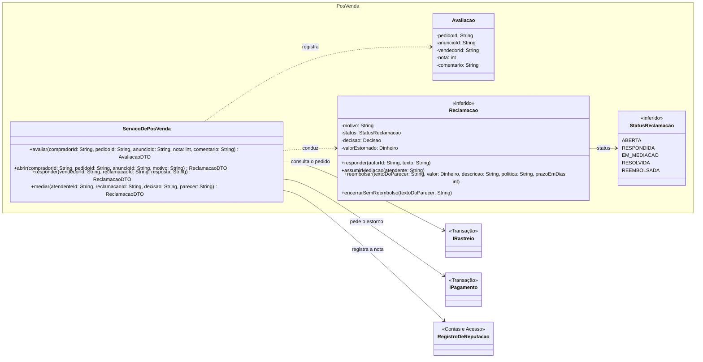

<p align="center"><strong>Figura 6: Pacote Pós-venda.</strong> <em>Fonte: Diagrama de Classes e Diagrama de Atividades (Entrega 02) e código de <code>app/src/comercio/posvenda</code> (Entrega 04).</em></p>

| Classe                        | Responsabilidade arquitetural                                                                                                                                                                                                                                                                        | Origem                                                                                                                                                                                                                                                                                       |
| :---------------------------- | :--------------------------------------------------------------------------------------------------------------------------------------------------------------------------------------------------------------------------------------------------------------------------------------------------- | :------------------------------------------------------------------------------------------------------------------------------------------------------------------------------------------------------------------------------------------------------------------------------------------- |
| `Avaliacao`                   | Registro imutável da nota (1 a 5) e do comentário sobre a oferta de um vendedor. É dela que a reputação do vendedor é derivada. A regra "uma avaliação por item do pedido" é garantida pelo `ServicoDePosVenda`, que conhece as demais avaliações.                                                   | Implementado (`posvenda/dominio/Avaliacao.java`). Origem observada: RN-A05, RF-A05; Diagrama de Classes, decisões 1 e 9                                                                                                                                                                      |
| `Reclamacao` «inferido»       | Conduz o ciclo `ABERTA`, `RESPONDIDA`, `EM_MEDIACAO` e o desfecho `REEMBOLSADA` ou `RESOLVIDA`, conferindo em cada transição quem a pede. Recusa qualquer transição fora desse desenho; como os estados finais não aceitam novas transições, a mesma reclamação não pode ser reembolsada duas vezes. | Implementado (`posvenda/dominio/Reclamacao.java`). Origem inferida: processo 3 do Rich Picture da Entrega 01 ("Jenny reclama, atendimento media com o vendedor, e retorna com resposta ou reembolso"); Limites do modelo do Diagrama de Classes: "inferidos do Rich Picture, não observados" |
| `StatusReclamacao` «inferido» | Situações da reclamação. `encerrada()` identifica os estados finais.                                                                                                                                                                                                                                 | Implementado (`posvenda/dominio/StatusReclamacao.java`). Origem inferida: mesma origem de `Reclamacao`; valores do Diagrama de Atividades (Entrega 02)                                                                                                                                       |
| `ServicoDePosVenda`           | Fornece `IReclamacao` e requer `IRastreio` e `IPagamento` da Transação. Confere o papel de quem age contra a conta e o pedido, sem aceitá-lo do cliente, e é o único caminho pelo qual uma avaliação altera a reputação.                                                                             | Implementado (`posvenda/aplicacao/ServicoDePosVenda.java`). Componente Serviço de Pós-venda do Diagrama de Componentes (Entrega 02); UC17 a UC21                                                                                                                                             |

**Divergências entre o modelo e o código.**

- **Classes inferidas com código.** `Reclamacao`, `StatusReclamacao` e `Atendente` (este em Contas e Acesso, `contas/dominio/Atendente.java`) existem na Entrega 04, mas continuam com origem inferida: o fluxo de reclamação não é acessível sem uma compra real e não foi observado na Engenharia Reversa. Ter código mostra que o modelo é coerente e executável, e não que corresponde à plataforma real.
- **`StatusReclamacao` mudou de valores.** O modelo tem `AGUARDANDO_VENDEDOR`. O código usa `ABERTA` para o intervalo até a resposta e acrescenta `RESPONDIDA`, para o atendimento saber se há versão do vendedor antes de decidir.
- **`Reclamacao.encerrar(desfecho)` foi dividida.** O código tem `assumirMediacao`, `reembolsar` e `encerrarSemReembolso`, e acrescenta a enumeração interna `Decisao` (`PROCEDENTE`, `IMPROCEDENTE`), que o modelo não tem. Não há `abertaEm`; o histórico fica em uma linha do tempo. O modelo associa a reclamação a um `Envio`, e o código identifica o envio pelos identificadores do pedido e do vendedor.
- **A regra inferida do reembolso automático não foi implementada.** O Diagrama de Atividades da Entrega 02 encerra a reclamação como `REEMBOLSADA` quando o prazo do vendedor se esgota sem resposta, regra marcada ali como inferida. No código, o reembolso só ocorre por decisão do atendimento.
- **Fórmula da reputação.** O Diagrama de Classes registra que a fórmula não é observável. O código adota a média aritmética das notas e a marca como `INFERIDO` (`contas/dominio/Reputacao.java`). `Avaliacao` não tem o atributo `data` do modelo e ganhou `pedidoId`.

### 5.2.5 Dependências entre pacotes de domínio

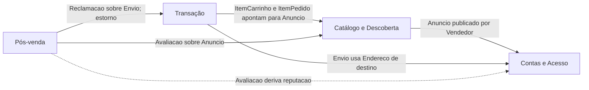

<p align="center"><strong>Figura 7: Dependências entre os pacotes de domínio.</strong> <em>Autor: João Paulo Barbosa Pereira Nunes.</em></p>

O grafo é acíclico com uma única exceção conhecida: `Vendedor./reputacao` (Contas e Acesso) é derivada de `Avaliacao` (Pós-venda), enquanto `Avaliacao` depende, indiretamente, de `Vendedor` via `Anuncio`. A seta tracejada registra essa dependência **de dado derivado**, discutida como limitação na [Seção 5.6](#56-limitações-do-modelo-lógico).

---

## 5.3 Decisões Arquiteturais e Análise Crítica

### 1. Reconciliar camadas e domínio em vez de escolher um dos dois

O Diagrama de Pacotes (José Joaquim da Silva Neto) e o Diagrama de Classes (Pedro Luciano de Azevedo) foram feitos em paralelo e chegaram a decomposições diferentes. A alternativa mais simples seria adotar apenas um deles na Visão Lógica. Optou-se por mantê-los como dimensões ortogonais porque cada um responde a uma pergunta diferente: as camadas controlam **a direção das dependências técnicas**; os pacotes de domínio controlam **o acoplamento entre assuntos de negócio**. Um modelo só com camadas esconderia que `Transação` depende de `Catálogo` (e não o contrário); um modelo só com domínio esconderia que nenhuma classe de `Model` pode conhecer um `Controller`.

### 2. Autenticação como subpacote explícito

O próprio Diagrama de Pacotes da Entrega 02 registrou como limitação a **ausência de uma camada de segurança e autenticação** (seção 7 daquele documento). A Entrega 03 preencheu essa lacuna na prática, com quatro padrões aplicados ao login. A Visão Lógica formaliza o resultado: Autenticação passa a ser um subpacote de `Contas e Acesso`, com papéis distribuídos entre Controller (coordenação), Builder (montagem do contexto), Chain of Responsibility (validação) e Facade (emissão da sessão). Essa é a principal evolução arquitetural desta visão em relação aos artefatos anteriores.

### 3. Padrões de projeto como mecanismos internos, não como pacotes

Uma tentação seria criar pacotes chamados `observer`, `state` ou `factory`, espelhando a organização das pastas da Entrega 03. Isso foi evitado: padrões são **soluções aplicadas dentro de um pacote de domínio**, e não assuntos de negócio. O Observer pertence a `Transação` porque reage a mudanças de `Pagamento`; o Decorator pertence a `Catálogo e Descoberta` porque refina a busca. Organizar por padrão espalharia um mesmo assunto de negócio por vários pacotes técnicos.

### 4. Inversão de dependência aplicada aos sistemas externos

A Operadora de Pagamento e a Transportadora são acessadas apenas por interfaces definidas no domínio (`IAutorizacao`, `ICotacaoEntrega`, e no código, `Autorizador` da Abstract Factory). Assim, trocar de operadora exige uma nova família de classes, sem alteração em `Pedido` ou `Pagamento`. A mesma regra **não** foi aplicada uniformemente à persistência, inconsistência já reconhecida no Diagrama de Pacotes (seção 2.3) e mantida aqui de forma consciente para não inventar uma estrutura que nenhum artefato anterior modelou.

### 5. Monólito lógico, distribuição física opaca

A Visão Lógica descreve uma única aplicação em camadas, enquanto a Visão de Implantação mostra o backend como um nó opaco que, segundo fontes públicas, é composto por milhares de microsserviços. As duas visões não se contradizem: a Visão Lógica organiza **responsabilidades**, não processos. Cada pacote de domínio corresponde a um conjunto de componentes (tabela da [Seção 5.1](#51-visão-geral-camadas-e-hierarquia-de-pacotes)) que poderia ser implantado de forma independente sem alterar o modelo lógico. Essa é, inclusive, a trajetória real documentada da empresa (monólito Java em camadas que evoluiu para microsserviços), já discutida no Diagrama de Pacotes da Entrega 02.

---

## 5.4 Legenda de Confiança da Evidência

Em conformidade com as diretrizes de governança técnica e transparência do DAS, cada elemento da Visão Lógica é classificado pelo grau de certeza da evidência que o sustenta. Aqui as categorias respondem a duas perguntas complementares: **Implementado** e **modelado** indicam onde a classe existe (no código da Entrega 04 ou na modelagem estática da Entrega 02). **Observado** e **inferido** indicam a fonte originária do comportamento (da Engenharia Reversa da Entrega 01 ou de dedução analítica necessária para a completude do sistema). Uma classe pode, portanto, ser implementada e ter origem inferida, como `Reclamacao`. Nas tabelas das Seções 5.2.2 a 5.2.4, a coluna Origem documenta essa categorização.

| Categoria        | Critério                                                                                                               | Método de coleta                                                                                                                                                       | Representação nos diagramas da 5.2                                                                                                                                                                                                               | Exemplos nas Seções 5.2.1 a 5.2.4                                                                                                                                                                                                                              |
| :--------------- | :--------------------------------------------------------------------------------------------------------------------- | :--------------------------------------------------------------------------------------------------------------------------------------------------------------------- | :----------------------------------------------------------------------------------------------------------------------------------------------------------------------------------------------------------------------------------------------- | :------------------------------------------------------------------------------------------------------------------------------------------------------------------------------------------------------------------------------------------------------------- |
| **Observado**    | Vem da Engenharia Reversa da Entrega 01: regra de negócio (RN), requisito funcional (RF) ou inspeção do DOM            | Navegação na interface pública e inspeção do DOM, registradas nos Recortes A, B e C da Engenharia Reversa                                                              | Sem estereótipo próprio. Aparece na coluna Origem pelo código da RN ou do RF                                                                                                                                                                     | `CEP` com oito dígitos sem separador (RN-B04, 5.2.1); contagem prévia de `Faceta` (RN-A03, 5.2.2); agrupamento por vendedor em `Carrinho` e `Envio` (RN-B01, 5.2.3); nota e reputação na listagem, origem de `Avaliacao` (RN-A05, 5.2.4)                       |
| **Modelado**     | Está em um diagrama da Entrega 02 e não tem classe ou método correspondente em `app/src` da Entrega 04                 | Leitura do Diagrama de Classes, do SVG exportado e do Diagrama de Atividades, seguida de busca pelo nome em `app/src`                                                  | Não é desenhado nos diagramas das Seções 5.2.2 a 5.2.4. Aparece só nas listas de divergências                                                                                                                                                    | `Comprador.abrirReclamacao` e `Atendente.mediar` (5.2.1); `Catalogo` e `vincular` (5.2.2); `Carrinho.finalizar()`, `Envio.codigoRastreio` e seis dos doze valores de `StatusPedido` (5.2.3); reembolso automático por ausência de resposta do vendedor (5.2.4) |
| **Implementado** | A classe existe em `app/src` da Entrega 04                                                                             | Busca por `class`, `interface` ou `enum` com o nome em `app/src`; execução da suíte de testes e da verificação de arquitetura ([Seção 5.5](#55-evidência-de-execução)) | Toda classe desenhada dentro de um `namespace` nas Seções 5.2.2 a 5.2.4 é implementada. O papel GoF aparece como estereótipo, e o arquivo, na coluna Origem. Classes de outro pacote aparecem sem membros, com o nome do pacote como estereótipo | `Usuario`, `Endereco` e `CEP` (5.2.1); `Produto` e `RefinamentoDecorator` (5.2.2); `Pedido`, `EstadoPedido` e `FabricaMeioPagamento` (5.2.3); `Avaliacao` e `Reclamacao` (5.2.4)                                                                               |
| **Inferido**     | Deduzido sem observação: da coerência entre artefatos, do Rich Picture ou da necessidade de tornar o modelo executável | Dedução registrada nos Limites do modelo do Diagrama de Classes e nos comentários `INFERIDO` do código ([Seção 5.5.5](#555-limites-desta-evidência))                   | Estereótipo «inferido» na classe quando a classe inteira é inferida. Quando só um valor ou regra é inferido, a marcação fica na tabela, e não no diagrama                                                                                        | `Atendente` (5.2.1, sem a marcação naquele diagrama); critério dos termos alternativos e limite de parcelas (5.2.2); `ServicoDeEntrega` e tabela de frete da `TransportadoraSimulada` (5.2.3); `Reclamacao`, `StatusReclamacao` e fórmula da reputação (5.2.4) |

---

## 5.5 Evidência de Execução e Verificação de Arquitetura

> [!IMPORTANT]
> **Catálogo Visual Completo das Features em Execução:** A demonstração visual detalhada das 7 telas do e-commerce rodando no navegador, o guia completo de comandos (`make run`, `make test`, `make demo`) e o endpoint dinâmico `/api/rastreabilidade` estão documentados no módulo autônomo **[1.1.7. Evidências de Execução das Features (Demonstração do Software)](/Base/Relatórios/1.1.8.EvidenciasExecucao.md)**. Esta seção foca na comprovação técnica da **verificação de regras de dependência de camadas e padrões GoF** executada automaticamente pela suíte de testes sobre o código Java puro.

A Visão Lógica das seções 5.1 e 5.2 não ficou só no desenho: ela está implementada na pasta [`app/`](https://github.com/UnBArqDsw2026-2-Turma01/2026.2-T01-_G1_ProjetoComercioEletronico_Entrega_04/tree/main/app) do repositório e roda com um comando. A aplicação reaproveita o código Java dos padrões da Entrega 03 e o distribui nas camadas e nos pacotes de domínio desta visão: cada pacote Java tem a forma `comercio.<domínio>.<camada>`, que é a matriz "camadas × pacotes de domínio" da Figura 2 escrita no nome do pacote.

Esta seção reúne três evidências que se complementam:

1. as regras de dependência da seção 5.1 e da Figura 7, **verificadas automaticamente sobre o código-fonte** (5.5.2);
2. as funcionalidades **em execução no navegador**. Cada tela traz, à direita, o painel "Arquitetura em execução", que mostra os casos de uso, as linhas da matriz e as classes que a própria rota declara no código (5.5.3);
3. o cenário de compra de ponta a ponta **CA-01 executado no terminal** (5.5.4).

### 5.5.1 Como executar

Requisito único: JDK 11 ou superior. Não há biblioteca externa nem etapa de instalação.

```bash
cd app
make run          # sobe a loja em http://localhost:8080
make verificar    # compila e executa todos os testes, inclusive o de arquitetura
make arquitetura  # executa só a verificação das regras de dependência
make demo         # cenário CA-01 no terminal
```

No Windows, os comandos rodam no Git Bash. Para os testes, informe o separador de classpath do sistema: `make verificar CPT='"out/principal;out/teste"'`.

### 5.5.2 Regras da Visão Lógica verificadas sobre o código

As tabelas "Regras de dependência entre camadas" (5.1) e "Dependências entre pacotes de domínio" (5.2.5) estão transcritas em [`RegrasDeArquitetura.java`](https://github.com/UnBArqDsw2026-2-Turma01/2026.2-T01-_G1_ProjetoComercioEletronico_Entrega_04/blob/main/app/teste/comercio/arquitetura/RegrasDeArquitetura.java). O teste de arquitetura lê as importações de todos os arquivos de `app/src`. Se alguma violar uma regra, ele falha e aponta o arquivo, a importação e a seção do DAS violada. Saída de `make arquitetura` em 22/11/2026:

```text
comercio.arquitetura.ArquiteturaTeste
         170 arquivos verificados, nenhum isento
  ok     DAS 5.1 e 5.2.5: nenhuma importacao do codigo real viola as regras de dependencia
  ok     DAS 5.2.5: os pacotes de dominio so dependem no sentido da figura
  ok     DAS 5.1: o Dominio nao depende de nenhuma outra camada
  ok     DAS 5.1: o Controle so conhece a Aplicacao
  ok     DAS 5.1: Aplicacao nao depende do Controle; Persistencia so do Dominio
  ok     DAS 5.3: sistemas externos so entram por porta do dominio
  ok     nucleo e infraestrutura nao conhecem o negocio; nao ha mais area de espera
  ok     sem biblioteca de terceiros e sem interface grafica dentro das camadas
  ok     pacote fora da matriz dominio x camada e apontado

1 suite(s), 9 caso(s), 0 falha(s)
```

A suíte completa (`make verificar`) tem **22 suítes e 201 casos, com 0 falhas**. O nome de cada caso começa pelo código da regra de negócio, do caso de uso ou do ADR que ele verifica. Isso liga o teste à matriz da seção 8.3:

| Pacote                | Casos | Exemplos de casos verificados                                                                                                                                           |
| :-------------------- | :---: | :---------------------------------------------------------------------------------------------------------------------------------------------------------------------- |
| Catálogo e Descoberta |  63   | `RN-A03`: a contagem prévia de cada faceta é o total obtido ao aplicar aquele filtro; `UC30`: filtrar antes de paginar; `RN-A06`: a busca é reproduzida a partir da URL |
| Transação             |  51   | `ADR-05`: o checkout é tudo ou nada; `ADR-05`: um pedido pago não é cobrado de novo; `ADR-02`: o serviço funciona com uma família de pagamento que ele nunca viu        |
| Pós-venda             |  27   | `UC17 e RN-A05`: a reputação do vendedor muda depois da avaliação; `UC21`: o segundo reembolso da mesma reclamação é recusado                                           |
| Infraestrutura        |  22   | regra de negócio violada vira HTTP 422 com o código da regra; toda resposta carrega a rastreabilidade declarada pela rota                                               |
| Contas e Acesso       |  18   | `Chain`: sem desafio de captcha, a cadeia para no primeiro elo; `ValidadorRisco`: dispositivo novo exige segundo fator                                                  |
| Arquitetura           |   9   | as regras das seções 5.1, 5.2.5 e 5.3, listadas acima                                                                                                                   |
| Composição            |   5   | `CA-01`: o anúncio achado na busca é o mesmo que o pedido reserva, paga e entrega                                                                                       |
| Núcleo                |   4   | parcelar não perde centavos                                                                                                                                             |

### 5.5.3 Funcionalidades em execução

Em toda tela, o painel "Arquitetura em execução" é desenhado a partir do campo `arquitetura` que acompanha cada resposta da API. Esse campo traz os casos de uso (seção 4), as linhas da matriz (seção 8.3) e as classes que a rota declara, da camada mais externa para a mais interna. A cor de cada classe indica a camada e é deduzida do nome: Controle em roxo, Aplicação em verde e as demais em laranja. Traz também o **mecanismo**, uma frase que diz qual padrão de projeto atuou naquela chamada. Assim, a rastreabilidade deixa de ser uma tabela mantida à mão e passa a ser um dado do próprio código.

| Figura | Funcionalidade                    | Casos de uso           |    Matriz    | Padrão em execução                                         | Pacote                |
| :----: | :-------------------------------- | :--------------------- | :----------: | :--------------------------------------------------------- | :-------------------- |
|   E1   | Rastreabilidade de todas as rotas | todos                  |    todas     | —                                                          | infraestrutura        |
|   E2   | Login em quatro elos              | UC22                   |    TR-08     | Builder, Chain of Responsibility, Facade, Controller GRASP | Contas e Acesso       |
|   E3   | Busca refinada                    | UC01, UC03, UC04, UC30 |    TR-01     | Decorator, com a cadeia montada por consulta               | Catálogo e Descoberta |
|   E4   | Busca sem resultado               | UC01                   |    TR-01     | Decorator (`ComTermosAlternativos`)                        | Catálogo e Descoberta |
|   E5   | Ficha do produto com frete        | UC05, UC06, UC07       | TR-02, TR-03 | Porta `IFrete` (inversão de dependência)                   | Catálogo e Descoberta |
|   E6   | Pagamento do pedido               | UC12, UC24, UC25       |    TR-05     | Abstract Factory, Observer, State                          | Transação             |
|   E7   | Mediação e reembolso              | UC17 a UC21            | TR-03, TR-09 | Abstract Factory (política de estorno)                     | Pós-venda             |

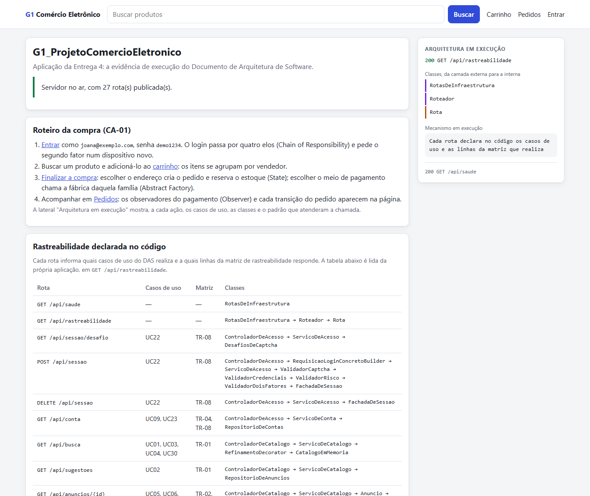

<p align="center"><strong>Figura E1: Rastreabilidade declarada no código.</strong> A tabela é lida de <code>GET /api/rastreabilidade</code>: cada rota informa os casos de uso e as linhas da matriz que realiza e as classes que participam da chamada. <em>Autor: Pedro Luciano de Azevedo.</em></p>

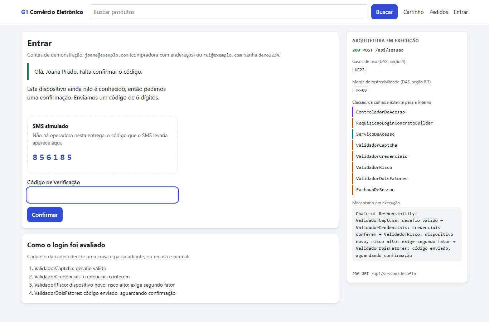

<p align="center"><strong>Figura E2: Login (UC22).</strong> Os quatro elos da Chain of Responsibility (captcha, credenciais, risco e segundo fator) aparecem na página e no mecanismo. O dispositivo é novo, então o elo de risco exige o segundo fator, e o código chega por um SMS simulado. As classes vão do Controller GRASP ao Builder e à Facade que emite a sessão. <em>Autor: Pedro Luciano de Azevedo.</em></p>

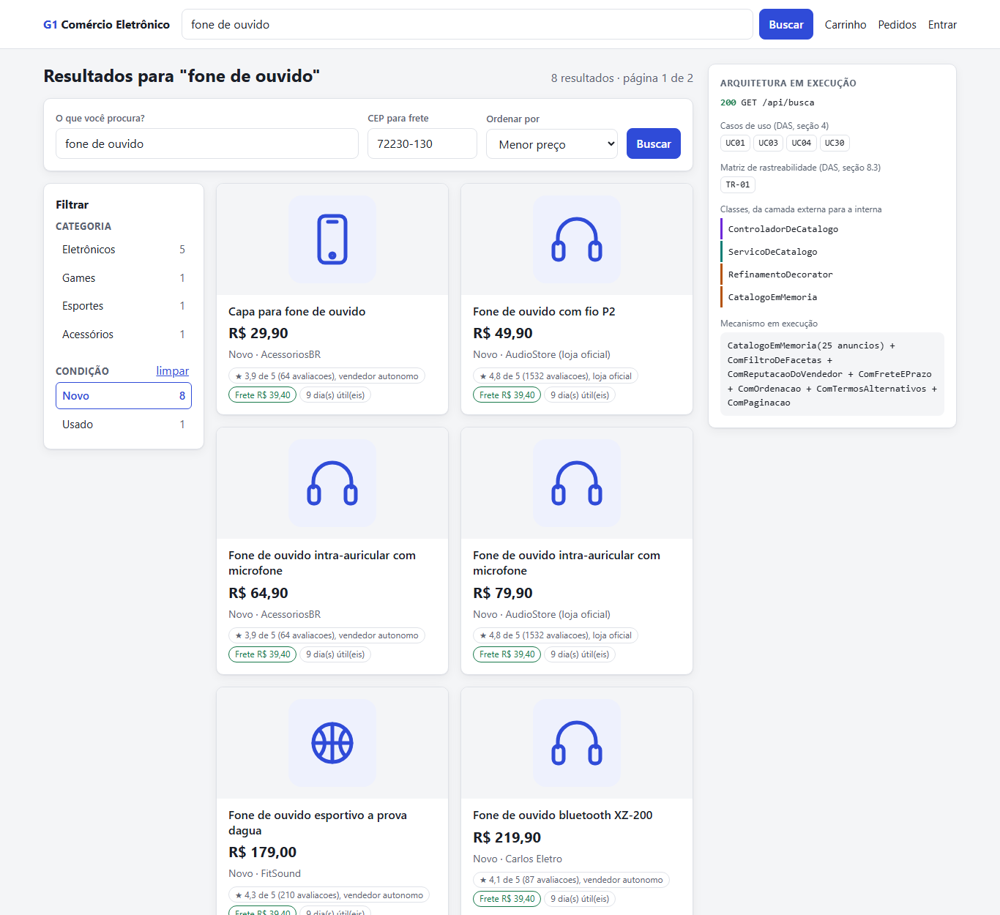

<p align="center"><strong>Figura E3: Busca refinada (UC01, UC03, UC04, UC30).</strong> O mecanismo mostra a pilha de decoradores que o <code>ServicoDeCatalogo</code> montou para esta consulta. Com CEP informado, entra <code>ComFreteEPrazo</code>, que pergunta o frete pela porta <code>IFrete</code>. Com ordenação por menor preço, entra <code>ComOrdenacao</code>. Sem CEP e por relevância, esses dois não são empilhados. As facetas trazem a contagem prévia (RN-A03), e o estado da busca vive na URL da página (RN-A06). <em>Autor: Pedro Luciano de Azevedo.</em></p>

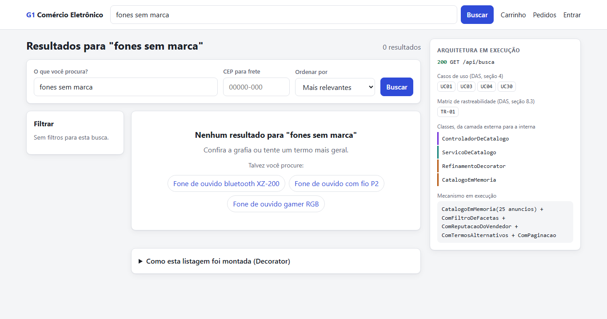

<p align="center"><strong>Figura E4: Busca sem resultado (RN-A01).</strong> Em vez de uma tela vazia, o decorador <code>ComTermosAlternativos</code> oferece até três títulos do acervo que compartilham alguma palavra com o termo buscado. <em>Autor: Pedro Luciano de Azevedo.</em></p>

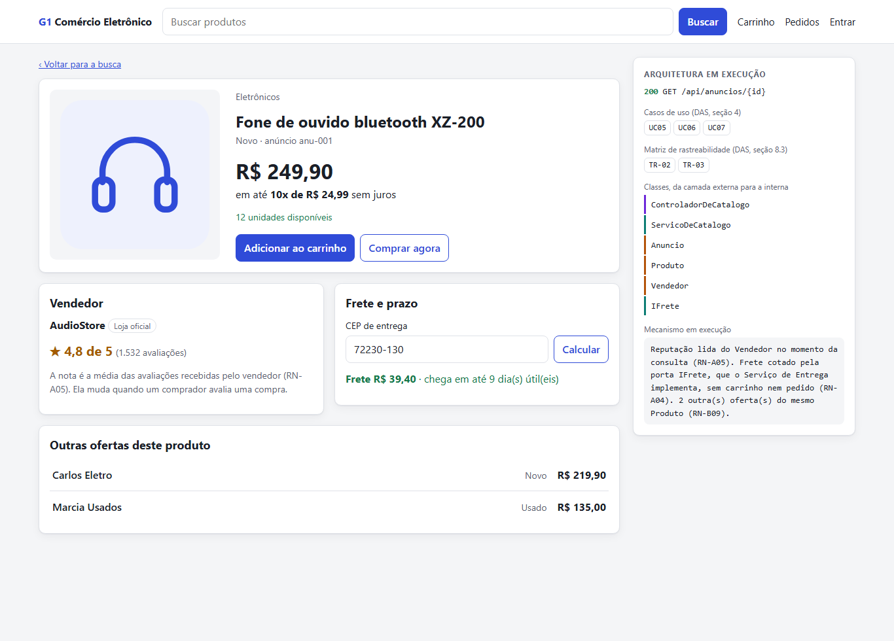

<p align="center"><strong>Figura E5: Ficha do produto (UC05, UC06, UC07).</strong> O frete é cotado antes de existir carrinho ou pedido (RN-A04), pela porta <code>IFrete</code>. A porta é declarada no Catálogo e implementada pelo Serviço de Entrega, na Transação, de modo que o Catálogo não importa a Transação. A reputação do vendedor é lida no momento da consulta (RN-A05), e as outras ofertas do mesmo produto aparecem em bloco separado (RN-B09). <em>Autor: Pedro Luciano de Azevedo.</em></p>

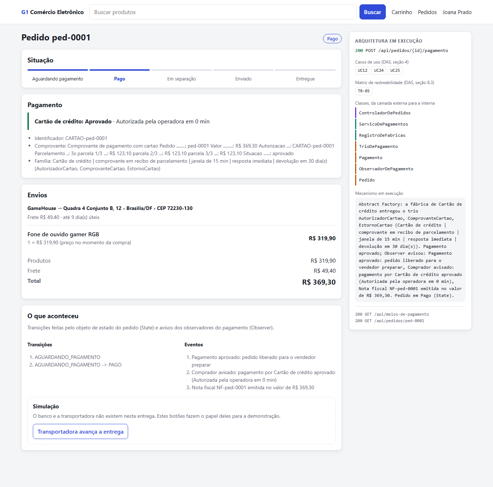

<p align="center"><strong>Figura E6: Pagamento do pedido (UC12, UC24, UC25).</strong> A fábrica da família Cartão entregou o trio coerente <code>AutorizadorCartao</code>, <code>ComprovanteCartao</code> e <code>EstornoCartao</code> (Abstract Factory). O pagamento aprovado avisou os observadores: pedido liberado, comprador avisado e nota fiscal emitida (Observer). O pedido passou de AGUARDANDO_PAGAMENTO para PAGO pelo objeto de estado (State). <em>Autor: Pedro Luciano de Azevedo.</em></p>

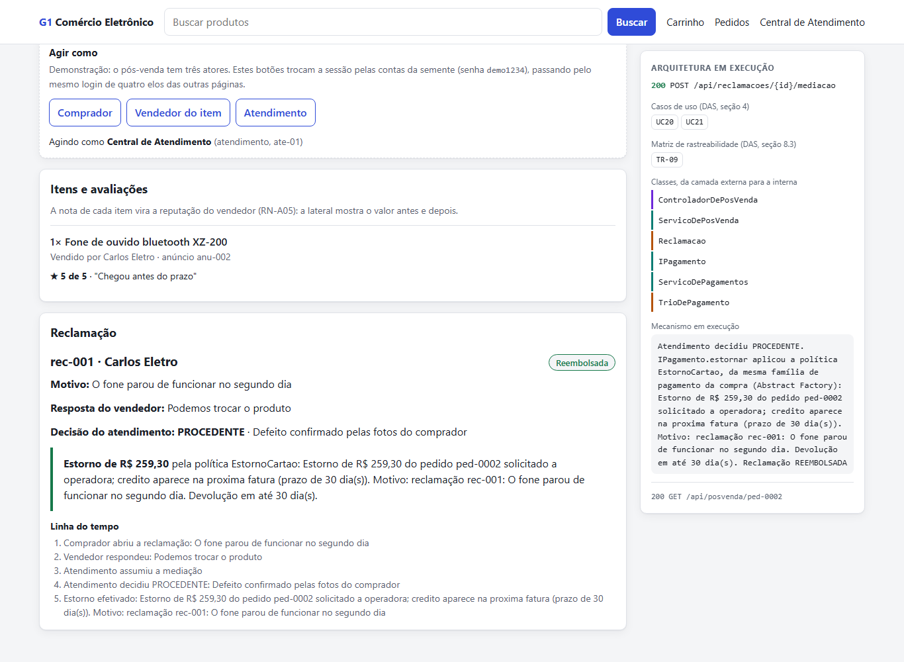

<p align="center"><strong>Figura E7: Mediação e reembolso (UC17 a UC21).</strong> A compradora avaliou o item, e a nota passou a compor a reputação do vendedor (RN-A05). Depois abriu uma reclamação, o vendedor respondeu e o atendimento decidiu pela procedência. O Pós-venda pediu o estorno pela interface <code>IPagamento</code>, e a Transação aplicou a política <code>EstornoCartao</code>, da mesma família que autorizou a compra. A reclamação só foi marcada como REEMBOLSADA depois de o estorno ser efetivado. <em>Autor: Pedro Luciano de Azevedo.</em></p>

### 5.5.4 Cenário CA-01 no terminal

`make demo` executa a compra completa sem servidor e informa, a cada passo, os casos de uso, a linha da matriz e o padrão que trabalhou. Trecho da saída em 22/11/2026, com algumas linhas omitidas:

```text
1. Buscar e refinar
[UC01, UC03, UC04, UC06, UC07 | TR-01, TR-02 | Decorator em catalogo.dominio]
  cadeia montada : CatalogoEmMemoria(25 anuncios) + ComFiltroDeFacetas + ComOrdenacao + ComFreteEPrazo + ComReputacaoDoVendedor
  consulta (URL) : /busca?termo=fone+de+ouvido&condicao=NOVO&ordem=MENOR_PRECO&pagina=1&cep=72230-130
  resultados     : 8
  O frete veio do Servico de Entrega pela porta IFrete: o Catalogo nao importa a Transacao.

3. Finalizar a compra
[UC10 (inclui UC09) | TR-05 | State nasce em AGUARDANDO_PAGAMENTO]
  pedido ped-0001 | situacao AGUARDANDO_PAGAMENTO
  envio de AudioStore: 2 item(ns), frete R$ 49,40, 9 dia(s)
  envio de GameHouse: 1 item(ns), frete R$ 49,40, 9 dia(s)
  subtotal R$ 869,60 + frete R$ 98,80 = total R$ 968,40

4. Escolher o meio e pagar
[UC12, UC24, UC25 | TR-05 | Abstract Factory + Observer em transacao.dominio.pagamento]
  tentativa 1, saldo em conta: RECUSADO (Saldo insuficiente: disponivel R$ 500,00, necessario R$ 968,40)
  tentativa 2, cartao        : APROVADO | trio [AutorizadorCartao, ComprovanteCartao, EstornoCartao]
  pedido agora esta PAGO
  cobrar de novo -> recusa ADR-05: O pedido ped-0001 não aguarda pagamento: está pago

5. Acompanhar o envio
[UC13, UC26, UC27 | TR-05 | State em transacao.dominio.pedido]
  AGUARDANDO_PAGAMENTO -> PAGO
  PAGO -> EM_SEPARACAO
  EM_SEPARACAO -> ENVIADO
  ENVIADO -> ENTREGUE
```

### 5.5.5 Limites desta evidência

- **Persistência em memória.** Os dados voltam à semente a cada execução, e a garantia de "tudo ou nada" do checkout vem de compensação em memória, não de transação de banco de dados (ADR-05).
- **Sistemas externos simulados.** Transportadora, operadora de pagamento, captcha e envio do código de verificação são simuladores. Eles ficam atrás das portas do domínio (decisão 4 da seção 5.3), e os valores que não foram observados na Engenharia Reversa estão marcados como `INFERIDO` no código.
- **Ambiente das capturas.** As figuras e as saídas foram obtidas em 22/11/2026, com JDK 21, a partir das branches `feat/catalogo-descoberta` e `feat/posvenda` integradas e com os controladores do Catálogo e do Pós-venda registrados na raiz de composição (`comercio.Aplicacao`).
- **Escala e Modularidade:** A aplicação executável foi desenvolvida como um monólito modular puro em processo Java único sobre o JDK, validando rigorosamente em código as regras de negócio, o isolamento entre camadas e a aplicação de padrões GoF desta Visão Lógica, enquanto a [Visão de Implantação](/Base/Relatórios/1.1.5.VisaoImplantacao.md) projeta a distribuição física em múltiplos nós, CDN e nuvem privada para suportar alta demanda operacional.

---

## 5.6 Limitações do Modelo Lógico

1. **Módulos executáveis não integrados:** o código da Entrega 03 está organizado por padrão, e não por pacote lógico. Existem, por exemplo, versões diferentes de `RequisicaoLogin` nos módulos do Builder, do Chain of Responsibility e do GRASP Controller. A Visão Lógica as trata como a mesma classe conceitual, mas o código ainda não reflete essa unificação.
2. **Autenticação no Diagrama de Componentes:** o subpacote Autenticação foi integrado conceitualmente ao domínio de Contas e Acesso no backend. Uma evolução futura da modelagem de componentes pode segregar um componente autônomo `Serviço de Identidade` com interface própria.
3. **Dependência de dado derivado entre Pós-venda e Contas:** `Vendedor./reputacao` depende de `Avaliacao`. Em uma implementação real, essa dependência seria resolvida por evento (o que o próprio Observer da Entrega 03 sugere como mecanismo), e não por referência direta.
4. **Persistência sem abstração uniforme:** como já apontado no Diagrama de Pacotes, `Repository` não é tratado por interface, ao contrário dos sistemas externos.
5. **Modelo, não engenharia reversa do código real:** o código-fonte do Mercado Livre é fechado. Todo o interior desta visão é uma hipótese coerente com o comportamento observado, e não uma reprodução da implementação real.

---

## Histórico de Versões

| Versão | Data | Descrição | Autor(es) | Revisor(es) |
| :---: | :---: | :--- | :--- | :--- |
| 1.0 | 19/11/2026 | Elaboração inicial da Visão Lógica: camadas, regras de dependência, Contas e Acesso | João Paulo Nunes | Júlia Santana Campos |
| 1.1 | 22/11/2026 | Modelagem dos pacotes Catálogo, Transação e Pós-venda com padrões GoF/GRASP | Júlia Santana Campos | João Paulo Nunes |
| 1.2 | 22/11/2026 | Implementação do código executável da aplicação, separação Produto x Anúncio e testes | Patrick Anderson Carvalho dos Santos, Pedro Luciano de Azevedo | Equipe |
| 1.3 | 23/11/2026 | Vinculação com novas ADRs (04 a 08) e alinhamento com a Visão de Processos e Evidências | Pedro Henrique Gomes | Equipe |

---

<div style="display: flex; justify-content: space-between;">
  <a href="#/Base/Relatórios/1.1.2.VisaoCasosDeUso"><strong>← Voltar para 1.1.2. Visão de Casos de Uso</strong></a>
  <a href="#/Base/Relatórios/1.1.4.VisaoProcessos"><strong>Avançar para 1.1.4. Visão de Processos →</strong></a>
</div>
