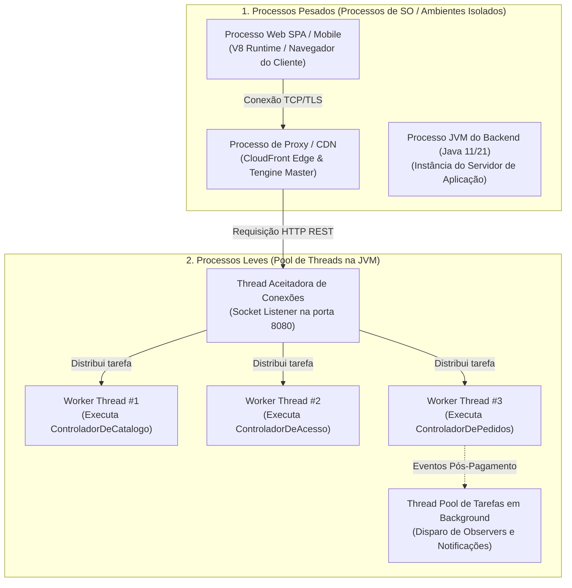
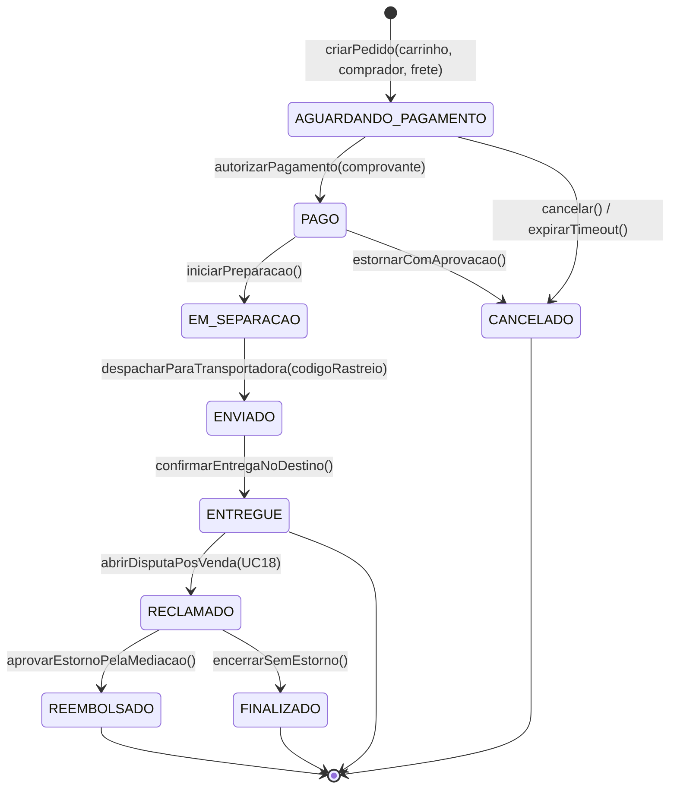
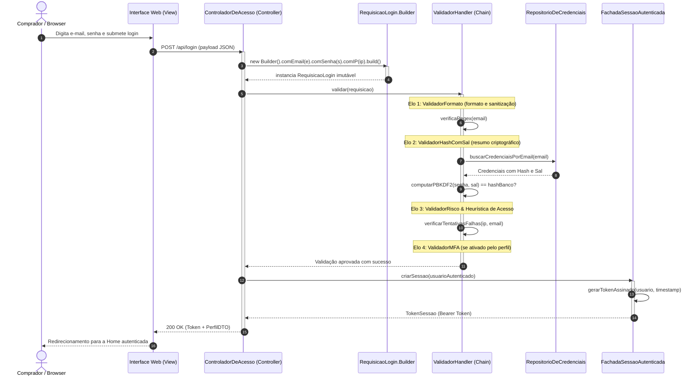
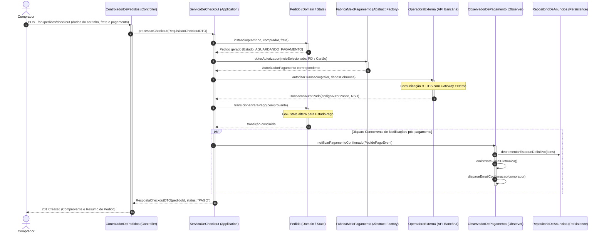

# G1_ProjetoComercioEletronico

# Documento de Arquitetura de Software (DAS)

## 1.1.4. Visão de Processos

> **Navegação do DAS:** [1.1.1. Introdução](/Base/Relatórios/1.1.1.Introducao.md) | [1.1.2. Casos de Uso](/Base/Relatórios/1.1.2.VisaoCasosDeUso.md) | [1.1.3. Visão Lógica](/Base/Relatórios/1.1.3.VisaoLogica.md) | **1.1.4. Visão de Processos** | [1.1.5. Implantação](/Base/Relatórios/1.1.5.VisaoImplantacao.md) | [1.1.6. ADRs](/Base/Relatórios/1.1.6.ADRs.md) | [1.1.7. Rastreabilidade](/Base/Relatórios/1.1.7.Rastreabilidade.md) | [1.1.8. Evidências de Execução](/Base/Relatórios/1.1.8.EvidenciasExecucao.md)

---

# 4. Visão de Processos

A **Visão de Processos** trata dos aspectos dinâmicos da arquitetura do sistema no **Modelo 4+1 Visões** de Philippe Kruchten (1995). Enquanto a [Visão Lógica](/Base/Relatórios/1.1.3.VisaoLogica.md) organiza as classes e pacotes por responsabilidade conceitual e a [Visão de Implantação](/Base/Relatórios/1.1.5.VisaoImplantacao.md) mapeia os nós físicos de rede, esta seção responde a três perguntas operacionais críticas do tempo de execução (_runtime_):
1. **Quais são os processos, threads e fluxos de execução** concorrentes que mantêm o e-commerce operando?
2. **Como os subsistemas se comunicam**, diferenciando requisições síncronas de processamentos assíncronos orientados a eventos?
3. **Como a integridade transacional (ACID) e o controle de concorrência** são garantidos nas operações sensíveis de checkout, reserva de estoque, liquidação financeira e transição de pedidos?

Esta visão consolida e integra a modelagem dinâmica desenvolvida na **Entrega 02** — abrangendo o [Diagrama de Sequência](https://unbarqdsw2026-2-turma01.github.io/2026.2-T01-_G1_ProjetoComercioEletronico_Entrega_02/#/Base/Relat%C3%B3rios/Subequipe03/ModelagemDinamica/DiagramaDeSequencia), o [Diagrama de Máquina de Estados](https://unbarqdsw2026-2-turma01.github.io/2026.2-T01-_G1_ProjetoComercioEletronico_Entrega_02/#/Base/Relat%C3%B3rios/Subequipe03/ModelagemDinamica/DiagramaDeMaquinaDeEstados), o [Diagrama de Atividades](https://unbarqdsw2026-2-turma01.github.io/2026.2-T01-_G1_ProjetoComercioEletronico_Entrega_02/#/Base/Relat%C3%B3rios/Subequipe03/ModelagemDinamica/DiagramaDeAtividades) e o [Diagrama de Comunicação](https://unbarqdsw2026-2-turma01.github.io/2026.2-T01-_G1_ProjetoComercioEletronico_Entrega_02/#/Base/Relat%C3%B3rios/Subequipe03/ModelagemDinamica/DiagramaDeComunicacao) — articulando-a diretamente com os padrões comportamentais GoF implementados no código executável da **Entrega 03 e 04** (**State**, **Observer**, **Chain of Responsibility**).

---

## 4.1 Decomposição em Processos e Modelo de Concorrência

A arquitetura de execução do e-commerce divide as tarefas em duas categorias fundamentais de concorrência: **Processos Pesados do Sistema Operacional** e **Processos Leves (Threads)**:

### 1. Processos Pesados (Process-Level Boundaries)
- **Processo do Cliente (Front-end Runtime):** Aplicação Single Page Application (SPA) executando em ambiente sandbox no navegador do usuário (motor V8/JavaScript) ou aplicativo nativo mobile. Gerencia a renderização da interface e dispara requisições HTTP REST de forma assíncrona (AJAX/Fetch API).
- **Processos de Aceleração e Borda (Edge / Proxy):** Instâncias distribuídas do Amazon CloudFront e servidor proxy reverso Tengine/Nginx. Operam como processos autônomos de alta concorrência baseados em _Event Loop_ não-bloqueante (`epoll`), gerenciando terminação de TLS 1.3, compressão Gzip e cache regional de arquivos estáticos.
- **Processo Central do Backend (JVM Application Runtime):** Processo dedicado do sistema operacional executando a máquina virtual Java (HotSpot JVM). Isola os pacotes de negócio e a máquina transacional do e-commerce em espaço de memória protegido.

### 2. Processos Leves (Thread-Level Concurrency)
- **Thread Aceitadora de Conexões (`Acceptor Thread`):** Responsável por escutar a porta de rede (`8080`), efetuar o _three-way handshake_ TCP e delegar a requisição recém-chegada para o pool de trabalhadores.
- **Pool de Threads de Trabalho (`Worker Thread Pool`):** Cada requisição HTTP de entrada é atendida por uma thread do pool do servidor nativo Java (`com.sun.net.httpserver.HttpServer`). A thread executa de ponta a ponta o pipeline da [Visão Lógica](/Base/Relatórios/1.1.3.VisaoLogica.md): roteamento (`comercio.infra.http.Roteador`), controlador GRASP, serviço de aplicação, validações de domínio e serialização da resposta JSON.
- **Tarefas de Execução Assíncrona (Background Observers):** Ações pós-transação (como disparo de e-mails, emissão de nota fiscal simulada e atualização de estatísticas de reputação) são desacopladas da thread principal da requisição através do padrão **Observer** (formalizado na [ADR-06](/Base/Relatórios/1.1.6.ADRs.md?id=_77-adr-06-desacoplamento-de-tarefas-pós-transação-via-padrão-gof-observer)), evitando que lentidões em integrações externas degradem o tempo de resposta do checkout.

---

## 4.2 Modelo de Comunicação: Sincronismo versus Assincronismo

A integridade do e-commerce depende do equilíbrio estrito entre o que deve ser respondido imediatamente ao usuário e o que pode ser processado em segundo plano:

| Dimensão | Comunicação Síncrona (Request-Response) | Comunicação Assíncrona (Event-Driven / Observer) |
| :--- | :--- | :--- |
| **Protocolo & Mecanismo** | HTTP/1.1 e HTTP/2 sobre TCP com payload JSON e headers REST. | Notificação interna baseada no padrão GoF **Observer** e Webhooks HTTP. |
| **Tempo de Bloqueio** | Bloqueante para o cliente: aguarda resposta para prosseguir o fluxo na UI. | Não-bloqueante: a confirmação é imediata e o processamento ocorre em background. |
| **Casos de Uso Aplicados** | • `UC01` / `UC30`: Consulta e busca de catálogo paginada. • `UC05`: Renderização da ficha técnica e cotação de frete imediato. • `UC22`: Autenticação e validação de senha. • `UC10`: Submissão do pedido de compra. | • `UC12`: Disparo de notificações de pagamento pós-autorização bancária. • `UC13` / `UC27`: Webhooks assíncronos de rastreamento das transportadoras. • `UC17`: Recálculo da reputação pública do vendedor após avaliação do comprador. |
| **Garantia Arquitetural** | Baixa latência (RTT < 200 ms) via cache de borda e DTOs leves. | Resiliência contra falhas parciais e desacoplamento de serviços terceiros. |

---

## 4.3 Ciclo de Vida e Máquina de Estados Transacional

Um dos pilares da Visão de Processos é a definição formal das máquinas de estados que governam o comportamento dinâmico das entidades de negócio. No comércio eletrônico, a entidade mais sensível é o **Pedido (`Order`)**, cujo ciclo de vida não permite saltos de estado arbitrários nem inconsistências financeiras.

### Máquina de Estados do Pedido (Padrão GoF State)

O ciclo de vida transacional do pedido foi modelado conceitualmente no Diagrama de Estados da Entrega 02 e está implementado em código Java executável no pacote `comercio.transacao.dominio.pedido` através do padrão de projeto GoF **State** (`EstadoPedido`), respaldado pela [ADR-05 (Máquina de Estados com Garantia ACID)](/Base/Relatórios/1.1.6.ADRs.md?id=_76-adr-05-máquina-de-estados-finita-para-ciclo-de-vida-do-pedido-com-garantia-acid):

### Regras de Transição Invariantes no Código:
1. **Garantia de Não-Duplicação de Pagamento:** Uma vez transitado para o estado `EstadoPago`, chamadas repetidas de autorização financeira lançam `RegraDeNegocioException`, impedindo bitributação ou cobrança duplicada.
2. **Reserva Atômica de Estoque:** Ao entrar em `AGUARDANDO_PAGAMENTO`, a quantidade dos produtos é reservada. Se o estado transicionar para `CANCELADO` (por recusa de cartão, timeout de PIX ou cancelamento do usuário), o estoque reservado é devolvido atomicamente ao acervo do anúncio.
3. **Disparo de Eventos no Estado Pago:** A entrada no estado `PAGO` é um gatilho dinâmico que dispara concorrentemente:
   - A geração da nota fiscal de compra (`EmissaoNotaFiscal`);
   - A liberação de empacotamento para o vendedor (`LiberacaoPedido`);
   - O e-mail de confirmação para o comprador (`NotificacaoComprador`).

---

## 4.4 Colaboração e Concorrência nos Cenários Críticos

A seguir, apresentam-se os **Diagramas de Sequência** detalhando as trocas de mensagens dinâmicas e o paralelismo dos dois cenários mais complexos da plataforma:

---

### Cenário 1: Autenticação Segura em Cadeia (UC22 e UC23)

O processo de autenticação exige múltiplas etapas sequenciais de segurança sem acoplamento entre as validações. A dinâmica é executada por uma cadeia de responsabilidade (GoF **Chain of Responsibility**), orquestrada por uma fachada (**Facade**) e instanciada por um construtor (**Builder**):

---

### Cenário 2: Checkout Transacional e Liquidação de Pagamento (UC10, UC12 e UC24)

O fechamento de compra envolve colaboração intensa entre múltiplos subsistemas, autorização externa e disparo concorrente de ações subsequentes:

---

## 4.5 Controle de Concorrência, Integridade e Propriedades ACID

No processamento transacional de comércio eletrônico, o controle rigoroso de concorrência é essencial para evitar anomalias clássicas de banco de dados e regras de negócio:

### 1. Prevenção de Overselling (Venda sem Estoque por Concorrência)
Quando múltiplos compradores tentam adquirir simultaneamente as últimas unidades de um produto em promoção:
- **Mecanismo:** Bloqueio atômico de linha no momento do checkout (_Pessimistic Locking_ na persistência ou bloco atômico sincronizado sobre o registro de estoque do `Anuncio`).
- **Garantia de Consistência:** A operação de verificação e decremento de saldo de estoque ocorre em uma única etapa indivisível. Se a quantidade remanescente for inferior à solicitada, o processo rejeita a criação do pedido lançando `EstoqueInsuficienteException` e estorna a reserva antes de qualquer cobrança bancária.

### 2. Atomicidade e Isolamento Transacional (ACID no Checkout)
O fechamento do pedido obedece ao princípio "tudo ou nada":
- Se a cobrança falhar, o pedido não é criado e o carrinho permanece intacto.
- Se o serviço de transportadora falhar na emissão da etiqueta durante o checkout, o pagamento é imediatamente compensado via rotina de estorno automático (`EstornoPix` / `EstornoCartao`).
- Cada requisição de checkout executa em transação isolada, garantindo que leituras concorrentes do catálogo visualizem saldos de estoque consistentes.

### 3. Concorrência na Busca versus Atualizações de Catálogo
- O motor de busca (`ConsultaCatalogo` com GoF **Decorator**) lê dados em memória de forma imutável (_Read-Only Snapshots_).
- A adição ou edição de anúncios pelo vendedor (`UC14`) opera através de cópias seguras para leitura concorrente (_Copy-On-Write_), assegurando que a navegação e a busca dos compradores continuem com latência zero e sem bloqueios de tabela enquanto produtos são indexados.

---

## 4.6 Rastreabilidade Dinâmica com os Artefatos da Entrega 02

A tabela a seguir estabelece a correspondência entre os processos em tempo de execução documentados nesta visão e os diagramas dinâmicos modelados na Entrega 02:

| Processo / Dinâmica de Execução | Padrão GoF Associado | Artefato Fonte da Entrega 02 | Link de Rastreabilidade |
| :--- | :--- | :--- | :--- |
| **Autenticação em Quatro Elos e Gestão de Sessão** | **Builder**, **Chain of Responsibility**, **Facade** | • Diagrama de Sequência de Login • Diagrama de Máquina de Estados do Usuário | [Sequência de Login (E02)](https://unbarqdsw2026-2-turma01.github.io/2026.2-T01-_G1_ProjetoComercioEletronico_Entrega_02/#/Base/Relat%C3%B3rios/Subequipe03/ModelagemDinamica/DiagramaDeSequencia?id=_3-diagrama-de-sequência-login) [Máquina de Estados (E02)](https://unbarqdsw2026-2-turma01.github.io/2026.2-T01-_G1_ProjetoComercioEletronico_Entrega_02/#/Base/Relat%C3%B3rios/Subequipe03/ModelagemDinamica/DiagramaDeMaquinaDeEstados) |
| **Fluxo Transacional de Checkout e Pagamentos** | **State**, **Abstract Factory**, **Observer** | • Diagrama de Sequência de Compras • Diagrama de Atividades do Fluxo de Compra | [Sequência de Compra (E02)](https://unbarqdsw2026-2-turma01.github.io/2026.2-T01-_G1_ProjetoComercioEletronico_Entrega_02/#/Base/Relat%C3%B3rios/Subequipe03/ModelagemDinamica/DiagramaDeSequencia?id=_5-diagrama-de-sequência-fluxo-de-compra) [Atividades de Compra (E02)](https://unbarqdsw2026-2-turma01.github.io/2026.2-T01-_G1_ProjetoComercioEletronico_Entrega_02/#/Base/Relat%C3%B3rios/Subequipe03/ModelagemDinamica/DiagramaDeAtividades) |
| **Logística Reversa, Mediação e Devolução** | **State** (`StatusReclamacao`), Controller GRASP | • Diagrama de Sequência de Estorno • Diagrama de Atividades de Devolução | [Sequência de Estorno (E02)](https://unbarqdsw2026-2-turma01.github.io/2026.2-T01-_G1_ProjetoComercioEletronico_Entrega_02/#/Base/Relat%C3%B3rios/Subequipe03/ModelagemDinamica/DiagramaDeSequencia?id=_6-diagrama-de-sequência-devolução-e-estorno) [Atividades de Devolução (E02)](https://unbarqdsw2026-2-turma01.github.io/2026.2-T01-_G1_ProjetoComercioEletronico_Entrega_02/#/Base/Relat%C3%B3rios/Subequipe03/ModelagemDinamica/DiagramaDeAtividades) |
| **Busca Dinâmica com Refinamentos Facetados** | **Decorator** (`RefinamentoDecorator`) | • Diagrama de Atividades de Busca | [Atividades de Busca (E02)](https://unbarqdsw2026-2-turma01.github.io/2026.2-T01-_G1_ProjetoComercioEletronico_Entrega_02/#/Base/Relat%C3%B3rios/Subequipe03/ModelagemDinamica/DiagramaDeAtividades) |

---

## 4.7 Limitações e Considerações da Dinâmica de Processos

1. **Simulação de Webhooks e Gateways Bancários:** No protótipo executável sobre Java puro (`app/`), as operadoras de cartão e o BACEN (PIX) operam como simuladores em memória (`comercio.externos.pagamento`), reproduzindo os tempos de resposta e códigos de autorização observados na Engenharia Reversa sem onerar serviços em produção.
2. **Workers em Fila de Mensageria:** Em escala de produção continental, o disparo de eventos do padrão Observer é tipicamente apoiado por corretores de mensagens distribuídas como Apache Kafka ou RabbitMQ. No código demonstrador da Entrega 04, a fila é resolvida de forma síncrona/reativa em memória JVM, mantendo a simplicidade de execução sobre JDK padrão sem dependências de containers pesados.
3. **Escopo Transacional:** A garantia atômica de "tudo ou nada" do checkout na semente de demonstração foi implementada via compensação direta em memória (conforme formalizado no [ADR-05](/Base/Relatórios/1.1.6.ADRs.md)), sendo suficiente para validar a arquitetura sem exigir um cluster PostgreSQL/MySQL ativo.

---

### Referências desta seção

- KRUCHTEN, Philippe. _The 4+1 View Model of Architecture_. IEEE Software, v. 12, n. 6, p. 42-50, 1995.
- GAMMA, Erich et al. _Design Patterns: Elements of Reusable Object-Oriented Software_. Boston: Addison-Wesley, 1994. (Padrões State, Observer, Chain of Responsibility).
- TANENBAUM, Andrew S.; STEEN, Maarten van. _Distributed Systems: Principles and Paradigms_. Boston: Pearson, 2017.
- Artefatos Dinâmicos da Subequipe 03 da Entrega 02 (Diagramas de Sequência, Máquina de Estados, Atividades e Comunicação).

---

## Histórico de Versões

| Versão | Data | Descrição | Autor(es) | Revisor(es) |
| :---: | :---: | :--- | :--- | :--- |
| 1.0 | 23/11/2026 | Elaboração da Visão de Processos: processos leves/pesados, threads, modelo síncrono/assíncrono, máquina de estados do Pedido e diagramas de sequência | Pedro Henrique Gomes, Subequipe 03 | Equipe |

---

  <a href="#/Base/Relatórios/1.1.3.VisaoLogica"><strong>← Voltar para 1.1.3. Visão Lógica</strong></a>
  <a href="#/Base/Relatórios/1.1.5.VisaoImplantacao"><strong>Avançar para 1.1.5. Visão de Implantação →</strong></a>

