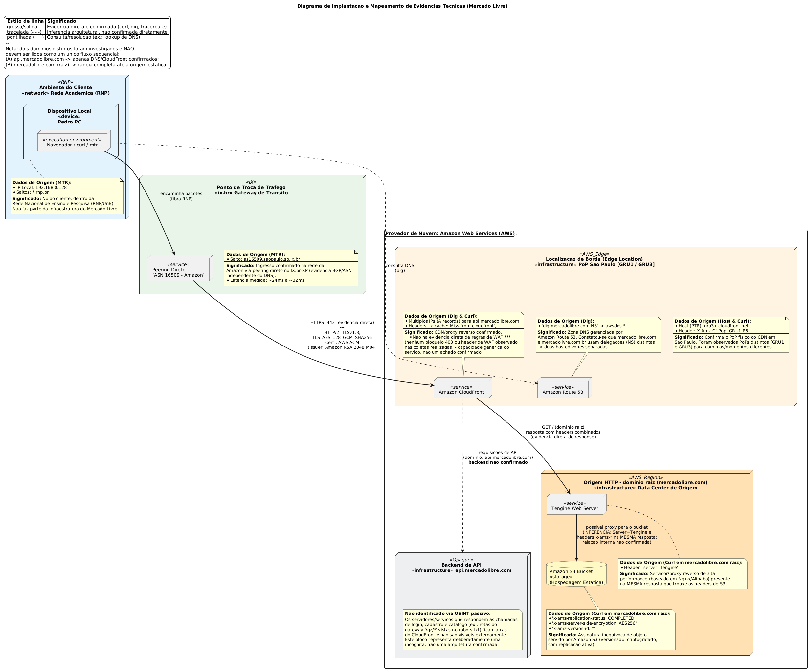
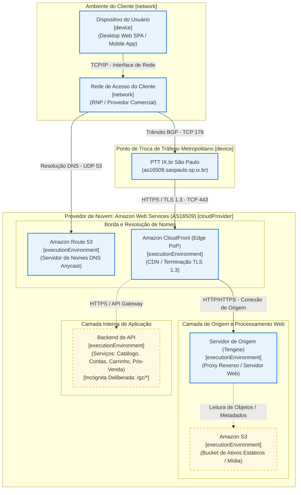

# G1_ProjetoComercioEletronico

# Documento de Arquitetura de Software (DAS)

## 1.1.5. Visão de Implantação

> **Navegação do DAS:** [1.1.1. Introdução](/Base/Relatórios/1.1.1.Introducao.md) | [1.1.2. Casos de Uso](/Base/Relatórios/1.1.2.VisaoCasosDeUso.md) | [1.1.3. Visão Lógica](/Base/Relatórios/1.1.3.VisaoLogica.md) | [1.1.4. Visão de Processos](/Base/Relatórios/1.1.4.VisaoProcessos.md) | **1.1.5. Implantação** | [1.1.6. ADRs](/Base/Relatórios/1.1.6.ADRs.md) | [1.1.7. Rastreabilidade](/Base/Relatórios/1.1.7.Rastreabilidade.md) | [1.1.8. Evidências de Execução](/Base/Relatórios/1.1.8.EvidenciasExecucao.md)

---

# 6. Visão de Implantação

A **Visão de Implantação** documenta a infraestrutura física de rede, os nós computacionais em nuvem e os caminhos de comunicação encarregados de hospedar e executar os componentes e pacotes de software modelados na [Visão Lógica](/Base/Relatórios/1.1.3.VisaoLogica.md), sustentando com alta resiliência os fluxos de valor da [Visão de Casos de Uso](/Base/Relatórios/1.1.2.VisaoCasosDeUso.md). Esta seção consolida a topologia de produção a partir de evidências técnicas verificáveis (inspeção DNS, cabeçalhos HTTP, certificados TLS e latência de rede), integrando o ambiente de nuvem AWS com a matriz de serviços e contratos de negócio do e-commerce.

---

## 6.1 Visão Geral e Topologia Física

A infraestrutura física é estruturada em três macroambientes:

1. **Ambiente do Cliente:** Compreende as duas aplicações clientes (Desktop Web SPA e Mobile App) executando nos dispositivos dos usuários finais, conectadas à rede de acesso local.
2. **Ponto de Troca de Tráfego (IX.br-SP):** PTT metropolitano onde ocorre o roteamento BGP direto para a rede autônoma da Amazon (AS16509).
3. **Provedor de Nuvem (Amazon Web Services - AS16509):** Nuvem corporativa segregada contendo a camada de DNS (Route 53), a borda de CDN (CloudFront), servidores web de aceleração (Tengine), buckets de armazenamento (S3) e o cluster de serviços de backend.

### Diagrama de Implantação

<strong>Figura 8: Diagrama de Implantação do Sistema</strong> — Reconstrução da infraestrutura física e de rede via OSINT passivo. <em>Autor: Pedro Henrique Gomes (Entrega 02).</em>

---

### Diagrama Arquitetural de Implantação (Notação Estrutural de Nós)

O diagrama a seguir detalha as relações de nós físicos, ambientes de execução e protocolos de comunicação:

---

## 6.2 Decomposição dos Nós e Mapeamento Multivisão

A tabela a seguir correlaciona os nós físicos e ambientes de execução da Visão de Implantação com os pacotes e classes da [Visão Lógica](/Base/Relatórios/1.1.3.VisaoLogica.md) e os cenários da [Visão de Casos de Uso](/Base/Relatórios/1.1.2.VisaoCasosDeUso.md):

| Nó / Elemento de Modelo | Estereótipo | Pacotes Lógicos e Componentes Suportados | Casos de Uso Viabilizados | Evidência Técnica de Rastreio |
| :--- | :--- | :--- | :--- | :--- |
| **Dispositivo do Usuário** | `«device»` | Camada de Apresentação (`View`): `Aplicação Web SPA` (Desktop) e `Aplicativo Móvel` (Smartphone). | Todos os casos de uso voltados a atores humanos (`UC01` a `UC23`, `UC28` a `UC30`). | Origem das requisições observadas nos fluxos de Busca e Checkout. |
| **Ambiente de Acesso** | `«network»` | Roteamento de pacotes do usuário até o trânsito autônomo. | Conectividade cliente-servidor. | Saltos iniciais identificados via `mtr` e `traceroute`. |
| **IX.br São Paulo** | `«device»` | Ponto de conexão física com o sistema autônomo da Amazon (AS16509). | Trânsito metropolitano de alta velocidade e baixa latência. | Salto `as16509.saopaulo.sp.ix.br` detectado via traceroute. |
| **Amazon Route 53** | `«executionEnvironment»` | Resolução autoritativa de DNS com latência otimizada Anycast em 4 zonas mundiais. | Resolução de nomes para todos os fluxos de acesso à plataforma. | Consultas `dig NS` apontando para quatro servidores mundiais AWS. |
| **Amazon CloudFront** | `«executionEnvironment»` | Borda de entrega rápida (CDN), terminação TLS 1.3 e cache regional de assets de catálogo. | `UC01` a `UC07`, `UC30` (Busca e Ficha Técnica com RTT < 200 ms). | Respostas HTTP contendo cabeçalhos `x-amz-cf-pop` e `x-cache: Hit/Miss from cloudfront`. |
| **Servidor de Origem (Tengine)** | `«executionEnvironment»` | Proxy reverso de alta concorrência e entrega da página raiz do e-commerce. | Entrega inicial do frontend e roteamento de rotas estáticas. | Cabeçalho `server: Tengine` na requisição ao domínio raiz. |
| **Amazon S3** | `«executionEnvironment»` | Repositório de mídias de produtos e upload de fotos de vendedores. | `UC01` (Exibição de fotos de produtos) e `UC14`/`UC15` (Upload de fotos de anúncios). | Cabeçalhos `x-amz-server-side-encryption` e `x-amz-version-id`. |
| **Backend de API (VPC Privada)** | `«executionEnvironment»` | Hospedagem dos 4 pacotes de domínio da Visão Lógica: `Contas e Acesso`, `Catálogo e Descoberta`, `Transação` e `Pós-Venda` com seus respectivos padrões GoF e controladores. | `UC08` a `UC13`, `UC16` a `UC27` (Checkout, Pagamento, Envio, Avaliação). | Rotas com prefixo `/gz/*` e diretivas no arquivo `robots.txt`. |

---

## 6.3 Decisões Arquiteturais e Análise Crítica de Evidências

A modelagem da Visão de Implantação fundamenta-se nas seguintes decisões críticas de engenharia:

### 1. Separação Estrita de Domínios (Cliente vs. Trânsito vs. Nuvem)

Um equívoco comum em modelagens arquiteturais baseadas em tráfego de rede é incorporar roteadores intermediários do provedor de acesso do analista como se fossem componentes da empresa-alvo. O diagrama isola deliberadamente os saltos de rede sob o estereótipo `«network» Ambiente do Cliente`, garantindo que apenas os nós de propriedade ou contratação da plataforma façam parte do domínio de nuvem.

### 2. O Peering via IX.br como Evidência Independente de DNS

A identificação do nó `as16509.saopaulo.sp.ix.br` constitui uma evidência independente da cadeia de DNS: o **AS 16509** é o número de sistema autônomo registrado publicamente para a _Amazon.com, Inc._. Essa informação comprova que, ao transitar pelo IX.br em São Paulo, os pacotes ingressam diretamente na rede privada da nuvem AWS, sem intermediação de operadoras terceiras, viabilizando menor latência e maior segurança.

### 3. O "Backend de API" como Incógnita Deliberada e Subsistemas Integrados

As rotas de backend (como `api.mercadolibre.com`) e os serviços transacionais foram confirmados até a camada de CDN (CloudFront). Internamente, o arquivo `robots.txt` e o tráfego HTTP revelam rotas especializadas como `/gz/*`.
Ao cruzarmos esses achados com a decomposição do Diagrama de Componentes, compreende-se que esse nó opaco abriga os subsistemas desacoplados (`Contas/Endereços`, `Catálogo`, `Carrinho` e `Pós-Venda`). A segregação desses serviços através de contratos de interfaces explícitas (`ICatalogo`, `IFrete`, `IPagamento`) viabiliza a independência de falhas, de modo que uma sobrecarga na busca de catálogo não inviabilize o fechamento de pedidos em andamento.

### 4. Coexistência Tengine e S3 no Domínio Raiz

Na inspeção do domínio raiz (`mercadolibre.com`), constatou-se a presença simultânea do cabeçalho `server: Tengine` e de metadados característicos do Amazon S3 (`x-amz-version-id`). Essa configuração aponta para um servidor Tengine atuando como camada de proxy frontal com cache dinâmico conectada a um bucket S3 de origem. Essa relação foi classificada como inferência arquitetural e representada com aresta tracejada.

### 5. Deliberação sobre a Capacidade "WAF" no CloudFront

A inclusão de componentes de _Web Application Firewall_ (WAF) associados ao CloudFront foi expressamente evitada. Embora o CloudFront ofereça suporte nativo ao AWS WAF, nenhum cabeçalho ou evento de bloqueio observado por meio de requisições padrão confirma que essa funcionalidade esteja ativada na rota inspecionada. Tratar uma capacidade potencial como componente real violaria o rigor empírico do artefato.

---

## 6.4 Legenda de Confiança da Evidência

Para assegurar total transparência entre a notação UML oficial e a natureza da engenharia reversa, adotou-se o seguinte padrão de representação:

| Estilo Gráfico no Diagrama | Grau de Certeza                            | Método de Coleta                                       | Exemplos no Diagrama                                          |
| :------------------------- | :----------------------------------------- | :----------------------------------------------------- | :------------------------------------------------------------ |
| **Linha Sólida Contínua**  | **Evidência Direta e Confirmada**          | Inspeção empírica via `curl -I`, `dig` ou `traceroute` | Cliente → PTT IX.br; IX.br → CloudFront; CloudFront → Tengine |
| **Linha Tracejada**        | **Inferência Arquitetural Não Confirmada** | Dedução lógica a partir de metadados indiretos         | CloudFront → Backend de API; Tengine → Bucket S3              |
| **Linha Pontilhada**       | **Consulta e Resolução de Nomes**          | Consulta UDP padrão de protocolo                       | Cliente → Amazon Route 53                                     |

---

## 6.5 Limitações do Método e Considerações de Borda

1. **Cobertura Observacional Parcial:** A topologia física documenta exclusivamente os componentes com interface voltada para a rede pública. Componentes internos (bancos de dados relacionais de contas, catálogo e pedidos, clusters Kafka/RabbitMQ e microsserviços internos de pagamento) operam em sub-redes privadas não expostas.
2. **Volatilidade Temporal de Roteamento:** As resoluções DNS Anycast e caminhos BGP podem sofrer reconfigurações automáticas dinâmicas por políticas de balanceamento de carga da AWS.
3. **Ponto Focal Geográfico:** Os ensaios de traceroute e resolução de PoPs foram realizados a partir de conexão situada em Brasília (DF). Usuários conectando-se de outros estados ou países são atendidos por outros PoPs de borda do CloudFront.

---

## Histórico de Versões

| Versão | Data | Descrição | Autor(es) | Revisor(es) |
| :---: | :---: | :--- | :--- | :--- |
| 1.0 | 12/11/2026 | Elaboração inicial da Visão de Implantação: topologia AWS CloudFront, Tengine e VPC | Pedro Henrique Gomes | Equipe |
| 1.1 | 21/11/2026 | Enriquecimento da topologia, mapeamento multivisão de nós para pacotes e casos de uso | Pedro Henrique Gomes | Equipe |

---

  <a href="#/Base/Relatórios/1.1.4.VisaoProcessos"><strong>← Voltar para 1.1.4. Visão de Processos</strong></a>
  <a href="#/Base/Relatórios/1.1.6.ADRs"><strong>Avançar para 1.1.6. Decisões Arquiteturais (ADRs) →</strong></a>

