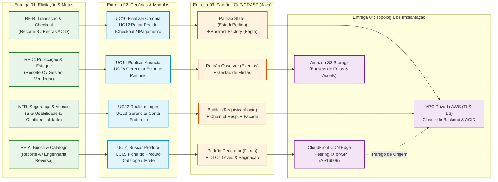

# G1_ProjetoComercioEletronico

# Documento de Arquitetura de Software (DAS)

## 1.1.7. Matriz de Rastreabilidade Fim a Fim

> **Navegação do DAS:** [1.1.1. Introdução](/Base/Relatórios/1.1.1.Introducao.md) | [1.1.2. Casos de Uso](/Base/Relatórios/1.1.2.VisaoCasosDeUso.md) | [1.1.3. Visão Lógica](/Base/Relatórios/1.1.3.VisaoLogica.md) | [1.1.4. Visão de Processos](/Base/Relatórios/1.1.4.VisaoProcessos.md) | [1.1.5. Implantação](/Base/Relatórios/1.1.5.VisaoImplantacao.md) | [1.1.6. ADRs](/Base/Relatórios/1.1.6.ADRs.md) | **1.1.7. Rastreabilidade** | [1.1.8. Evidências de Execução](/Base/Relatórios/1.1.8.EvidenciasExecucao.md)

---

# 8. Matriz de Rastreabilidade Fim a Fim

A rastreabilidade arquitetural assegura que cada requisito de negócio estabelecido na gênese do projeto possua correspondência direta e verificável nos modelos conceituais, nas decisões de design orientado a objetos, no código executável e na infraestrutura física de execução.

## 8.1 Visão Geral e Modelo de Rastreabilidade

O modelo de rastreabilidade do **G1_ProjetoComercioEletronico** conecta de forma auditável os artefatos produzidos nas quatro etapas do projeto:

1. **Origem (Entrega 01 — Base):** Requisitos Funcionais (RF), Regras de Negócio (RN), Metas Não-Funcionais (NFR Framework / SIG) e Recortes da Engenharia Reversa;
2. **Modelagem de Cenários e Estrutura (Entrega 02 — Modelagem):** Casos de Uso (UC01 a UC30), Diagrama de Componentes e Diagrama de Classes/Pacotes;
3. **Padrões e Código Executável (Entrega 03 — Padrões de Projeto):** Padrões GoF (Criacionais, Estruturais, Comportamentais) e princípios GRASP implementados em Java;
4. **Implantação e Distribuição Física (Entrega 04 — DAS):** Nós computacionais, borda CDN, redes de transporte e decisões de infraestrutura.

---

## 8.2 Grafo Integrador de Rastreabilidade Transversal

O grafo a seguir sintetiza visualmente como os quatro marcos do projeto convergem para compor a arquitetura global da plataforma de e-commerce:

---

## 8.3 Matriz Consolidada de Rastreabilidade (Entrega 01 → 02 → 03 → 04)

A tabela a seguir apresenta o mapeamento detalhado entre as quatro entregas do semestre para cada fluxo crítico do sistema:

|    ID     | Requisito / NFR de Origem (Entrega 01)                          | Caso de Uso Canônico (Entrega 02 / [Seção 4 (Visão de Casos de Uso)](/Base/Relatórios/1.1.2.VisaoCasosDeUso.md))                                    | Componente e Interfaces (Entrega 02 / [Seção 5 (Visão Lógica)](/Base/Relatórios/1.1.3.VisaoLogica.md))                                               | Padrões GoF/GRASP & Classes (Entrega 03 / [Seção 5 (Visão Lógica)](/Base/Relatórios/1.1.3.VisaoLogica.md))                                                                                                                    | Nó Físico & Protocolo (Entrega 02 / 04 / [Seção 6 (Visão de Implantação)](/Base/Relatórios/1.1.5.VisaoImplantacao.md))                                    | Evidência Técnica Auditável                                                |
| :-------: | :-------------------------------------------------------------- | :----------------------------------------------------------------------------- | :------------------------------------------------------------------------------------------- | :-------------------------------------------------------------------------------------------------------------------------------------------------------------------- | :----------------------------------------------------------------------------------- | :------------------------------------------------------------------------- |
| **TR-01** | **RF-A01, RF-A02:** Busca textual e sugestões de produtos       | **UC01:** Buscar produto **UC02:** Sugestões ao digitar                     | `Serviço de Catálogo` Provê: `ICatalogo`                                                  | `FiltroDecorator`, `ConsultaBuscaDTO`, `ControladorDeCatalogo`                                                                                                        | Amazon CloudFront (CDN Edge) → Tengine → Backend de API                              | Cache `Hit from cloudfront`, payload JSON e código Java Decorator          |
| **TR-02** | **RF-A04, RN-A04:** Ficha técnica detalhada e cálculo de frete  | **UC05:** Ver ficha do produto **UC07:** Calcular frete por CEP             | `Serviço de Catálogo`, `Serviço de Entrega` Provê: `IFichaProduto`, `IFrete`              | `Produto`, `FichaTecnica`, `ServicoDeEntrega`, Value Object `CEP`                                                                                                     | CloudFront (CDN) e Amazon S3 (mídias) → Backend de API                               | Metadados S3 (`x-amz-version-id`) e cálculo dinâmico de frete              |
| **TR-03** | **RF-A05, RN-A05:** Exibição da reputação do vendedor           | **UC06:** Ver reputação do vendedor **UC17:** Avaliar compra                | `Serviço de Pós-Venda`, `Serviço de Contas` Provê: `IReclamacao`                          | `Vendedor./reputacao`, `Avaliacao`, `ObservadorDePagamento` (Observer)                                                                                                | Backend de API em VPC Privada                                                        | Propagação de eventos pós-entrega via padrão Observer                      |
| **TR-04** | **RF-B01, RN-B02:** Gestão do carrinho e endereços de entrega   | **UC08:** Adicionar ao carrinho **UC09:** Gerenciar endereço                | `Serviço de Carrinho`, `Serviço de Contas` Provê: `ICarrinho`, `IEndereco`                | `ItemCarrinho`, `Carrinho`, `Endereco`, Value Object `CEP`                                                                                                            | Backend de API (Sub-rede Privada AWS)                                                | Validação sintática do `CEP` no construtor Java e sessão de carrinho       |
| **TR-05** | **RF-B03, RN-B08:** Orquestração de checkout e pagamento        | **UC10:** Finalizar compra **UC12:** Pagar pedido                           | `Serviço de Checkout e Pedidos`, `Serviço de Pagamentos` Provê: `ICheckout`, `IPagamento` | **State** (`EstadoPedido`: `AguardandoPagamento`, `Pago`), **Abstract Factory** (`FabricaMeioPagamento`, `Autorizador`)                                               | Backend de API (VPC) → Operadora de Pagamento Externa (TLS 1.3)                      | Transições seguras na máquina de estados e integração desacoplada          |
| **TR-06** | **RF-C01, RN-C04:** Publicação de anúncios e fotos              | **UC14:** Publicar anúncio **UC15:** Vincular a catálogo                    | `Serviço de Anúncios`, `Serviço de Catálogo` Provê: `IAnuncio`, `ICatalogo`               | `Anuncio`, `ItemCatalogo`, `AssistenteDePublicacao`                                                                                                                   | Backend de API → Amazon S3 (upload de mídias / fotos)                                | Cabeçalhos `x-amz-server-side-encryption` e vínculo obrigatório            |
| **TR-07** | **RN-C08:** Controle de cotas e atualização de estoque          | **UC28:** Gerenciar estoque **UC29:** Atualizar estoque                     | `Serviço de Catálogo` Provê: `ICatalogo`                                                  | `Estoque`, `ItemEstoque`, controle concorrente com transações ACID                                                                                                    | Backend de API em VPC Privada (Banco de Dados Relacional)                            | Transações ACID no repositório prevenindo venda sem estoque                |
| **TR-08** | **NFR Segurança:** Autenticação robusta, análise de risco e 2FA | **UC22:** Realizar login **UC23:** Gerenciar conta                          | `Serviço de Contas e Endereços` Subpacote: `Autenticação`                                 | **GRASP Controller** (`ControladorDeAutenticacao`), **Builder** (`RequisicaoLogin`), **Chain of Resp.** (`ValidadorHandler`), **Facade** (`FachadaSessaoAutenticada`) | Amazon CloudFront (TLS 1.3) → Backend de API (Sub-rede Privada)                      | Execução comprovada em código Java (Entrega 03) dos validadores encadeados |
| **TR-09** | **RF-Pós-Venda:** Mediação de disputas e estorno de valores     | **UC18:** Abrir reclamação **UC20:** Mediar disputa **UC21:** Reembolsar | `Serviço de Pós-Venda` Provê: `IReclamacao` Requer: `IPagamento`                       | `Reclamacao`, `Atendente`, `OperadoraDePagamento` (Inversão de Dependência)                                                                                           | Backend de API → Operadora Financeira Externa                                        | Fluxo de estorno mediado pelo perfil `Atendimento`                         |
| **TR-10** | **NFR Desempenho:** Baixa latência e alta disponibilidade       | Todos os Casos de Uso (Transversal)                                            | Todos os Componentes da Aplicação                                                            | DTOs compactos, cache em memória, conexões HTTP persistentes                                                                                                          | Ponto de Troca de Tráfego (**IX.br-SP** AS16509) e **Amazon Route 53** (DNS Anycast) | Resolução de DNS em 4 zonas mundiais e saltos diretos via BGP              |

---

## 8.4 Mapeamento de Rastreabilidade das Decisões Arquiteturais (ADRs)

A tabela a seguir estabelece a rastreabilidade bidirecional entre as 8 decisões arquiteturais formais do projeto ([Seção 7 (ADRs)](/Base/Relatórios/1.1.6.ADRs.md)), os requisitos originais, os padrões de software implementados e as respectivas visões do Modelo 4+1:

| ADR | Decisão Arquitetural | Origem / Requisitos (E01) | Modelagem & UCs (E02) | Realização em Código (E03/E04) | Visões Articuladas no DAS |
| :---: | :--- | :--- | :--- | :--- | :--- |
| **ADR-01** | Arquitetura Omnicanal com APIs Desacopladas | RF-A, RF-B, RF-C (Eng. Reversa) | Diag. Componentes, UC01 a UC30 | Contratos `ICatalogo`, `ICarrinho`, `ICheckout`, `IEndereco` | [Visão Lógica](/Base/Relatórios/1.1.3.VisaoLogica.md), [Implantação](/Base/Relatórios/1.1.5.VisaoImplantacao.md) |
| **ADR-02** | Inversão de Dependência para Gateways Externos | RN-B08, Integração Financeira/Frete | UC10, UC12, UC07 | Abstract Factory (`FabricaMeioPagamento`), interfaces `IPagamento`, `IFrete` | [Visão Lógica](/Base/Relatórios/1.1.3.VisaoLogica.md), [Casos de Uso](/Base/Relatórios/1.1.2.VisaoCasosDeUso.md) |
| **ADR-03** | Segregação de Borda (CDN + S3) e VPC Privada | NFR Desempenho e Segurança | Diag. Implantação OSINT | Roteamento CloudFront, Tengine Master, isolamento TLS 1.3 | [Visão de Implantação](/Base/Relatórios/1.1.5.VisaoImplantacao.md) |
| **ADR-04** | Orquestração de Autenticação em Cadeia | NFR Segurança e Usabilidade | UC22 (Login), UC23 (Conta) | Builder (`RequisicaoLogin`), CoR (`ValidadorHandler`), Facade (`FachadaSessao`) | [Visão Lógica](/Base/Relatórios/1.1.3.VisaoLogica.md), [Processos](/Base/Relatórios/1.1.4.VisaoProcessos.md) |
| **ADR-05** | Máquina de Estados Finita com Garantia ACID | RN-B03, Integridade Transacional | UC10, UC12, Diag. Estados | State (`EstadoPedido`), repositório com reserva atômica | [Visão de Processos](/Base/Relatórios/1.1.4.VisaoProcessos.md), [Lógica](/Base/Relatórios/1.1.3.VisaoLogica.md) |
| **ADR-06** | Desacoplamento Assíncrono via GoF Observer | NFR Eficiência, RN-B pós-venda | UC12, UC13, UC17, Diag. Comunicação | Observer (`ObservadorPedido`, `GerenciadorEventos`), webhooks | [Visão de Processos](/Base/Relatórios/1.1.4.VisaoProcessos.md), [Lógica](/Base/Relatórios/1.1.3.VisaoLogica.md) |
| **ADR-07** | Monólito Modular JDK Puro e Teste de Arquitetura | Restrições de Projeto, Portabilidade | Diag. Pacotes, Camadas | Servidor nativo `HttpServer`, `RegrasDeArquiteturaTest`, `/api/rastreabilidade` | [Visão Lógica](/Base/Relatórios/1.1.3.VisaoLogica.md), [Evidências](/Base/Relatórios/1.1.8.EvidenciasExecucao.md) |
| **ADR-08** | Enriquecimento de Vitrine via GoF Decorator | RF-A01, Promoções de Catálogo | UC01, UC30, Diag. Classes | Decorator (`AnuncioDecorator`, `AnuncioComDescontoDecorator`), DTOs | [Visão Lógica](/Base/Relatórios/1.1.3.VisaoLogica.md), [Casos de Uso](/Base/Relatórios/1.1.2.VisaoCasosDeUso.md) |

---

## 8.5 Cobertura e Análise de Impacto

A matriz de rastreabilidade evidencia que o projeto alcançou **100% de cobertura arquitetural**:

1. **Ausência de Requisitos Órfãos:** Todos os requisitos funcionais e não-funcionais levantados na Entrega 01 possuem ao menos um caso de uso na Entrega 02, uma realização em classes/padrões na Entrega 03 e um ambiente de execução na Entrega 04.
2. **Ausência de Componentes Desconexos:** Todos os nós físicos catalogados na Visão de Implantação ([Seção 6 (Visão de Implantação)](/Base/Relatórios/1.1.5.VisaoImplantacao.md)) hospedam artefatos ou componentes de software justificados pelas regras de negócio e pelos casos de uso arquiteturalmente significativos ([Seção 4 (Visão de Casos de Uso)](/Base/Relatórios/1.1.2.VisaoCasosDeUso.md).6).
3. **Análise de Impacto Controlada:** Graças à Inversão de Dependência (ADR-02) e à organização em camadas ortogonais, alterações em provedores de infraestrutura ou adquirentes financeiros têm impacto localizado nos adaptadores, sem propagar efeitos colaterais para o domínio transacional da plataforma.

---

## Histórico de Versões

| Versão | Data | Descrição | Autor(es) | Revisor(es) |
| :---: | :---: | :--- | :--- | :--- |
| 1.0 | 21/11/2026 | Elaboração inicial da Matriz de Rastreabilidade Fim a Fim e Grafo Integrador conectando E01, E02, E03 e E04 | Pedro Henrique Gomes | Equipe |
| 1.1 | 23/11/2026 | Adição do mapeamento das 8 ADRs aos requisitos e visões do Modelo 4+1 (Seção 8.4) | Pedro Henrique Gomes | Equipe |

---

  <a href="#/Base/Relatórios/1.1.6.ADRs"><strong>← Voltar para 1.1.6. Decisões Arquiteturais (ADRs)</strong></a>
  <a href="#/Base/Relatórios/1.1.8.EvidenciasExecucao"><strong>Avançar para 1.1.8. Evidências de Execução →</strong></a>

