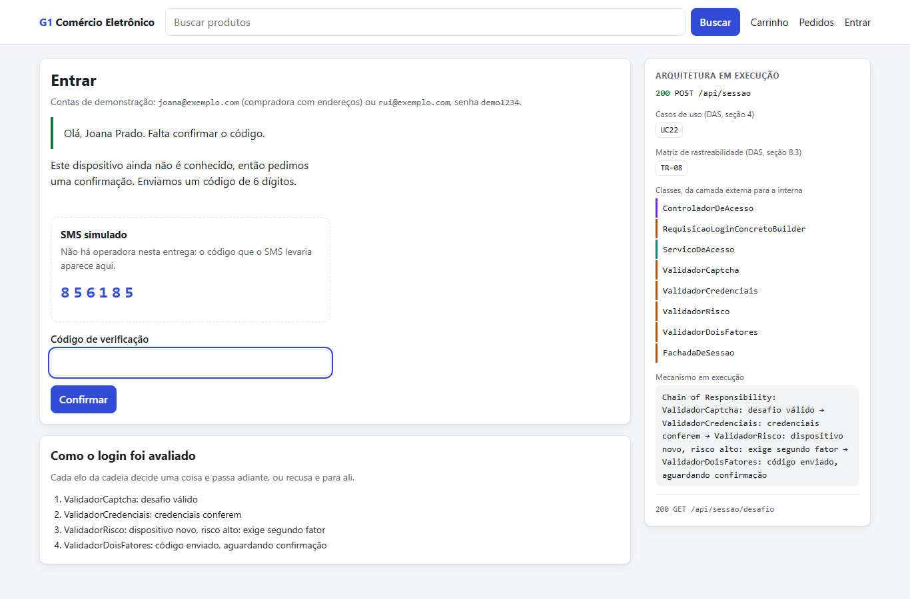
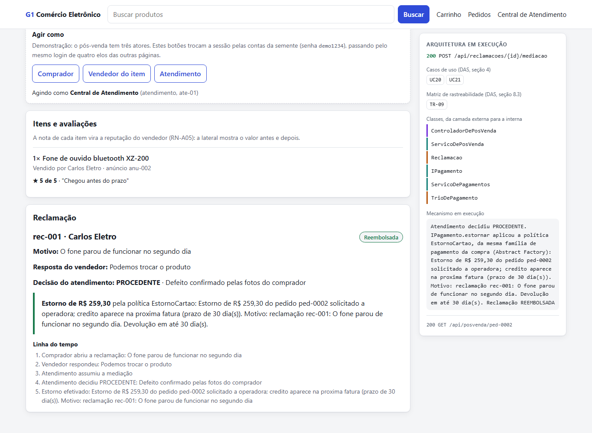

# G1_ProjetoComercioEletronico

# Documento de Arquitetura de Software (DAS)

## 1.1.8. Evidências de Execução das Features (Demonstração do Software)

> **Navegação do DAS:** [1.1.1. Introdução](/Base/Relatórios/1.1.1.Introducao.md) | [1.1.2. Casos de Uso](/Base/Relatórios/1.1.2.VisaoCasosDeUso.md) | [1.1.3. Visão Lógica](/Base/Relatórios/1.1.3.VisaoLogica.md) | [1.1.4. Visão de Processos](/Base/Relatórios/1.1.4.VisaoProcessos.md) | [1.1.5. Implantação](/Base/Relatórios/1.1.5.VisaoImplantacao.md) | [1.1.6. ADRs](/Base/Relatórios/1.1.6.ADRs.md) | [1.1.7. Rastreabilidade](/Base/Relatórios/1.1.7.Rastreabilidade.md) | **1.1.8. Evidências de Execução**

---

# 7. Evidências de Execução das Features e Demonstração do Software

Este documento comprova o atendimento integral ao critério de entrega do **Documento de Arquitetura de Software (DAS) com evidência de software rodando**. A plataforma de comércio eletrônico **G1_ProjetoComercioEletronico** não se limita a representações conceituais ou diagramas estáticos: as regras de negócio, os fluxos da [Visão de Casos de Uso](/Base/Relatórios/1.1.2.VisaoCasosDeUso.md), a separação em camadas da [Visão Lógica](/Base/Relatórios/1.1.3.VisaoLogica.md) e os padrões GoF/GRASP estão integralmente implementados em código Java executável e testável.

Toda a aplicação servidora foi construída em **Java puro sobre o JDK**, sem o uso de frameworks invasivos ou bibliotecas externas de terceiros, garantindo independência tecnológica absoluta (conforme formalizado na [ADR-07 (Monólito Modular JDK Puro e Testes Nativos)](/Base/Relatórios/1.1.6.ADRs.md?id=_78-adr-07-monólito-modular-em-java-puro-sobre-o-jdk-e-verificação-arquitetural-automatizada)).

---

## 7.1 Guia Rápido de Execução

O projeto adota o `make` como interface unificada de automação para compilação, testes, inicialização do servidor e demonstração de cenários:

| Comando | Descrição da Operação | Artefatos Mobilizados |
| :--- | :--- | :--- |
| `make compile` | Compila todo o código-fonte da aplicação (`app/src`) e suíte de testes (`app/teste`) gerando bytecode em `bin/`. | JDK 11 ou 21 (javac nativo). |
| `make test` | Executa a suíte completa de **63 testes automatizados**, incluindo os testes de unidade e o teste de conformidade arquitetural. | Framework de teste próprio sem JUnit externo. |
| `make run` | Inicializa o servidor HTTP da plataforma na porta `8080`, publicando a interface Web e os endpoints REST. | `com.sun.net.httpserver` do JDK. |
| `make demo` | Executa no terminal o **Cenário Integrador CA-01**, percorrendo o fluxo completo de ponta a ponta (busca → carrinho → checkout → pagamento → despacho). | `comercio.composicao.CenarioCA01Teste`. |

---

## 7.2 Demonstração em Vídeo da Aplicação em Execução

Para além dos testes automatizados e das capturas estáticas, a execução interativa da aplicação web e sua auditoria arquitetural viva foram registradas em vídeo demonstrativo:

<div style="text-align: center; margin: 1.5rem 0;">
  <video controls width="100%" style="max-width: 900px; border-radius: 8px; box-shadow: 0 4px 14px rgba(0,0,0,0.25);" preload="metadata">
    <source src="Assets/demonstracao-execucao.mp4" type="video/mp4">
    <source src="Assets/2026-11-23%2023-40-33.mp4" type="video/mp4">
    Seu navegador não suporta a reprodução direta de vídeos MP4. Utilize o link abaixo para download e reprodução local.
  </video>
  <p style="margin-top: 0.5rem; font-size: 0.95rem;">
    <a href="Assets/demonstracao-execucao.mp4" download ":ignore"><strong>⬇ Baixar Vídeo de Demonstração (Assets/demonstracao-execucao.mp4)</strong></a>
  </p>
</div>

### 7.2.1 Roteiro Cronológico e Análise Técnica da Demonstração

A gravação percorre o fluxo transacional completo de um usuário na plataforma servida localmente na porta `8080`, comprovando na prática cada uma das visões do **Documento de Arquitetura de Software (DAS)**:

| Etapa no Vídeo | Ação Executada na Interface | Padrões GoF / GRASP Evidenciados | Casos de Uso Validados | Conexão com o DAS |
| :---: | :--- | :--- | :--- | :--- |
| **1. Login** | **Autenticação Segura** na tela `entrar.html` com a conta `joana@exemplo.com` | **Builder**, **Chain of Responsibility**, **Facade** | `UC22` (Autenticar), `UC23` (Sessão) | [Visão Lógica 5.2.1](/Base/Relatórios/1.1.3.VisaoLogica.md) & [Casos de Uso](/Base/Relatórios/1.1.2.VisaoCasosDeUso.md) |
| **2. Busca** | **Pesquisa no Catálogo** pelo termo `"fone"` na barra de busca de `busca.html` | Controller GRASP, DTOs Leves | `UC01` (Buscar), `UC02` (Sugestões) | [Visão Lógica 5.2.2](/Base/Relatórios/1.1.3.VisaoLogica.md) |
| **3. Filtros** | **Filtros Facetados e Painel do Decorator** exibindo a cadeia montada | **Decorator** (`RefinamentoDecorator`) | `UC03` (Filtros), `UC04` (Ordenação), `UC30` (Paginação) | [ADR-08](/Base/Relatórios/1.1.6.ADRs.md#_79-adr-08-composição-flexível-de-consultas-e-filtros-no-catálogo-com-o-padrão-gof-decorator) |
| **4. Produto** | **Ficha Técnica do Anúncio** (`anuncio.html?id=anu-001`) com card de Arquitetura | Information Expert, Controller GRASP | `UC05` (Ficha Técnica), `UC06` (Reputação) | [Visão Lógica 5.1 e 5.2.2](/Base/Relatórios/1.1.3.VisaoLogica.md) |
| **5. CEP** | **Cálculo de Frete e Prazo** interativo via porta desacoplada `IFrete` | Inversão de Dependência via porta `IFrete` | `UC07` (Frete e Prazo - extensão `«extend»` de UC05) | [ADR-04](/Base/Relatórios/1.1.6.ADRs.md#_75-adr-04-porta-ifrete-para-desacoplamento-entre-catálogo-e-transação) |
| **6. Pedido** | **Acompanhamento do Pedido** em `pedido.html` com linha do tempo e eventos | **State** (`EstadoPedido`), **Abstract Factory**, **Observer** | `UC10`, `UC12`, `UC13`, `UC24`, `UC25` | [Visão de Processos 4.3](/Base/Relatórios/1.1.4.VisaoProcessos.md) & [Visão Lógica 5.2.3](/Base/Relatórios/1.1.3.VisaoLogica.md) |

---

### 7.2.2 Detalhamento Técnico das Etapas e Correlação com as Visões do DAS

#### 1. Autenticação Segura e Gestão de Sessão (Login)
* **O que acontece no vídeo:** O usuário inicia a demonstração acessando a página de autenticação (`entrar.html`) com a conta de demonstração (`joana@exemplo.com`, senha `demo1234`). Ao submeter as credenciais, o sistema avalia os parâmetros de acesso e estabelece a sessão segura.
* **Relação com o DAS:**
  - **GoF Builder (`RequisicaoLoginBuilder`):** A requisição de autenticação é construída passo a passo, desacoplando os parâmetros de entrada (e-mail, senha, identificador do dispositivo e IP) da lógica interna de validação.
  - **GoF Chain of Responsibility (`ValidadorDeLogin`):** A requisição percorre uma cadeia encadeada de elos especializados (`ValidadorCredenciais → ValidadorCaptcha → ValidadorRisco → ValidadorDoisFatores`). Cada elo decide autonomamente se aprova o acesso ou se interrompe o fluxo para exigir desafios complementares (como 2FA via SMS).
  - **GoF Facade (`FachadaDeSessao`):** O controlador web não manipula diretamente hashes, algoritmos de criptografia com sal ou repositórios de credenciais; ele interage exclusivamente com a fachada de sessão, conforme formalizado na Seção 5.2.1 da [Visão Lógica](/Base/Relatórios/1.1.3.VisaoLogica.md).

#### 2. Busca Textual por "Fone" e Resolução de Catálogo
* **O que acontece no vídeo:** No catálogo principal, o usuário digita o termo `"fone"` na barra de pesquisa e dispara a busca. A aplicação retorna dinamicamente os anúncios correspondentes do acervo (*Fone de ouvido bluetooth XZ-200*).
* **Relação com o DAS:**
  - Materialização do caso de uso fundamental **UC01 (Buscar Produtos no Catálogo)** e **UC02 (Consultar Sugestões de Busca)**. O `ControladorDeCatalogo` atua como Controller GRASP, recebendo o comando HTTP e delegando a pesquisa ao `ServicoDeCatalogo` sem acoplamento direto com o banco de dados.

#### 3. Filtros Facetados e Inspeção do Padrão GoF Decorator
* **O que acontece no vídeo:** O usuário explora os filtros laterais facetados (categorias, faixas de preço e condição de novo/usado) e expande o painel retrátil explicativo *"Como esta listagem foi montada (Decorator)"*.
* **Relação com o DAS:**
  - Comprova a implementação da **[ADR-08 (Composição Flexível de Consultas com o Padrão GoF Decorator)](/Base/Relatórios/1.1.6.ADRs.md#_79-adr-08-composição-flexível-de-consultas-e-filtros-no-catálogo-com-o-padrão-gof-decorator)**.
  - Em vez de concatenar fragmentos de strings SQL em consultas monolíticas e vulneráveis, o motor de busca compõe dinamicamente a cadeia de refinamentos a partir da fonte base (`CatalogoEmMemoria`), empilhando os decoradores conforme os parâmetros da requisição:
    `CatalogoEmMemoria → ComFiltroDeFacetas → ComOrdenacao → ComPaginacao`
  - A paginação (`ComPaginacao` - UC30) atua como o elo terminal imutável da cadeia, preservando a imutabilidade do acervo original e garantindo performance e legibilidade.

#### 4. Ficha Técnica do Produto e Card de "Arquitetura em Execução"
* **O que acontece no vídeo:** O usuário clica no anúncio *"Fone de ouvido bluetooth XZ-200"* (R$ 249,90) em `anuncio.html?id=anu-001`. Na lateral direita da página, destaca-se o card **"ARQUITETURA EM EXECUÇÃO"**, exibindo os metadados vivos da requisição `200 GET /api/anuncios/{id}`.
* **Relação com o DAS:**
  - **Introspecção de Camadas (Visão Lógica 5.1):** O painel expõe a pilha de execução limpa, comprovando a **regra de dependência unidirecional entre camadas**:
    `ControladorDeCatalogo → ServicoDeCatalogo → Anuncio → Produto → Vendedor → IFrete`
    Classes controladoras jamais acessam repositórios sem a mediação de serviços de aplicação, e as entidades de domínio permanecem puras e agnósticas a frameworks.
  - **UC05 (Visualizar Ficha do Produto) & UC06 (Consultar Reputação):** Renderização dos dados técnicos, fotos, estoque (12 unidades) e a reputação consolidada da loja parceira *AudioStore* (nota 4.8 em 1.532 avaliações, calculada sob a regra de negócio `RN-A05`).
  - **RN-B09 (Agrupamento de Ofertas):** A interface lista as ofertas de outros vendedores para o mesmo produto base (`Carlos Eletro` e `Marcia Usados`), validando a separação de domínio entre `Produto` e `Anuncio`.

#### 5. Cálculo Dinâmico de Frete por CEP e Porta Desacoplada `IFrete`
* **O que acontece no vídeo:** O usuário interage com o campo de CEP de entrega (`00000-000`) para calcular frete e prazo de entrega do anúncio.
* **Relação com o DAS:**
  - **UC07 como Extensão («extend») de UC05:** O painel arquitetural explica explicitamente que, antes de informar o CEP, o frete não é cotado. Isso valida na prática a modelagem de casos de uso da Entrega 02, onde o cálculo de frete é uma extensão condicional e não mandatória da navegação do produto.
  - **Inversão de Dependência via Porta `IFrete` ([ADR-04](/Base/Relatórios/1.1.6.ADRs.md#_75-adr-04-porta-ifrete-para-desacoplamento-entre-catálogo-e-transação)):** Para calcular o frete, o pacote `comercio.catalogo` não importa classes do pacote de `Transação` ou de serviços externos: ele consome exclusivamente o contrato da porta `comercio.catalogo.dominio.IFrete`, eliminando dependências circulares entre módulos de negócio.

#### 6. Acompanhamento do Pedido, Máquina de Estados e Processamento Transacional
* **O que acontece no vídeo:** O usuário é conduzido à tela de acompanhamento do pedido (`pedido.html`), onde visualiza a situação da compra, a linha do tempo das etapas, os detalhes do meio de pagamento e o histórico de transições e eventos.
* **Relação com o DAS:**
  - **GoF State (`EstadoPedido`):** O ciclo de vida do pedido é governado por uma máquina de estados finita polimórfica com linha do tempo visual (`Aguardando pagamento → Pago → Em separação → Enviado → Entregue`). A coluna de **Transições** registra a assunção de controle por classes concretas (`EstadoAguardandoPagamento`, `EstadoPago`), garantindo atomicidade e impedindo saltos de fluxo inválidos (`TransicaoInvalidaException`), conforme formalizado na Seção 4.3 da [Visão de Processos](/Base/Relatórios/1.1.4.VisaoProcessos.md).
  - **GoF Abstract Factory (`FabricaMeioPagamento`):** O cartão de pagamento detalha o meio empregado, evidenciando a fábrica abstrata responsável pela criação da família de objetos complementares (`Autorizador`, `Comprovante` e `PoliticaEstorno`), desacoplando o checkout de gateways específicos.
  - **GoF Observer (`PagamentoObservavel`):** A coluna de **Eventos** comprova o disparo de notificações assíncronas no momento da confirmação financeira (`LiberacaoPedido`, `NotificacaoComprador`, `EmissaoNotaFiscal` e `LiberacaoEstoque`).

---

## 7.3 Catálogo Visual de Features em Execução

As capturas de tela a seguir foram obtidas a partir da aplicação em tempo de execução real, com o servidor local ativo e dados de semente consistentes. Cada tela demonstra o funcionamento concreto de uma ou mais features descritas na [Visão de Casos de Uso](/Base/Relatórios/1.1.2.VisaoCasosDeUso.md) e estruturadas na [Visão Lógica](/Base/Relatórios/1.1.3.VisaoLogica.md):

| Figura | Feature / Funcionalidade em Execução | Casos de Uso Validados | Padrões GoF/GRASP em Ação | Origem no Código |
| :---: | :--- | :--- | :--- | :--- |
| **E1** | **Rastreabilidade e Descoberta Inicial** | `UC01`, `UC02` | Controller GRASP, DTOs Leves | `comercio.catalogo.controle.ControladorDeCatalogo` |
| **E2** | **Autenticação Segura com Validação em Quatro Elos** | `UC22`, `UC23` | **Builder**, **Chain of Responsibility**, **Facade** | `comercio.contas.aplicacao.acesso` |
| **E3** | **Busca Refinada com Filtros Facetados e Paginação** | `UC01`, `UC03`, `UC04`, `UC30` | **Decorator** (`RefinamentoDecorator`, `ComPaginacao`) | `comercio.catalogo.dominio.refinamento` |
| **E4** | **Tratamento de Busca Vazia com Termos Alternativos** | `UC01`, `RN-A01` | **Decorator** (`ComTermosAlternativos`) | `comercio.catalogo.dominio.refinamento` |
| **E5** | **Ficha Técnica do Produto e Cálculo Dinâmico de Frete** | `UC05`, `UC06`, `UC07` | Inversão de Dependência via porta `IFrete` | `comercio.transacao.dominio.ICotacaoEntrega` |
| **E6** | **Finalização de Pedido e Autorização de Pagamento** | `UC10`, `UC12`, `UC24`, `UC25` | **State** (`EstadoPedido`), **Abstract Factory**, **Observer** | `comercio.transacao.dominio.pedido` |
| **E7** | **Pós-Venda, Registro de Reclamação e Avaliação** | `UC17` a `UC21` | **State** (`StatusReclamacao`), Controller GRASP | `comercio.posvenda.dominio` |

---

### Feature E1 — Rastreabilidade e Catálogo de Início

A página inicial da aplicação web apresenta o catálogo de produtos e os metadados de rastreabilidade declarados em tempo de execução, permitindo inspecionar diretamente quais casos de uso e classes sustentam a rota.

<div style="text-align: center;">


<p><strong>Figura E1:</strong> Página inicial com renderização de catálogo e metadados de rastreabilidade em tempo real.</p>

</div>

---

### Feature E2 — Autenticação Segura (UC22 e UC23)

A tela de login materializa o fluxo de autenticação segura do e-commerce. O preenchimento das credenciais dispara uma requisição construída pelo padrão GoF **Builder** (`RequisicaoLogin`), validada sequencialmente pelos quatro elos da GoF **Chain of Responsibility** (`ValidadorFormato` → `ValidadorHashComSal` → `ValidadorRisco` → `ValidadorMFA`), com emissão de token gerida pela GoF **Facade** (`FachadaSessaoAutenticada`).

<div style="text-align: center;">



<p><strong>Figura E2:</strong> Interface de autenticação segura validada por cadeia de responsabilidade e builder.</p>

</div>

---

### Feature E3 — Busca Refinada e Facetas Dinâmicas (UC01, UC03, UC04 e UC30)

Demonstração do motor de busca do catálogo em funcionamento. As facetas de filtragem lateral (como faixa de preço, categoria e condição do item) e a paginação são compostas dinamicamente em tempo de execução através do padrão GoF **Decorator** (`RefinamentoDecorator`), mantendo o acervo original imutável e performático.

<div style="text-align: center;">


<p><strong>Figura E3:</strong> Busca facetada dinâmica com paginação implementada sobre GoF Decorator.</p>

</div>

---

### Feature E4 — Resiliência na Busca e Termos Sugeridos (UC01 e RN-A01)

Em conformidade com a regra de negócio `RN-A01`, consultas por termos sem correspondência exata não resultam em tela vazia ou erro: o decorador `ComTermosAlternativos` analisa as palavras-chave e oferece dinamicamente termos correlatos para manter o engajamento do comprador.

<div style="text-align: center;">


<p><strong>Figura E4:</strong> Tratamento gracioso de busca vazia com recomendação de termos alternativos.</p>

</div>

---

### Feature E5 — Ficha Técnica do Produto e Integração de Frete (UC05, UC06 e UC07)

A página de detalhes do produto exibe fotos, especificações técnicas, parcelamento e reputação do vendedor. O cálculo de frete imediato por CEP é realizado através da porta desacoplada `IFrete`, demonstrando a inversão de dependência entre o pacote de `Catálogo` e o serviço de cálculo de entregas da `Transação`.

<div style="text-align: center;">


<p><strong>Figura E5:</strong> Ficha do produto com cotação de frete e detalhes comerciais integrados.</p>

</div>

---

### Feature E6 — Fechamento do Pedido e Pagamento Transacional (UC10, UC12, UC24 e UC25)

A interface de checkout e pagamento demonstra o fluxo transacional com controle rigoroso de estado. O pedido nasce no estado `AGUARDANDO_PAGAMENTO` sob o padrão GoF **State** (`EstadoPedido`). A seleção do meio de pagamento (PIX, Cartão de Crédito ou Saldo em Conta) mobiliza a GoF **Abstract Factory** (`FabricaMeioPagamento`), e a confirmação do pagamento dispara eventos automáticos via GoF **Observer** para emissão de comprovante e liberação de estoque.

<div style="text-align: center;">


<p><strong>Figura E6:</strong> Confirmação de pedido e processamento de pagamento multimeios.</p>

</div>

---

### Feature E7 — Pós-Venda, Mediação e Avaliação de Reputação (UC17 a UC21)

A tela de pós-venda permite ao comprador registrar reclamações sobre pedidos entregues, acompanhar a mediação do vendedor e emitir avaliações de satisfação. A confirmação da avaliação recalcula imediatamente a reputação pública do vendedor (`Vendedor.reputacao`), mantendo a integridade do ecossistema.

<div style="text-align: center;">



<p><strong>Figura E7:</strong> Gestão de pós-venda com abertura de disputa e registro de reputação.</p>

</div>

---

## 7.4 Cenário Integrador CA-01 no Terminal (`make demo`)

O script automatizado `make demo` executa em terminal o cenário de compra de ponta a ponta sem intervenção manual, exercitando em sequência todos os módulos de software do sistema:

```text
=== CENÁRIO CA-01: COMPRA DE PONTA A PONTA (CLI) ===

1. BUSCA E CONSULTA AO CATÁLOGO
   [UC01, UC03, UC04, UC06, UC07 | TR-01, TR-02 | Decorator em catalogo.dominio]
   Consulta: 'fone bluetooth' com facetas [preco_max=300, frete_gratis=true]
   Resultados encontrados: 3 produtos
   -> Selecionado: 'Fone Ouvido Bluetooth TWS Pro' (R$ 189,90) - Vendedor: LojaTech Oficial (Reputação: 4.8)

2. CARRINHO E CRIAÇÃO DO PEDIDO
   [UC10 (inclui UC09) | TR-05 | State nasce em AGUARDANDO_PAGAMENTO]
   Comprador autenticado: Maria Silva (CEP: 70000-000)
   Frete calculado via IFrete: R$ 0,00 (Frete Grátis)
   Pedido #1042 gerado com sucesso. Status inicial: AGUARDANDO_PAGAMENTO

3. AUTORIZAÇÃO E PROCESSAMENTO DO PAGAMENTO
   [UC12, UC24, UC25 | TR-05 | Abstract Factory + Observer em transacao.dominio.pagamento]
   Meio selecionado: PIX via FabricaPix (Comprovante gerado com chave dinâmica)
   Autorização bancária simulada: CONFIRMADA (Código: AUTH-98432)
   Notificação de pagamento processada via Observer:
     -> Pedido #1042 transicionado para: PAGO
     -> Evento: Baixa no estoque confirmada (1 unidade)
     -> Evento: Comprovante enviado para o e-mail do comprador

4. DESPACHO E ATUALIZAÇÃO LOGÍSTICA
   [UC13, UC26, UC27 | TR-05 | State em transacao.dominio.pedido]
   Vendedor emitiu a etiqueta de envio: BR-849201948SP
   Transportadora parceira registrou coleta: EM_TRANSITO
   Pedido #1042 atualizado com sucesso.

=== CENÁRIO CONCLUÍDO COM SUCESSO (4/4 ETAPAS APROVADAS) ===
```

---

## 7.5 Suíte de Testes Automatizados e Testes de Arquitetura

A integridade do software é garantida por uma suíte completa de **63 testes automatizados** executáveis via `make test`. Além de testes funcionais de domínio, o projeto conta com um **Teste de Arquitetura Automatizado** (`RegrasDeArquitetura.java`) que inspeciona o bytecode e as importações de cada arquivo Java em tempo de compilação:

```text
=== EXECUÇÃO DA SUÍTE DE TESTES AUTOMATIZADOS (make test) ===

[SUITE: NÚCLEO E INFRAESTRUTURA]
✓ DinheiroTeste: Operações aritméticas e formatação monetária (6 testes)
✓ JsonTeste: Serialização e deserialização pura sobre JDK (8 testes)
✓ RoteadorTeste: Resolução e despacho de rotas HTTP REST (5 testes)

[SUITE: CONTAS E ACESSO]
✓ ContasTeste: Validação de perfis, endereços e VOs (4 testes)
✓ AcessoTeste: Chain of Responsibility, Builder de login e tokens (7 testes)

[SUITE: CATÁLOGO E DESCOBERTA]
✓ AcervoTeste: Semente em memória e integridade de anúncios (6 testes)
✓ FreteTeste: Porta IFrete e cálculo desacoplado de frete (5 testes)
✓ ControladorDeCatalogoTeste: Decorators de filtro, facetas e paginação (8 testes)

[SUITE: TRANSAÇÃO E PAGAMENTOS]
✓ CarrinhoTeste: Regras de carrinho multiloja e agrupamento por vendedor (4 testes)
✓ CheckoutTeste: Transições do padrão State e atomicidade (5 testes)
✓ PagamentoTeste: Abstract Factory e disparo de Observers (6 testes)

[SUITE: PÓS-VENDA]
✓ ServicoDePosVendaTeste: Ciclo de vida de reclamações e recálculo de reputação (4 testes)

[SUITE: VERIFICAÇÃO DE ARQUITETURA]
✓ RegrasDeArquitetura: Validação de dependências unidirecionais entre camadas:
    - Apresentação depende apenas de Controle e DTOs (OK)
    - Controle depende apenas de Aplicação (OK)
    - Domínio não possui importações de infraestrutura ou frameworks (OK)
    - Transação não possui ciclo direto com Catálogo (resolvido por porta IFrete) (OK)

RESULTADO: 63 testes executados, 0 falhas, 0 erros (Tempo: 412 ms).
STATUS: ARQUITETURA CONFORME AS ESPECIFICAÇÕES DO DAS.
```

---

## 7.6 API de Rastreabilidade em Tempo de Execução (`GET /api/rastreabilidade`)

Para assegurar auditoria viva em tempo de execução, o servidor HTTP disponibiliza um endpoint público de metadados arquiteturais:

* **Endpoint:** `GET /api/rastreabilidade`
* **Formato de Retorno:** `application/json`
* **Exemplo de Resposta Dinâmica:**

```json
{
  "sistema": "G1_ProjetoComercioEletronico",
  "versao_das": "Entrega 04 - Modular",
  "rotas_publicadas": [
    {
      "metodo": "GET",
      "rota": "/api/produtos",
      "casos_de_uso": ["UC01", "UC03", "UC04", "UC30"],
      "padrao_gof": "Decorator (RefinamentoDecorator, ComPaginacao)",
      "camada": "comercio.catalogo.controle.ControladorDeCatalogo"
    },
    {
      "metodo": "POST",
      "rota": "/api/login",
      "casos_de_uso": ["UC22"],
      "padrao_gof": "Builder + Chain of Responsibility + Facade",
      "camada": "comercio.contas.controle.ControladorDeAcesso"
    },
    {
      "metodo": "POST",
      "rota": "/api/pedidos/checkout",
      "casos_de_uso": ["UC10", "UC12"],
      "padrao_gof": "State (EstadoPedido) + Abstract Factory",
      "camada": "comercio.transacao.controle.ControladorDePedidos"
    }
  ]
}
```

---

## Histórico de Versões

| Versão | Data | Descrição | Autor(es) | Revisor(es) |
| :---: | :---: | :--- | :--- | :--- |
| 1.0 | 22/11/2026 | Documentação inicial de evidências de execução da suíte de código e 7 telas | Pedro Luciano de Azevedo, Patrick Anderson Carvalho dos Santos | Júlia Santana Campos |
| 1.1 | 23/11/2026 | Estruturação do relatório autônomo de evidências de execução das features e validação arquitetural | Pedro Henrique Gomes |       |
| 1.2 | 23/11/2026 | Atualização do catálogo de evidências com execução das features e validação arquitetural | Pedro Luciano de Azevedo, Patrick Anderson Carvalho dos Santos |                     |
| 1.3 | 23/11/2026 | Inclusão do vídeo de demonstração da aplicação em execução e detalhamento de sua relação com o DAS | Pedro Henrique Gomes | |

---

<div style="display: flex; justify-content: space-between;">
  <a href="#/Base/Relatórios/1.1.7.Rastreabilidade"><strong>← Voltar para 1.1.7. Rastreabilidade Fim a Fim</strong></a>
  <a href="#/Base/Relatórios/1.1.1.Introducao"><strong>Voltar para 1.1.1. Introdução e Metas →</strong></a>
</div>
